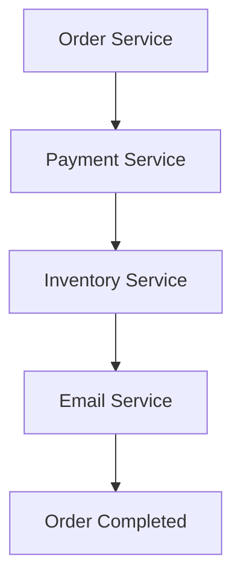

<!-- SOURCE: 0.md -->
# File: 0.md

<div dir="rtl" style="text-align: right; font-family: 'B Nazanin', Tahoma, sans-serif;">



**بخش ۱ — مبانی**
1. Regex چیه و کجا به کار میاد
2. کلاس‌های `Pattern` و `Matcher` در جاوا
3. متدهای `matches()`, `find()`, `replaceAll()`, `split()`

**بخش ۲ — نحو پایه Regex**
4. کاراکترهای متنی و متاکاراکترها
5. کلاس‌های کاراکتری: `[abc]`, `[^abc]`, `\d \w \s` و معادل‌هاشون
6. کوانتیفایرها: `* + ? {n} {n,m}` و حالت‌های greedy/lazy/possessive
7. لنگرها: `^ $ \b \B`
8. گروه‌بندی `()` و انتخاب `|`
9. Backreference ها (`\1`) و گروه‌های named در جاوا (`(?<name>...)`)

**بخش ۳ — متوسط**
10. Lookahead و Lookbehind (`(?=)`, `(?!)`, `(?<=)`, `(?<!)`)
11. پرچم‌ها (Flags): `CASE_INSENSITIVE`, `MULTILINE`, `DOTALL`, `UNICODE_CASE`
12. Unicode در جاوا و `\p{...}`

**بخش ۴ — پیشرفته و کاربردی در جاوا**
13. `Pattern.compile` و کش کردن الگوها (performance)
14. `Matcher.group()`, `group(int)`, `start()`, `end()`
15. `appendReplacement` و `appendTail`
16. Atomic groups و possessive quantifiers
17. Catastrophic backtracking و راه‌های جلوگیری
18. Regex برای اعتبارسنجی (ایمیل، شماره، تاریخ و...)

**بخش ۵ — پروژه‌های عملی**
19. پارس کردن لاگ
20. اعتبارسنجی فرم
21. استخراج داده از HTML/JSON ساده
22. Refactor کردن regex های بد

---

### 🎯 پیشنهاد شروع

بیا **بخش ۱ رو همین الان با هم شروع کنیم**. من درس رو می‌دم، مثال جاوا می‌زنم، و آخرش ۲-۳ تا تمرین بهت می‌دم که خودت حل کنی و برام بفرستی تا بررسی کنیم.

---

**سوال قبل از شروع:**
- سطح فعلی‌ت از Regex چقدره؟ (هیچ / مبتدی / متوسط)
- هدف اصلیت چیه؟ (اعتبارسنجی، پردازش متن، مصاحبه شغلی، پروژه خاص)
- ترجیح می‌دی هر جلسه **کوتاه و فشرده** باشه یا **مفصل با تمرین زیاد**؟

جواب این ۳ تا رو بده تا دوره رو دقیقاً متناسب با تو بچینم. 🚀

</div>


<!-- SOURCE: 1.1.md -->
# File: 1.1.md

<div dir="rtl" style="text-align: right; font-family: 'B Nazanin', Tahoma, sans-serif;">
عالی بود! 👏 کدت کامپایل می‌شه و ساختار درستیه. الان دقیق بررسی می‌کنیم — **۳ تا از ۵ تا درسته، ۲ تا مشکل داره، و چند نکته سبک هم هست.**

---

## ✅ چی درست بود

| تمرین | الگو | وضعیت |
|-------|------|-------|
| ۱ | `^[a-z]+$` | ✅ درست |
| ۲ | `^\d{8}$` | ✅ درست |
| ۳ | `^[0][9]\d{9}$` | ✅ درست (ولی می‌شد تمیزتر) |

## ❌ تمرین ۴ — مشکل جدی
</div> 


```java
String postalCode = "^[0-9-]{10}$";
```
<div dir="rtl" style="text-align: right; font-family: 'B Nazanin', Tahoma, sans-serif;">

این الگو یعنی: **«دقیقاً ۱۰ کاراکتر از مجموعهٔ {رقم، خط تیره}»**. یعنی `-` رو به عنوان کاراکتر مجاز داخل `[]` گذاشتی — پس هر ترکیبی از ۱۰ تا رقم/دش قبول می‌شه:
</div> 


```
"----------"   → ✅ true  ❌ (فقط دش!)
"1-2-3-4-56"   → ✅ true  ❌ (چند دش پشت هم)
"-123456789"   → ✅ true  ❌ (شروع با دش)
```
<div dir="rtl" style="text-align: right; font-family: 'B Nazanin', Tahoma, sans-serif;">


### چرا؟

`[0-9-]` یعنی **یکی از این کاراکترها: ۰ تا ۹ یا `-`**. این «اختیاری بودن `-`» نیست — یعنی دش خودش یکی از گزینه‌های مجازه.

اختیاری کردن باید **بیرون** از `[]` و با `?` انجام بشه:
</div> 


```java
// ۵ رقم، خط تیرهٔ اختیاری، ۵ رقم = ۱۰ رقم + دش اختیاری بین‌شون
String postalCode = "^\\d{5}-?\\d{5}$";
```
<div dir="rtl" style="text-align: right; font-family: 'B Nazanin', Tahoma, sans-serif;">


**نکته:** توی صورت تمرین یه ناسازگاری کوچیک بود — گفتم «۱۰ رقم» ولی مثال `12345-6789` فقط ۹ رقمه. با الگوی بالا این‌ها قبول می‌شن:
- `1234567890` ✅
- `12345-67890` ✅
- `12345-6789` ❌ (۹ رقمه)

## ❌ تمرین ۵ — `$` فراموش شده
</div> 


```java
String user = "^[A-Za-z0-9_]{3,16}";   // ← $ نداره
```
<div dir="rtl" style="text-align: right; font-family: 'B Nazanin', Tahoma, sans-serif;">


اینجا **شانسی کار می‌کنه**، چون `matches()` خودش کل رشته رو چک می‌کنه. ولی:
</div> 


```java
Pattern.compile("^[A-Za-z0-9_]{3,16}").matcher("ali123_ali_with_extra").find();
// true ❌ چون فقط پیشوند رو match کرده
```
<div dir="rtl" style="text-align: right; font-family: 'B Nazanin', Tahoma, sans-serif;">


یعنی اگه یه روز از `find()` استفاده کنی، این باگ می‌شه. **همیشه `$` رو بذار.**
</div> 


```java
String user = "^[A-Za-z0-9_]{3,16}$";
```

<div dir="rtl" style="text-align: right; font-family: 'B Nazanin', Tahoma, sans-serif;">


---

## 💡 نکات سبک (خوبه بدونی، ضروری نیست)

**۱. `[0][9]` عجیبه — بنویس `09` یا `0[9]`:**

```java
String iranMobile = "^09\\d{9}$";   // ساده‌تر و خواناتر
```

**۲. `[A-Za-z0-9_]` همون `\w` هست** (در جاوا پیش‌فرض ASCII):
</div> 


```java
String user = "^\\w{3,16}$";
```
<div dir="rtl" style="text-align: right; font-family: 'B Nazanin', Tahoma, sans-serif;">


⚠️ ولی حواست باشه: اگه بعداً پرچم `Pattern.UNICODE_CHARACTER_CLASS` رو فعال کنی، `\w` حروف فارسی و ... رو هم شامل می‌شه. برای اعتبارسنجی سختگیرانه ASCII، `[A-Za-z0-9_]` امن‌تره.

**۳. `^...$` با `matches()` تکراریه ولی ضرر نداره.** من خودم همیشه می‌ذارم، چون:
- خوندن کد رو شفاف می‌کنه (قصدت «کل رشته» است)
- اگه یه روز به `find()` سوییچ کردی، امن می‌مونی

---

## 🔧 نسخهٔ نهایی همهٔ ۵ تمرین
</div> 


```java
public class Validators {
    public static void main(String[] args) {
        // ۱
        String lowChar = "^[a-z]+$";
        System.out.println("adc".matches(lowChar));           // true

        // ۲
        String nationalCode = "^\\d{8}$";
        System.out.println("12345678".matches(nationalCode)); // true

        // ۳
        String iranMobile = "^09\\d{9}$";
        System.out.println("09123456789".matches(iranMobile));// true

        // ۴
        String postalCode = "^\\d{5}-?\\d{5}$";
        System.out.println("1234567890".matches(postalCode)); // true
        System.out.println("12345-67890".matches(postalCode));// true
        System.out.println("----------".matches(postalCode)); // false ✅

        // ۵
        String user = "^[A-Za-z0-9_]{3,16}$";
        System.out.println("ali123_ali".matches(user));       // true
        System.out.println("ab".matches(user));               // false
        System.out.println("a".repeat(17).matches(user));     // false
    }
}
```
<div dir="rtl" style="text-align: right; font-family: 'B Nazanin', Tahoma, sans-serif;">


---

## 🎯 دو تمرین بونوس (کوتاه، قبل از جلسه ۲)

### بونوس ۱
شماره تلفن ثابت تهران: با `021` شروع بشه، بعدش **دقیقاً ۸ رقم**، و کاربر ممکنه با یا بدون خط تیره بنویسه:
- `02112345678` ✅
- `021-12345678` ✅
- `0211234567` ❌ (۷ رقم)

### بونوس ۲
بفهم **چرا** این الگو همه‌چیز رو قبول می‌کنه:
</div> 


```java
String bad = "^\\d*$";
System.out.println("".matches(bad));       // ?
System.out.println("12345".matches(bad));  // ?
```
<div dir="rtl" style="text-align: right; font-family: 'B Nazanin', Tahoma, sans-serif;">


بعد بگو چطور می‌شه کاری کرد که **حداقل ۱ رقم** الزامی باشه.

---

## 📅 پیش‌نمایش جلسه ۲

توی جلسهٔ بعد می‌ریم سراغ:

1. **کوانتیفایرها** به طور کامل: `* + ? {n} {n,m}` و حالت‌های **greedy / lazy / possessive**
2. **کلاس‌های کاراکتری** حرفه‌ای: `\d \w \s` و منفی‌هاشون `\D \W \S`، و تفاوت `[abc]` با `(abc)`
3. **داکرمنت‌های واقعی اعتبارسنجی:** ایمیل، کد ملی ۱۰ رقمی با چک‌سام، شبا، کد پستی واقعی ایران
4. **تله‌های رایج** مثل همون `[0-9-]` که امروز خوردی — چند تا هم از این جنس

جواب بونوس‌ها رو بفرست تا بریم جلسه ۲. 🚀

</div>


<!-- SOURCE: 1.md -->
# File: 1.md

<div dir="rtl" style="text-align: right; font-family: 'B Nazanin', Tahoma, sans-serif;">

# 🎓 جلسه ۱ — پایه‌ها و ذهنیت درست

## ۱.۱ Regex در جاوا چطور کار می‌کنه؟

سه راه اصلی:
</div>

```java
// ۱. ساده و سریع (برای یک بار استفاده)
boolean ok = "abc123".matches("[a-z]+\\d+");

// ۲. وقتی چند بار استفاده می‌کنی (بهتر برای performance)
Pattern p = Pattern.compile("[a-z]+\\d+");
Matcher m = p.matcher("abc123");
boolean ok2 = m.matches();

// ۳. متدهای راحتی روی String
"a,b,c".split(",");
"hello".replaceAll("l", "L");
```
<div dir="rtl" style="text-align: right; font-family: 'B Nazanin', Tahoma, sans-serif;">


## ⚠️ نکته حیاتی #۱: `matches()` vs `find()`

این بزرگ‌ترین اشتباه مبتدی‌هاست:

| متد | معنی |
|-----|------|
| `matches()` | **کل** رشته باید با الگو مطابقت کنه |
| `find()` | الگو **جایی داخل** رشته پیدا بشه کافیه |
</div>


```java
Pattern p = Pattern.compile("\\d+");

p.matcher("123").matches();     // true  (کل رشته عدد)
p.matcher("abc123").matches();  // false (کل رشته عدد نیست)
p.matcher("abc123").find();     // true  (یه عدد داخلش هست)
```
<div dir="rtl" style="text-align: right; font-family: 'B Nazanin', Tahoma, sans-serif;">


👉 **برای اعتبارسنجی معمولاً `matches()` می‌خوای.** ولی `^...$` هم در `find()` همین کار رو می‌کنه.

## ⚠️ نکته حیاتی #۲: `\` در جاوا دو تاست

در Regex می‌نویسی `\d`، در جاوا باید بنویسی `"\\d"` چون `\` در String خودش escape character هست.
</div>


```java
String regex = "\\d{3}-\\d{4}";  // در regex: \d{3}-\d{4}
```
<div dir="rtl" style="text-align: right; font-family: 'B Nazanin', Tahoma, sans-serif;">


## ۱.۲ آناتومی یک regex برای اعتبارسنجی
</div>


```java
Pattern.compile("^[a-z]{3}\\d{2}$")
//              ^  ^^^  ^^^  ^
//              |   |    |   └── پایان رشته
//              |   |    └────── دقیقاً ۲ رقم
//              |   └─────────── دقیقاً ۳ حرف کوچک
//              └─────────────── شروع رشته
```
<div dir="rtl" style="text-align: right; font-family: 'B Nazanin', Tahoma, sans-serif;">


---

# 📝 تمرین‌های جلسه ۱

برای هر کدوم، **کد جاوای کامل** بنویس (کلاس با `main`). سعی کن اول خودت، بعد جواب.

### تمرین ۱
رشته‌ای رو اعتبارسنجی کن که **فقط شامل حروف کوچک انگلیسی** باشه (`a-z`)، حداقل ۱ کاراکتر.

</div>


```
"abc"    → true
"Abc"    → false
"abc1"   → false
""       → false
```

<div dir="rtl" style="text-align: right; font-family: 'B Nazanin', Tahoma, sans-serif;">


### تمرین ۲
کدی بنویس که چک کنه رشته **دقیقاً ۸ رقم** باشه (کد ملی ساده‌شده).

### تمرین ۳
شماره موبایل ایران: با `09` شروع بشه و بعدش **۹ رقم** (جمعاً ۱۱ رقم).
</div>


```
"09123456789"  → true
"0912345678"   → false (۱۰ رقم)
"9123456789"   → false (با 9 شروع نشده)
```
<div dir="rtl" style="text-align: right; font-family: 'B Nazanin', Tahoma, sans-serif;">


### تمرین ۴
یک کد پستی: **دقیقاً ۱۰ رقم**، ولی می‌تونه بین رقم‌ها `-` داشته باشه (مثلاً `12345-6789`). یعنی `-` اختیاریه.

### تمرین ۵
نام کاربری: **بین ۳ تا ۱۶ کاراکتر**، فقط حروف انگلیسی بزرگ/کوچک، رقم، و `_`.

---

## 💡 راهنما (اگه گیر کردی)

- `\d` = یک رقم، `\d{8}` = دقیقاً ۸ رقم
- `[a-z]` = یک حرف کوچک، `[a-zA-Z0-9_]` = همه‌چیز مجاز
- `{3,16}` = بین ۳ تا ۱۶
- `-?` = صفر یا یک `-`

---
</div>


<!-- SOURCE: 2.md -->
# File: 2.md


<div dir="rtl" style="text-align: right; font-family: 'B Nazanin', Tahoma, sans-serif;">

آفرین! 🎉


## ✅ بونوس ۱ — کامل درست
</div>


```java
String phone = "^021-?\\d{8}$";
```
<div dir="rtl" style="text-align: right; font-family: 'B Nazanin', Tahoma, sans-serif;">


دقیقاً همون چیزی که می‌خواستم. `-?` یعنی «صفر یا یک خط تیره» — که یعنی اختیاری. تمیز و درست. 👏

## ⚠️ بونوس ۲ — نصفه

جواب `+` رو درست نوشتی، ولی گفتی «نمی‌دونم» چرا `*` همه‌چیز رو قبول می‌کنه. بذار دقیق بگم چون **این تفاوت خیلی مهمه و پایهٔ کل جلسه ۲ است:**

### `*` یعنی «صفر یا بیشتر»
</div>


```java
String bad = "^\\d*$";
"".matches(bad)        // true ✅ چون صفر رقم هم مجازه
"12345".matches(bad)   // true ✅
"abc".matches(bad)     // false
```
<div dir="rtl" style="text-align: right; font-family: 'B Nazanin', Tahoma, sans-serif;">


پس `*` **رشتهٔ خالی رو هم قبول می‌کنه** — این مشکل اصلیه. برای اعتبارسنجی «کد ملی»، «شماره تلفن» و... هرگز رشتهٔ خالی نباید قبول بشه.

### `+` یعنی «یک یا بیشتر»
</div>


```java
String good = "^\\d+$";
"".matches(good)       // false ✅
"12345".matches(good)  // true ✅
```
<div dir="rtl" style="text-align: right; font-family: 'B Nazanin', Tahoma, sans-serif;">


پس جواب تو (`\d+`) **درست بود** — فقط باید می‌دونستی چرا. حالا می‌دونی. 👌

---

## 📊 کارنامهٔ جلسه ۱

| تمرین | وضعیت |
|-------|-------|
| ۱ — حروف کوچک | ✅ |
| ۲ — ۸ رقم | ✅ |
| ۳ — موبایل | ✅ |
| ۴ — کد پستی | ❌ (یاد گرفتیم چرا) |
| ۵ — نام کاربری | ⚠️ (`$` فراموش شد) |
| بونوس ۱ — تلفن ثابت | ✅ |
| بونوس ۲ — `*` vs `+` | ✅ (الگو) / 📖 (مفهوم رو یاد گرفتی) |

نمرهٔ کلی: **خیلی خوب.** پایه‌ت محکمه، فقط باید دقت به جزئیات (`$`، معنای دقیق `[]` و `*`) رو ملکه کنی.

---

# 🎓 جلسه ۲ — کوانتیفایرها و کلاس‌های کاراکتری (عمیق)

این جلسه **قلب اعتبارسنجی**‌ه. اگه این رو کامل بفهمی، ۸۰٪ اعتبارسنجی‌ها رو راحت می‌نویسی.

## ۲.۱ کوانتیفایرها — لیست کامل

| کوانتیفایر | معنی | مثال | match می‌شه با |
|-----------|------|------|---------------|
| `?` | ۰ یا ۱ | `colou?r` | `color`, `colour` |
| `*` | ۰ یا بیشتر | `ab*` | `a`, `ab`, `abb`, `abbb` |
| `+` | ۱ یا بیشتر | `ab+` | `ab`, `abb` (نه `a`) |
| `{n}` | دقیقاً n | `\d{3}` | `123` (نه `12`, نه `1234`) |
| `{n,}` | حداقل n | `\d{3,}` | `123`, `1234`, `12345` |
| `{n,m}` | بین n تا m | `\d{3,5}` | `123`, `1234`, `12345` |

## ۲.۲ سه حالت کوانتیفایر — Greedy / Lazy / Possessive

این بخشی‌ه که خیلی‌ها نمی‌دونن و بعداً باگ می‌سازه:
</div>


```java
String text = "<a><b><c>";
```
<div dir="rtl" style="text-align: right; font-family: 'B Nazanin', Tahoma, sans-serif;">


| الگو | نتیجه | توضیح |
|------|-------|-------|
| `<.+>` (greedy) | `<a><b><c>` | بیشترین مقدار ممکن |
| `<.+?>` (lazy) | `<a>`, `<b>`, `<c>` | کمترین مقدار ممکن |
| `<.++>` (possessive) | `<a><b><c>` (بدون backtracking) | مثل greedy ولی بدون عقب‌گرد |

**پیش‌فرض `greedy` هست.** برای اعتبارسنجی معمولاً همین خوبه. ولی برای **استخراج** (مثلاً از HTML یا لاگ) معمولاً `lazy` (`?`) می‌خوای.
</div>


```java
// مثال واقعی: استخراج محتوای تگ <b>
String html = "<b>سلام</b> و <b>خداحافظ</b>";
Pattern.compile("<b>(.*?)</b>");   // lazy → دو تا match جدا
Pattern.compile("<b>(.*)</b>");    // greedy → یک match بزرگ
```
<div dir="rtl" style="text-align: right; font-family: 'B Nazanin', Tahoma, sans-serif;">


## ۲.۳ کلاس‌های کاراکتری — لیست کامل

| نماد | معنی | معادل |
|------|------|-------|
| `\d` | یک رقم | `[0-9]` |
| `\D` | غیر رقم | `[^0-9]` |
| `\w` | word (حرف/رقم/_ ) | `[a-zA-Z0-9_]` (پیش‌فرض ASCII) |
| `\W` | غیر word | `[^a-zA-Z0-9_]` |
| `\s` | فضای خالی (space, tab, \n...) | `[ \t\n\x0B\f\r]` |
| `\S` | غیر فضای خالی | — |
| `.` | **هر** کاراکتری به‌جز newline | — |

## ۲.۴ ⚠️ تله‌های رایج (این‌ها رو حفظ کن)

**تله ۱: `.` با `matches()` و رشتهٔ خالی**
</div>


```java
"".matches(".*");   // true ✅ (صفر کاراکتر)
"".matches(".+");   // false ✅ (حداقل یک کاراکتر)
```
<div dir="rtl" style="text-align: right; font-family: 'B Nazanin', Tahoma, sans-serif;">


**تله ۲: `.` شامل newline نمی‌شه**
</div>


```java
"a\nb".matches("a.b");   // false ❌
"a\nb".matches("a(?s).b"); // true (یا با Pattern.DOTALL)
```
<div dir="rtl" style="text-align: right; font-family: 'B Nazanin', Tahoma, sans-serif;">


**تله ۳: `-` داخل `[]`**
</div>


```java
"[a-z]"    // بازه: هر حرف کوچک ✅
"[az-]"    // حرف a، حرف z، یا دش (چون آخر `[]` هست)
"[-az]"    // همون بالا (چون اول `[]` هست)
"[a\\-z]"  // حرف a، دش، حرف z (escape شده)
```
<div dir="rtl" style="text-align: right; font-family: 'B Nazanin', Tahoma, sans-serif;">


دش در **وسط** `[]` معنی «بازه» می‌ده. این دقیقاً همون چیزیه که توی تمرین ۴ جلسهٔ قبل خوردی.

**تله ۴: `^` داخل `[]` معنی نگاتیو داره**
</div>


```java
"[abc]"    // a یا b یا c
"[^abc]"   // هر چیزی به‌جز a, b, c (حداقل یک کاراکتر)
```
<div dir="rtl" style="text-align: right; font-family: 'B Nazanin', Tahoma, sans-serif;">


**تله ۵: `\w` حروف فارسی رو نمی‌گیره (پیش‌فرض)**
</div>


```java
"سلام".matches("\\w+");   // false ❌
```
<div dir="rtl" style="text-align: right; font-family: 'B Nazanin', Tahoma, sans-serif;">


اگه لازم داری Unicode هم پشتیبانی بشه، `Pattern.UNICODE_CHARACTER_CLASS` یا `\p{L}` لازمه (جلسهٔ ۳).

## ۲.۵ نکته‌ای که خیلی کمک می‌کنه: «چی مجاز نیست؟» رو بپرس

برای اعتبارسنجی، دو طرز فکر:

**الف) «چه چیزایی مجازه»** (whitelist — پیشنهادی):
</div>


```java
"^[a-z]+$"   // فقط حروف کوچک
```
<div dir="rtl" style="text-align: right; font-family: 'B Nazanin', Tahoma, sans-serif;">


**ب) «چه چیزایی مجاز نیست»** (blacklist — خطرناک):
</div>


```java
"^[^0-9]+$"  // هر چیزی به‌جز رقم ← شامل فاصله، ایموجی، ...
```

<div dir="rtl" style="text-align: right; font-family: 'B Nazanin', Tahoma, sans-serif;">


همیشه از **الف** استفاده کن. blacklist نشت داره.

---

## 📝 تمرین‌های جلسه ۲ (۶ تا — سخت‌تر از قبل)

برای هرکدوم **الگو + یه تست کوچیک** بنویس.

### تمرین ۱ — کوانتیفایر `*` و `+` (مفهومی، ولی بنویس)
این‌ها true هستن یا false؟ چرا؟

```java
"".matches("a*")          // ?
"".matches("a+")          // ?
"aaa".matches("a{2,}")    // ?
"aa".matches("a{2,}")     // ?
"a".matches("a{2,}")      // ?
"abcdef".matches("a.*f")  // ?
"af".matches("a.*f")      // ?
```

### تمرین ۲ — کد ملی ۱۰ رقمی واقعی
کد ملی ایران: **دقیقاً ۱۰ رقم**. سه رقم اول **نباید همه صفر باشن** (مثل `0001234567` نامعتبره).
</div>


```
"1234567890"  → true
"0001234567"  → false
"123456789"   → false (۹ رقم)
"12345678901" → false (۱۱ رقم)
```
<div dir="rtl" style="text-align: right; font-family: 'B Nazanin', Tahoma, sans-serif;">


**راهنما:** از lookahead منفی استفاده کن: `(?!...)` — در جلسهٔ ۳ مفصل می‌گم ولی توی این یه مورد می‌تونی امتحان کنی. یا از یه روش دیگه هم می‌شه (بدون lookahead) — هر دو درسته.

### تمرین ۳ — کد ملی «با چک‌سام» (چالشی)
فقط با Regex **نمی‌شه** چک‌سام کد ملی رو حساب کرد. پس:
1. اول Regex بنویس که فقط ۱۰ رقم و سه رقم اول غیرصفر رو قبول کنه
2. بعد یه متد جاوا بنویس که چک‌سام واقعی رو چک کنه (الگوریتم معروف: مجموع رقم‌ها × وزن، mod 11)

این تمرین بهت یاد می‌ده **مرز Regex کجاست** — بخش مهمی از اعتبارسنجی درست.

### تمرین ۴ — ایمیل (نسخهٔ کاربردی، نه استاندارد کامل)
ایمیل: `username@domain.tld`
- username: حروف انگلیسی، رقم، `.`، `_`، `-` (حداقل ۱ کاراکتر)
- `@`
- domain: حروف، رقم، `-` (حداقل ۱ کاراکتر)
- `.`
- tld: حروف (حداقل ۲ کاراکتر)
</div>


```
"ali@gmail.com"        → true
"ali.2000@test.co.uk"  → true
"ali@"                 → false
"@gmail.com"           → false
"ali@gmail"            → false (tld نداره)
```
<div dir="rtl" style="text-align: right; font-family: 'B Nazanin', Tahoma, sans-serif;">


### تمرین ۵ — این الگو چه اشکالی داره؟
</div>


```java
String email = "^.+@.+\\..+$";
```
<div dir="rtl" style="text-align: right; font-family: 'B Nazanin', Tahoma, sans-serif;">


چرا این برای اعتبارسنجی **بد** هست؟ حداقل ۲ تا مشکل بگو. (نکته: از بحث blacklist vs whitelist کمک بگیر.)

### تمرین ۶ — URL ساده
URL که با `http://` یا `https://` شروع می‌شه، بعد domain (حروف/رقم/`-`/`.`، حداقل ۱ کاراکتر)، و اختیاراً یه `/path` با هر کاراکتری به‌جز فاصله.
</div>


```
"https://google.com"           → true
"http://test.org/path/to/page" → true
"ftp://google.com"             → false
"google.com"                   → false
```
<div dir="rtl" style="text-align: right; font-family: 'B Nazanin', Tahoma, sans-serif;">


---

## 💡 راهنماها

| چی می‌خوای | چطور |
|-----------|------|
| دقیقاً ۱۰ رقم | `\d{10}` |
| سه رقم اول غیر از ۰۰۰ | `(?!000)` یا `[1-9]\d{2}` برای بخش اول + `\d{7}` |
| حروف+رقم+بعضی نمادها | `[A-Za-z0-9._-]` |
| اختیاری | `?` |
| `(?!...)` = «از اینجا به بعد نباید شروع بشه با...» | جلسهٔ ۳ کامل می‌گم |
| tld حداقل ۲ حرف | `[a-zA-Z]{2,}` |

---

هر ۶ تا رو بنویس. **مخصوصاً تمرین ۵ رو جدی بگیر** — این طرز فکر (چرا این الگو بد است؟) از هر تکنیک Regex مهم‌تره.

بعد جلسه ۳ می‌ریم **lookahead/lookbehind** که برای اعتبارسنجی حرفه‌ای حیاتیه. 🚀

</div>


<!-- SOURCE: 3.md -->
# File: 3.md

<div dir="rtl" style="text-align: right; font-family: 'B Nazanin', Tahoma, sans-serif;">


# 🎓 جلسه ۳ — Lookarounds و پرچم‌ها (قلب اعتبارسنجی حرفه‌ای)

قبل از شروع، **جواب‌های سریع جلسهٔ ۲** رو بذارم که یه‌جا جمع‌بندی بشه (اگه هنوز تمرین‌ها رو نفرستادی، اول خودت تلاش کن، بعد بیا):

<details>
<summary>📋 کلید سریع جلسهٔ ۲ (کلیک کن)</summary>

**تمرین ۱:** `true`، `false`، `true`، `true`، `false`، `true`، `true`

**تمرین ۲:**
```java
"^(?!000)\\d{10}$"                          // با lookahead
"^(?:[1-9]\\d{2}|0[1-9]\\d|00[1-9])\\d{7}$" // بدون lookahead
```

**تمرین ۴:**
```java
"^[A-Za-z0-9._-]+@[A-Za-z0-9-]+\\.[A-Za-z]{2,}$"
```

**تمرین ۵:** `^.+@.+\\..+$` ← `.+` هرچیزی به‌جز newline رو قبول می‌کنه (blacklist)، پس `a b c@x.y z` هم قبول می‌شه. راه‌حل: whitelist با `[A-Za-z0-9._-]`.

**تمرین ۶:**
```java
"^https?://[A-Za-z0-9.-]+(/\\S*)?$"
```

</details>

الان بریم جلسهٔ ۳. این جلسه شاید **مهم‌ترین جلسهٔ کل دوره** باشه.

---

## ۳.۱ Lookaround چیه؟

تا حالا هرچی خوندیم **کاراکتر مصرف می‌کرد** (یعنی قسمتی از رشته رو match می‌کرد). Lookaround ها **صفر کاراکتر مصرف می‌کنن** — فقط **نگاه می‌کنن** که چیزی هست یا نیست، ولی از روش رد نمی‌شن. به همین دلیل بهشون **zero-width assertion** (ادعای صفر-عرض) هم می‌گن.

چهار نوع داریم:

| نحو | اسم | معنی |
|-----|-----|-------|
| `(?=...)` | Positive Lookahead | «از اینجا به بعد باید با `...` شروع بشه» |
| `(?!...)` | Negative Lookahead | «از اینجا به بعد نباید با `...` شروع بشه» |
| `(?<=...)` | Positive Lookbehind | «از اینجا به قبل باید `...` باشه» |
| `(?<!...)` | Negative Lookbehind | «از اینجا به قبل نباید `...` باشه» |

**Lookahead به راست نگاه می‌کنه، Lookbehind به چپ.** تفاوت `=` (positive) و `!` (negative) هم همون «هست/نیست» هست.

---

## ۳.۲ Positive Lookahead — `(?=...)`

```java
// رقمی که بعدش «تومان» اومده باشه
Pattern.compile("\\d+(?= تومان)").matcher("5000 تومان");
// match: "5000" (بدون مصرف کردن " تومان")
```

توجه کن: **فقط `5000` match می‌شه**، نه `5000 تومان`. چون `(?=...)` خودش صفر کاراکتره.

```java
// اعتبارسنجی: رمز باید حداقل یه رقم داشته باشه (بدون اینکه بگیم کجا)
"^(?=.*\\d).+$"
```

## ۳.۳ Negative Lookahead — `(?!...)`

```java
// ایمیل که با admin شروع نشه
"^(?!admin)[A-Za-z0-9._-]+@[A-Za-z0-9-]+\\.[A-Za-z]{2,}$"
```
`(?!admin)` یعنی: «سه‌چهار کاراکتر بعدی «admin» نباشه».

**همین الگو رو توی تمرین ۲ جلسهٔ ۲ استفاده کردیم:** `^(?!000)\d{10}$` یعنی «۱۰ رقم، ولی سه رقم اولش ۰۰۰ نباشه».

## ۳.۴ Positive Lookbehind — `(?<=...)`

```java
// رقمی که قبلش $ اومده
Pattern.compile("(?<=\\$)\\d+").matcher("$100 and $200");
// match می‌کنه: 100 و 200 (بدون $)
```

## ۳.۵ Negative Lookbehind — `(?<!...)`

```java
// رقمی که قبلش $ نیومده
Pattern.compile("(?<!\\$)\\d+").matcher("$100 and 200");
// match می‌کنه: 200 (چون 100 قبلش $ داره)
```

---

## ۳.۶ ⚠️ محدودیت مهم جاوا در Lookbehind

**در جاوا (برخلاف بعضی زبان‌ها)، Lookbehind باید طول محدود داشته باشه.** یعنی نمی‌تونی `+` یا `*` داخل `(?<=...)` بذاری:

```java
// ❌ این کامپایل می‌شه ولی موقع اجرا throw می‌کنه:
Pattern.compile("(?<=\\d+)abc");

// ✅ باید بازهٔ محدود بدی:
Pattern.compile("(?<=\\d{1,10})abc");

// ✅ بدون کوانتیفایر هم درسته:
Pattern.compile("(?<=\\$)\\d+");
```

**قانون طلایی:** داخل `(?<=...)` فقط `{n}` یا `{n,m}` (با m مشخص) مجازه، نه `*` و `+` و `{n,}`.

⚠️ این محدودیت فقط روی **Lookbehind** هست. **Lookahead مشکلی نداره** و می‌تونی `+` و `*` آزادانه بذاری.

---

## ۳.۷ الگوهای اعتبارسنجی واقعی با Lookahead

این‌ها رو **حفظ کن** — در ۹۰٪ پروژه‌ها لازمت می‌شن:

### رمز عبور قوی (بین ۸ تا ۲۰، حداقل یه رقم، یه حرف کوچک، یه حرف بزرگ، یه کاراکتر خاص)

```java
"^(?=.*[0-9])(?=.*[a-z])(?=.*[A-Z])(?=.*[!@#$%^&*()_+\\-=\\[\\]{};':\"\\\\|,.<>\\/?]).{8,20}$"
```

**چرا اینطوری؟** هر `(?=...)` از **ابتدای رشته** نگاه می‌کنه (`.*` یعنی «هرچیزی بین»)، بدون اینکه مصرف کنه. بعد آخرش `.{8,20}` کل رشته رو match می‌کنه.

این تکنیک رو «**Lookahead chain**» یا «زنجیرهٔ lookahead» می‌گن — قدرتمندترین الگوی اعتبارسنجی چندشرطی.

### کد ملی (۱۰ رقم، ۳ رقم اول غیر از ۰۰۰)

```java
"^(?!000)\\d{10}$"
```

### شبا (شماره شبا ایران: `IR` + ۲۴ رقم)

```java
"^IR\\d{24}$"
```

### کد پستی ایران (۱۰ رقم، بدون صفر ابتدایی، حداکثر ۵ رقم تکراری)

```java
"^(?!0)(?!.*(\\d)\\1{4})\\d{10}$"
```
`(?!.*(\\d)\\1{4})` یعنی: «از اینجا به بعد (تا آخر رشته) هیچ رقم چهارباری تکرار نشده باشه». `\\1` = backreference به گروه اول.

### نام کاربری که با عدد شروع نشه

```java
"^(?![0-9])[A-Za-z0-9_]{3,16}$"
```

### پسورد بدون فاصله و بدون کاراکترهای خاص خطرناک

```java
"^(?!.*[<>\"'])[\\x20-\\x7E]{8,20}$"   // فقط کاراکترهای چاپ‌شدنی ASCII به‌جز <>\"'
```

---

## ۳.۸ پرچم‌ها (Flags)

Flag ها رفتار کلی Pattern رو تغییر می‌دن. یا موقع کامپایل می‌دی، یا **inline** داخل regex:

| Flag | Inline | کار |
|------|--------|-----|
| `CASE_INSENSITIVE` | `(?i)` | حساس نبودن به بزرگی/کوچکی |
| `MULTILINE` | `(?m)` | `^` و `$` به ابتدا/انتهای **هر خط** (نه کل رشته) |
| `DOTALL` | `(?s)` | `.` با newline هم match می‌شه |
| `UNICODE_CASE` | `(?u)` | `(?i)` روی Unicode هم اعمال بشه |
| `UNICODE_CHARACTER_CLASS` | `(?U)` | `\d` و `\w` و `\s` Unicode-aware بشن |
| `COMMENTS` | `(?x)` | فضای خالی نادیده گرفته بشه، `#` کامنت بشه |

### نمونه:

```java
// inline
"^(?i)abc$"      // ABC, abc, AbC, ... همه ok

// با Pattern
Pattern.compile("^abc$", Pattern.CASE_INSENSITIVE);

// ترکیب
Pattern.compile("^abc$", Pattern.CASE_INSENSITIVE | Pattern.UNICODE_CASE);

// inline ترکیبی
"^(?im)^abc$"    // case-insensitive + multiline
```

### `UNICODE_CHARACTER_CLASS` — نکتهٔ حیاتی برای فارسی

```java
// پیش‌فرض: \w فقط ASCII
"سلام".matches("\\w+");   // false ❌

// با (?U) یا Pattern.UNICODE_CHARACTER_CLASS
Pattern.compile("\\w+", Pattern.UNICODE_CHARACTER_CLASS)
       .matcher("سلام").matches();  // true ✅

// یا inline:
"سلام".matches("(?U)\\w+");  // true ✅
```

---

## ۳.۹ Unicode Properties — `\p{...}`

برای کار با فارسی و زبان‌های غیرانگلیسی، `\p{...}` فوق‌العاده‌ست:

| الگو | معنی |
|------|------|
| `\p{L}` | هر حرف (هر زبانی) |
| `\p{Lu}` | حرف بزرگ |
| `\p{Ll}` | حرف کوچک |
| `\p{N}` | هر رقم (هر زبانی، شامل ۰-۹ فارسی) |
| `\p{Nd}` | رقم اعشاری |
| `\p{P}` | نقطه‌گذاری |
| `\p{IsArabic}` | اسکریپت عربی (فارسی هم داخلش) |
| `\p{IsLatin}` | اسکریپت لاتین |

### کاربرد عملی برای اعتبارسنجی نام فارسی:

```java
// فقط حروف فارسی/عربی (بدون اعداد و علائم)
"^[\\p{IsArabic}\\s]{2,50}$"

// یا با بازهٔ کد پوینت (کنترل دقیق‌تر)
"^[\\u0600-\\u06FF\\s]{2,50}$"
```

### پسوندهای حرف خاص فارسی:

اگه می‌خوای فقط حروف رایج فارسی رو بپذیری (پ، چ، ژ، گ و ...):
```java
"^[آ-ی\\s]{2,50}$"
```
بازهٔ `آ-ی` (U+0622 تا U+06CC) تقریباً همهٔ حروف رایج فارسی رو شامل می‌شه.

---

## 📝 تمرین‌های جلسه ۳ (۷ تا)

### تمرین ۱ — رمز عبور متوسط
رمز: بین ۸ تا ۲۰ کاراکتر، **حداقل یه حرف** و **حداقل یه رقم**.

```
"abc12345"    → true
"abcdefgh"    → false (رقم نداره)
"12345678"    → false (حرف نداره)
"abc123"      → false (کوتاه)
```

### تمرین ۲ — نام کاربری که با رقم شروع نشه
بین ۳ تا ۱۶ کاراکتر، حروف/رقم/`_`، **اولی نباید رقم باشه**.

```
"ali123"   → true
"123ali"   → false
"a_b"      → true
"ab"       → false (کوتاه)
```

### تمرین ۳ — پسورد با تمام شرط‌ها
بین ۱۰ تا ۲۵ کاراکتر، **حداقل**:
- یه حرف کوچک
- یه حرف بزرگ
- یه رقم
- یه کاراکتر از `@#$%!`

### تمرین ۴ — اعتبارسنجی با Lookbehind
یک pattern بنویس که فقط **اعدادی که بعد از `$` اومدن** رو استخراج کنه.

```java
String text = "قیمت: $100 و مالیات: $20 و تخفیف: 5";
// چی استخراج می‌شه؟ فقط 100 و 20
```

### تمرین ۵ — این الگو چرا کار نمی‌کنه؟
```java
String pwd = "^(?=.*[a-z])(?=.*[A-Z])(?=.*\\d)[A-Z]+$";
```
(توضیح: کاربر انتظار داره پسورد حداقل یه حرف کوچک داشته باشه، ولی همچین چیزی هیچ‌وقت match نمی‌شه. چرا؟)

### تمرین ۶ — ایمیل دقیق‌تر با Lookaround
ایمیل استاندارد، ولی:
- نقطه **نباید** اول یا آخر username باشه
- username نمی‌تونه دو نقطهٔ پشت‌سرهم داشته باشه (`ali..reza` نامعتبر)

```
"ali.reza@gmail.com"  → true
".ali@gmail.com"      → false
"ali.@gmail.com"      → false
"ali..reza@gmail.com" → false
```

**راهنما:** از lookahead استفاده کن: `(?![.])` و `(?!.*\\.\\.)`.

### تمرین ۷ — پیچیده: اعتبارسنجی تاریخ میلادی
تاریخ `YYYY-MM-DD`، ولی فقط خیلی ساده:
- سال: ۴ رقم از ۱۹۰۰ تا ۲۰۹۹
- ماه: ۰۱ تا ۱۲
- روز: ۰۱ تا ۳۱

```
"2024-03-15" → true
"2024-13-01" → false (ماه ۱۳)
"2024-03-32" → false (روز ۳۲)
"1899-01-01" → false (سال قبل ۱۹۰۰)
```

**راهنما:** `(?:19|20)\d{2}` برای سال. برای ماه و روز از `(?:0[1-9]|1[0-2])` و `(?:0[1-9]|[12]\d|3[01])` استفاده کن.

---

## 💡 راهنمای سريع

| می‌خوای... | بنویس |
|-----------|-------|
| حداقل یه رقم **جایی** در رشته | `^(?=.*\d)` |
| حداقل یه حرف بزرگ **جایی** | `^(?=.*[A-Z])` |
| رشته با X شروع نشه | `^(?!X)` |
| رشته شامل Y نباشه | `^(?!.*Y)` |
| اعداد بعد از `$` | `(?<=\$)\d+` |
| اعداد قبل از `$` | `\d+(?=\$)` |
| کاراکتر تکراری ۳ بار | `(.)\1{2}` |

---

## 📅 پیش‌نمایش جلسهٔ ۴

- **گروه‌های نام‌دار** `(?<year>\d{4})` و `Matcher.group("year")`
- **`appendReplacement` / `appendTail`** برای replace پیچیده
- **Backreference ها** `\1` `\2`
- **Atomic groups** `(?>...)` و **possessive quantifiers** `*+` `++` `?+`
- **Catastrophic backtracking** — چرا بعضی regex ها سرور رو می‌کشن 💀
- **Performance**: `Pattern` رو کش کن، از `String.matches` داخل حلقه بپرهیز

---

تمرین‌ها رو بفرست. **مخصوصاً ۳، ۶، ۷ رو جدی بگیر** — این‌ها ترکیب همهٔ چیزهاییه که تا حالا یاد گرفتی. 🚀

</div>


<!-- SOURCE: 1.md -->
# File: 1.md

Moving from Java 8 to Java 11 is a significant step. While Java 8 introduced major language features like Lambdas and Streams, Java 11 consolidates many improvements made in versions 9 and 10, focusing on performance, modern APIs, and a leaner runtime. Here is a breakdown of the key differences.

### 🚀 Key Language & API Features

Java 11 brings several new tools to make your code more concise and capable.

**Local Variable Type Inference (`var`)**
Introduced in Java 10 and refined in 11, `var` lets you declare local variables without explicitly stating their type. The compiler infers the type from the initializer, making code cleaner, especially with complex generics.
```java
// Java 8
List<String> names = new ArrayList<>();
// Java 11
var names = new ArrayList<String>();
```
In Java 11, you can also use `var` in lambda parameters for consistency and to apply annotations.

**New String Methods**
Java 11 adds several utility methods to the `String` class that simplify common text-processing tasks:
*   **`isBlank()`**: Checks if a string is empty or contains only whitespace.
*   **`lines()`**: Returns a stream of lines extracted from the string.
*   **`strip()`, `stripLeading()`, `stripTrailing()`**: Remove leading/trailing whitespace (more Unicode-aware than `trim()`).
*   **`repeat(int)`**: Returns a string repeated a given number of times.

**Standardized HTTP Client**
Java 11 includes a modern `HttpClient` API (`java.net.http`) that replaces the legacy `HttpURLConnection`. It supports **HTTP/1.1, HTTP/2, and WebSocket**, and offers both **synchronous and asynchronous** programming models, making it much easier to build modern networked applications.

**Single-File Source-Code Launch**
You can now run a Java source file directly with `java MyFile.java`, without a separate compilation step. This is great for quick scripts and prototyping.

### ⚡ Performance & JVM Enhancements

Java 11 offers tangible performance benefits, primarily through a new default garbage collector and a modular runtime.

**The G1 Garbage Collector is Now Default**
Java 8 used Parallel GC as default, but Java 11 switched to the **G1 (Garbage-First) GC**. G1 is designed for better pause-time predictability and higher throughput, especially for large heaps. Benchmarks often show G1 in Java 11 outperforming Java 8's collectors.
*   A performance comparison for a specific workload showed **JDK 11 + G1** achieving a lower average GC pause time (177ms) and higher throughput (94.7%) compared to **JDK 8 + CMS** (311ms, 92.7%).

**The Module System (Project Jigsaw)**
While optional for running existing code, the module system (`JPMS`) is the most profound change. It enables you to create a **custom, minimal runtime image** containing only the modules your application needs using the `jlink` tool. This can drastically reduce the application's footprint and startup time, which is ideal for microservices and containers.

### 🛠️ Tooling & Diagnostics

Java 11 makes powerful diagnostic tools available to everyone.

**Java Flight Recorder (JFR) is Open Source**
JFR, a low-overhead profiling and event-recording tool, was a **commercial feature** in Oracle JDK 8. In Java 11, it is **open source and free to use** in any OpenJDK build. This is a major win for performance analysis and troubleshooting in production.

### ⚠️ Removals and Deprecations (Migration Essentials)

Upgrading from 8 to 11 is not entirely seamless because several components were removed or deprecated.

**Java EE and CORBA Modules Removed**
The JDK no longer bundles Java EE APIs like **JAXB, JAX-WS, and CORBA**. If your application uses these, you must add them as explicit external dependencies (e.g., via Maven or Gradle).

**JavaFX Decoupled**
JavaFX is no longer part of the JDK. It is now a separate project (OpenJFX) that must be included as a dependency if you need it.

**Applet API Deprecated**
The Applet API, already on its way out, is deprecated in Java 11.

**Internal APIs Encapsulated**
Access to many internal APIs (like `sun.misc.Unsafe`) is restricted. While some still work, relying on them is risky and they should be replaced.

### 📋 Migration Checklist (High-Level)

1.  **Analyze**: Use the `jdeps` tool to analyze your dependencies and identify any usage of internal APIs or removed modules.
2.  **Update Dependencies**: Replace removed Java EE APIs with standalone libraries (e.g., `javax.xml.bind:jaxb-api`). Ensure your frameworks (Spring Boot, etc.) and build plugins support Java 11.
3.  **Compile & Test**: Compile your code with JDK 11 and run your full test suite. Pay attention to warnings and errors related to reflection and classloaders.
4.  **Consider `var` and New APIs**: Gradually adopt `var`, new String methods, and the new HTTP Client to modernize your codebase.

### 💎 Summary: Which to Choose?

Java 8 remains a stable and widely used platform, but it is no longer receiving public updates. **Java 11 is the modern baseline** for enterprise development. It offers better performance (G1 GC), a richer API (HTTP Client, String methods), free diagnostics (JFR), and a path to smaller, more efficient deployments (modules, `jlink`). The migration effort is primarily related to replacing removed Java EE dependencies, but the long-term benefits in performance, security, and developer productivity make it a worthwhile investment.


<!-- SOURCE: 1.md -->
# File: 1.md

Java 21 is the successor to Java 17 as the latest Long-Term Support (LTS) release, and the jump between them represents one of the most significant upgrades in recent Java history. While both are LTS versions, Java 21 introduces transformative features—most notably **Virtual Threads**—that fundamentally change how you build concurrent applications, alongside major improvements to the language syntax and core libraries.

### 🚀 The Headline Act: Virtual Threads (Concurrency Reinvented)
The biggest practical shift from Java 17 to 21 is the standardization of **Virtual Threads (JEP 444)**. In Java 17, you are limited to "platform threads," which are expensive OS-level resources (using 1–2 MB of memory each). This caps your concurrency at a few thousand threads, making high-throughput I/O-bound applications difficult to scale without complex reactive programming.

Java 21 flips this model. Virtual threads are lightweight (using ~100 KB) and are managed by the JVM, not the OS. This allows you to spawn **millions of threads** in a single JVM. You can now write simple, familiar blocking code while achieving the scalability previously reserved for asynchronous frameworks.
*   **Performance Impact**: In I/O-intensive scenarios, benchmarks show Java 21 can deliver **2–3x higher throughput** compared to Java 17, with thread stack memory usage dropping by over 90%. For example, one real-world test measured a drop from **3460ms to 1271ms** for 100 concurrent requests (nearly 3x faster) after migrating to virtual threads.

### ✨ Language Evolution: More Expressive, Less Boilerplate
Java 21 finalizes several language features that were only previews or absent in Java 17, making your code more concise and readable.

*   **Pattern Matching for `switch` (Final in 21)**: In Java 17, this was only a preview feature. Java 21 makes it a standard tool. You can now switch on the *type* of an object, eliminating verbose `if-else` chains and explicit casts.
    ```java
    // Java 17 (verbose)
    if (obj instanceof String) {
        String s = (String) obj;
        return s.toUpperCase();
    } else if (obj instanceof Integer) {
        Integer i = (Integer) obj;
        return i.toString();
    }
    // Java 21 (pattern matching)
    return switch (obj) {
        case String s -> s.toUpperCase();
        case Integer i -> i.toString();
        case null -> "null";
        default -> "unknown";
    };
    ```
*   **Record Patterns (Final in 21)**: This feature, previewed in Java 19, lets you deconstruct a `record` directly in a pattern match, extracting its components without calling accessor methods.
    ```java
    // Destructuring a record in a switch
    case Point(var x, var y) -> "Point at (" + x + ", " + y + ")";
    ```
*   **String Templates (Preview in 21)**: Introduced as a preview feature, this provides a safer and more readable way to embed expressions in strings compared to concatenation or `String.format()`. It uses template processors (like `STR`) to prevent injection attacks.
    ```java
    // Preview feature (requires --enable-preview)
    String message = STR."Hello, \{name}! You have \{count} messages.";
    ```

### 📚 Core Library Upgrades
*   **Sequenced Collections (JEP 431)**: Java 17's collections framework lacked a common interface for ordered collections, making it awkward to get the first/last element or iterate in reverse. Java 21 introduces `SequencedCollection`, `SequencedSet`, and `SequencedMap`, providing uniform methods like `getFirst()`, `getLast()`, and `reversed()` across lists, deques, and linked sets/maps.
*   **UTF-8 by Default (JEP 400)**: Since Java 18 (included in 21), the default charset for file I/O and other APIs is now **UTF-8**, standardizing behavior across all operating systems. Previously, it depended on the platform's locale, which could lead to subtle bugs when moving code between environments.

### ⚡ Performance and JVM Enhancements
Beyond virtual threads, Java 21 generally offers better performance and more efficient memory usage.
*   **Garbage Collection**: Both G1 and ZGC have received further optimizations since 17, reducing latency and improving throughput for memory-intensive applications.
*   **Overall Speed**: Independent benchmarks note a "notable performance jump" when moving from Java 17 to 21, with incremental gains continuing in later versions.

### ⚠️ Migration Considerations: What to Watch Out For
Upgrading from 17 to 21 is generally smooth, but you should be aware of these changes:
*   **Removed APIs**: Several deprecated APIs have been removed. Notably, `java.lang.Compiler` and `javax.management.remote.rmi.RMIIOPServerImpl` are gone, and methods like `ThreadGroup.allowThreadSuspension(boolean)` have been removed. The `SecurityManager` APIs, deprecated for removal in 17, are also removed in 21.
*   **Behavioral Changes**: Be mindful of stricter URL validation, changes in `Double/Float::toString` and `IdentityHashMap` bug fixes, and new warnings from tooling.
*   **Ecosystem Compatibility**: Ensure your frameworks (e.g., Spring Boot) and build tools support Java 21. For instance, leveraging virtual threads in Spring Boot typically requires version 3.2 or later.

### 💎 Summary: Which Should You Choose?
**Java 17 remains a perfectly solid, supported LTS** and is a fine choice for new projects that prioritize maximum ecosystem stability and don't need the new concurrency model.

However, **Java 21 is the recommended upgrade for most teams**. The combination of virtual threads (for massive scalability in I/O-bound services), finalized pattern matching (for cleaner code), and sequenced collections (for simpler data handling) delivers a compelling boost in both developer productivity and application performance. Since Java 21 is the current LTS with support extending further than 17, starting new projects on it is the most future-proof decision.


<!-- SOURCE: 1.md -->
# File: 1.md

Java 25 is the direct successor to Java 21, and both are **Long-Term Support (LTS)** releases. Moving from 21 to 25 isn't just a version bump; it brings a significant set of finalized language features, crucial concurrency fixes, and substantial performance improvements, often without requiring any code changes.

Here is a breakdown of the key differences to help you understand what Java 25 offers over Java 21.

### 🗓️ LTS Status and Support Timeline

Both versions are LTS, but Java 25 is the newer standard, which affects support lifecycles depending on your vendor.

*   **Java 21**: Released in September 2023. Under Oracle's timeline, commercial support is available until at least **September 2031**. OpenJDK community support typically extends to around **2029–2032**, depending on the distributor.
*   **Java 25**: Released in September 2025. As the latest LTS, it has a longer support runway. For example, some vendor distributions offer support until **2034**.

### 💻 Key Language and API Features (Finalized since Java 21)

Java 25 incorporates features that were previewed or incubated across Java 22, 23, and 24. Here are the notable additions you gain by upgrading:

*   **Unnamed Variables & Patterns (JEP 456)**: You can use an underscore (`_`) for variables you don't intend to use, such as in `catch` blocks or lambda parameters, making the intent clearer and the code cleaner.
*   **Module Import Declarations (JEP 511)**: You can now import all packages exported by a module with a single declaration, like `import java.util;`, simplifying dependency management.
*   **Compact Source Files and Instance Main Methods (JEP 512)**: This feature, part of the "on-ramp" initiative, makes it easier to write small Java programs and scripts without the boilerplate of a full class structure.
*   **Flexible Constructor Bodies (JEP 513)**: Allows statements to appear before the explicit constructor invocation (`super(...)` or `this(...)`), giving more flexibility in initialization logic.
*   **Markdown Documentation Comments (JEP 467)**: You can now write Javadoc comments using Markdown, which is often more intuitive than HTML.

### ⚡ Concurrency: Virtual Threads and Project Loom

This is arguably the most impactful area for many applications.

*   **Virtual Thread Pinning Fix**: Java 21 introduced Virtual Threads, but they had a known limitation where they could get "pinned" to their carrier thread during `synchronized` blocks, hurting scalability. **This is fixed in Java 25** (the fix was delivered via JEP 491 in JDK 24). Virtual threads are now truly production-ready for a wider range of workloads.
*   **Scoped Values (Final)**: Finalized as JEP 506, Scoped Values provide a safer and more lightweight alternative to `ThreadLocal` for sharing immutable data within a thread and its child threads.

### 🚀 Performance and JVM Improvements

Java 25 includes numerous under-the-hood optimizations that can speed up existing applications.

*   **Compact Object Headers (JEP 519)**: This reduces the object header size on 64-bit JVMs, which can lead to **5–20% heap savings** and better CPU cache utilization. Benchmarks have shown up to **22% less heap space** and **8% less CPU time** in certain workloads.
*   **Generational Shenandoah (JEP 404/490)**: A new garbage collector mode that aims to improve performance by focusing on young objects, which tend to die quickly.
*   **Region Pinning for G1 (JEP 423)**: Reduces latency in the G1 garbage collector by pinning memory regions instead of disabling garbage collection during certain operations.
*   **Overall Gains**: While results are workload-dependent, the cumulative effect of these changes can be significant. One report noted performance gains of almost **8%** in benchmarks, and another case study observed **~70% performance gains** simply by moving from JDK 21 to 25 without code changes.

### 📊 Quick Comparison Table

| Feature Area | Java 21 (LTS) | Java 25 (LTS) |
| :--- | :--- | :--- |
| **Virtual Threads** | Introduced, but had pinning issues with `synchronized`. | **Pinning issue fixed**. Production-ready for broader use. |
| **Scoped Values** | Preview feature. | **Finalized (JEP 506)**. Safer alternative to `ThreadLocal`. |
| **Object Headers** | Standard size. | **Compact Object Headers (JEP 519)**, reducing memory footprint. |
| **Language Conveniences** | Record Patterns, Pattern Matching for switch. | Adds **Unnamed Variables**, **Module Import Declarations**, **Compact Source Files**. |
| **Documentation** | HTML-based Javadoc. | **Markdown Documentation Comments (JEP 467)**. |

### 🛠️ Migration Considerations: Is It Worth Upgrading?

For most teams, **yes**.

*   **Smooth Path**: Upgrading from an existing LTS like Java 21 to Java 25 is generally a straightforward process. Since you are already on a modular codebase, the migration is often smaller than previous jumps.
*   **Primary Drivers**: The main reasons to upgrade are the **virtual thread pinning fix** (if you rely on concurrency), the **memory and performance gains** from compact object headers, and the **language features** that improve developer productivity.
*   **Tools**: Tools like **OpenRewrite** provide automated recipes to help migrate your codebase from Java 21 to 25, handling many of the necessary API and configuration changes.

In summary, Java 25 builds significantly on the foundation of Java 21. If your application uses virtual threads or is memory-sensitive, the upgrade offers concrete, measurable benefits. For others, it provides a more refined language and a longer support runway.


<!-- SOURCE: 1.md -->
# File: 1.md

# Java Threads — Step by Step

I'll walk you from "what is a thread" to writing safe, modern multithreaded code. Each step builds on the previous one.

---

## Step 1: What is a Thread?

A **thread** is the smallest unit of execution inside a program. A Java program starts with one thread — the **main thread**. Threads let you do multiple things "at the same time" (concurrently).

**Why use threads?**
- Keep the UI responsive while doing background work
- Use multi-core CPUs
- Handle many network requests at once

**Key idea:** Threads share memory (the heap), but each has its own stack. Sharing memory is powerful *and* dangerous (we'll see why in Step 5).

---

## Step 2: Creating a Thread

There are **two classic ways**, plus a modern lambda way.

### Way 1: Extend `Thread`

```java
class MyThread extends Thread {
    @Override
    public void run() {
        System.out.println("Running in: " + Thread.currentThread().getName());
    }
}

public class Main {
    public static void main(String[] args) {
        MyThread t = new MyThread();
        t.start();   // NOT t.run()!
    }
}
```

### Way 2: Implement `Runnable` (preferred)

```java
class MyTask implements Runnable {
    @Override
    public void run() {
        System.out.println("Running in: " + Thread.currentThread().getName());
    }
}

public class Main {
    public static void main(String[] args) {
        Thread t = new Thread(new MyTask());
        t.start();
    }
}
```

### Way 3: Lambda (modern, concise)

```java
public class Main {
    public static void main(String[] args) {
        Thread t = new Thread(() -> System.out.println("Hello from " + Thread.currentThread().getName()));
        t.start();
    }
}
```

> ⚠️ **Critical:** call `start()`, never `run()` directly. `start()` creates a new thread; `run()` just executes the code on the current thread.

**Why prefer `Runnable`?** Java allows only one superclass, so extending `Thread` blocks you from extending anything else. `Runnable` keeps your class free.

---

## Step 3: Thread Lifecycle & Key Methods

A thread goes through states: `NEW → RUNNABLE → (BLOCKED / WAITING / TIMED_WAITING) → TERMINATED`.

The methods you'll actually use:

```java
Thread t = new Thread(() -> {
    try {
        Thread.sleep(2000);               // pause 2s (throws InterruptedException)
    } catch (InterruptedException e) {
        System.out.println("Interrupted!");
        return;                            // good practice: stop cleanly
    }
    System.out.println("Done sleeping");
});

t.start();
t.join();                                  // main thread waits until t finishes
System.out.println("Main continues");
```

| Method | What it does |
|---|---|
| `start()` | Launch the thread |
| `join()` | Wait for a thread to finish |
| `sleep(ms)` | Pause current thread (static) |
| `interrupt()` | Signal a thread to stop; causes `InterruptedException` in blocking calls |
| `Thread.currentThread()` | Reference to the running thread (static) |
| `isAlive()` | Is it still running? |

---

## Step 4: The Problem — Race Conditions

When threads share mutable data, results become unpredictable.

```java
class Counter {
    int count = 0;
    void increment() { count++; }     // NOT atomic!
}

public class Main {
    public static void main(String[] args) throws InterruptedException {
        Counter c = new Counter();
        Runnable task = () -> {
            for (int i = 0; i < 100_000; i++) c.increment();
        };

        Thread t1 = new Thread(task);
        Thread t2 = new Thread(task);
        t1.start(); t2.start();
        t1.join();  t2.join();

        System.out.println(c.count);   // Expect 200000, often get less!
    }
}
```

Why? `count++` is actually **three steps**: read → add → write. Threads interleave between steps and overwrite each other. This is a **race condition**.

---

## Step 5: Fix It with `synchronized`

`synchronized` ensures only one thread at a time executes a block, using a **lock** (monitor).

### Synchronized method

```java
class Counter {
    private int count = 0;

    synchronized void increment() {   // locks on `this`
        count++;
    }

    synchronized int getCount() { return count; }
}
```

### Synchronized block (finer-grained, better performance)

```java
class Counter {
    private int count = 0;
    private final Object lock = new Object();

    void increment() {
        synchronized (lock) {          // only this block is locked
            count++;
        }
    }
}
```

**Rules to remember:**
- `synchronized` instance method → locks on `this`
- `synchronized static` method → locks on the `Class` object
- Threads must lock on the **same object** to be mutually excluded

---

## Step 6: `volatile` and Atomics

### `volatile` — visibility, not atomicity

```java
class Flag {
    volatile boolean running = true;   // other threads see writes immediately
}
```

`volatile` guarantees a thread sees the latest value. It does **not** make `count++` safe.

### `AtomicInteger` — lock-free, thread-safe counters

```java
import java.util.concurrent.atomic.AtomicInteger;

class Counter {
    private final AtomicInteger count = new AtomicInteger(0);

    void increment() { count.incrementAndGet(); }   // atomic
    int getCount()   { return count.get(); }
}
```

Use `Atomic*` classes for simple counters and flags; they're usually faster than `synchronized`.

---

## Step 7: Deadlock (what to avoid)

Deadlock happens when two threads each hold a lock the other needs — forever.

```java
Object lockA = new Object();
Object lockB = new Object();

Thread t1 = new Thread(() -> {
    synchronized (lockA) {
        sleep(100);
        synchronized (lockB) { System.out.println("t1 done"); }
    }
});

Thread t2 = new Thread(() -> {
    synchronized (lockB) {
        sleep(100);
        synchronized (lockA) { System.out.println("t2 done"); }
    }
});
// Both threads hang forever.
```

**Prevention:** always acquire locks in the **same order** across all threads, and keep lock scopes small.

---

## Step 8: Thread Pools & `ExecutorService` (the modern way)

Creating a new thread per task is expensive. Use a **thread pool** instead.

```java
import java.util.concurrent.ExecutorService;
import java.util.concurrent.Executors;

public class Main {
    public static void main(String[] args) {
        ExecutorService pool = Executors.newFixedThreadPool(4);  // 4 worker threads

        for (int i = 0; i < 10; i++) {
            int taskId = i;
            pool.submit(() -> System.out.println("Task " + taskId + " on " + Thread.currentThread().getName()));
        }

        pool.shutdown();   // stop accepting new tasks; existing ones finish
    }
}
```

Common factories: `newFixedThreadPool(n)`, `newCachedThreadPool()`, `newSingleThreadExecutor()`.

> 💡 Always `shutdown()` the pool, or your app may never exit.

---

## Step 9: Getting Results with `Callable` + `Future`

`Runnable` can't return a value. `Callable<T>` can.

```java
import java.util.concurrent.*;

public class Main {
    public static void main(String[] args) throws Exception {
        ExecutorService pool = Executors.newFixedThreadPool(2);

        Callable<Integer> task = () -> {
            Thread.sleep(1000);
            return 42;
        };

        Future<Integer> future = pool.submit(task);

        System.out.println("Doing other work...");
        int result = future.get();      // blocks until result is ready
        System.out.println("Result: " + result);

        pool.shutdown();
    }
}
```

`Future` also gives you `isDone()`, `cancel()`, and `get(timeout, unit)`.

---

## Step 10: Best Practices ✅

1. **Prefer executors over raw `Thread`.** Let the pool manage threads.
2. **Minimize shared mutable state.** If you can avoid sharing, do.
3. **Prefer immutability.** `final` fields, immutable objects, no shared mutability = no locks needed.
4. **Use `Atomic*` or `synchronized` — but know which you need.** `volatile` alone won't make compound operations safe.
5. **Keep synchronized blocks small.** Don't do I/O or long work while holding a lock.
6. **Never swallow `InterruptedException`.** Either rethrow or restore the interrupt flag with `Thread.currentThread().interrupt()`.
7. **For complex coordination**, learn `java.util.concurrent`: `CountDownLatch`, `Semaphore`, `BlockingQueue`, `CompletableFuture`.
8. **Test under stress** — run your concurrency code many times; race conditions are intermittent.

---

## Quick Cheat Sheet

| Need | Use |
|---|---|
| Run code in background | `ExecutorService.submit(Runnable)` |
| Return a value | `Callable<T>` + `Future<T>` |
| Safe counter | `AtomicInteger` |
| Visibility across threads | `volatile` |
| Protect a critical section | `synchronized` block |
| Producer/consumer | `BlockingQueue` |
| Wait for N tasks | `CountDownLatch` / `invokeAll` |
| Combine async results | `CompletableFuture` |

---

**Suggested next steps:** try the Step 4 example, break it (see the wrong count), fix it with `synchronized`, then with `AtomicInteger`. Then rewrite Step 8 using `CompletableFuture`. That progression covers 90% of what you'll need in real code.

Want me to go deeper into any step — e.g., `CompletableFuture`, `BlockingQueue`, or how `synchronized` works under the hood (monitors & happens-before)?


<!-- SOURCE: 2.md -->
# File: 2.md

# Deep Dive: `CompletableFuture` — Step by Step

Great choice to go deep. I'll pick **`CompletableFuture`** because:
- It builds on `ExecutorService`, `Future`, and `Callable` (Steps 8–9)
- It's what modern Java code actually uses
- It's where most people get confused, so learning it properly pays off

We'll go from zero to chaining, combining, error handling, and custom executors.

---

## Part 0: Why `CompletableFuture`?

`Future<T>` from Step 9 has **three big limitations**:

1. **`get()` blocks.** You can't say "when it's done, do X."
2. **No chaining.** You can't easily say "then transform the result, then use it elsewhere."
3. **No error handling.** If the task throws, you only find out when `get()` throws `ExecutionException`.

`CompletableFuture<T>` fixes all three. It's a **promise**: "I don't have the value yet, but I'll let you know when I do — and here's what to do with it."

---

## Part 1: Creating a `CompletableFuture`

### 1a. From a value you already have

```java
CompletableFuture<String> cf = CompletableFuture.completedFuture("hello");
System.out.println(cf.get());   // hello  (already done)
```

### 1b. From a task (async)

```java
// Runs on the common ForkJoinPool
CompletableFuture<String> cf1 = CompletableFuture.supplyAsync(() -> "computed value");

// Runs a task that returns nothing
CompletableFuture<Void> cf2 = CompletableFuture.runAsync(() -> System.out.println("fire and forget"));
```

`supplyAsync` = returns a value. `runAsync` = returns nothing.

> ⚠️ The default pool is `ForkJoinPool.commonPool()`. Fine for CPU work, **bad for blocking I/O** (more on that in Part 8).

### 1c. From your own `ExecutorService`

```java
ExecutorService pool = Executors.newFixedThreadPool(4);
CompletableFuture<String> cf = CompletableFuture.supplyAsync(() -> "hi", pool);
```

---

## Part 2: The Core Idea — Chaining with `thenApply`

This is the "then" of the promise.

```java
CompletableFuture<Integer> result =
    CompletableFuture.supplyAsync(() -> 10)          // 10
        .thenApply(n -> n * 2)                       // 20
        .thenApply(n -> n + 1);                      // 21

System.out.println(result.get());   // 21
```

Read it as: *"Compute 10, **then apply** ×2, **then apply** +1."*

- `thenApply` **transforms** the result.
- The **next stage starts automatically** as soon as the previous finishes. No `get()` in between.
- Each `then*` returns a **new** `CompletableFuture`. The original is never mutated.

### `thenApply` vs `thenApplyAsync`

| Method | Where does the function run? |
|---|---|
| `thenApply(fn)` | Same thread that completed the previous stage |
| `thenApplyAsync(fn)` | A thread from the pool (common pool by default) |

Rule of thumb: if the function is **cheap** (a quick transform), use `thenApply`. If it's **expensive or blocking**, use `thenApplyAsync` with your own executor.

---

## Part 3: `thenAccept` and `thenRun` — Endpoints

Sometimes you don't need to return a value; you just want to *consume* the result.

```java
CompletableFuture.supplyAsync(() -> "world")
    .thenApply(s -> "hello " + s)          // returns String
    .thenAccept(s -> System.out.println(s));   // consumes, returns void
// prints: hello world
```

| Method | Input | Returns |
|---|---|---|
| `thenApply(fn)` | previous value | `CompletableFuture<R>` (new value) |
| `thenAccept(consumer)` | previous value | `CompletableFuture<Void>` |
| `thenRun(runnable)` | **nothing** | `CompletableFuture<Void>` |

---

## Part 4: Combining Two Independent Futures

This is where `CompletableFuture` really shines.

### 4a. `thenCombine` — combine two results

```java
CompletableFuture<Integer> a = CompletableFuture.supplyAsync(() -> 10);
CompletableFuture<Integer> b = CompletableFuture.supplyAsync(() -> 32);

CompletableFuture<Integer> sum = a.thenCombine(b, (x, y) -> x + y);
System.out.println(sum.get());   // 42
```

Both futures run **in parallel**. `thenCombine` fires when **both** finish, then merges them.

### 4b. `thenCompose` — chain dependent futures (the "flatMap")

Careful — this trips up everyone. Suppose you have a function that **itself returns a `CompletableFuture`**:

```java
CompletableFuture<User> fetchUser(int id)     { /* async */ }
CompletableFuture<Order> fetchOrder(User u)   { /* async */ }
```

If you use `thenApply`, you get `CompletableFuture<CompletableFuture<Order>>` — ugly and unusable. Use `thenCompose` to **flatten**:

```java
CompletableFuture<Order> order =
    fetchUser(42)
        .thenCompose(user -> fetchOrder(user));   // flattened
```

**Mental model:**

| You want to... | Use |
|---|---|
| transform the value | `thenApply` |
| transform **into another future** and flatten | `thenCompose` |
| combine **two** separate futures | `thenCombine` |

This is exactly `map` vs `flatMap` from streams / Optional.

---

## Part 5: Running Many Futures — `allOf` and `anyOf`

### 5a. `allOf` — wait for all of them

```java
CompletableFuture<String> f1 = CompletableFuture.supplyAsync(() -> "A");
CompletableFuture<String> f2 = CompletableFuture.supplyAsync(() -> "B");
CompletableFuture<String> f3 = CompletableFuture.supplyAsync(() -> "C");

CompletableFuture<Void> all = CompletableFuture.allOf(f1, f2, f3);

all.thenRun(() -> {
    // all three are done
    System.out.println(f1.join() + f2.join() + f3.join());   // ABC
});
```

Important: `allOf` returns `CompletableFuture<Void>` — you lose the types. You have to `join()` each one afterward to collect results.

### 5b. `anyOf` — wait for the first one

```java
CompletableFuture<Object> any =
    CompletableFuture.anyOf(
        CompletableFuture.supplyAsync(() -> { sleep(300); return "slow"; }),
        CompletableFuture.supplyAsync(() -> { sleep(100); return "fast"; })
    );

System.out.println(any.get());   // fast
```

Great for "whichever mirror responds first" scenarios.

---

## Part 6: Error Handling — the Three Tools

Without handling, an exception inside a stage **propagates to every later stage**. `get()` / `join()` throws.

### 6a. `exceptionally` — recover with a default

```java
CompletableFuture<Integer> cf =
    CompletableFuture.supplyAsync(() -> {
        if (true) throw new RuntimeException("boom");
        return 1;
    })
    .exceptionally(ex -> {
        System.out.println("Caught: " + ex.getMessage());
        return -1;
    });

System.out.println(cf.get());   // -1
```

### 6b. `handle` — runs whether success or failure

`handle` gets **both** the result **and** the throwable. This is more flexible:

```java
CompletableFuture<Integer> cf =
    CompletableFuture.supplyAsync(() -> 10)
        .handle((value, ex) -> {
            if (ex != null) return -1;
            return value * 2;
        });
// 20
```

### 6c. `whenComplete` — observe without changing

```java
CompletableFuture<Integer> cf =
    CompletableFuture.supplyAsync(() -> 10)
        .whenComplete((value, ex) -> {
            System.out.println("Result: " + value + ", ex: " + ex);
        });
// value still 10 downstream
```

| Method | On success | On failure | Can change result? |
|---|---|---|---|
| `exceptionally` | skipped | recover | yes |
| `handle` | value | throwable | yes |
| `whenComplete` | value | throwable | **no** (passes through) |

---

## Part 7: A Realistic Pipeline Example

Let's put it all together. Scenario:

1. Fetch user by ID (async)
2. Fetch their orders (depends on user)
3. Validate the total
4. Fall back to a default order if anything fails
5. Print the result

```java
record User(int id, String name) {}
record Order(int userId, double amount) {}

CompletableFuture<User> fetchUser(int id) {
    return CompletableFuture.supplyAsync(() -> new User(id, "Alice"));
}

CompletableFuture<Order> fetchOrder(User user) {
    return CompletableFuture.supplyAsync(() -> new Order(user.id(), 99.99));
}

public void runPipeline() {
    CompletableFuture<Order> pipeline =
        fetchUser(42)
            .thenCompose(this::fetchOrder)                 // user -> order
            .thenApply(order -> {                          // transform
                if (order.amount() < 0) throw new IllegalStateException("bad amount");
                return order;
            })
            .exceptionally(ex -> {                         // fallback
                System.out.println("Fallback: " + ex.getMessage());
                return new Order(-1, 0.0);
            });

    pipeline.thenAccept(o -> System.out.println("Got order: " + o));
    pipeline.join();   // wait for demo
}
```

Notice the flow: **compose → apply → recover → consume**. This is the shape of most real pipelines.

---

## Part 8: Executors — The Rule Everyone Gets Wrong

The default `ForkJoinPool.commonPool()` is sized to `CPU cores - 1` and **must not** run blocking code (I/O, `Thread.sleep`, DB calls). If you block all pool threads, the whole JVM's parallel streams and other `CompletableFuture`s stall.

**Rule:** pass your own executor whenever the work might block.

```java
ExecutorService ioPool = Executors.newFixedThreadPool(50);   // or virtual-thread pool on Java 21+

CompletableFuture<String> cf =
    CompletableFuture.supplyAsync(() -> readFromDatabase(), ioPool)
        .thenApplyAsync(this::parse, ioPool)
        .thenApplyAsync(this::transform, ioPool);
```

On **Java 21+** with virtual threads:

```java
ExecutorService pool = Executors.newVirtualThreadPerTaskExecutor();
```

— and blocking is fine, because virtual threads are cheap.

---

## Part 9: `join()` vs `get()`

| Method | Throws | Notes |
|---|---|---|
| `get()` | **checked** (`ExecutionException`, `InterruptedException`) | for external callers |
| `join()` | **unchecked** (`CompletionException`) | convenient inside pipelines |

Both **block** until done. In async code, try to avoid blocking calls entirely and let the chain continue asynchronously. Only call `join()` at the very edges of your program (e.g., `main`, a test, or a servlet handler that has no choice).

---

## Part 10: Common Pitfalls 🚨

1. **Not capturing the returned future.** `cf.thenApply(...)` returns a *new* future. If you discard it, nothing is "chained" and errors in that stage go unreported.
   ```java
   cf.thenApply(f);           // ❌ result discarded
   CompletableFuture<?> next = cf.thenApply(f);  // ✅
   ```

2. **Using `thenApply` where the function returns a future.** Leads to nested `CompletableFuture<CompletableFuture<...>>`. Use `thenCompose`.

3. **Blocking common pool.** Use a dedicated executor for I/O.

4. **Swallowing exceptions.** `exceptionally` / `handle` recover, but if you never inspect the throwable, you'll never know a stage failed. Log it.

5. **Over-parallelizing tiny tasks.** Futures have overhead. Chaining five trivial `thenApply`s on the same pool gives little benefit and hurts readability — keep chains meaningful.

6. **Forgetting that `allOf` returns `Void`.** Don't be surprised `allOf(...).thenApply(v -> v.something())` doesn't compile — you must `join()` individual futures yourself.

---

## Cheat Sheet — Which Method Do I Use?

| Goal | Method |
|---|---|
| Start an async task that returns a value | `supplyAsync` |
| Start an async task with no return | `runAsync` |
| Transform result | `thenApply` |
| Transform into another future (flatten) | `thenCompose` |
| Consume result, return nothing | `thenAccept` |
| Run something after, ignore result | `thenRun` |
| Combine **two** futures | `thenCombine` |
| Wait for **many** futures | `allOf` |
| Wait for the **first** of many | `anyOf` |
| Recover from an error | `exceptionally` |
| Handle success *or* failure | `handle` |
| Observe without changing | `whenComplete` |
| Block for the result | `join` (unchecked) / `get` (checked) |

---

## Practice Path — Do These in Order

1. **Warm-up:** `supplyAsync(() -> 5).thenApply(n -> n * n).thenAccept(System.out::println)` — see 25.
2. **`thenCompose`:** simulate `fetchUser` returning a `CompletableFuture`, then `fetchOrder(user)` also returning one. Chain them.
3. **Combine:** fire three `supplyAsync` tasks returning numbers, use `thenCombine` twice to sum them.
4. **`allOf`:** fire 5 tasks, collect results with `.join()`, sum them.
5. **Error path:** throw inside a stage; make sure `.exceptionally(ex -> -1)` still gives you a downstream result.
6. **Pipeline:** build the `fetchUser → fetchOrder → validate → fallback` chain from Part 7 and run it twice — once succeeding, once with a thrown exception.

Try those, and if you want, tell me which one you get stuck on — I can walk through debugging any stage. Or if you'd rather go deeper on a *different* topic next (**`synchronized` under the hood / happens-before**, **`BlockingQueue` and producer-consumer**, or **virtual threads in Java 21+**), just say which and I'll do the same deep-dive treatment.


<!-- SOURCE: 1.md -->
# File: 1.md


<div dir="rtl" style="text-align: right; font-family: 'B Nazanin', Tahoma, sans-serif;">

عالی! این یک **برنامه‌ی روزانه‌ی ۸ هفته‌ای** است که هر روز دقیقاً می‌گوید چه چیزی از Java 17 را یاد بگیری و چه مسائلی را حل کنی. فرض من این است که روزی **۱.۵ تا ۲ ساعت** وقت داری (۱ ساعت Java 17 + ۱ ساعت DSA). اگر وقت بیشتری داری، DSA را بیشتر کن.

---

## 🗓 ساختار هر روز

- **۳۰ دقیقه**: یادگیری یک ویژگی Java 17 (خواندن + کد زدن)
- **۶۰ دقیقه**: حل ۱ تا ۲ مسئله DSA با آن ویژگی
- **۱۵ دقیقه**: مرور و یادداشت‌برداری

---

## 📅 هفته ۱: پایه‌های Java 17 + آرایه و Two Pointers

| روز | Java 17 | DSA |
|---|---|---|
| شنبه | `var` و محدودیت‌هایش | Two Sum (Easy) |
| یکشنبه | Text Blocks (`"""`) | Best Time to Buy and Sell Stock (Easy) |
| دوشنبه | Records: تعریف و کاربرد | Contains Duplicate (Easy) |
| سه‌شنبه | Records: constructor فشرده، static factory | Product of Array Except Self (Medium) |
| چهارشنبه | Pattern Matching for `instanceof` | Maximum Subarray (Medium) |
| پنجشنبه | Switch Expressions (بازگشت مقدار) | Move Zeroes (Easy) |
| جمعه | مرور + بازنویسی کدهای هفته با Java 17 | مرور ۳ مسئله‌ی سخت‌تر هفته |

**تمرین عملی هفته**: یک `record` برای `Point(x, y)` بنویس و در یک مسئله‌ی Two Pointer استفاده کن.

---

## 📅 هفته ۲: Sealed + HashMap و Sliding Window

| روز | Java 17 | DSA |
|---|---|---|
| شنبه | Sealed Classes: مفهوم و کاربرد | Valid Anagram (Easy) |
| یکشنبه | Sealed + Records با هم | Group Anagrams (Medium) |
| دوشنبه | Pattern Matching for `switch` | Longest Substring Without Repeating Characters (Medium) |
| سه‌شنبه | ترکیب Sealed + Switch + Record | Longest Repeating Character Replacement (Medium) |
| چهارشنبه | `List.of`, `Map.of`, `Set.of` | Top K Frequent Elements (Medium) |
| پنجشنبه | `Optional` و `orElseThrow` | Two Sum II (Easy) |
| جمعه | مرور + بازنویسی | مرور ۳ مسئله |

**تمرین عملی هفته**: یک `sealed interface PaymentMethod` با `record Card`, `record Cash`, `record Crypto` بساز و با `switch` پردازش کن.

---

## 📅 هفته ۳: Stream + Linked List / Stack / Queue

| روز | Java 17 | DSA |
|---|---|---|
| شنبه | Stream: `map`, `filter`, `collect` | Reverse Linked List (Easy) |
| یکشنبه | Stream: `reduce`, `flatMap` | Merge Two Sorted Lists (Easy) |
| دوشنبه | Stream: `groupingBy`, `partitioningBy` | Linked List Cycle (Easy) |
| سه‌شنبه | `Collectors.toMap`, `joining` | Remove Nth Node From End (Medium) |
| چهارشنبه | Stack با `ArrayDeque` | Valid Parentheses (Easy) |
| پنجشنبه | Queue و Deque | Min Stack (Medium) |
| جمعه | مرور + بازنویسی | مرور ۳ مسئله |

**تمرین عملی هفته**: یک `Stack<T>` سفارشی با `Iterable<T>` بنویس و با Stream پیمایش کن.

---

## 📅 هفته ۴: Stream پیشرفته + Binary Search و Sorting

| روز | Java 17 | DSA |
|---|---|---|
| شنبه | `IntStream`, `range`, `rangeClosed` | Binary Search (Easy) |
| یکشنبه | Stream + parallel (مقدماتی) | Search in Rotated Sorted Array (Medium) |
| دوشنبه | `Comparator` و `thenComparing` | Find Minimum in Rotated Sorted Array (Medium) |
| سه‌شنبه | `Arrays.sort` با Comparator | Merge Intervals (Medium) |
| چهارشنبه | `Collections.sort` vs `List.sort` | Sort Colors (Medium) |
| پنجشنبه | `PriorityQueue` با Comparator سفارشی | Kth Largest Element (Medium) |
| جمعه | مرور + Mock Interview | ۲ مسئله با زمان‌سنجی |

**تمرین عملی هفته**: یک `Comparator<Employee>` بنویس که اول بر اساس دپارتمان، بعد حقوق نزولی مرتب کند.

---

## 📅 هفته ۵: Pattern Matching for switch + درخت و Graph

| روز | Java 17 | DSA |
|---|---|---|
| شنبه | Pattern Matching for switch (type patterns) | Invert Binary Tree (Easy) |
| یکشنبه | Guarded patterns (`when`) | Maximum Depth of Binary Tree (Easy) |
| دوشنبه | Null handling در switch | Same Tree (Easy) |
| سه‌شنبه | ترکیب Sealed + Pattern Matching | Binary Tree Level Order Traversal (Medium) |
| چهارشنبه | `record` برای Tree Node | Validate BST (Medium) |
| پنجشنبه | Nested patterns | Number of Islands (Medium - BFS/DFS) |
| جمعه | مرور + Mock Interview | Clone Graph (Medium) |

**تمرین عملی هفته**: یک `sealed interface Expr` با `Num`, `Add`, `Mul` بساز و یک evaluator با `switch` pattern بنویس.

---

## 📅 هفته ۶: ماژول‌ها و مهاجرت + Graph پیشرفته

| روز | Java 17 | DSA |
|---|---|---|
| شنبه | Module System (`module-info.java`) مقدماتی | Course Schedule (Medium - Topological) |
| یکشنبه | `javax` به `jakarta` (Spring Boot 3) | Pacific Atlantic Water Flow (Medium) |
| دوشنبه | چالش‌های مهاجرت 8 → 17 | Dijkstra ساده (با PriorityQueue) |
| سه‌شنبه | حذف JAXB و JAX-WS | Network Delay Time (Medium) |
| چهارشنبه | کپسوله‌سازی قوی JDK | Union-Find (پیاده‌سازی) |
| پنجشنبه | `--add-opens` و `--add-exports` | Number of Connected Components (Medium) |
| جمعه | مرور + Mock Interview | ۲ مسئله گراف |

**تمرین عملی هفته**: یک پروژه‌ی Java 8 ساده را به Java 17 مهاجرت بده (مثلاً با `jshell` تست کن).

---

## 📅 هفته ۷: JVM / GC + Dynamic Programming

| روز | Java 17 | DSA |
|---|---|---|
| شنبه | G1 GC: مفهوم و تنظیمات | Climbing Stairs (Easy) |
| یکشنبه | ZGC و تفاوت‌ها | House Robber (Medium) |
| دوشنبه | Heap, Stack, Metaspace | Coin Change (Medium) |
| سه‌شنبه | `jcmd`, `jmap`, `jstack` مقدماتی | Longest Increasing Subsequence (Medium) |
| چهارشنبه | JIT و Tiered Compilation | Longest Common Subsequence (Medium) |
| پنجشنبه | Profiling با JFR | Word Break (Medium) |
| جمعه | مرور + Mock Interview | ۲ مسئله DP با زمان‌سنجی |

**تمرین عملی هفته**: یک برنامه‌ی ساده بنویس و با `-Xlog:gc*` اجرا کن، لاگ GC را تحلیل کن.

---

## 📅 هفته ۸: مرور و Mock Interviews

| روز | Java 17 | DSA |
|---|---|---|
| شنبه | مرور Records + Sealed + Pattern Matching | Mock Interview ۱ |
| یکشنبه | مرور Stream + Optional | Mock Interview ۲ |
| دوشنبه | مرور Module + Migration | Mock Interview ۳ |
| سه‌شنبه | مرور GC + JVM | Mock Interview ۴ |
| چهارشنبه | پروژه‌ی کوچک: LRU Cache با Java 17 | Mock Interview ۵ |
| پنجشنبه | پروژه‌ی کوچک: Task Scheduler | Mock Interview ۶ |
| جمعه | مرور کل + لیست نقاط ضعف | Mock Interview ۷ |

---

## 🎯 پروژه‌های عملی در طول ۸ هفته

این‌ها را در کنار برنامه انجام بده تا Java 17 در ذهنت نهادینه شود:

1. **هفته ۱-۲**: `Shape` با Sealed + Record + Pattern Matching
2. **هفته ۳-۴**: `Employee` Analytics با Stream
3. **هفته ۵-۶**: `Expression Evaluator` با Sealed + Pattern
4. **هفته ۷-۸**: **LRU Cache** با `LinkedHashMap` سپس دستی + **Rate Limiter** با Concurrency

---

## 📌 قوانین طلایی

1. **هر روز کد بزن**، حتی ۱۵ دقیقه. خواندن تنها کافی نیست.
2. **قبل از دیدن راه‌حل، ۲۰ دقیقه تلاش کن.**
3. **هر مسئله را دو بار حل کن**: یک بار ساده، یک بار با Java 17 idiom.
4. **یادداشت بردار**: برای هر مسئله، الگو و پیچیدگی را بنویس.
5. **هفته‌ای یک Mock Interview** با خودت یا با دوستت.
6. **اگر یک روز عقب افتادی، جبران نکن؛ فقط ادامه بده.**

---

## 🧰 ابزارها

- **IDE**: IntelliJ IDEA (Community کافی است)
- **JDK**: نصب Java 17 (Temurin یا Oracle) کنار Java 8
- **Build**: Maven یا Gradle با `<release>17</release>`
- **تمرین**: LeetCode, NeetCode, Quera
- **Mock**: Pramp, Interviewing.io, یا خودت با timer

---

## ✅ چک‌لیست پایان ۸ هفته

- [ ] ۱۵+ ویژگی Java 17 را در کد استفاده کرده‌ام
- [ ] ۵۰+ مسئله DSA با Java 17 حل کرده‌ام
- [ ] حداقل ۵ Mock Interview انجام داده‌ام
- [ ] LRU Cache و Expression Evaluator را ساخته‌ام
- [ ] یک پروژه‌ی Java 8 را به Java 17 مهاجرت داده‌ام
- [ ] لاگ GC را تحلیل کرده‌ام

---

اگر بخواهی، می‌توانم:
- **هفته‌ی اول را روز‌به‌روز با کد نمونه** برایت بنویسم، یا
- یک **فایل README** بسازم که این برنامه را در Git نگه داری و تیک بزنی، یا
- برای هر ویژگی Java 17 یک **تمرین کوچک با راه‌حل** بنویسم.

کدام را می‌خواهی اول شروع کنیم؟
</div>


<!-- SOURCE: anagram.md -->
# File: anagram.md

<div dir="rtl" style="text-align: right; font-family: 'B Nazanin', Tahoma, sans-serif;">

### معنی Anagram (آناگرام) چیست؟

دو رشته **anagram** هم هستند اگر:

- دقیقاً **همان حروف** را داشته باشند،
- هر حرف **به همان تعداد** تکرار شده باشد،
- فقط **ترتیب حروف** فرق کند.

به عبارت ساده: اگر بتوانی با جابه‌جا کردن حروف یکی، دیگری را بسازی، آن دو آناگرام هستند.

### مثال‌ها

این دو آناگرام هستند:
</div>


```text
s = "listen"
t = "silent"
```
<div dir="rtl" style="text-align: right; font-family: 'B Nazanin', Tahoma, sans-serif;">


چون هر دو حروف `l, i, s, t, e, n` را دقیقاً یک بار دارند.

این دو هم آناگرام هستند:
</div>


```text
s = "rail safety"
t = "fairy tales"
```
<div dir="rtl" style="text-align: right; font-family: 'B Nazanin', Tahoma, sans-serif;">


اگر فاصله‌ها را نادیده بگیریم.

اما این دو آناگرام نیستند:
</div>


```text
s = "hello"
t = "world"
```
<div dir="rtl" style="text-align: right; font-family: 'B Nazanin', Tahoma, sans-serif;">


چون حروفشان یکی نیست.

و این دو هم آناگرام نیستند:
</div>


```text
s = "aab"
t = "abb"
```
<div dir="rtl" style="text-align: right; font-family: 'B Nazanin', Tahoma, sans-serif;">


چون تعداد تکرار `a` و `b` یکی نیست.

---

### شرط‌های لازم برای آناگرام بودن

1. طول دو رشته باید برابر باشد.
2. تعداد تکرار هر کاراکتر در دو رشته باید برابر باشد.

---

### الگوریتم ساده

در پایتون می‌توانی این‌طور بررسی کنی:
</div>


```python
from collections import Counter

def is_anagram(s, t):
    return Counter(s) == Counter(t)
```
<div dir="rtl" style="text-align: right; font-family: 'B Nazanin', Tahoma, sans-serif;">


یا حتی ساده‌تر:
</div>


```python
def is_anagram(s, t):
    return sorted(s) == sorted(t)
```
<div dir="rtl" style="text-align: right; font-family: 'B Nazanin', Tahoma, sans-serif;">


ولی روش `Counter` معمولاً بهتر است، چون مرتب‌سازی هزینه‌ی بیشتری دارد.

---

### مثال کامل
</div>


```python
from collections import Counter

s = "listen"
t = "silent"

print(Counter(s) == Counter(t))  # True
```
<div dir="rtl" style="text-align: right; font-family: 'B Nazanin', Tahoma, sans-serif;">


اگر بخواهی فاصله‌ها و بزرگی/کوچکی حروف مهم نباشند:
</div>


```python
def normalize(x):
    return x.replace(" ", "").lower()

def is_anagram(s, t):
    return Counter(normalize(s)) == Counter(normalize(t))
```
<div dir="rtl" style="text-align: right; font-family: 'B Nazanin', Tahoma, sans-serif;">


---

### خلاصه

**Anagram یعنی دو کلمه/رشته که حروفشان دقیقاً یکی است، فقط جایشان عوض شده.**
مثلاً:
</div>


```text
"listen"  ↔  "silent"
"abc"     ↔  "cba"
"123"     ↔  "321"
```
<div dir="rtl" style="text-align: right; font-family: 'B Nazanin', Tahoma, sans-serif;">


اگر رشته‌های `s` و `t` خودت را بفرستی، می‌توانم دقیقاً بگویم آناگرام هستند یا نه.
</div>


<!-- SOURCE: markdown.md -->
# File: markdown.md

<div dir="rtl" style="text-align: right; font-family: 'B Nazanin', Tahoma, sans-serif;">


# 🚀 Java 17 + DSA Journey

سفر ۸ هفته‌ای من برای تسلط بر Java 17، آماده‌سازی مصاحبه، و تقویت توانایی حل مسئله.

## 🎯 هدف
- تسلط بر Java 17 (از Java 8)
- آماده‌سازی برای مصاحبه‌های فنی
- حل سریع مسائل با الگوهای DSA

## 📅 برنامه
- [هفته ۱](./week-01/README.md) — پایه‌های Java 17 + Two Pointers
- [هفته ۲](./week-02/README.md) — Sealed + HashMap / Sliding Window
- ...

## 📊 پیشرفت
[progress.md](./progress.md)

## 🗂 ساختار
- `week-XX/` — یادداشت‌های روزانه
- `code/` — کد Java
- `mock-interviews/` — Mock Interview ها

## 🧰 ابزارها
- Java 17 (Temurin)
- IntelliJ IDEA
- Maven
- LeetCode / NeetCode

## 📌 قوانین من
1. هر روز کد می‌زنم، حتی ۱۵ دقیقه.
2. قبل از دیدن راه‌حل، ۲۰ دقیقه تلاش می‌کنم.
3. هر مسئله را دو بار حل می‌کنم: یک بار ساده، یک بار Java 17 idiom.
4. یادداشت روزانه می‌نویسم.
5. هفته‌ای یک Mock Interview.

</div>


<!-- SOURCE: template.md -->
# File: template.md

<div dir="rtl" style="text-align: right; font-family: 'B Nazanin', Tahoma, sans-serif;">
عالی! این یک قالب Markdown کامل است که می‌توانی برای هر روز استفاده کنی. پیشنهاد می‌کنم یک ریپو Git بسازی و ساختار زیر را پیاده کنی:

---

## 📁 ساختار پیشنهادی پروژه

```
java17-dsa-journey/
├── README.md
├── progress.md
├── week-01/
│   ├── day-01-var.md
│   ├── day-02-text-blocks.md
│   ├── day-03-records-1.md
│   └── ...
├── week-02/
│   └── ...
├── code/
│   ├── src/
│   │   └── main/java/...
│   └── pom.xml
└── mock-interviews/
    ├── mock-01.md
    └── ...
```

---

## 📄 قالب روزانه: `day-XX-topic.md`

```markdown
# 📅 روز XX — [عنوان موضوع]

**تاریخ:** YYYY-MM-DD
**زمان صرف‌شده:** ___ دقیقه
**حالت روحی:** 😀 / 😐 / 😞
**هفته:** [شماره هفته]

---

## 🎓 بخش Java 17

### موضوع امروز
[نام ویژگی — مثلاً `var`]

### خلاصه‌ی مفهوم
> در ۲-۳ خط توضیح بده که این ویژگی چیست و چه مشکلی را حل می‌کند.

### نکات کلیدی
- نکته ۱
- نکته ۲
- نکته ۳

### کد نمونه (خودم نوشتم)
```java
// کد را اینجا بگذار
```

### اشتباهات رایج
- اشتباه ۱: ...
- اشتباه ۲: ...

### سؤال مصاحبه‌ای مرتبط
> [سؤالی که ممکن است در مصاحبه پرسیده شود]

**پاسخ من:**
...

### منابعی که خواندم
- [ ] Baeldung: ...
- [ ] Oracle Docs: ...
- [ ] ویدیو: ...

---

## 🧩 بخش DSA

### مسئله‌ی امروز
**نام:** [مثلاً Two Sum]
**لینک:** [LeetCode URL]
**سطح:** Easy / Medium / Hard

### صورت مسئله (به زبان خودم)
> صورت مسئله را با کلمات خودت بازنویسی کن. این کار فهم را عمیق می‌کند.

### رویکرد اولیه‌ی من (قبل از حل)
- ایده: ...
- پیچیدگی تخمینی: O(?) زمان، O(?) فضا
- الگو: ...

### راه‌حل نهایی (با Java 17)
```java
public int[] twoSum(int[] nums, int target) {
    // کد
}
```

### تحلیل پیچیدگی
- **زمان:** O(?)
- **فضا:** O(?)
- **توضیح:** ...

### Edge Cases که چک کردم
- [ ] آرایه خالی
- [ ] یک عنصر
- [ ] عناصر تکراری
- [ ] مقادیر منفی
- [ ] سرریز (overflow)

### زمان‌سنجی
- **شروع:** HH:MM
- **پایان:** HH:MM
- **مدت:** ___ دقیقه
- **آیا در زمان هدف بودم؟** ✅ / ❌

### درس‌هایی که گرفتم
- ...
- ...

### آیا با Java 17 idioms بازنویسی کردم؟
- [ ] بله
- [ ] خیر — چرا: ...

---

## 🎯 پروژه / تمرین عملی

**توضیح:** [مثلاً یک record Shape ساختم]
**کد:**
```java
// کد پروژه
```
**چه چیزی یاد گرفتم؟**
- ...

---

## 📝 بازتاب روزانه

### چه چیزی خوب پیش رفت؟
- ...

### چه چیزی سخت بود؟
- ...

### چه چیزی را باید مرور کنم؟
- ...

### یک نکته برای خودم در آینده
> ...

---

## ✅ چک‌لیست پایان روز

- [ ] ۳۰ دقیقه Java 17 خواندم
- [ ] ۶۰ دقیقه DSA حل کردم
- [ ] کد را در Git commit کردم
- [ ] یادداشت را کامل کردم
- [ ] فردا را برنامه‌ریزی کردم

---

## 🔗 لینک‌های مرتبط
- روز قبل: [day-XX-1](./day-XX-1.md)
- روز بعد: [day-XX+1](./day-XX+1.md)
- هفته: [week-XX](../week-XX/README.md)
```

---

## 📄 قالب هفتگی: `week-XX/README.md`

```markdown
# 📆 هفته XX — [عنوان هفته]

**تاریخ شروع:** YYYY-MM-DD
**تاریخ پایان:** YYYY-MM-DD

## 🎯 اهداف هفته
- [ ] هدف ۱
- [ ] هدف ۲
- [ ] هدف ۳

## 📚 موضوعات Java 17
- [ ] `var`
- [ ] Text Blocks
- [ ] Records
- [ ] ...

## 🧩 مسائل DSA
- [ ] Two Sum
- [ ] Best Time to Buy and Sell Stock
- [ ] ...

## 🎁 پروژه‌ی هفته
[توضیح پروژه]

## 📊 آمار هفته
| روز | Java 17 | DSA | زمان | حالت |
|---|---|---|---|---|
| ۱ | var | Two Sum | ۹۰ | 😀 |
| ۲ | Text Blocks | Stock | ۷۵ | 😐 |
| ... | ... | ... | ... | ... |

**مجموع زمان:** ___ ساعت
**تعداد مسائل حل‌شده:** ___
**نکته‌ی مهم هفته:** ...

## 🔄 مرور هفته
### چه چیزی خوب بود؟
### چه چیزی نه؟
### هفته‌ی بعد چه تغییری می‌دهم؟
```

---

## 📄 فایل پیشرفت کلی: `progress.md`

```markdown
# 📊 پیشرفت کلی — سفر Java 17 + DSA

**شروع:** YYYY-MM-DD
**هدف:** آماده‌سازی مصاحبه + تسلط بر Java 17

## 🎯 اهداف بلندمدت
- [ ] تسلط بر ۱۵+ ویژگی Java 17
- [ ] حل ۵۰+ مسئله DSA
- [ ] ۵+ Mock Interview
- [ ] پروژه LRU Cache
- [ ] پروژه Rate Limiter
- [ ] مهاجرت یک پروژه از Java 8 به 17

## 📈 آمار کلی

| هفته | Java 17 | DSA | Mock | زمان کل | وضعیت |
|---|---|---|---|---|---|
| ۱ | ✅ | ۷ | ۱ | ۱۰.۵h | ✅ |
| ۲ | ⏳ | ۰ | ۰ | ۰ | ⏳ |
| ۳ | ⬜ | ۰ | ۰ | ۰ | ⬜ |
| ۴ | ⬜ | ۰ | ۰ | ۰ | ⬜ |
| ۵ | ⬜ | ۰ | ۰ | ۰ | ⬜ |
| ۶ | ⬜ | ۰ | ۰ | ۰ | ⬜ |
| ۷ | ⬜ | ۰ | ۰ | ۰ | ⬜ |
| ۸ | ⬜ | ۰ | ۰ | ۰ | ⬜ |

## 🧠 الگوهای DSA که مسلط شدم
- [x] Two Pointers
- [x] Sliding Window
- [ ] Fast & Slow Pointers
- [ ] HashMap / HashSet
- [ ] Binary Search
- [ ] Heap / PriorityQueue
- [ ] Backtracking
- [ ] BFS / DFS
- [ ] Dynamic Programming
- [ ] Greedy
- [ ] Trie
- [ ] Union-Find

## 📚 ویژگی‌های Java 17 که مسلط شدم
- [x] `var`
- [x] Text Blocks
- [x] Records
- [x] Pattern Matching for `instanceof`
- [x] Switch Expressions
- [ ] Sealed Classes
- [ ] Pattern Matching for `switch`
- [ ] Stream API پیشرفته
- [ ] Optional
- [ ] Module System
- [ ] G1 GC / ZGC
- [ ] JVM Tuning

## 🏆 دستاوردها
- [ ] اولین Mock Interview
- [ ] اولین مسئله Hard
- [ ] اولین پروژه‌ی Java 17
- [ ] مهاجرت موفق یک پروژه

## 🚧 چالش‌ها و راه‌حل‌ها
| چالش | راه‌حل |
|---|---|
| ... | ... |
```

---

## 📄 قالب Mock Interview: `mock-interviews/mock-XX.md`

```markdown
# 🎤 Mock Interview XX

**تاریخ:** YYYY-MM-DD
**مسئله:** [نام]
**سطح:** Easy / Medium / Hard
**مدت هدف:** ۳۰ / ۴۵ دقیقه
**مدت واقعی:** ___ دقیقه

## 🎯 سؤال
[صورت مسئله]

## 🗣 رویکرد من (روی کاغذ)
1. ...
2. ...
3. ...

## 💻 کد نهایی
```java
// کد
```

## 🧪 تست‌هایی که اجرا کردم
- [ ] Test 1: ...
- [ ] Test 2: ...

## 📊 ارزیابی خودم
| معیار | امتیاز (۱-۵) | یادداشت |
|---|---|---|
| فهم مسئله | | |
| رویکرد | | |
| کد | | |
| تست | | |
| ارتباط | | |

## 🎓 درس‌ها
- ...
- ...

## 🔁 اگر دوباره بود، چه می‌کردم؟
- ...
```

---

## 📄 قالب README اصلی پروژه

```markdown
# 🚀 Java 17 + DSA Journey

سفر ۸ هفته‌ای من برای تسلط بر Java 17، آماده‌سازی مصاحبه، و تقویت توانایی حل مسئله.

## 🎯 هدف
- تسلط بر Java 17 (از Java 8)
- آماده‌سازی برای مصاحبه‌های فنی
- حل سریع مسائل با الگوهای DSA

## 📅 برنامه
- [هفته ۱](./week-01/README.md) — پایه‌های Java 17 + Two Pointers
- [هفته ۲](./week-02/README.md) — Sealed + HashMap / Sliding Window
- ...

## 📊 پیشرفت
[progress.md](./progress.md)

## 🗂 ساختار
- `week-XX/` — یادداشت‌های روزانه
- `code/` — کد Java
- `mock-interviews/` — Mock Interview ها

## 🧰 ابزارها
- Java 17 (Temurin)
- IntelliJ IDEA
- Maven
- LeetCode / NeetCode

## 📌 قوانین من
1. هر روز کد می‌زنم، حتی ۱۵ دقیقه.
2. قبل از دیدن راه‌حل، ۲۰ دقیقه تلاش می‌کنم.
3. هر مسئله را دو بار حل می‌کنم: یک بار ساده، یک بار Java 17 idiom.
4. یادداشت روزانه می‌نویسم.
5. هفته‌ای یک Mock Interview.
```

---

## 💡 نکات استفاده

1. **هر روز یک فایل**: `week-XX/day-YY-topic.md`
2. **Git commit روزانه**: پیام مثل `day 01: var + two sum`
3. **پروژه‌ی Maven ساده** برای کدها:
```xml
<properties>
    <maven.compiler.release>17</maven.compiler.release>
</properties>
```
4. **از `jshell` استفاده کن** برای تست سریع Java 17:
```bash
jshell --enable-preview
```
5. **در پایان هفته**، `progress.md` را آپدیت کن.

---

## 🎁 نکته‌ی طلایی

اگر این قالب را جدی بگیری، در پایان ۸ هفته یک **پورتفولیوی واقعی** از یادگیری‌ات داری که:
- در مصاحبه می‌توانی نشانش بدهی
- برای مرور سریع عالیه
- به دیگران هم می‌توانی آموزش بدهی

می‌خواهی **هفته‌ی دوم** را با همین سطح جزئیات بنویسم، یا اول این قالب را در Git راه‌اندازی کنی و بعد برویم سراغ ادامه؟

</div>


<!-- SOURCE: week1.md -->
# File: week1.md

<div dir="rtl" style="text-align: right; font-family: 'B Nazanin', Tahoma, sans-serif;">
باشه، پس از **هفته‌ی اول** شروع می‌کنیم و روز‌به‌روز با کد نمونه پیش می‌رویم. هدف این هفته این است که با `var`, Text Blocks, Records, Pattern Matching for `instanceof`, و Switch Expressions راحت شوی و همزمان ۷ مسئله‌ی آرایه/Two Pointers را با سبک Java 17 حل کنی.

---

## 📅 هفته ۱ — روز ۱: `var`

### 🎓 بخش Java 17 (۳۰ دقیقه)

`var` یک **Local Variable Type Inference** است، نه داینامیک تایپینگ. کامپایلر نوع را از سمت راست استنتاج می‌کند و بعد از آن نوع ثابت است.

**کجا مجاز است:**
</div>

```java
var name = "Ali";                  // String
var list = new ArrayList<String>(); // ArrayList<String>
var map = new HashMap<String, Integer>();
for (var entry : map.entrySet()) { ... }
try (var reader = new BufferedReader(...)) { ... }
```

**کجا مجاز نیست:**
```java
var x;                    // ❌ بدون مقدار اولیه
var y = null;             // ❌ نوع قابل استنتاج نیست
class Foo { var field; }  // ❌ فیلد کلاس
void m(var p) {}          // ❌ پارامتر متد
var f() { return 1; }     // ❌ نوع بازگشتی
```
<div dir="rtl" style="text-align: right; font-family: 'B Nazanin', Tahoma, sans-serif;">
**نکته‌ی مصاحبه:** `var` نوع را در **compile-time** استنتاج می‌کند؛ پس `var x = 1; x = "hi";` کامپایل نمی‌شود. این سؤال خیلی رایج است.

### 🧩 بخش DSA (۶۰ دقیقه) — Two Sum

**مسئله:** آرایه‌ی `nums` و عدد `target` داده شده. دو ایندکسی را برگردان که جمعشان `target` شود.

**راه‌حل با Java 17:**

</div>


```java
public int[] twoSum(int[] nums, int target) {
    var seen = new HashMap<Integer, Integer>(); // value -> index
    for (var i = 0; i < nums.length; i++) {
        var complement = target - nums[i];
        if (seen.containsKey(complement)) {
            return new int[]{seen.get(complement), i};
        }
        seen.put(nums[i], i);
    }
    return new int[]{};
}
```
<div dir="rtl" style="text-align: right; font-family: 'B Nazanin', Tahoma, sans-serif;">
- **پیچیدگی:** زمان O(n)، فضا O(n)
- **الگو:** Hash Map
- **Edge cases:** آرایه‌ی خالی، دو عنصر یکسان، جواب در انتها

### ✍️ تمرین
همین مسئله را یک بار دیگر بنویس ولی این بار از `record` استفاده نکن (چون هنوز یاد نگرفته‌ای) و با `var` تمیز نگهش دار.

---

## 📅 روز ۲: Text Blocks

### 🎓 بخش Java 17 (۳۰ دقیقه)

Text Block یک رشته‌ی چندخطی است که با `"""` شروع و تمام می‌شود.

</div>

```java
var json = """
        {
          "name": "Ali",
          "age": 30
        }
        """;
```
<div dir="rtl" style="text-align: right; font-family: 'B Nazanin', Tahoma, sans-serif;">
**قوانین:**
- باید بعد از `"""` یک خط جدید باشد.
- فاصله‌ی ابتدایی مشترک حذف می‌شود (incidental whitespace).
- `\` در انتهای خط یعنی بدون newline.
- `\s` یعنی فاصله‌ی اجباری.

**مثال کاربردی:**
</div>

```java
var query = """
        SELECT id, name
        FROM users
        WHERE age > %d
        ORDER BY name
        """.formatted(18);
```
<div dir="rtl" style="text-align: right; font-family: 'B Nazanin', Tahoma, sans-serif;">
**نکته‌ی مصاحبه:** Text Block یک `String` معمولی است، فقط سینتکس راحت‌تر است. `String` در جاوا immutable است، پس هر Text Block هم immutable است.

### 🧩 بخش DSA (۶۰ دقیقه) — Best Time to Buy and Sell Stock

**مسئله:** آرایه‌ی قیمت‌ها. یک بار بخر و یک بار بعدش بفروش. بیشترین سود را برگردان.

**راه‌حل:**
</div>

```java
public int maxProfit(int[] prices) {
    var minPrice = Integer.MAX_VALUE;
    var maxProfit = 0;
    for (var price : prices) {
        if (price < minPrice) {
            minPrice = price;
        } else {
            maxProfit = Math.max(maxProfit, price - minPrice);
        }
    }
    return maxProfit;
}
```
<div dir="rtl" style="text-align: right; font-family: 'B Nazanin', Tahoma, sans-serif;">
- **پیچیدگی:** زمان O(n)، فضا O(1)
- **الگو:** Greedy / One Pass
- **Edge cases:** آرایه‌ی نزولی (سود صفر)، یک عنصر

### ✍️ تمرین
یک `record Report(String title, String body)` بساز که `body` را با Text Block پرش کنی و در `toString` چاپ کنی.

---

## 📅 روز ۳: Records (بخش ۱)

### 🎓 بخش Java 17 (۳۰ دقیقه)

`record` یک کلاس **immutable** است که فقط داده نگه می‌دارد. کامپایلر خودش `constructor`, `accessor`, `equals`, `hashCode`, `toString` را می‌سازد.
</div>

```java
public record Point(int x, int y) {}

var p = new Point(3, 5);
System.out.println(p.x());       // 3
System.out.println(p);           // Point[x=3, y=5]
System.out.println(p.equals(new Point(3, 5))); // true
```

**محدودیت‌ها:**
- نمی‌تواند `extends` کند (ولی `implements` می‌تواند).
- فیلدها `final` هستند.
- نمی‌توانی فیلد اضافه اضافه کنی.
- می‌توانی متد اضافه کنی، متد static، و constructor سفارشی.

**نکته‌ی مصاحبه:** Records به‌طور خودکار `final` هستند و برای DTO و value object عالی‌اند. در مصاحبه‌ها وقتی state کوچک و immutable داری، از `record` استفاده کن.

### 🧩 بخش DSA (۶۰ دقیقه) — Contains Duplicate

**مسئله:** آیا آرایه عنصر تکراری دارد؟
</div>

```java
public boolean containsDuplicate(int[] nums) {
    var seen = new HashSet<Integer>();
    for (var n : nums) {
        if (!seen.add(n)) return true;
    }
    return false;
}
```
<div dir="rtl" style="text-align: right; font-family: 'B Nazanin', Tahoma, sans-serif;">
- **پیچیدگی:** زمان O(n)، فضا O(n)
- **الگو:** HashSet
- **نکته:** `Set.add` اگر عنصر تکراری باشد `false` برمی‌گرداند — یک trick تمیز.

### ✍️ تمرین
یک `record Range(int start, int end)` بساز با یک متد `boolean contains(int n)`.

---

## 📅 روز ۴: Records (بخش ۲) — Constructor فشرده

### 🎓 بخش Java 17 (۳۰ دقیقه)

**Compact Constructor** برای اعتبارسنجی یا نرمال‌سازی:

</div>

```java
public record Range(int start, int end) {
    public Range {
        if (start > end) {
            throw new IllegalArgumentException("start > end");
        }
    }
}
```

**Static Factory:**
```java
public record Point(int x, int y) {
    public static Point origin() { return new Point(0, 0); }
    public Point translate(int dx, int dy) { return new Point(x + dx, y + dy); }
}
```
<div dir="rtl" style="text-align: right; font-family: 'B Nazanin', Tahoma, sans-serif;">
**نکته‌ی مصاحبه:** در `record` نمی‌توانی فیلد mutable اضافه کنی. اگر state متغیر می‌خواهی، `record` انتخاب درستی نیست.

### 🧩 بخش DSA (۶۰ دقیقه) — Product of Array Except Self

**مسئله:** آرایه‌ی `nums`. آرایه‌ای برگردان که هر عنصرش حاصل‌ضرب همه‌ی عناصر به‌جز خودش باشد. بدون تقسیم و در O(n).
</div>

```java
public int[] productExceptSelf(int[] nums) {
    var n = nums.length;
    var result = new int[n];
    result[0] = 1;
    for (var i = 1; i < n; i++) {
        result[i] = result[i - 1] * nums[i - 1];
    }
    var right = 1;
    for (var i = n - 1; i >= 0; i--) {
        result[i] *= right;
        right *= nums[i];
    }
    return result;
}
```
<div dir="rtl" style="text-align: right; font-family: 'B Nazanin', Tahoma, sans-serif;">
- **پیچیدگی:** زمان O(n)، فضا O(1) (به‌جز آرایه‌ی خروجی)
- **الگو:** Prefix/Suffix Product

### ✍️ تمرین
یک `record Matrix(int[][] data)` بساز و در constructor فشرده چک کن که همه‌ی سطرها طول یکسان داشته باشند.

---

## 📅 روز ۵: Pattern Matching for `instanceof`

### 🎓 بخش Java 17 (۳۰ دقیقه)

**قبل (Java 8):**
</div>

```java
if (obj instanceof String) {
    String s = (String) obj;
    System.out.println(s.length());
}
```

**حالا (Java 16+):**
```java
if (obj instanceof String s) {
    System.out.println(s.length());
}
```

**با شرط:**
```java
if (obj instanceof String s && s.length() > 5) {
    System.out.println(s.toUpperCase());
}
```
<div dir="rtl" style="text-align: right; font-family: 'B Nazanin', Tahoma, sans-serif;">
**نکته‌ی مصاحبه:** این pattern flow-sensitive است؛ یعنی `s` فقط داخل بلاکی که شرط true است قابل استفاده است. این را با `&&` و `||` می‌توانی کنترل کنی.

### 🧩 بخش DSA (۶۰ دقیقه) — Maximum Subarray (Kadane)

**مسئله:** بزرگ‌ترین مجموع زیرآرایه‌ی پیوسته را برگردان.
</div>

```java
public int maxSubArray(int[] nums) {
    var maxEndingHere = nums[0];
    var maxSoFar = nums[0];
    for (var i = 1; i < nums.length; i++) {
        maxEndingHere = Math.max(nums[i], maxEndingHere + nums[i]);
        maxSoFar = Math.max(maxSoFar, maxEndingHere);
    }
    return maxSoFar;
}
```
<div dir="rtl" style="text-align: right; font-family: 'B Nazanin', Tahoma, sans-serif;">
- **پیچیدگی:** زمان O(n)، فضا O(1)
- **الگو:** Kadane / DP ساده

### ✍️ تمرین
یک متد بنویس که `Object` می‌گیرد و اگر `Integer` بود مربعش را، اگر `String` بود طولش را، وگرنه `-1` برگرداند. با `instanceof` pattern بنویس.

---

## 📅 روز ۶: Switch Expressions

### 🎓 بخش Java 17 (۳۰ دقیقه)
</div>

**قبل:**
```java
String dayType;
switch (day) {
    case MONDAY:
    case TUESDAY:
        dayType = "Weekday";
        break;
    default:
        dayType = "Other";
}
```

**حالا:**
```java
var dayType = switch (day) {
    case MONDAY, TUESDAY, WEDNESDAY, THURSDAY, FRIDAY -> "Weekday";
    case SATURDAY, SUNDAY -> "Weekend";
};
```

**با بلاک و `yield`:**
```java
var result = switch (x) {
    case 1 -> "one";
    case 2 -> {
        var doubled = x * 2;
        yield "two (" + doubled + ")";
    }
    default -> "many";
};
```
<div dir="rtl" style="text-align: right; font-family: 'B Nazanin', Tahoma, sans-serif;">
**نکته‌ی مصاحبه:** `switch` expression باید **exhaustive** باشد (یا `default` داشته باشد یا همه‌ی حالت‌ها پوشش داده شوند). این با enum و sealed خیلی خوب کار می‌کند.

### 🧩 بخش DSA (۶۰ دقیقه) — Move Zeroes

**مسئله:** همه‌ی صفرها را به انتهای آرایه منتقل کن، ترتیب بقیه حفظ شود، in-place.

</div>

```java
public void moveZeroes(int[] nums) {
    var insertPos = 0;
    for (var n : nums) {
        if (n != 0) {
            nums[insertPos++] = n;
        }
    }
    while (insertPos < nums.length) {
        nums[insertPos++] = 0;
    }
}
```
<div dir="rtl" style="text-align: right; font-family: 'B Nazanin', Tahoma, sans-serif;">
- **پیچیدگی:** زمان O(n)، فضا O(1)
- **الگو:** Two Pointers

### ✍️ تمرین
یک enum `Season` بساز و با `switch` expression تعداد روزهای هر فصل را برگردان.

---

## 📅 روز ۷: مرور + بازنویسی

### 🎯 کارهای امروز

1. **مرور Java 17**: همه‌ی کدهای هفته را باز کن و یک بار دیگر بخوان. کدام‌ها را راحت یاد گرفتی و کدام‌ها سخت؟
2. **بازنویسی DSA**: سه مسئله‌ی زیر را دوباره حل کن، این بار بدون نگاه کردن به راه‌حل:
    - Maximum Subarray
    - Product of Array Except Self
    - Move Zeroes
3. **Mock Interview کوچک**: با تایمر ۳۰ دقیقه، یک مسئله‌ی جدید (مثلاً Two Sum II) را حل کن و صدایت را ضبط کن که چطور فکر می‌کنی.
4. **پروژه‌ی هفته**: یک `record Shape` بساز که `sealed interface` باشد و با `switch` expression محیط و مساحت را حساب کن.

### 📝 چک‌لیست پایان هفته

- [ ] `var` را در ۵ جای مختلف استفاده کرده‌ام
- [ ] Text Block را در یک برنامه‌ی واقعی استفاده کرده‌ام
- [ ] حداقل ۳ `record` ساخته‌ام (با compact constructor)
- [ ] `instanceof` pattern را در کد استفاده کرده‌ام
- [ ] `switch` expression نوشته‌ام
- [ ] ۷ مسئله‌ی DSA را حل کرده‌ام
- [ ] ۱ Mock Interview انجام داده‌ام

---

## 💡 نکات مهم برای ادامه

- **هر روز کد بزن**، حتی اگر ۱۵ دقیقه. بدون کد، یادگیری Java 17 فراموش می‌شود.
- **قبل از دیدن راه‌حل، ۲۰ دقیقه تلاش کن.** این سخت‌ترین ولی مفیدترین بخش است.
- **یادداشت بردار**: برای هر مسئله، الگو + پیچیدگی + edge caseها را در یک فایل Markdown بنویس.
- **هفته‌ی بعد** روی `Sealed`, `Switch Pattern Matching`, و `HashMap/Sliding Window` تمرکز داریم.

---

اگر خواستی، می‌توانم:
- **هفته‌ی دوم** را هم با همین سطح جزئیات بنویسم، یا
- یک **قالب Markdown** برای یادداشت‌هایت بسازم که هر روز پر کنی، یا
- یک **پروژه‌ی کوچک هفتگی** طراحی کنم که همه‌ی مفاهیم هفته را ترکیب کند.

کدام را اول شروع کنیم؟

</div>


<!-- SOURCE: week2.md -->
# File: week2.md

<div dir="rtl" style="text-align: right; font-family: 'B Nazanin', Tahoma, sans-serif;">


عالی! هفته‌ی دوم روی **Sealed Classes**, **Pattern Matching for `switch`**, و **HashMap / Sliding Window** تمرکز دارد. این هفته نقطه‌ی اوج Java 17 است چون Sealed + Pattern Matching + Records یک trio قدرتمند می‌سازند که در مصاحبه‌ها خیلی دیده می‌شود.

---

## 📅 هفته ۲ — روز ۱: Sealed Classes (مقدمه)

### 🎓 بخش Java 17 (۳۰ دقیقه)

**Sealed Class** به تو اجازه می‌دهد کنترل کنی چه کلاس‌هایی می‌توانند از آن ارث‌بری کنند. این یک انقلاب در طراحی domain model است.

**سینتکس:**
</div>


```java
public sealed class Shape permits Circle, Rectangle, Triangle {}

public final class Circle extends Shape {}
public final class Rectangle extends Shape {}
public final class Triangle extends Shape {}
```
<div dir="rtl" style="text-align: right; font-family: 'B Nazanin', Tahoma, sans-serif;">


**سه حالت برای زیرکلاس‌ها:**
- `final` — دیگر کسی نمی‌تواند ارث‌بری کند
- `sealed` — خودش هم محدود است
- `non-sealed` — باز می‌شود (برای کتابخانه‌های third-party)

**نکته‌ی مهم:** زیرکلاس‌ها باید در **همان ماژول/پکیج** باشند (اگر unnamed module باشد، همان پکیج).

**چرا مهم است؟**
- exhaustive checking در `switch`
- مدل‌سازی دقیق‌تر domain
- جلوگیری از ارث‌بری ناخواسته
- مکمل عالی برای Records

**مثال کاربردی:**
</div>


```java
public sealed interface PaymentMethod permits Card, Cash, Crypto {}

public record Card(String number, String cvv) implements PaymentMethod {}
public record Cash(double amount) implements PaymentMethod {}
public record Crypto(String wallet, double amount) implements PaymentMethod {}
```
<div dir="rtl" style="text-align: right; font-family: 'B Nazanin', Tahoma, sans-serif;">


**نکته‌ی مصاحبه:** Sealed + Record + Pattern Matching = replacement برای Visitor Pattern و `enum` های سنگین.

### 🧩 بخش DSA (۶۰ دقیقه) — Valid Anagram

**مسئله:** دو رشته‌ی `s` و `t` داده شده. آیا anagram یکدیگرند؟

**راه‌حل ۱ — شمارش با آرایه:**
</div>


```java
public boolean isAnagram(String s, String t) {
    if (s.length() != t.length()) return false;
    var count = new int[26];
    for (var i = 0; i < s.length(); i++) {
        count[s.charAt(i) - 'a']++;
        count[t.charAt(i) - 'a']--;
    }
    for (var c : count) if (c != 0) return false;
    return true;
}
```
<div dir="rtl" style="text-align: right; font-family: 'B Nazanin', Tahoma, sans-serif;">


**راه‌حل ۲ — HashMap (برای یونیکد):**
</div>


```java
public boolean isAnagram(String s, String t) {
    if (s.length() != t.length()) return false;
    var freq = new HashMap<Character, Integer>();
    for (var c : s.toCharArray()) freq.merge(c, 1, Integer::sum);
    for (var c : t.toCharArray()) {
        var v = freq.get(c);
        if (v == null || v == 0) return false;
        freq.put(c, v - 1);
    }
    return true;
}
```
<div dir="rtl" style="text-align: right; font-family: 'B Nazanin', Tahoma, sans-serif;">


- **پیچیدگی:** زمان O(n)، فضا O(1) یا O(k)
- **الگو:** Frequency Count

### ✍️ تمرین
یک `sealed interface Shape` با `record Circle`, `record Square` بساز. در `main` یک `List<Shape>` بساز و هر کدام را چاپ کن.

---

## 📅 روز ۲: Sealed + Records با هم

### 🎓 بخش Java 17 (۳۰ دقیقه)

**ترکیب Sealed + Record** یک الگوی idiomatic است:
</div>


```java
public sealed interface Expr permits Num, Add, Mul, Neg {}

public record Num(double value) implements Expr {}
public record Add(Expr left, Expr right) implements Expr {}
public record Mul(Expr left, Expr right) implements Expr {}
public record Neg(Expr operand) implements Expr {}
```
<div dir="rtl" style="text-align: right; font-family: 'B Nazanin', Tahoma, sans-serif;">


**چرا عالی است؟**
- `record` برای داده‌ی immutable
- `sealed` برای محدود کردن حالت‌ها
- کامپایلر می‌داند همه‌ی حالت‌ها را دیده
- `switch` بدون `default` کار می‌کند (اگر exhaustive باشد)

**نکته:** `record` خودش `final` است، پس `permits` نیازی به `final` اضافی ندارد.

**مثال: ارزیابی expression**
</div>


```java
public double eval(Expr e) {
    return switch (e) {
        case Num n -> n.value();
        case Add a -> eval(a.left()) + eval(a.right());
        case Mul m -> eval(m.left()) * eval(m.right());
        case Neg n -> -eval(n.operand());
    };
}
```
<div dir="rtl" style="text-align: right; font-family: 'B Nazanin', Tahoma, sans-serif;">


هیچ `default` لازم نیست — این قدرت Sealed + Pattern Matching است.

### 🧩 بخش DSA (۶۰ دقیقه) — Group Anagrams

**مسئله:** آرایه‌ای از رشته‌ها. آن‌ها را به گروه‌های anagram تقسیم کن.

**راه‌حل — HashMap با کلید مرتب‌شده:**
</div>


```java
public List<List<String>> groupAnagrams(String[] strs) {
    var map = new HashMap<String, List<String>>();
    for (var s : strs) {
        var chars = s.toCharArray();
        Arrays.sort(chars);
        var key = new String(chars);
        map.computeIfAbsent(key, k -> new ArrayList<>()).add(s);
    }
    return new ArrayList<>(map.values());
}
```

**راه‌حل پیشرفته — کلید شمارشی (سریع‌تر):**
```java
public List<List<String>> groupAnagrams(String[] strs) {
    var map = new HashMap<String, List<String>>();
    for (var s : strs) {
        var count = new int[26];
        for (var c : s.toCharArray()) count[c - 'a']++;
        var key = Arrays.toString(count);
        map.computeIfAbsent(key, k -> new ArrayList<>()).add(s);
    }
    return new ArrayList<>(map.values());
}
```

- **پیچیدگی:** زمان O(n·k) (با شمارش)، فضا O(n·k)
- **الگو:** HashMap + Canonical Key

### ✍️ تمرین
یک `sealed interface Json` با `record JsonString`, `record JsonNumber`, `record JsonBool`, `record JsonNull`, `record JsonArray`, `record JsonObject` بساز.

---

## 📅 روز ۳: Pattern Matching for `switch`

### 🎓 بخش Java 17 (۳۰ دقیقه)

**قبل (Java 8):**
```java
double area(Shape s) {
    if (s instanceof Circle) {
        Circle c = (Circle) s;
        return Math.PI * c.radius() * c.radius();
    } else if (s instanceof Rectangle) {
        Rectangle r = (Rectangle) s;
        return r.width() * r.height();
    }
    throw new IllegalArgumentException();
}
```

**حالا (Java 17 preview، Java 21 stable):**
```java
double area(Shape s) {
    return switch (s) {
        case Circle c -> Math.PI * c.radius() * c.radius();
        case Rectangle r -> r.width() * r.height();
        case Triangle t -> 0.5 * t.base() * t.height();
    };
}
```

**انواع pattern:**
```java
// Type pattern
case Circle c -> ...

// Guarded pattern (با when)
case Circle c when c.radius() > 10 -> "big circle";
case Circle c -> "small circle";

// Null handling (Java 21)
case null -> "null!";

// Constant
case Integer i when i == 0 -> "zero";
```

**نکته‌ی مهم:** در Java 17 این ویژگی **preview** است و باید با `--enable-preview` کامپایل شود. در Java 21 رسماً stable شد. اگر مصاحبه‌ات Java 17 است، بگو که با آن آشنا هستی و در Java 21 کامل شده.

**Exhaustiveness:** اگر selector از نوع sealed باشد و همه‌ی زیرکلاس‌ها پوشش داده شوند، `default` لازم نیست.

### 🧩 بخش DSA (۶۰ دقیقه) — Longest Substring Without Repeating Characters

**مسئله:** طولانی‌ترین زیررشته‌ی بدون کاراکتر تکراری را برگردان.

**راه‌حل — Sliding Window + HashMap:**
```java
public int lengthOfLongestSubstring(String s) {
    var lastSeen = new HashMap<Character, Integer>();
    var maxLen = 0;
    var left = 0;
    for (var right = 0; right < s.length(); right++) {
        var c = s.charAt(right);
        if (lastSeen.containsKey(c) && lastSeen.get(c) >= left) {
            left = lastSeen.get(c) + 1;
        }
        lastSeen.put(c, right);
        maxLen = Math.max(maxLen, right - left + 1);
    }
    return maxLen;
}
```

**راه‌حل بهینه — آرایه برای ASCII:**
```java
public int lengthOfLongestSubstring(String s) {
    var lastSeen = new int[128];
    Arrays.fill(lastSeen, -1);
    var maxLen = 0;
    var left = 0;
    for (var right = 0; right < s.length(); right++) {
        var c = s.charAt(right);
        if (lastSeen[c] >= left) {
            left = lastSeen[c] + 1;
        }
        lastSeen[c] = right;
        maxLen = Math.max(maxLen, right - left + 1);
    }
    return maxLen;
}
```

- **پیچیدگی:** زمان O(n)، فضا O(min(n, alphabet))
- **الگو:** Sliding Window + HashMap/Array

**Edge cases:**
- رشته خالی
- همه کاراکترها یکسان
- همه کاراکترها متفاوت

### ✍️ تمرین
متد `area(Shape)` را با `switch` pattern بنویس. اگر JDK 17 داری، با `--enable-preview` کامپایل کن.

---

## 📅 روز ۴: Sealed + Switch + Record (ترکیب کامل)

### 🎓 بخش Java 17 (۳۰ دقیقه)

**الگوی کامل:** Sealed + Record + Pattern Matching

```java
public sealed interface Result<T> permits Success, Failure {}

public record Success<T>(T value) implements Result<T> {}
public record Failure<T>(String error) implements Result<T> {}

public <T> T unwrap(Result<T> result) {
    return switch (result) {
        case Success<T> s -> s.value();
        case Failure<T> f -> throw new RuntimeException(f.error());
    };
}
```

**مزایا:**
- کامپایلر مطمئن می‌شود همه‌ی حالت‌ها پوشش داده شده
- generic type inference عالی کار می‌کند
- جایگزین `Optional` و `Either` می‌شود

**نکته‌ی مصاحبه:** این الگو در طراحی APIهای مدرن (Result, Either, State Machine) خیلی رایج است. اگر بتوانی در مصاحبه نشان بدهی، امتیاز بزرگی می‌گیری.

### 🧩 بخش DSA (۶۰ دقیقه) — Longest Repeating Character Replacement

**مسئله:** رشته‌ی `s` و عدد `k`. می‌توانی حداکثر `k` کاراکتر را عوض کنی. طولانی‌ترین زیررشته‌ی با کاراکتر یکسان را برگردان.

**راه‌حل — Sliding Window:**
```java
public int characterReplacement(String s, int k) {
    var count = new int[26];
    var left = 0;
    var maxCount = 0;
    var maxLen = 0;
    for (var right = 0; right < s.length(); right++) {
        count[s.charAt(right) - 'A']++;
        maxCount = Math.max(maxCount, count[s.charAt(right) - 'A']);
        // پنجره نامعتبر: (طول - maxCount) > k
        while ((right - left + 1) - maxCount > k) {
            count[s.charAt(left) - 'A']--;
            left++;
        }
        maxLen = Math.max(maxLen, right - left + 1);
    }
    return maxLen;
}
```

- **پیچیدگی:** زمان O(n)، فضا O(1)
- **الگو:** Sliding Window با frequency

**نکته‌ی کلیدی:** در این مسئله، `maxCount` را هرگز کاهش نمی‌دهیم — این یک trick معروف است که در مصاحبه توضیحش را بدهی، امتیاز می‌گیری.

### ✍️ تمرین
یک `sealed interface Tree` با `record Leaf`, `record Node` بساز و یک متد `int sum(Tree)` با `switch` pattern بنویس.

---

## 📅 روز ۵: `List.of`, `Map.of`, `Set.of`

### 🎓 بخش Java 17 (۳۰ دقیقه)

**کارخانه‌های Collection (از Java 9):**
```java
var list = List.of(1, 2, 3);              // immutable
var map = Map.of("a", 1, "b", 2);         // immutable
var set = Set.of(1, 2, 3);                // immutable
var mapOfEntries = Map.ofEntries(
    Map.entry("a", 1),
    Map.entry("b", 2)
);
```

**ویژگی‌ها:**
- **Immutable** — هر تغییر `UnsupportedOperationException` می‌دهد
- **Null-hostile** — `null` را قبول نمی‌کند
- **Compact** — پیاده‌سازی بهینه
- **Random iteration order** برای Set و Map

**تفاوت با `Arrays.asList`:**
```java
var a = Arrays.asList(1, 2, 3); // fixed-size, قابل set
var b = List.of(1, 2, 3);        // immutable کامل
```

**نکته‌ی مصاحبه:** `List.of` برای داده‌های ثابت (constant lists) عالی است. برای داده‌های متغیر، `new ArrayList<>(List.of(...))` بساز.

**متدهای مفید Java 8+:**
```java
map.getOrDefault(key, 0);
map.putIfAbsent(key, value);
map.computeIfAbsent(key, k -> new ArrayList<>());
map.merge(key, 1, Integer::sum);
list.removeIf(x -> x < 0);
```

### 🧩 بخش DSA (۶۰ دقیقه) — Top K Frequent Elements

**مسئله:** آرایه و عدد `k`. `k` عنصر پرتکرار را برگردان.

**راه‌حل ۱ — Heap:**
```java
public int[] topKFrequent(int[] nums, int k) {
    var freq = new HashMap<Integer, Integer>();
    for (var n : nums) freq.merge(n, 1, Integer::sum);
    
    var heap = new PriorityQueue<Map.Entry<Integer, Integer>>(
        Comparator.comparingInt(Map.Entry::getValue)
    );
    for (var e : freq.entrySet()) {
        heap.offer(e);
        if (heap.size() > k) heap.poll();
    }
    
    var result = new int[k];
    for (var i = k - 1; i >= 0; i--) {
        result[i] = heap.poll().getKey();
    }
    return result;
}
```

**راه‌حل ۲ — Bucket Sort (بهینه‌تر):**
```java
public int[] topKFrequent(int[] nums, int k) {
    var freq = new HashMap<Integer, Integer>();
    for (var n : nums) freq.merge(n, 1, Integer::sum);
    
    var buckets = new List[nums.length + 1];
    for (var e : freq.entrySet()) {
        var f = e.getValue();
        if (buckets[f] == null) buckets[f] = new ArrayList<>();
        buckets[f].add(e.getKey());
    }
    
    var result = new int[k];
    var idx = 0;
    for (var i = buckets.length - 1; i >= 0 && idx < k; i--) {
        if (buckets[i] != null) {
            for (var n : buckets[i]) {
                result[idx++] = n;
                if (idx == k) return result;
            }
        }
    }
    return result;
}
```

- **پیچیدگی راه‌حل ۱:** زمان O(n log k)، فضا O(n)
- **پیچیدگی راه‌حل ۲:** زمان O(n)، فضا O(n)
- **الگو:** HashMap + Heap/Bucket

### ✍️ تمرین
یک `Map<String, List<Integer>>` بساز با `Map.of` و `List.of` و روی آن iterate کن.

---

## 📅 روز ۶: Optional

### 🎓 بخش Java 17 (۳۰ دقیقه)

**Optional** یک container است که ممکن است مقدار داشته باشد یا نداشته باشد. برای جلوگیری از `NullPointerException` طراحی شده.

**ساخت:**
```java
var present = Optional.of("hello");
var empty = Optional.empty();
var nullable = Optional.ofNullable(maybeNull);
```

**استفاده:**
```java
optional.ifPresent(System.out::println);
optional.orElse("default");
optional.orElseGet(() -> computeDefault());
optional.orElseThrow(() -> new RuntimeException("missing"));
optional.map(String::length).orElse(0);
optional.filter(s -> s.length() > 3);
```

**زنجیره‌سازی:**
```java
var result = findUser(id)
    .map(User::getAddress)
    .map(Address::getCity)
    .orElse("Unknown");
```

**اشتباهات رایج:**
- ❌ `optional.get()` بدون `isPresent()`
- ❌ `Optional` به‌عنوان فیلد کلاس یا پارامتر متد
- ❌ `Optional<List<T>>` — به‌جایش `List<T>` خالی برگردان
- ✅ فقط به‌عنوان نوع بازگشتی متد

**نکته‌ی مصاحبه:** `Optional` یک value-based class است؛ نباید برای identity یا sync استفاده شود.

### 🧩 بخش DSA (۶۰ دقیقه) — Two Sum II (Sorted Array)

**مسئله:** آرایه‌ی **مرتب** و `target`. دو ایندکس (۱-based) را برگردان.

**راه‌حل — Two Pointers:**
```java
public int[] twoSum(int[] numbers, int target) {
    var left = 0;
    var right = numbers.length - 1;
    while (left < right) {
        var sum = numbers[left] + numbers[right];
        if (sum == target) {
            return new int[]{left + 1, right + 1};
        } else if (sum < target) {
            left++;
        } else {
            right--;
        }
    }
    return new int[]{};
}
```

- **پیچیدگی:** زمان O(n)، فضا O(1)
- **الگو:** Two Pointers

**نکته:** چون آرایه مرتب است، Two Pointers از HashMap سریع‌تر و کم‌حافظه‌تر است.

### ✍️ تمرین
یک متد `Optional<User> findById(int id)` بنویس که اگر پیدا شد `Optional.of(user)` وگرنه `Optional.empty()` برگرداند.

---

## 📅 روز ۷: مرور + پروژه

### 🎯 کارهای امروز

1. **مرور Java 17**: Sealed, Pattern Matching, `List.of`, Optional
2. **بازنویسی DSA**: این ۳ مسئله را دوباره حل کن:
    - Longest Substring Without Repeating Characters
    - Group Anagrams
    - Top K Frequent Elements
3. **Mock Interview**: با تایمر ۴۵ دقیقه، `Longest Repeating Character Replacement` را حل کن.
4. **پروژه‌ی هفته: Expression Evaluator**

### 🎁 پروژه‌ی هفته: Expression Evaluator

یک ارزیاب expression ساده با Sealed + Record + Pattern Matching بساز:

```java
public sealed interface Expr permits Num, Add, Sub, Mul, Div, Neg {}

public record Num(double value) implements Expr {}
public record Add(Expr left, Expr right) implements Expr {}
public record Sub(Expr left, Expr right) implements Expr {}
public record Mul(Expr left, Expr right) implements Expr {}
public record Div(Expr left, Expr right) implements Expr {}
public record Neg(Expr operand) implements Expr {}

public class Evaluator {
    public static double eval(Expr e) {
        return switch (e) {
            case Num n -> n.value();
            case Add a -> eval(a.left()) + eval(a.right());
            case Sub s -> eval(s.left()) - eval(s.right());
            case Mul m -> eval(m.left()) * eval(m.right());
            case Div d -> eval(d.left()) / eval(d.right());
            case Neg n -> -eval(n.operand());
        };
    }
    
    public static void main(String[] args) {
        // (2 + 3) * 4
        Expr e = new Mul(
            new Add(new Num(2), new Num(3)),
            new Num(4)
        );
        System.out.println(eval(e)); // 20.0
    }
}
```

**توسعه‌ی اختیاری:**
- `simplify(Expr)` — ساده‌سازی
- `toString(Expr)` — چاپ به‌صورت infix
- `sealed interface Stmt` برای متغیرها

### 📝 چک‌لیست پایان هفته

- [ ] `sealed interface` ساخته‌ام
- [ ] `sealed` + `record` ترکیب کرده‌ام
- [ ] `switch` pattern نوشته‌ام
- [ ] `List.of`, `Map.of` استفاده کرده‌ام
- [ ] `Optional` را درست به‌کار برده‌ام
- [ ] ۷ مسئله‌ی DSA را حل کرده‌ام
- [ ] پروژه‌ی Expression Evaluator را کامل کرده‌ام
- [ ] Mock Interview انجام داده‌ام

---

## 📊 آمار پایان هفته ۲

اگر طبق برنامه پیش رفته باشی:

| مورد | تعداد |
|---|---|
| ویژگی‌های Java 17 یادگرفته | ۵ |
| مسائل DSA | ۷ |
| پروژه | ۱ |
| Mock Interview | ۱ |
| **مجموع مسائل تا الان** | **۱۴** |
| **مجموع ویژگی‌ها تا الان** | **۱۰** |

---

## 💡 نکات مهم برای هفته ۳

هفته‌ی بعد می‌رویم سراغ:
- **Stream API** (پایه‌ای برای کد مدرن)
- **Linked List / Stack / Queue**
- **بازنویسی کدهای Java 8 با Stream**

اگر خواستی، می‌توانم:
- **هفته‌ی سوم** را با همین سطح جزئیات بنویسم
- یک **پروژه‌ی Maven** آماده کنم که این کدها را در آن نگه داری
- یک **بانک سؤال Mock Interview** برای Java 17 بسازم

کدام را اول شروع کنیم؟

</div>


<!-- SOURCE: week3.md -->
# File: week3.md

<div dir="rtl" style="text-align: right; font-family: 'B Nazanin', Tahoma, sans-serif;">


عالی! هفته‌ی سوم روی **Stream API** (قلب کد مدرن جاوا)، **Linked List**, **Stack**, و **Queue** تمرکز دارد. این هفته پلی است بین Java 8 که بلدی و Java 17 که می‌خواهی مسلط شوی.

---

## 📅 هفته ۳ — روز ۱: Stream API (مقدمه)

### 🎓 بخش Java 17 (۳۰ دقیقه)

**Stream** یک pipeline از عملیات روی داده است. Stream خودش داده نگه نمی‌دارد؛ فقط روی منبع (Collection, Array, I/O) کار می‌کند.

**ساخت Stream:**
</div>


```java
var list = List.of(1, 2, 3, 4, 5);

var s1 = list.stream();                          // از Collection
var s2 = Arrays.stream(new int[]{1, 2, 3});     // از Array
var s3 = Stream.of(1, 2, 3);                     // مستقیم
var s4 = IntStream.range(1, 6);                  // 1..5
var s5 = IntStream.rangeClosed(1, 5);            // 1..5 شامل 5
var s6 = Stream.iterate(1, n -> n * 2).limit(5); // 1,2,4,8,16
var s7 = Stream.generate(Math::random).limit(3); // تصادفی
```
<div dir="rtl" style="text-align: right; font-family: 'B Nazanin', Tahoma, sans-serif;">


**دو نوع عملیات:**
- **Intermediate** (تنبل): `map`, `filter`, `sorted`, `distinct`, `limit`, `skip`, `peek`, `flatMap`
- **Terminal** (اجراشونده): `collect`, `forEach`, `reduce`, `count`, `anyMatch`, `allMatch`, `findFirst`, `min`, `max`, `toArray`

**مثال پایه:**
</div>


```java
var result = list.stream()
    .filter(n -> n % 2 == 0)
    .map(n -> n * n)
    .sorted()
    .toList();  // Java 16+
// [4, 16]
```
<div dir="rtl" style="text-align: right; font-family: 'B Nazanin', Tahoma, sans-serif;">


**نکات مهم:**
- Stream یک‌بار مصرف است. بعد از terminal operation، دیگر قابل استفاده نیست.
- عملیات‌ها تنبل‌اند: تا terminal نرسد، اجرا نمی‌شوند.
- Stream موازی (`parallelStream`) فقط وقتی مفید است که کار سنگین و داده زیاد باشد.

**نکته‌ی مصاحبه:** `map` یک‌به‌یک است، `flatMap` یک‌به‌چند. `Stream` vs `Collection`: Collection داده دارد، Stream pipeline است.

### 🧩 بخش DSA (۶۰ دقیقه) — Reverse Linked List

**مسئله:** یک singly linked list را معکوس کن.

**تعریف Node:**
</div>


```java
class ListNode {
    int val;
    ListNode next;
    ListNode(int val) { this.val = val; }
    ListNode(int val, ListNode next) { this.val = val; this.next = next; }
}
```
<div dir="rtl" style="text-align: right; font-family: 'B Nazanin', Tahoma, sans-serif;">


**راه‌حل — Iterative:**
</div>


```java
public ListNode reverseList(ListNode head) {
    ListNode prev = null;
    var curr = head;
    while (curr != null) {
        var next = curr.next;
        curr.next = prev;
        prev = curr;
        curr = next;
    }
    return prev;
}
```

**راه‌حل — Recursive:**
```java
public ListNode reverseList(ListNode head) {
    if (head == null || head.next == null) return head;
    var newHead = reverseList(head.next);
    head.next.next = head;
    head.next = null;
    return newHead;
}
```

- **پیچیدگی:** زمان O(n)، فضا O(1) iterative / O(n) recursive
- **الگو:** Pointer Manipulation

**نکته‌ی Java 17:** می‌توانی از `record` برای Node استفاده کنی اگر immutable باشد، ولی در این مسئله نیاز به تغییر `next` داریم، پس `class` بهتر است.

### ✍️ تمرین
یک `Stream<Integer>` از اعداد ۱ تا ۱۰۰ بساز، اعداد بخش‌پذیر بر ۳ را فیلتر کن، مربعشان را بگیر و جمع کن.

---

## 📅 روز ۲: Stream — `map`, `filter`, `flatMap`

### 🎓 بخش Java 17 (۳۰ دقیقه)

**`map`** — تبدیل هر عنصر:
```java
var names = List.of("ali", "sara", "reza");
var upper = names.stream()
    .map(String::toUpperCase)
    .toList();
// [ALI, SARA, REZA]
```

**`filter`** — انتخاب بر اساس شرط:
```java
var evens = IntStream.rangeClosed(1, 10)
    .filter(n -> n % 2 == 0)
    .boxed()
    .toList();
// [2, 4, 6, 8, 10]
```

**`flatMap`** — یک‌به‌چند:
```java
var words = List.of("hello world", "java 17");
var letters = words.stream()
    .flatMap(w -> Arrays.stream(w.split(" ")))
    .toList();
// [hello, world, java, 17]
```

**مثال ترکیبی — فایل و کلمات:**
```java
var wordCount = Files.lines(Path.of("file.txt"))
    .flatMap(line -> Arrays.stream(line.split("\\s+")))
    .map(String::toLowerCase)
    .filter(w -> !w.isBlank())
    .collect(Collectors.groupingBy(w -> w, Collectors.counting()));
```

**نکته‌ی مصاحبه:** `flatMap` برای "unwrapping" ساختارهای nested است. مثال: `List<List<T>>` → `List<T>`.

### 🧩 بخش DSA (۶۰ دقیقه) — Merge Two Sorted Lists

**مسئله:** دو لیست مرتب را در یک لیست مرتب ادغام کن.

```java
public ListNode mergeTwoLists(ListNode l1, ListNode l2) {
    var dummy = new ListNode(0);
    var tail = dummy;
    while (l1 != null && l2 != null) {
        if (l1.val <= l2.val) {
            tail.next = l1;
            l1 = l1.next;
        } else {
            tail.next = l2;
            l2 = l2.next;
        }
        tail = tail.next;
    }
    tail.next = (l1 != null) ? l1 : l2;
    return dummy.next;
}
```

- **پیچیدگی:** زمان O(n+m)، فضا O(1)
- **الگو:** Two Pointers + Dummy Node

**نکته:** Dummy Node یک trick کلاسیک است که کد را ساده می‌کند و edge caseها را حذف می‌کند.

### ✍️ تمرین
یک `List<List<Integer>>` بساز و با `flatMap` همه را در یک `List<Integer>` بریز، سپس `distinct` و `sorted` کن.

---

## 📅 روز ۳: Stream — `reduce`, `collect`, `groupingBy`

### 🎓 بخش Java 17 (۳۰ دقیقه)

**`reduce`** — تجمیع:
```java
var sum = IntStream.rangeClosed(1, 10).reduce(0, Integer::sum);
// 55

var product = IntStream.rangeClosed(1, 5).reduce(1, (a, b) -> a * b);
// 120

var max = list.stream().reduce(Integer::max);
```

**`collect`** — جمع‌آوری:
```java
var list = stream.collect(Collectors.toList());       // یا .toList()
var set = stream.collect(Collectors.toSet());
var map = stream.collect(Collectors.toMap(
    User::id, User::name
));
var joined = names.stream().collect(Collectors.joining(", "));
```

**`groupingBy`:**
```java
var byDept = employees.stream()
    .collect(Collectors.groupingBy(Employee::department));
// Map<String, List<Employee>>

var countByDept = employees.stream()
    .collect(Collectors.groupingBy(
        Employee::department,
        Collectors.counting()
    ));
// Map<String, Long>

var avgSalaryByDept = employees.stream()
    .collect(Collectors.groupingBy(
        Employee::department,
        Collectors.averagingDouble(Employee::salary)
    ));
```

**`partitioningBy`:**
```java
var partitioned = numbers.stream()
    .collect(Collectors.partitioningBy(n -> n > 0));
// Map<Boolean, List<Integer>>
```

**`teeing` (Java 12+):**
```java
var result = numbers.stream().collect(Collectors.teeing(
    Collectors.minBy(Integer::compareTo),
    Collectors.maxBy(Integer::compareTo),
    (min, max) -> "Min: " + min.orElseThrow() + ", Max: " + max.orElseThrow()
));
```

**نکته‌ی مصاحبه:** `groupingBy` + downstream collector یکی از پرکاربردترین ترکیب‌هاست. در مصاحبه‌های SQL-محور جاوا، این را از تو می‌پرسند.

### 🧩 بخش DSA (۶۰ دقیقه) — Linked List Cycle

**مسئله:** آیا لیست حلقه دارد؟

**راه‌حل — Floyd's Tortoise and Hare:**
```java
public boolean hasCycle(ListNode head) {
    var slow = head;
    var fast = head;
    while (fast != null && fast.next != null) {
        slow = slow.next;
        fast = fast.next.next;
        if (slow == fast) return true;
    }
    return false;
}
```

- **پیچیدگی:** زمان O(n)، فضا O(1)
- **الگو:** Fast & Slow Pointers

**نسخه‌ی پیشرفته — پیدا کردن شروع حلقه:**
```java
public ListNode detectCycle(ListNode head) {
    var slow = head;
    var fast = head;
    while (fast != null && fast.next != null) {
        slow = slow.next;
        fast = fast.next.next;
        if (slow == fast) {
            var entry = head;
            while (entry != slow) {
                entry = entry.next;
                slow = slow.next;
            }
            return entry;
        }
    }
    return null;
}
```

### ✍️ تمرین
یک `List<Employee>` بساز و با `groupingBy` میانگین حقوق هر دپارتمان را حساب کن.

---

## 📅 روز ۴: Stack و Queue

### 🎓 بخش Java 17 (۳۰ دقیقه)

**Stack با `ArrayDeque`:**
```java
var stack = new ArrayDeque<Integer>();
stack.push(1);
stack.push(2);
stack.push(3);
System.out.println(stack.pop());  // 3
System.out.println(stack.peek()); // 2
System.out.println(stack.isEmpty()); // false
```

**چرا `ArrayDeque` و نه `Stack`؟**
- `Stack` قدیمی است و از `Vector` ارث‌بری می‌کند (synchronized، کند).
- `ArrayDeque` سریع‌تر، بدون synchronization اضافی.
- `ArrayDeque` هم stack و هم queue است.

**Queue با `ArrayDeque`:**
```java
var queue = new ArrayDeque<Integer>();
queue.offer(1);
queue.offer(2);
queue.offer(3);
System.out.println(queue.poll());  // 1
System.out.println(queue.peek());  // 2
```

**تفاوت متدها:**
| عملیات | صف (Queue) | پشته (Stack) |
|---|---|---|
| افزودن | `offer` / `add` | `push` / `addFirst` |
| حذف | `poll` / `remove` | `pop` / `removeFirst` |
| دیدن | `peek` | `peek` / `peekFirst` |

**`PriorityQueue`:**
```java
var pq = new PriorityQueue<Integer>(); // min-heap
pq.offer(3); pq.offer(1); pq.offer(2);
System.out.println(pq.poll()); // 1

// max-heap
var maxPq = new PriorityQueue<Integer>(Comparator.reverseOrder());
```

**نکته‌ی مصاحبه:** `ArrayDeque` هرگز `null` را قبول نمی‌کند (چون `null` نشانه‌ی خالی بودن است). `PriorityQueue` بر اساس heap پیاده شده، نه sorted list؛ پس iterate روی آن ترتیب ندارد.

### 🧩 بخش DSA (۶۰ دقیقه) — Valid Parentheses

**مسئله:** رشته‌ای از `()[]{}` داده شده. آیا معتبر است؟

```java
public boolean isValid(String s) {
    var stack = new ArrayDeque<Character>();
    for (var c : s.toCharArray()) {
        switch (c) {
            case '(', '[', '{' -> stack.push(c);
            case ')' -> { if (stack.isEmpty() || stack.pop() != '(') return false; }
            case ']' -> { if (stack.isEmpty() || stack.pop() != '[') return false; }
            case '}' -> { if (stack.isEmpty() || stack.pop() != '{') return false; }
        }
    }
    return stack.isEmpty();
}
```

**نکته‌ی Java 17:** از `switch` expression با `->` استفاده کردم که خوانا‌تر از `case ... break` است.

- **پیچیدگی:** زمان O(n)، فضا O(n)
- **الگو:** Stack

### ✍️ تمرین
یک `MyStack<T>` با `ArrayDeque` بنویس و متدهای `push`, `pop`, `peek`, `isEmpty` را پیاده کن.

---

## 📅 روز ۵: Stack — مسائل کلاسیک

### 🎓 بخش Java 17 (۳۰ دقیقه)

**الگوهای رایج Stack:**
- **Monotonic Stack** — برای پیدا کردن next greater/smaller element
- **Expression Evaluation** — infix/postfix
- **Backtracking iterative**
- **Balanced parentheses**

**Monotonic Stack مثال:**
```java
// Next Greater Element
public int[] nextGreater(int[] nums) {
    var n = nums.length;
    var result = new int[n];
    Arrays.fill(result, -1);
    var stack = new ArrayDeque<Integer>(); // ایندکس‌ها
    for (var i = 0; i < n; i++) {
        while (!stack.isEmpty() && nums[stack.peek()] < nums[i]) {
            result[stack.pop()] = nums[i];
        }
        stack.push(i);
    }
    return result;
}
```

**نکته:** Monotonic Stack یک تکنیک O(n) برای مسائلی است که به‌نظر O(n²) می‌رسند.

### 🧩 بخش DSA (۶۰ دقیقه) — Min Stack

**مسئله:** یک Stack طراحی کن که `push`, `pop`, `top`, `getMin` را در O(1) انجام دهد.

```java
class MinStack {
    private final ArrayDeque<Integer> stack = new ArrayDeque<>();
    private final ArrayDeque<Integer> minStack = new ArrayDeque<>();
    
    public void push(int val) {
        stack.push(val);
        if (minStack.isEmpty() || val <= minStack.peek()) {
            minStack.push(val);
        }
    }
    
    public void pop() {
        var val = stack.pop();
        if (val.equals(minStack.peek())) {
            minStack.pop();
        }
    }
    
    public int top() {
        return stack.peek();
    }
    
    public int getMin() {
        return minStack.peek();
    }
}
```

- **پیچیدگی:** همه‌ی عملیات‌ها O(1)
- **الگو:** Auxiliary Stack

**نکته:** استفاده از `equals` به‌جای `==` برای مقایسه‌ی `Integer` مهم است (چون `==` فقط برای مقادیر -128..127 درست است).

### ✍️ تمرین
با `nextGreater`، مسائل Next Smaller Element و Daily Temperatures را هم حل کن.

---

## 📅 روز ۶: Queue و Deque — مسائل

### 🎓 بخش Java 17 (۳۰ دقیقه)

**الگوهای رایج Queue:**
- **BFS** در گراف/درخت
- **Sliding Window Maximum** با Deque
- **Task Scheduling** با PriorityQueue
- **Producer-Consumer** با `BlockingQueue`

**Sliding Window Maximum — Monotonic Deque:**
```java
public int[] maxSlidingWindow(int[] nums, int k) {
    var deque = new ArrayDeque<Integer>(); // ایندکس‌ها، کاهشی
    var result = new int[nums.length - k + 1];
    var idx = 0;
    for (var i = 0; i < nums.length; i++) {
        // حذف از جلو اگر بیرون پنجره است
        while (!deque.isEmpty() && deque.peekFirst() <= i - k) {
            deque.pollFirst();
        }
        // حذف از عقب اگر کوچک‌تر از فعلی است
        while (!deque.isEmpty() && nums[deque.peekLast()] < nums[i]) {
            deque.pollLast();
        }
        deque.offerLast(i);
        // اضافه به نتیجه
        if (i >= k - 1) {
            result[idx++] = nums[deque.peekFirst()];
        }
    }
    return result;
}
```

**نکته‌ی مصاحبه:** این مسئله یکی از سخت‌ترین مسائل Queue است. اگر بتوانی با Monotonic Deque توضیح بدهی، امتیاز بزرگی می‌گیری.

### 🧩 بخش DSA (۶۰ دقیقه) — Implement Queue using Stacks

**مسئله:** یک Queue با دو Stack پیاده کن.

```java
class MyQueue {
    private final ArrayDeque<Integer> inStack = new ArrayDeque<>();
    private final ArrayDeque<Integer> outStack = new ArrayDeque<>();
    
    public void push(int x) {
        inStack.push(x);
    }
    
    public int pop() {
        if (outStack.isEmpty()) {
            while (!inStack.isEmpty()) {
                outStack.push(inStack.pop());
            }
        }
        return outStack.pop();
    }
    
    public int peek() {
        if (outStack.isEmpty()) {
            while (!inStack.isEmpty()) {
                outStack.push(inStack.pop());
            }
        }
        return outStack.peek();
    }
    
    public boolean empty() {
        return inStack.isEmpty() && outStack.isEmpty();
    }
}
```

- **پیچیدگی:** amortized O(1) برای هر عملیات
- **الگو:** Two Stacks

### ✍️ تمرین
یک `BlockingQueue` ساده با `ArrayDeque` و `synchronized` پیاده کن.

---

## 📅 روز ۷: مرور + پروژه

### 🎯 کارهای امروز

1. **مرور Stream API**: `map`, `filter`, `flatMap`, `reduce`, `collect`, `groupingBy`
2. **مرور Stack/Queue**: `ArrayDeque`, `PriorityQueue`, Monotonic Stack
3. **بازنویسی DSA**:
    - Reverse Linked List (هم iterative هم recursive)
    - Valid Parentheses (با `switch` expression)
    - Min Stack
4. **Mock Interview**: با تایمر ۴۵ دقیقه، `Sliding Window Maximum` را حل کن.
5. **پروژه‌ی هفته: Employee Analytics با Stream**

### 🎁 پروژه‌ی هفته: Employee Analytics

یک برنامه بنویس که یک `List<Employee>` می‌گیرد و با Stream این گزارش‌ها را می‌سازد:

```java
public record Employee(String name, String department, double salary, int age) {}

public class EmployeeAnalytics {
    
    // میانگین حقوق هر دپارتمان
    public static Map<String, Double> avgSalaryByDept(List<Employee> employees) {
        return employees.stream()
            .collect(Collectors.groupingBy(
                Employee::department,
                Collectors.averagingDouble(Employee::salary)
            ));
    }
    
    // گران‌ترین کارمند هر دپارتمان
    public static Map<String, Optional<Employee>> topPaidByDept(List<Employee> employees) {
        return employees.stream()
            .collect(Collectors.groupingBy(
                Employee::department,
                Collectors.maxBy(Comparator.comparingDouble(Employee::salary))
            ));
    }
    
    // اسامی مرتب‌شده‌ی کارمندان با حقوق بالای میانگین
    public static List<String> highEarners(List<Employee> employees) {
        var avg = employees.stream()
            .mapToDouble(Employee::salary)
            .average()
            .orElse(0);
        return employees.stream()
            .filter(e -> e.salary() > avg)
            .map(Employee::name)
            .sorted()
            .toList();
    }
    
    // تعداد کارمندان هر دپارتمان
    public static Map<String, Long> countByDept(List<Employee> employees) {
        return employees.stream()
            .collect(Collectors.groupingBy(
                Employee::department,
                Collectors.counting()
            ));
    }
    
    // بخش‌بندی بر اساس سن
    public static Map<Boolean, List<Employee>> partitionByAge(
            List<Employee> employees, int threshold) {
        return employees.stream()
            .collect(Collectors.partitioningBy(e -> e.age() >= threshold));
    }
}
```

**توسعه‌ی اختیاری:**
- `Map<String, DoubleSummaryStatistics>` با `Collectors.summarizingDouble`
- گزارش با `Collectors.joining` برای چاپ
- `teeing` برای min و max همزمان

### 📝 چک‌لیست پایان هفته

- [ ] `Stream` را در ۵ جای مختلف استفاده کرده‌ام
- [ ] `flatMap` را در یک مسئله‌ی واقعی به‌کار برده‌ام
- [ ] `groupingBy` + downstream collector نوشته‌ام
- [ ] `ArrayDeque` را برای Stack و Queue استفاده کرده‌ام
- [ ] `PriorityQueue` با Comparator سفارشی نوشته‌ام
- [ ] `Monotonic Stack` را پیاده کرده‌ام
- [ ] ۷ مسئله‌ی DSA را حل کرده‌ام
- [ ] پروژه‌ی Employee Analytics را کامل کرده‌ام
- [ ] Mock Interview انجام داده‌ام

---

## 📊 آمار پایان هفته ۳

| مورد | تعداد |
|---|---|
| ویژگی‌های Java 17/Stream | ۶ |
| مسائل DSA | ۷ |
| پروژه | ۱ |
| Mock Interview | ۱ |
| **مجموع مسائل تا الان** | **۲۱** |
| **مجموع ویژگی‌ها تا الان** | **۱۶** |

---

## 💡 نکات مهم برای هفته ۴

هفته‌ی بعد می‌رویم سراغ:
- **Stream پیشرفته**: `IntStream`, `parallelStream`, `Collectors.teeing`
- **Binary Search**: پیاده‌سازی و مسائل
- **Sorting**: Merge, Quick, Heap
- **Comparator پیشرفته**: `thenComparing`, `reversed`, `nullsFirst`

اگر خواستی، می‌توانم:
- **هفته‌ی چهارم** را با همین سطح جزئیات بنویسم
- یک **پروژه‌ی Maven کامل** با تمام کدهای سه هفته بسازم
- یک **بانک ۵۰ سؤال Mock Interview** درباره Java 17 + DSA بسازم

کدام را اول شروع کنیم؟

</div>


<!-- SOURCE: week4.md -->
# File: week4.md

<div dir="rtl" style="text-align: right; font-family: 'B Nazanin', Tahoma, sans-serif;">


عالی! هفته‌ی چهارم روی **Stream پیشرفته**، **Binary Search**، **الگوریتم‌های مرتب‌سازی**، و **Comparator پیشرفته** تمرکز دارد. این هفته پایه‌ی مصاحبه‌های فنی جدی است.

---

## 📅 هفته ۴ — روز ۱: IntStream و Streamهای تخصصی

### 🎓 بخش Java 17 (۳۰ دقیقه)

**چرا IntStream؟** برای جلوگیری از autoboxing. `Stream<Integer>` هر عنصر را box می‌کند؛ `IntStream` مستقیم روی `int` کار می‌کند.

**ساخت:**
</div>


```java
var range = IntStream.range(1, 5);        // 1,2,3,4
var closed = IntStream.rangeClosed(1, 5); // 1,2,3,4,5
var fromArray = Arrays.stream(new int[]{1, 2, 3});
var chars = "hello".chars();              // IntStream از کاراکترها
```
<div dir="rtl" style="text-align: right; font-family: 'B Nazanin', Tahoma, sans-serif;">


**متدهای اختصاصی:**
</div>


```java
IntStream.rangeClosed(1, 10)
    .filter(n -> n % 2 == 0)
    .map(n -> n * n)          // int → int (بدون boxing)
    .sum();                    // 220

var stats = IntStream.of(3, 1, 4, 1, 5, 9).summaryStatistics();
stats.getMin();    // 1
stats.getMax();    // 9
stats.getSum();    // 23
stats.getAverage(); // 3.833...
stats.getCount();  // 6
```
<div dir="rtl" style="text-align: right; font-family: 'B Nazanin', Tahoma, sans-serif;">


**تبدیل بین Stream و IntStream:**
</div>


```java
var boxed = IntStream.range(1, 5).boxed();        // IntStream → Stream<Integer>
var unboxed = list.stream().mapToInt(Integer::intValue); // Stream<Integer> → IntStream
```
<div dir="rtl" style="text-align: right; font-family: 'B Nazanin', Tahoma, sans-serif;">


**متدهای مفید دیگر:**
</div>


```java
IntStream.rangeClosed(1, 5)
    .mapToObj(i -> "Item " + i)   // IntStream → Stream<String>
    .forEach(System.out::println);

"hello world".chars()
    .filter(Character::isLetter)
    .mapToObj(c -> (char) c)
    .forEach(System.out::print); // helloworld
```
<div dir="rtl" style="text-align: right; font-family: 'B Nazanin', Tahoma, sans-serif;">


**نکته‌ی مصاحبه:** `IntStream`, `LongStream`, `DoubleStream` برای کارایی هستند. `mapToInt`, `mapToLong`, `mapToDouble` برای تبدیل از Stream معمولی استفاده می‌شوند.

### 🧩 بخش DSA (۶۰ دقیقه) — Binary Search (پیاده‌سازی)

**مسئله:** جستجوی دودویی در آرایه‌ی مرتب.

**راه‌حل iterative (استاندارد):**
</div>


```java
public int binarySearch(int[] nums, int target) {
    var left = 0;
    var right = nums.length - 1;
    while (left <= right) {
        var mid = left + (right - left) / 2;  // جلوگیری از overflow
        if (nums[mid] == target) return mid;
        if (nums[mid] < target) left = mid + 1;
        else right = mid - 1;
    }
    return -1;
}
```
<div dir="rtl" style="text-align: right; font-family: 'B Nazanin', Tahoma, sans-serif;">


**راه‌حل recursive:**
</div>


```java
public int binarySearch(int[] nums, int target) {
    return search(nums, target, 0, nums.length - 1);
}

private int search(int[] nums, int target, int left, int right) {
    if (left > right) return -1;
    var mid = left + (right - left) / 2;
    if (nums[mid] == target) return mid;
    if (nums[mid] < target) return search(nums, target, mid + 1, right);
    return search(nums, target, left, mid - 1);
}
```
<div dir="rtl" style="text-align: right; font-family: 'B Nazanin', Tahoma, sans-serif;">


**نکات حیاتی:**
- `left + (right - left) / 2` بهتر از `(left + right) / 2` است (overflow).
- `while (left <= right)` — دقت کن که `<=` است نه `<`.
- پیچیدگی: زمان O(log n)، فضا O(1).

**الگوی `lower_bound` و `upper_bound`:**
</div>


```java
// اولین ایندکسی که nums[i] >= target
int lowerBound(int[] nums, int target) {
    var left = 0;
    var right = nums.length;
    while (left < right) {
        var mid = left + (right - left) / 2;
        if (nums[mid] < target) left = mid + 1;
        else right = mid;
    }
    return left;
}

// اولین ایندکسی که nums[i] > target
int upperBound(int[] nums, int target) {
    var left = 0;
    var right = nums.length;
    while (left < right) {
        var mid = left + (right - left) / 2;
        if (nums[mid] <= target) left = mid + 1;
        else right = mid;
    }
    return left;
}
```
<div dir="rtl" style="text-align: right; font-family: 'B Nazanin', Tahoma, sans-serif;">


**نکته‌ی مصاحبه:** در مصاحبه‌ها از تو می‌خواهند Binary Search را برای "پیدا کردن مرز" بنویسی، نه فقط پیدا کردن یک عدد. `lowerBound` و `upperBound` را حفظ کن.

### ✍️ تمرین
یک متد `int countOccurrences(int[] nums, int target)` بنویس که با `lowerBound` و `upperBound` تعداد تکرار را در O(log n) حساب کند.

---

## 📅 روز ۲: Binary Search روی جواب

### 🎓 بخش Java 17 (۳۰ دقیقه)

**الگوی "Binary Search on Answer":** وقتی جواب یک عدد در بازه‌ی مشخصی است و می‌توانی چک کنی که یک جواب خاص معتبر است یا نه.

**ساختار کلی:**
</div>


```java
int binarySearchOnAnswer(int low, int high) {
    while (low < high) {
        var mid = low + (high - low) / 2;
        if (isValid(mid)) high = mid;
        else low = mid + 1;
    }
    return low;
}
```
<div dir="rtl" style="text-align: right; font-family: 'B Nazanin', Tahoma, sans-serif;">


**مثال: Koko Eating Bananas (LeetCode 875)**
</div>


```java
public int minEatingSpeed(int[] piles, int h) {
    var low = 1;
    var high = Arrays.stream(piles).max().orElse(1);
    while (low < high) {
        var mid = low + (high - low) / 2;
        if (canFinish(piles, h, mid)) high = mid;
        else low = mid + 1;
    }
    return low;
}

private boolean canFinish(int[] piles, int h, int speed) {
    var hours = 0;
    for (var p : piles) {
        hours += (p + speed - 1) / speed;  // ceil division
    }
    return hours <= h;
}
```
<div dir="rtl" style="text-align: right; font-family: 'B Nazanin', Tahoma, sans-serif;">


**نکته‌ی Java 17:** از `Arrays.stream(piles).max()` استفاده کردم که idiomatic است. `(p + speed - 1) / speed` یک trick برای ceil division.

### 🧩 بخش DSA (۶۰ دقیقه) — Search in Rotated Sorted Array

**مسئله:** آرایه‌ی مرتبی که در نقطه‌ای چرخیده. `target` را پیدا کن.

</div>


```java
public int search(int[] nums, int target) {
    var left = 0;
    var right = nums.length - 1;
    while (left <= right) {
        var mid = left + (right - left) / 2;
        if (nums[mid] == target) return mid;
        
        // کدام نیمه مرتب است؟
        if (nums[left] <= nums[mid]) {
            // نیمه‌ی چپ مرتب
            if (nums[left] <= target && target < nums[mid]) right = mid - 1;
            else left = mid + 1;
        } else {
            // نیمه‌ی راست مرتب
            if (nums[mid] < target && target <= nums[right]) left = mid + 1;
            else right = mid - 1;
        }
    }
    return -1;
}
```
<div dir="rtl" style="text-align: right; font-family: 'B Nazanin', Tahoma, sans-serif;">


- **پیچیدگی:** زمان O(log n)، فضا O(1)
- **الگو:** Modified Binary Search

**نکته:** این مسئله سخت است چون باید تشخیص بدهی کدام نیمه مرتب است. شرط `nums[left] <= nums[mid]` کلید است.

### ✍️ تمرین
مسئله‌ی Find Minimum in Rotated Sorted Array را با همان منطق حل کن.

---

## 📅 روز ۳: Merge Sort

### 🎓 بخش Java 17 (۳۰ دقیقه)

**Merge Sort** یک الگوریتم divide-and-conquer با پیچیدگی O(n log n) است.
</div>


```java
public void mergeSort(int[] nums) {
    if (nums.length < 2) return;
    mergeSort(nums, 0, nums.length - 1);
}

private void mergeSort(int[] nums, int left, int right) {
    if (left >= right) return;
    var mid = left + (right - left) / 2;
    mergeSort(nums, left, mid);
    mergeSort(nums, mid + 1, right);
    merge(nums, left, mid, right);
}

private void merge(int[] nums, int left, int mid, int right) {
    var temp = new int[right - left + 1];
    var i = left;
    var j = mid + 1;
    var k = 0;
    
    while (i <= mid && j <= right) {
        if (nums[i] <= nums[j]) temp[k++] = nums[i++];
        else temp[k++] = nums[j++];
    }
    while (i <= mid) temp[k++] = nums[i++];
    while (j <= right) temp[k++] = nums[j++];
    
    System.arraycopy(temp, 0, nums, left, temp.length);
}
```
<div dir="rtl" style="text-align: right; font-family: 'B Nazanin', Tahoma, sans-serif;">


**نسخه‌ی Java 17 idiom — با `Arrays.copyOfRange`:**
</div>


```java
public int[] mergeSort(int[] nums) {
    if (nums.length < 2) return nums;
    var mid = nums.length / 2;
    var left = mergeSort(Arrays.copyOfRange(nums, 0, mid));
    var right = mergeSort(Arrays.copyOfRange(nums, mid, nums.length));
    return merge(left, right);
}

private int[] merge(int[] a, int[] b) {
    var result = new int[a.length + b.length];
    var i = 0; var j = 0; var k = 0;
    while (i < a.length && j < b.length) {
        result[k++] = (a[i] <= b[j]) ? a[i++] : b[j++];
    }
    while (i < a.length) result[k++] = a[i++];
    while (j < b.length) result[k++] = b[j++];
    return result;
}
```
<div dir="rtl" style="text-align: right; font-family: 'B Nazanin', Tahoma, sans-serif;">


**ویژگی‌ها:**
- **Stable**: ترتیب عناصر مساوی حفظ می‌شود
- **پیچیدگی:** زمان O(n log n) در همه‌ی حالات، فضا O(n)
- **کاربرد**: مرتب‌سازی linked list، external sorting، inversion count

**نکته‌ی مصاحبه:** Merge Sort بهترین گزینه برای linked list است چون نیازی به random access ندارد.

### 🧩 بخش DSA (۶۰ دقیقه) — Sort Colors (Dutch National Flag)

**مسئله:** آرایه‌ای از ۰، ۱، ۲. in-place مرتب کن.

**راه‌حل — Three Pointers:**
</div>


```java
public void sortColors(int[] nums) {
    var low = 0;
    var mid = 0;
    var high = nums.length - 1;
    while (mid <= high) {
        switch (nums[mid]) {
            case 0 -> { swap(nums, low++, mid++); }
            case 1 -> { mid++; }
            case 2 -> { swap(nums, mid, high--); }
        }
    }
}

private void swap(int[] nums, int i, int j) {
    var t = nums[i];
    nums[i] = nums[j];
    nums[j] = t;
}
```
<div dir="rtl" style="text-align: right; font-family: 'B Nazanin', Tahoma, sans-serif;">


- **پیچیدگی:** زمان O(n)، فضا O(1)
- **الگو:** Dutch National Flag

**نکته‌ی Java 17:** از `switch` expression استفاده کردم که خوانا‌تر است. دقت کن `mid` وقتی با ۰ swap می‌شود باید `mid++` شود، ولی با ۲ نه.

### ✍️ تمرین
الگوریتم Merge Sort را طوری تغییر بده که تعداد inversionها را هم بشمارد (Inversion Count).

---

## 📅 روز ۴: Quick Sort

### 🎓 بخش Java 17 (۳۰ دقیقه)

**Quick Sort** با pivot و partition کار می‌کند.
</div>


```java
public void quickSort(int[] nums) {
    quickSort(nums, 0, nums.length - 1);
}

private void quickSort(int[] nums, int low, int high) {
    if (low < high) {
        var pivot = partition(nums, low, high);
        quickSort(nums, low, pivot - 1);
        quickSort(nums, pivot + 1, high);
    }
}

private int partition(int[] nums, int low, int high) {
    var pivot = nums[high];
    var i = low - 1;
    for (var j = low; j < high; j++) {
        if (nums[j] <= pivot) {
            i++;
            swap(nums, i, j);
        }
    }
    swap(nums, i + 1, high);
    return i + 1;
}

private void swap(int[] nums, int i, int j) {
    var t = nums[i];
    nums[i] = nums[j];
    nums[j] = t;
}
```
<div dir="rtl" style="text-align: right; font-family: 'B Nazanin', Tahoma, sans-serif;">


**بهبود: Random Pivot**
</div>


```java
private int partition(int[] nums, int low, int high) {
    var randomIdx = low + new Random().nextInt(high - low + 1);
    swap(nums, randomIdx, high);
    // ... ادامه مثل قبل
}
```
<div dir="rtl" style="text-align: right; font-family: 'B Nazanin', Tahoma, sans-serif;">


**ویژگی‌ها:**
- **پیچیدگی:** میانگین O(n log n)، بدترین O(n²) (با pivot بد)
- **فضا:** O(log n) برای recursion stack
- **Stable:** ❌ (نسخه‌ی استاندارد ناپایدار است)
- **در عمل سریع‌تر از Merge Sort** برای آرایه‌ها

**مقایسه‌ی Merge vs Quick:**

| ویژگی | Merge Sort | Quick Sort |
|---|---|---|
| زمان (میانگین) | O(n log n) | O(n log n) |
| زمان (بدترین) | O(n log n) | O(n²) |
| فضا | O(n) | O(log n) |
| Stable | ✅ | ❌ |
| کاربرد | Linked List, External | Array, in-place |

**نکته‌ی مصاحبه:** `Arrays.sort()` در جاوا برای primitiveها از Dual-Pivot Quicksort و برای objectها از Timsort (ترکیب Merge + Insertion) استفاده می‌کند. این سؤال خیلی رایج است.

### 🧩 بخش DSA (۶۰ دقیقه) — Kth Largest Element

**مسئله:** k-امین بزرگ‌ترین عنصر را پیدا کن.

**راه‌حل ۱ — Quick Select (میانگین O(n)):**
</div>


```java
public int findKthLargest(int[] nums, int k) {
    var target = nums.length - k; // ایندکس در آرایه‌ی مرتب
    return quickSelect(nums, 0, nums.length - 1, target);
}

private int quickSelect(int[] nums, int low, int high, int target) {
    var pivot = partition(nums, low, high);
    if (pivot == target) return nums[pivot];
    if (pivot < target) return quickSelect(nums, pivot + 1, high, target);
    return quickSelect(nums, low, pivot - 1, target);
}
```
<div dir="rtl" style="text-align: right; font-family: 'B Nazanin', Tahoma, sans-serif;">


**راه‌حل ۲ — Min-Heap:**
</div>


```java
public int findKthLargest(int[] nums, int k) {
    var heap = new PriorityQueue<Integer>();
    for (var n : nums) {
        heap.offer(n);
        if (heap.size() > k) heap.poll();
    }
    return heap.peek();
}
```
<div dir="rtl" style="text-align: right; font-family: 'B Nazanin', Tahoma, sans-serif;">


- **Quick Select:** زمان میانگین O(n)، بدترین O(n²)، فضا O(1)
- **Heap:** زمان O(n log k)، فضا O(k)
- **الگو:** Quick Select / Heap

**نکته:** در مصاحبه، هر دو را بلد باش. Quick Select سریع‌تر است ولی Heap پایدارتر.

### ✍️ تمرین
یک `quickSort` با random pivot بنویس و با `Arrays.sort` مقایسه کن.

---

## 📅 روز ۵: Heap Sort و Comparator پیشرفته

### 🎓 بخش Java 17 (۳۰ دقیقه)

**Heap Sort:**
</div>


```java
public void heapSort(int[] nums) {
    var n = nums.length;
    // ساخت max-heap
    for (var i = n / 2 - 1; i >= 0; i--) heapify(nums, n, i);
    // استخراج یک‌به‌یک
    for (var i = n - 1; i > 0; i--) {
        swap(nums, 0, i);
        heapify(nums, i, 0);
    }
}

private void heapify(int[] nums, int n, int i) {
    var largest = i;
    var left = 2 * i + 1;
    var right = 2 * i + 2;
    if (left < n && nums[left] > nums[largest]) largest = left;
    if (right < n && nums[right] > nums[largest]) largest = right;
    if (largest != i) {
        swap(nums, i, largest);
        heapify(nums, n, largest);
    }
}
```
<div dir="rtl" style="text-align: right; font-family: 'B Nazanin', Tahoma, sans-serif;">


- **پیچیدگی:** زمان O(n log n) در همه حالات، فضا O(1)
- **Stable:** ❌

**Comparator پیشرفته:**
</div>


```java
var employees = new ArrayList<Employee>();

// زنجیره‌سازی
employees.sort(
    Comparator.comparing(Employee::department)
        .thenComparing(Employee::name)
        .thenComparingDouble(Employee::salary).reversed()
);

// null handling
employees.sort(Comparator.nullsFirst(
    Comparator.comparing(Employee::name)
));

// معکوس
var bySalaryDesc = Comparator.comparingDouble(Employee::salary).reversed();

// طبیعی
employees.sort(Comparator.naturalOrder());

// سفارشی
employees.sort((a, b) -> Double.compare(b.salary(), a.salary()));
```
<div dir="rtl" style="text-align: right; font-family: 'B Nazanin', Tahoma, sans-serif;">


**نکته‌ی Java 17 idiom:**
</div>


```java
// max با Comparator
var top = employees.stream()
    .max(Comparator.comparingDouble(Employee::salary))
    .orElseThrow();

// sort در Stream
var sorted = employees.stream()
    .sorted(Comparator.comparing(Employee::name))
    .toList();
```
<div dir="rtl" style="text-align: right; font-family: 'B Nazanin', Tahoma, sans-serif;">


**نکته‌ی مصاحبه:** `Comparator.comparing(...).thenComparing(...)` بهترین روش برای مرتب‌سازی چندسطحی است. `reversed()` را در جای درست بگذار (بعد از `thenComparing` یا قبل از آن).

### 🧩 بخش DSA (۶۰ دقیقه) — Merge Intervals

**مسئله:** لیستی از بازه‌ها. بازه‌های همپوشان را ادغام کن.
</div>


```java
public int[][] merge(int[][] intervals) {
    if (intervals.length <= 1) return intervals;
    
    // مرتب‌سازی بر اساس شروع
    Arrays.sort(intervals, Comparator.comparingInt(a -> a[0]));
    
    var result = new ArrayList<int[]>();
    var current = intervals[0];
    result.add(current);
    
    for (var i = 1; i < intervals.length; i++) {
        var next = intervals[i];
        if (next[0] <= current[1]) {
            // همپوشان — ادغام
            current[1] = Math.max(current[1], next[1]);
        } else {
            current = next;
            result.add(current);
        }
    }
    return result.toArray(new int[0][]);
}
```
<div dir="rtl" style="text-align: right; font-family: 'B Nazanin', Tahoma, sans-serif;">


- **پیچیدگی:** زمان O(n log n) (مرتب‌سازی)، فضا O(n)
- **الگو:** Sort + Merge

**نکته‌ی Java 17:** `Comparator.comparingInt(a -> a[0])` idiomatic است. `result.toArray(new int[0][])` یک trick برای تبدیل List به Array است.

### ✍️ تمرین
مسئله‌ی `Insert Interval` را با همین منطق حل کن.

---

## 📅 روز ۶: Collectors.teeing و Stream پیشرفته

### 🎓 بخش Java 17 (۳۰ دقیقه)

**`Collectors.teeing` (Java 12+):** دو collector را همزمان اجرا می‌کند و نتایج را ترکیب می‌کند.
</div>


```java
// min و max همزمان
record MinMax(int min, int max) {}

var result = IntStream.of(3, 1, 4, 1, 5, 9).boxed()
    .collect(Collectors.teeing(
        Collectors.minBy(Integer::compareTo),
        Collectors.maxBy(Integer::compareTo),
        (min, max) -> new MinMax(min.orElseThrow(), max.orElseThrow())
    ));
```
<div dir="rtl" style="text-align: right; font-family: 'B Nazanin', Tahoma, sans-serif;">


**مثال پیشرفته: گزارش employee**
</div>


```java
record DeptStats(long count, double avgSalary, double totalSalary) {}

var stats = employees.stream()
    .collect(Collectors.groupingBy(
        Employee::department,
        Collectors.teeing(
            Collectors.counting(),
            Collectors.averagingDouble(Employee::salary),
            (count, avg) -> new DeptStats(count, avg, count * avg)
        )
    ));
```
<div dir="rtl" style="text-align: right; font-family: 'B Nazanin', Tahoma, sans-serif;">


**`Collectors.summarizingDouble`:**
</div>


```java
var summary = employees.stream()
    .collect(Collectors.groupingBy(
        Employee::department,
        Collectors.summarizingDouble(Employee::salary)
    ));
// Map<String, DoubleSummaryStatistics>
```

**`parallelStream`:**
```java
var sum = IntStream.rangeClosed(1, 1_000_000)
    .parallel()
    .sum();
```
<div dir="rtl" style="text-align: right; font-family: 'B Nazanin', Tahoma, sans-serif;">


**نکته:** `parallelStream` فقط برای کارهای CPU-intensive و داده‌ی زیاد مفید است. برای I/O یا داده کم، overhead بیشتر از سود است.

**نکته‌ی مصاحبه:** `teeing` یک collector قدرتمند است که در مصاحبه‌های Java 17 خیلی دیده می‌شود. اگر بتوانی از آن استفاده کنی، نشان می‌دهی به‌روز هستی.

### 🧩 بخش DSA (۶۰ دقیقه) — Longest Increasing Subsequence (LIS)

**مسئله:** طولانی‌ترین زیردنباله‌ی صعودی را پیدا کن.

**راه‌حل ۱ — DP (O(n²)):**
</div>


```java
public int lengthOfLIS(int[] nums) {
    var n = nums.length;
    var dp = new int[n];
    Arrays.fill(dp, 1);
    var max = 1;
    for (var i = 1; i < n; i++) {
        for (var j = 0; j < i; j++) {
            if (nums[j] < nums[i]) {
                dp[i] = Math.max(dp[i], dp[j] + 1);
            }
        }
        max = Math.max(max, dp[i]);
    }
    return max;
}
```
<div dir="rtl" style="text-align: right; font-family: 'B Nazanin', Tahoma, sans-serif;">


**راه‌حل ۲ — Binary Search (O(n log n)):**
</div>


```java
public int lengthOfLIS(int[] nums) {
    var tails = new ArrayList<Integer>();
    for (var n : nums) {
        var idx = lowerBound(tails, n);
        if (idx == tails.size()) tails.add(n);
        else tails.set(idx, n);
    }
    return tails.size();
}

private int lowerBound(List<Integer> list, int target) {
    var left = 0;
    var right = list.size();
    while (left < right) {
        var mid = left + (right - left) / 2;
        if (list.get(mid) < target) left = mid + 1;
        else right = mid;
    }
    return left;
}
```
<div dir="rtl" style="text-align: right; font-family: 'B Nazanin', Tahoma, sans-serif;">


- **راه‌حل ۱:** زمان O(n²)، فضا O(n)
- **راه‌حل ۲:** زمان O(n log n)، فضا O(n)
- **الگو:** DP + Binary Search

**نکته:** `tails` یک آرایه‌ی کمکی است که کوچک‌ترین tail ممکن برای هر طول را نگه می‌دارد. این trick مهم است.

### ✍️ تمرین
مسئله‌ی `Russian Doll Envelopes` را با LIS حل کن.

---

## 📅 روز ۷: مرور + پروژه

### 🎯 کارهای امروز

1. **مرور Stream پیشرفته**: `IntStream`, `teeing`, `summarizingDouble`, `parallelStream`
2. **مرور Binary Search**: standard, lowerBound, upperBound, on answer
3. **مرور Sorting**: Merge, Quick, Heap
4. **مرور Comparator**: `thenComparing`, `reversed`, `nullsFirst`
5. **بازنویسی DSA**:
    - Search in Rotated Sorted Array
    - Kth Largest Element (هر دو رویکرد)
    - Merge Intervals
6. **Mock Interview**: با تایمر ۴۵ دقیقه، `LIS` را حل کن.
7. **پروژه‌ی هفته: Sorting Visualizer CLI**

### 🎁 پروژه‌ی هفته: Sorting Visualizer CLI

یک برنامه بنویس که یک آرایه می‌گیرد و مراحل مرتب‌سازی را چاپ می‌کند.
</div>


```java
public class SortingVisualizer {
    
    public static void bubbleSort(int[] arr, Consumer<int[]> onStep) {
        var n = arr.length;
        for (var i = 0; i < n - 1; i++) {
            for (var j = 0; j < n - i - 1; j++) {
                if (arr[j] > arr[j + 1]) {
                    var t = arr[j];
                    arr[j] = arr[j + 1];
                    arr[j + 1] = t;
                    onStep.accept(arr);
                }
            }
        }
    }
    
    public static void printBar(int[] arr) {
        var max = Arrays.stream(arr).max().orElse(1);
        for (var v : arr) {
            var bar = "█".repeat(Math.max(1, v * 20 / max));
            System.out.printf("%3d %s%n", v, bar);
        }
        System.out.println("-".repeat(30));
    }
    
    public static void main(String[] args) {
        var arr = new int[]{5, 2, 8, 1, 9, 3};
        System.out.println("Before:");
        printBar(arr);
        
        bubbleSort(arr, SortingVisualizer::printBar);
        
        System.out.println("After:");
        printBar(arr);
    }
}
```
<div dir="rtl" style="text-align: right; font-family: 'B Nazanin', Tahoma, sans-serif;">


**توسعه‌ی اختیاری:**
- Merge Sort, Quick Sort, Heap Sort را اضافه کن
- زمان هر الگوریتم را با `System.nanoTime()` اندازه بگیر
- با `Thread.sleep` انیمیشن واقعی بساز
- تعداد comparison و swap را بشمار

### 📝 چک‌لیست پایان هفته

- [ ] `IntStream` را در ۳ جای مختلف استفاده کرده‌ام
- [ ] `Collectors.teeing` نوشته‌ام
- [ ] `parallelStream` را تست کرده‌ام
- [ ] Binary Search را از حفظ نوشته‌ام
- [ ] `lowerBound` / `upperBound` را پیاده کرده‌ام
- [ ] Merge Sort, Quick Sort, Heap Sort را نوشته‌ام
- [ ] `Comparator.thenComparing` را در یک مسئله‌ی واقعی به‌کار برده‌ام
- [ ] ۷ مسئله‌ی DSA را حل کرده‌ام
- [ ] پروژه‌ی Sorting Visualizer را کامل کرده‌ام
- [ ] Mock Interview انجام داده‌ام

---

## 📊 آمار پایان هفته ۴

| مورد | تعداد |
|---|---|
| ویژگی‌های Java 17 | ۴ |
| الگوریتم‌های مرتب‌سازی | ۳ |
| مسائل DSA | ۷ |
| پروژه | ۱ |
| Mock Interview | ۱ |
| **مجموع مسائل تا الان** | **۲۸** |
| **مجموع ویژگی‌ها تا الان** | **۲۰** |

---

## 💡 نکات مهم برای هفته ۵

هفته‌ی بعد می‌رویم سراغ:
- **Pattern Matching for `switch`** (نسخه‌ی کامل، با preview در 17)
- **درخت‌ها**: Binary Tree, BST, پیمایش‌ها
- **Heap و PriorityQueue** در عمق
- **Trie** (مقدمه)

اگر خواستی، می‌توانم:
- **هفته‌ی پنجم** را با همین سطح جزئیات بنویسم
- یک **پروژه‌ی Maven کامل** با تمام کدهای چهار هفته بسازم
- یک **آزمون خودارزیابی** برای مرور چهار هفته‌ی گذشته طراحی کنم

کدام را اول شروع کنیم؟

</div>


<!-- SOURCE: week5.md -->
# File: week5.md

عالی! هفته‌ی پنجم روی **Pattern Matching for `switch`** (نسخه‌ی کامل)، **درخت‌ها** (Binary Tree, BST)، **Heap / PriorityQueue**، و **Trie** تمرکز دارد. این هفته وارد دنیای ساختارهای داده‌ی درختی می‌شویم که قلب مصاحبه‌های فنی است.

---

## 📅 هفته ۵ — روز ۱: Pattern Matching for switch (کامل)

### 🎓 بخش Java 17 (۳۰ دقیقه)

در Java 17 این ویژگی **preview** است و باید با `--enable-preview` کامپایل شود. در Java 21 رسماً stable شد.

**انواع pattern:**

**۱. Type Pattern:**
```java
static String describe(Object obj) {
    return switch (obj) {
        case Integer i -> "int: " + i;
        case String s -> "string: " + s;
        case null -> "null!";
        default -> "unknown";
    };
}
```

**۲. Guarded Pattern (با `when`):**
```java
static String classify(Object obj) {
    return switch (obj) {
        case Integer i when i < 0 -> "negative";
        case Integer i when i == 0 -> "zero";
        case Integer i -> "positive";
        default -> "other";
    };
}
```

**۳. Record Deconstruction Pattern (Java 21 stable، 17 preview):**
```java
record Point(int x, int y) {}

static String quadrant(Object obj) {
    return switch (obj) {
        case Point(int x, int y) when x > 0 && y > 0 -> "Q1";
        case Point(int x, int y) when x < 0 && y > 0 -> "Q2";
        case Point(int x, int y) when x < 0 && y < 0 -> "Q3";
        case Point(int x, int y) when x > 0 && y < 0 -> "Q4";
        case Point(int x, int y) when x == 0 || y == 0 -> "axis";
        default -> "?";
    };
}
```

**۴. Null Handling:**
```java
switch (obj) {
    case null -> "null!";
    case String s -> "string";
    default -> "other";
}
```

**۵. Nested Patterns:**
```java
record Line(Point start, Point end) {}

switch (shape) {
    case Line(Point(var x1, var y1), Point(var x2, var y2)) -> 
        Math.sqrt(Math.pow(x2-x1, 2) + Math.pow(y2-y1, 2));
    default -> 0;
}
```

**نکته‌ی مصاحبه:** Pattern Matching + Sealed + Record یک trilogy است که جایگزین Visitor Pattern می‌شود. اگر بتوانی در مصاحبه این را نشان بدهی، امتیاز بزرگی می‌گیری.

**نکات مهم:**
- در Java 17 preview، `when` استفاده می‌شود (در Java 21 هم `when`).
- Exhaustiveness: اگر selector از نوع sealed باشد، `default` لازم نیست.
- Dominance: ترتیب patternها مهم است (خاص‌تر اول).

### 🧩 بخش DSA (۶۰ دقیقه) — Invert Binary Tree

**مسئله:** یک درخت دودویی را معکوس کن (آینه‌ای).

**تعریف:**
```java
class TreeNode {
    int val;
    TreeNode left, right;
    TreeNode(int val) { this.val = val; }
    TreeNode(int val, TreeNode left, TreeNode right) {
        this.val = val; this.left = left; this.right = right;
    }
}
```

**راه‌حل recursive:**
```java
public TreeNode invertTree(TreeNode root) {
    if (root == null) return null;
    var left = invertTree(root.left);
    var right = invertTree(root.right);
    root.left = right;
    root.right = left;
    return root;
}
```

**راه‌حل iterative (BFS):**
```java
public TreeNode invertTree(TreeNode root) {
    if (root == null) return null;
    var queue = new ArrayDeque<TreeNode>();
    queue.offer(root);
    while (!queue.isEmpty()) {
        var node = queue.poll();
        var temp = node.left;
        node.left = node.right;
        node.right = temp;
        if (node.left != null) queue.offer(node.left);
        if (node.right != null) queue.offer(node.right);
    }
    return root;
}
```

- **پیچیدگی:** زمان O(n)، فضا O(h) (h ارتفاع)
- **الگو:** Tree DFS/BFS

### ✍️ تمرین
یک `sealed interface Tree` با `record Leaf`, `record Node` بساز و `invert` را با Pattern Matching بنویس.

---

## 📅 روز ۲: Binary Tree — پیمایش‌ها

### 🎓 بخش Java 17 (۳۰ دقیقه)

**چهار پیمایش اصلی:**

**۱. Inorder (چپ → ریشه → راست):**
```java
public List<Integer> inorder(TreeNode root) {
    var result = new ArrayList<Integer>();
    inorderHelper(root, result);
    return result;
}

private void inorderHelper(TreeNode node, List<Integer> result) {
    if (node == null) return;
    inorderHelper(node.left, result);
    result.add(node.val);
    inorderHelper(node.right, result);
}
```

**۲. Preorder (ریشه → چپ → راست):**
```java
public List<Integer> preorder(TreeNode root) {
    var result = new ArrayList<Integer>();
    var stack = new ArrayDeque<TreeNode>();
    if (root != null) stack.push(root);
    while (!stack.isEmpty()) {
        var node = stack.pop();
        result.add(node.val);
        if (node.right != null) stack.push(node.right);
        if (node.left != null) stack.push(node.left);
    }
    return result;
}
```

**۳. Postorder (چپ → راست → ریشه):**
```java
public List<Integer> postorder(TreeNode root) {
    var result = new LinkedList<Integer>();
    var stack = new ArrayDeque<TreeNode>();
    if (root != null) stack.push(root);
    while (!stack.isEmpty()) {
        var node = stack.pop();
        result.addFirst(node.val); // معکوس preorder
        if (node.left != null) stack.push(node.left);
        if (node.right != null) stack.push(node.right);
    }
    return result;
}
```

**۴. Level-order (BFS):**
```java
public List<List<Integer>> levelOrder(TreeNode root) {
    var result = new ArrayList<List<Integer>>();
    if (root == null) return result;
    var queue = new ArrayDeque<TreeNode>();
    queue.offer(root);
    while (!queue.isEmpty()) {
        var levelSize = queue.size();
        var level = new ArrayList<Integer>();
        for (var i = 0; i < levelSize; i++) {
            var node = queue.poll();
            level.add(node.val);
            if (node.left != null) queue.offer(node.left);
            if (node.right != null) queue.offer(node.right);
        }
        result.add(level);
    }
    return result;
}
```

**Morris Traversal (O(1) فضا):**
```java
public List<Integer> inorderMorris(TreeNode root) {
    var result = new ArrayList<Integer>();
    var curr = root;
    while (curr != null) {
        if (curr.left == null) {
            result.add(curr.val);
            curr = curr.right;
        } else {
            var predecessor = curr.left;
            while (predecessor.right != null && predecessor.right != curr) {
                predecessor = predecessor.right;
            }
            if (predecessor.right == null) {
                predecessor.right = curr;
                curr = curr.left;
            } else {
                predecessor.right = null;
                result.add(curr.val);
                curr = curr.right;
            }
        }
    }
    return result;
}
```

**نکته‌ی مصاحبه:** Morris Traversal یک تکنیک O(1) فضا است که در مصاحبه‌های سخت پرسیده می‌شود. اگر بلد باشی، امتیاز می‌گیری.

### 🧩 بخش DSA (۶۰ دقیقه) — Maximum Depth of Binary Tree

**مسئله:** بیشترین عمق درخت.

```java
public int maxDepth(TreeNode root) {
    if (root == null) return 0;
    return 1 + Math.max(maxDepth(root.left), maxDepth(root.right));
}
```

**نسخه‌ی iterative (BFS):**
```java
public int maxDepth(TreeNode root) {
    if (root == null) return 0;
    var queue = new ArrayDeque<TreeNode>();
    queue.offer(root);
    var depth = 0;
    while (!queue.isEmpty()) {
        depth++;
        var size = queue.size();
        for (var i = 0; i < size; i++) {
            var node = queue.poll();
            if (node.left != null) queue.offer(node.left);
            if (node.right != null) queue.offer(node.right);
        }
    }
    return depth;
}
```

- **پیچیدگی:** زمان O(n)، فضا O(h) recursive / O(w) BFS
- **الگو:** Tree DFS/BFS

### ✍️ تمرین
مسائل Same Tree و Symmetric Tree را با recursive و iterative حل کن.

---

## 📅 روز ۳: Binary Search Tree (BST)

### 🎓 بخش Java 17 (۳۰ دقیقه)

**BST Property:** برای هر گره، همه‌ی مقادیر چپ کوچک‌تر و همه‌ی مقادیر راست بزرگ‌تر هستند.

**Insert:**
```java
public TreeNode insert(TreeNode root, int val) {
    if (root == null) return new TreeNode(val);
    if (val < root.val) root.left = insert(root.left, val);
    else if (val > root.val) root.right = insert(root.right, val);
    return root;
}
```

**Search:**
```java
public TreeNode search(TreeNode root, int val) {
    var curr = root;
    while (curr != null) {
        if (curr.val == val) return curr;
        curr = (val < curr.val) ? curr.left : curr.right;
    }
    return null;
}
```

**Delete (سه حالت):**
```java
public TreeNode delete(TreeNode root, int val) {
    if (root == null) return null;
    if (val < root.val) root.left = delete(root.left, val);
    else if (val > root.val) root.right = delete(root.right, val);
    else {
        // حالت ۱ و ۲: صفر یا یک فرزند
        if (root.left == null) return root.right;
        if (root.right == null) return root.left;
        // حالت ۳: دو فرزند — جانشین inorder
        var successor = findMin(root.right);
        root.val = successor.val;
        root.right = delete(root.right, successor.val);
    }
    return root;
}

private TreeNode findMin(TreeNode node) {
    while (node.left != null) node = node.left;
    return node;
}
```

**Validate BST (با بازه):**
```java
public boolean isValidBST(TreeNode root) {
    return validate(root, Long.MIN_VALUE, Long.MAX_VALUE);
}

private boolean validate(TreeNode node, long min, long max) {
    if (node == null) return true;
    if (node.val <= min || node.val >= max) return false;
    return validate(node.left, min, node.val)
        && validate(node.right, node.val, max);
}
```

**نکته:** `validate` با `long` کار می‌کند تا مقادیر `Integer.MIN_VALUE` و `MAX_VALUE` مشکل نسازند.

**نکته‌ی مصاحبه:** BST معتبر = inorder traversal صعودی. یک راه ساده‌تر ولی O(n) فضا همین است.

### 🧩 بخش DSA (۶۰ دقیقه) — Validate BST

**مسئله:** آیا درخت یک BST معتبر است؟

**راه‌حل ۱ — با بازه (بهترین):**
```java
public boolean isValidBST(TreeNode root) {
    return validate(root, null, null);
}

private boolean validate(TreeNode node, Integer min, Integer max) {
    if (node == null) return true;
    if ((min != null && node.val <= min) || (max != null && node.val >= max)) {
        return false;
    }
    return validate(node.left, min, node.val)
        && validate(node.right, node.val, max);
}
```

**راه‌حل ۲ — Inorder:**
```java
public boolean isValidBST(TreeNode root) {
    var prev = new TreeNode[1]; // آرایه برای mutable در lambda
    return inorder(root, prev);
}

private boolean inorder(TreeNode node, TreeNode[] prev) {
    if (node == null) return true;
    if (!inorder(node.left, prev)) return false;
    if (prev[0] != null && prev[0].val >= node.val) return false;
    prev[0] = node;
    return inorder(node.right, prev);
}
```

- **پیچیدگی:** زمان O(n)، فضا O(h)
- **الگو:** Tree DFS + Bounds

**نکته:** صرفاً چک کردن `node.left.val < node.val < node.right.val` **کافی نیست**. باید بازه‌ی کل زیردرخت را چک کنی.

### ✍️ تمرین
مسئله‌ی Kth Smallest Element in a BST را با inorder حل کن.

---

## 📅 روز ۴: Heap و PriorityQueue

### 🎓 بخش Java 17 (۳۰ دقیقه)

**Heap Property:**
- **Min-Heap:** هر والد ≤ فرزندان (ریشه کوچک‌ترین)
- **Max-Heap:** هر والد ≥ فرزندان (ریشه بزرگ‌ترین)

**PriorityQueue در جاوا:**
```java
// Min-heap (پیش‌فرض)
var minHeap = new PriorityQueue<Integer>();
minHeap.offer(3); minHeap.offer(1); minHeap.offer(2);
minHeap.poll(); // 1

// Max-heap
var maxHeap = new PriorityQueue<Integer>(Comparator.reverseOrder());

// با Comparator سفارشی
var bySalary = new PriorityQueue<Employee>(
    Comparator.comparingDouble(Employee::salary)
);

// از Collection
var heap = new PriorityQueue<>(List.of(3, 1, 2));
```

**پیاده‌سازی Min-Heap از صفر:**
```java
public class MinHeap {
    private int[] data = new int[16];
    private int size = 0;
    
    public void offer(int val) {
        if (size == data.length) data = Arrays.copyOf(data, size * 2);
        data[size] = val;
        siftUp(size++);
    }
    
    public int poll() {
        if (size == 0) throw new NoSuchElementException();
        var min = data[0];
        data[0] = data[--size];
        siftDown(0);
        return min;
    }
    
    public int peek() {
        if (size == 0) throw new NoSuchElementException();
        return data[0];
    }
    
    private void siftUp(int i) {
        while (i > 0) {
            var parent = (i - 1) / 2;
            if (data[parent] <= data[i]) break;
            swap(parent, i);
            i = parent;
        }
    }
    
    private void siftDown(int i) {
        while (true) {
            var left = 2 * i + 1;
            var right = 2 * i + 2;
            var smallest = i;
            if (left < size && data[left] < data[smallest]) smallest = left;
            if (right < size && data[right] < data[smallest]) smallest = right;
            if (smallest == i) break;
            swap(i, smallest);
            i = smallest;
        }
    }
    
    private void swap(int i, int j) {
        var t = data[i]; data[i] = data[j]; data[j] = t;
    }
}
```

**Heapify — ساخت heap از آرایه در O(n):**
```java
public void heapify(int[] arr) {
    var n = arr.length;
    for (var i = n / 2 - 1; i >= 0; i--) {
        siftDown(arr, n, i);
    }
}
```

**نکته‌ی مصاحبه:** `PriorityQueue` در جاوا thread-safe نیست. برای نسخه‌ی thread-safe از `PriorityBlockingQueue` استفاده کن.

**مقایسه‌ی Heap با TreeMap:**
- `PriorityQueue`: فقط min/max دسترسی، O(log n) insert/poll
- `TreeMap`: کلیدها مرتب، O(log n) همه عملیات

### 🧩 بخش DSA (۶۰ دقیقه) — Kth Largest Element

**مسئله:** k-امین بزرگ‌ترین عنصر.

**راه‌حل — Min-Heap با اندازه k:**
```java
public int findKthLargest(int[] nums, int k) {
    var heap = new PriorityQueue<Integer>();
    for (var n : nums) {
        heap.offer(n);
        if (heap.size() > k) heap.poll();
    }
    return heap.peek();
}
```

- **پیچیدگی:** زمان O(n log k)، فضا O(k)
- **الگو:** Heap

**بهینه‌تر — Quick Select:** (در هفته ۴ دیدیم)

**نکته:** برای k کوچک، Heap بهتر است. برای k بزرگ، Quick Select.

### ✍️ تمرین
مسئله‌ی Top K Frequent Words را با Heap و Comparator حل کن.

---

## 📅 روز ۵: Tree — مسائل سطح متوسط

### 🎓 بخش Java 17 (۳۰ دقیقه)

**Lowest Common Ancestor (LCA):**
```java
public TreeNode lowestCommonAncestor(TreeNode root, TreeNode p, TreeNode q) {
    if (root == null || root == p || root == q) return root;
    var left = lowestCommonAncestor(root.left, p, q);
    var right = lowestCommonAncestor(root.right, p, q);
    if (left != null && right != null) return root;
    return (left != null) ? left : right;
}
```

**Binary Tree Paths:**
```java
public List<String> binaryTreePaths(TreeNode root) {
    var result = new ArrayList<String>();
    if (root != null) dfs(root, "", result);
    return result;
}

private void dfs(TreeNode node, String path, List<String> result) {
    var newPath = path.isEmpty() ? String.valueOf(node.val) : path + "->" + node.val;
    if (node.left == null && node.right == null) {
        result.add(newPath);
        return;
    }
    if (node.left != null) dfs(node.left, newPath, result);
    if (node.right != null) dfs(node.right, newPath, result);
}
```

**نسخه‌ی Java 17 idiom — با `record` و `switch`:**
```java
public List<String> binaryTreePaths(TreeNode root) {
    return paths(root, "");
}

private List<String> paths(TreeNode node, String prefix) {
    if (node == null) return List.of();
    var current = prefix.isEmpty() 
        ? String.valueOf(node.val) 
        : prefix + "->" + node.val;
    if (node.left == null && node.right == null) return List.of(current);
    return Stream.concat(
        paths(node.left, current).stream(),
        paths(node.right, current).stream()
    ).toList();
}
```

**نکته:** نسخه‌ی Stream-based elegant است ولی برای درخت‌های بزرگ overhead دارد. در مصاحبه، نسخه‌ی iterative یا recursive ساده را ترجیح بده.

### 🧩 بخش DSA (۶۰ دقیقه) — Binary Tree Level Order Traversal

**مسئله:** درخت را سطح‌به‌سطح چاپ کن.

```java
public List<List<Integer>> levelOrder(TreeNode root) {
    var result = new ArrayList<List<Integer>>();
    if (root == null) return result;
    var queue = new ArrayDeque<TreeNode>();
    queue.offer(root);
    while (!queue.isEmpty()) {
        var size = queue.size();
        var level = new ArrayList<Integer>(size);
        for (var i = 0; i < size; i++) {
            var node = queue.poll();
            level.add(node.val);
            if (node.left != null) queue.offer(node.left);
            if (node.right != null) queue.offer(node.right);
        }
        result.add(level);
    }
    return result;
}
```

**نسخه‌ی Zigzag:**
```java
public List<List<Integer>> zigzagLevelOrder(TreeNode root) {
    var result = new ArrayList<List<Integer>>();
    if (root == null) return result;
    var queue = new ArrayDeque<TreeNode>();
    queue.offer(root);
    var leftToRight = true;
    while (!queue.isEmpty()) {
        var size = queue.size();
        var level = new LinkedList<Integer>();
        for (var i = 0; i < size; i++) {
            var node = queue.poll();
            if (leftToRight) level.addLast(node.val);
            else level.addFirst(node.val);
            if (node.left != null) queue.offer(node.left);
            if (node.right != null) queue.offer(node.right);
        }
        result.add(level);
        leftToRight = !leftToRight;
    }
    return result;
}
```

- **پیچیدگی:** زمان O(n)، فضا O(w) (w پهنای درخت)
- **الگو:** BFS

### ✍️ تمرین
مسائل Right Side View و Average of Levels را با BFS حل کن.

---

## 📅 روز ۶: Trie (مقدمه)

### 🎓 بخش Java 17 (۳۰ دقیقه)

**Trie** (درخت پیشوندی) برای ذخیره و جستجوی رشته‌ها. هر گره نماینده‌ی یک کاراکتر.

**پیاده‌سازی:**
```java
public class Trie {
    private static class Node {
        Node[] children = new Node[26];
        boolean isEnd;
    }
    
    private final Node root = new Node();
    
    public void insert(String word) {
        var curr = root;
        for (var c : word.toCharArray()) {
            var idx = c - 'a';
            if (curr.children[idx] == null) {
                curr.children[idx] = new Node();
            }
            curr = curr.children[idx];
        }
        curr.isEnd = true;
    }
    
    public boolean search(String word) {
        var node = find(word);
        return node != null && node.isEnd;
    }
    
    public boolean startsWith(String prefix) {
        return find(prefix) != null;
    }
    
    private Node find(String s) {
        var curr = root;
        for (var c : s.toCharArray()) {
            var idx = c - 'a';
            if (curr.children[idx] == null) return null;
            curr = curr.children[idx];
        }
        return curr;
    }
}
```

**نسخه‌ی Java 17 idiom — با `record` و `HashMap` برای یونیکد:**
```java
public class Trie {
    private static final class Node {
        final Map<Character, Node> children = new HashMap<>();
        boolean isEnd;
    }
    
    private final Node root = new Node();
    
    public void insert(String word) {
        var curr = root;
        for (var c : word.toCharArray()) {
            curr = curr.children.computeIfAbsent(c, k -> new Node());
        }
        curr.isEnd = true;
    }
    // ...
}
```

**پیچیدگی:**
- Insert: O(m) (m طول کلمه)
- Search: O(m)
- Space: O(total characters × alphabet)

**کاربردها:**
- Autocomplete
- Spell checker
- IP routing
- Word search (Boggle)

**نکته‌ی مصاحبه:** Trie برای مسائل prefix-based عالیه. اگر مسئله "پیشوند مشترک" یا "جستجوی کلمه" داشت، به Trie فکر کن.

### 🧩 بخش DSA (۶۰ دقیقه) — Implement Trie (Prefix Tree)

**مسئله:** Trie را پیاده کن (LeetCode 208).

```java
class Trie {
    private final TrieNode root;
    
    public Trie() {
        root = new TrieNode();
    }
    
    public void insert(String word) {
        var node = root;
        for (var c : word.toCharArray()) {
            if (node.children[c - 'a'] == null) {
                node.children[c - 'a'] = new TrieNode();
            }
            node = node.children[c - 'a'];
        }
        node.isEnd = true;
    }
    
    public boolean search(String word) {
        var node = searchNode(word);
        return node != null && node.isEnd;
    }
    
    public boolean startsWith(String prefix) {
        return searchNode(prefix) != null;
    }
    
    private TrieNode searchNode(String s) {
        var node = root;
        for (var c : s.toCharArray()) {
            if (node.children[c - 'a'] == null) return null;
            node = node.children[c - 'a'];
        }
        return node;
    }
    
    private static class TrieNode {
        TrieNode[] children = new TrieNode[26];
        boolean isEnd;
    }
}
```

- **پیچیدگی:** insert/search O(m)، فضا O(n·m)
- **الگو:** Trie

### ✍️ تمرین
مسئله‌ی `Word Dictionary with Wildcards` را با Trie حل کن (جستجو با `.`).

---

## 📅 روز ۷: مرور + پروژه

### 🎯 کارهای امروز

1. **مرور Pattern Matching for switch**: type, guarded, record deconstruction
2. **مرور Tree**: traversals, BST, LCA
3. **مرور Heap**: PriorityQueue, heapify, Kth
4. **مرور Trie**: insert, search, startsWith
5. **بازنویسی DSA**:
    - Validate BST (دو رویکرد)
    - Level Order Traversal
    - Implement Trie
6. **Mock Interview**: با تایمر ۴۵ دقیقه، `Lowest Common Ancestor` را حل کن.
7. **پروژه‌ی هفته: Autocomplete System**

### 🎁 پروژه‌ی هفته: Autocomplete System

یک سیستم autocomplete با Trie که کلمات را ذخیره و بر اساس prefix پیشنهاد می‌دهد.

```java
public class AutocompleteSystem {
    
    private static final class TrieNode {
        TrieNode[] children = new TrieNode[26];
        boolean isEnd;
    }
    
    private final TrieNode root = new TrieNode();
    
    public void insert(String word) {
        var node = root;
        for (var c : word.toCharArray()) {
            var idx = c - 'a';
            if (node.children[idx] == null) {
                node.children[idx] = new TrieNode();
            }
            node = node.children[idx];
        }
        node.isEnd = true;
    }
    
    public List<String> suggest(String prefix) {
        var node = findNode(prefix);
        if (node == null) return List.of();
        var result = new ArrayList<String>();
        collect(prefix, node, result);
        return result;
    }
    
    private TrieNode findNode(String prefix) {
        var node = root;
        for (var c : prefix.toCharArray()) {
            var idx = c - 'a';
            if (node.children[idx] == null) return null;
            node = node.children[idx];
        }
        return node;
    }
    
    private void collect(String prefix, TrieNode node, List<String> result) {
        if (node.isEnd) result.add(prefix);
        for (var i = 0; i < 26; i++) {
            if (node.children[i] != null) {
                collect(prefix + (char) ('a' + i), node.children[i], result);
            }
        }
    }
    
    public static void main(String[] args) {
        var ac = new AutocompleteSystem();
        ac.insert("apple");
        ac.insert("app");
        ac.insert("application");
        ac.insert("banana");
        ac.insert("band");
        
        System.out.println(ac.suggest("app"));
        // [app, apple, application]
        System.out.println(ac.suggest("ban"));
        // [banana, band]
    }
}
```

**توسعه‌ی اختیاری:**
- ذخیره‌ی frequency و مرتب‌سازی بر اساس آن
- Top K suggestions (با Heap)
- ذخیره/بارگذاری از فایل
- Case-insensitive
- پشتیبانی از یونیکد

### 📝 چک‌لیست پایان هفته

- [ ] Pattern Matching for switch با guarded pattern نوشته‌ام
- [ ] Record deconstruction را تست کرده‌ام
- [ ] هر چهار traversal درخت را پیاده کرده‌ام
- [ ] BST را با insert/delete/search پیاده کرده‌ام
- [ ] `MinHeap` را از صفر نوشته‌ام
- [ ] `PriorityQueue` با Comparator سفارشی استفاده کرده‌ام
- [ ] `Trie` را پیاده کرده‌ام
- [ ] ۷ مسئله‌ی DSA را حل کرده‌ام
- [ ] پروژه‌ی Autocomplete System را کامل کرده‌ام
- [ ] Mock Interview انجام داده‌ام

---

## 📊 آمار پایان هفته ۵

| مورد | تعداد |
|---|---|
| ویژگی‌های Java 17 | ۲ |
| ساختارهای داده | ۳ (Tree, Heap, Trie) |
| مسائل DSA | ۷ |
| پروژه | ۱ |
| Mock Interview | ۱ |
| **مجموع مسائل تا الان** | **۳۵** |
| **مجموع ویژگی‌ها تا الان** | **۲۲** |

---

## 💡 نکات مهم برای هفته ۶

هفته‌ی بعد می‌رویم سراغ:
- **Graph**: نمایش، BFS، DFS، Topological Sort
- **Union-Find**: پیاده‌سازی و کاربردها
- **Dijkstra**: کوتاه‌ترین مسیر
- **Module System و مهاجرت Java 8 → 17**

اگر خواستی، می‌توانم:
- **هفته‌ی ششم** را با همین سطح جزئیات بنویسم
- یک **پروژه‌ی Maven کامل** با تمام کدهای پنج هفته بسازم
- یک **آزمون خودارزیابی** برای مرور پنج هفته‌ی گذشته طراحی کنم

کدام را اول شروع کنیم؟

</div>


<!-- SOURCE: week6.md -->
# File: week6.md

عالی! هفته‌ی ششم روی **گراف** (BFS, DFS, Topological Sort)، **Union-Find**، **Dijkstra**، و **Module System + مهاجرت Java 8 → 17** تمرکز دارد. این هفته سنگین‌ترین هفته از نظر DSA است، ولی چون پایه‌ی خوبی داری، از پسش برمی‌آیی.

---

## 📅 هفته ۶ — روز ۱: نمایش گراف و BFS

### 🎓 بخش Java 17 (۳۰ دقیقه)

**دو روش نمایش گراف:**

**۱. Adjacency List (برای گراف‌های sparse):**
```java
// گراف بدون وزن
Map<Integer, List<Integer>> graph = new HashMap<>();

// اضافه کردن یال
graph.computeIfAbsent(1, k -> new ArrayList<>()).add(2);
graph.computeIfAbsent(2, k -> new ArrayList<>()).add(1);

// یا با آرایه (اگر گره‌ها ۰..n-1 هستند)
List<List<Integer>> adj = new ArrayList<>();
for (var i = 0; i < n; i++) adj.add(new ArrayList<>());
adj.get(0).add(1);
adj.get(1).add(0);
```

**۲. Adjacency Matrix (برای گراف‌های dense):**
```java
int[][] matrix = new int[n][n];
matrix[0][1] = 1; // یال از ۰ به ۱
matrix[1][0] = 1; // دوطرفه
```

**مقایسه:**

| ویژگی | Adjacency List | Adjacency Matrix |
|---|---|---|
| فضا | O(V + E) | O(V²) |
| بررسی یال | O(degree) | O(1) |
| iterate روی همسایه‌ها | O(degree) | O(V) |
| مناسب برای | Sparse | Dense |

**ساخت گراف از edge list با Stream (Java 17 idiom):**
```java
record Edge(int from, int to) {}

var edges = List.of(
    new Edge(0, 1), new Edge(1, 2), new Edge(2, 0)
);

var graph = edges.stream()
    .collect(Collectors.groupingBy(
        Edge::from,
        Collectors.mapping(Edge::to, Collectors.toList())
    ));
```

**نکته‌ی مصاحبه:** در مصاحبه، معمولاً `Map<Integer, List<Integer>>` یا `List<List<Integer>>` کافی است. اگر وزن داشت، `Map<Integer, List<int[]>>` یا `List<List<int[]>>` با `[neighbor, weight]`.

### 🧩 بخش DSA (۶۰ دقیقه) — BFS

**الگوی BFS:**
```java
public void bfs(Map<Integer, List<Integer>> graph, int start) {
    var visited = new HashSet<Integer>();
    var queue = new ArrayDeque<Integer>();
    queue.offer(start);
    visited.add(start);
    
    while (!queue.isEmpty()) {
        var node = queue.poll();
        System.out.println(node);
        for (var neighbor : graph.getOrDefault(node, List.of())) {
            if (!visited.contains(neighbor)) {
                visited.add(neighbor);
                queue.offer(neighbor);
            }
        }
    }
}
```

**BFS با فاصله (level):**
```java
public Map<Integer, Integer> bfsWithDistance(
        Map<Integer, List<Integer>> graph, int start) {
    var dist = new HashMap<Integer, Integer>();
    var queue = new ArrayDeque<Integer>();
    dist.put(start, 0);
    queue.offer(start);
    
    while (!queue.isEmpty()) {
        var node = queue.poll();
        for (var neighbor : graph.getOrDefault(node, List.of())) {
            if (!dist.containsKey(neighbor)) {
                dist.put(neighbor, dist.get(node) + 1);
                queue.offer(neighbor);
            }
        }
    }
    return dist;
}
```

**نکته:** BFS کوتاه‌ترین مسیر را در گراف **بدون وزن** پیدا می‌کند. برای گراف وزن‌دار، Dijkstra لازم است.

### 🧩 مسئله — Number of Islands

**مسئله:** ماتریس ۰/۱. تعداد جزیره‌ها را بشمار.

```java
public int numIslands(char[][] grid) {
    if (grid == null || grid.length == 0) return 0;
    var rows = grid.length;
    var cols = grid[0].length;
    var count = 0;
    
    for (var r = 0; r < rows; r++) {
        for (var c = 0; c < cols; c++) {
            if (grid[r][c] == '1') {
                count++;
                bfs(grid, r, c);
            }
        }
    }
    return count;
}

private void bfs(char[][] grid, int r, int c) {
    var rows = grid.length;
    var cols = grid[0].length;
    var queue = new ArrayDeque<int[]>();
    queue.offer(new int[]{r, c});
    grid[r][c] = '0';
    
    int[][] dirs = {{1,0}, {-1,0}, {0,1}, {0,-1}};
    
    while (!queue.isEmpty()) {
        var cell = queue.poll();
        for (var d : dirs) {
            var nr = cell[0] + d[0];
            var nc = cell[1] + d[1];
            if (nr >= 0 && nr < rows && nc >= 0 && nc < cols 
                    && grid[nr][nc] == '1') {
                grid[nr][nc] = '0';
                queue.offer(new int[]{nr, nc});
            }
        }
    }
}
```

- **پیچیدگی:** زمان O(rows × cols)، فضا O(min(rows, cols))
- **الگو:** BFS/DFS روی Grid

### ✍️ تمرین
مسئله‌ی `Rotting Oranges` را با BFS multi-source حل کن.

---

## 📅 روز ۲: DFS و Topological Sort

### 🎓 بخش Java 17 (۳۰ دقیقه)

**DFS recursive:**
```java
public void dfs(Map<Integer, List<Integer>> graph, int node, Set<Integer> visited) {
    if (visited.contains(node)) return;
    visited.add(node);
    System.out.println(node);
    for (var neighbor : graph.getOrDefault(node, List.of())) {
        dfs(graph, neighbor, visited);
    }
}
```

**DFS iterative:**
```java
public void dfsIterative(Map<Integer, List<Integer>> graph, int start) {
    var visited = new HashSet<Integer>();
    var stack = new ArrayDeque<Integer>();
    stack.push(start);
    
    while (!stack.isEmpty()) {
        var node = stack.pop();
        if (visited.contains(node)) continue;
        visited.add(node);
        System.out.println(node);
        for (var neighbor : graph.getOrDefault(node, List.of())) {
            if (!visited.contains(neighbor)) {
                stack.push(neighbor);
            }
        }
    }
}
```

**Topological Sort (Kahn's Algorithm — BFS):**
```java
public List<Integer> topoSort(int n, int[][] edges) {
    var graph = new HashMap<Integer, List<Integer>>();
    var indegree = new int[n];
    
    for (var e : edges) {
        graph.computeIfAbsent(e[0], k -> new ArrayList<>()).add(e[1]);
        indegree[e[1]]++;
    }
    
    var queue = new ArrayDeque<Integer>();
    for (var i = 0; i < n; i++) {
        if (indegree[i] == 0) queue.offer(i);
    }
    
    var result = new ArrayList<Integer>();
    while (!queue.isEmpty()) {
        var node = queue.poll();
        result.add(node);
        for (var neighbor : graph.getOrDefault(node, List.of())) {
            if (--indegree[neighbor] == 0) {
                queue.offer(neighbor);
            }
        }
    }
    
    return result.size() == n ? result : List.of(); // cycle detection
}
```

**Topological Sort (DFS-based):**
```java
public List<Integer> topoSortDFS(int n, int[][] edges) {
    var graph = new HashMap<Integer, List<Integer>>();
    for (var e : edges) {
        graph.computeIfAbsent(e[0], k -> new ArrayList<>()).add(e[1]);
    }
    
    var visited = new boolean[n];
    var stack = new ArrayDeque<Integer>();
    
    for (var i = 0; i < n; i++) {
        if (!visited[i]) dfsTopo(graph, i, visited, stack);
    }
    
    var result = new ArrayList<Integer>();
    while (!stack.isEmpty()) result.add(stack.pop());
    return result;
}

private void dfsTopo(Map<Integer, List<Integer>> graph, int node,
                     boolean[] visited, ArrayDeque<Integer> stack) {
    visited[node] = true;
    for (var neighbor : graph.getOrDefault(node, List.of())) {
        if (!visited[neighbor]) dfsTopo(graph, neighbor, visited, stack);
    }
    stack.push(node);
}
```

**نکته‌ی مصاحبه:** Topological Sort فقط روی **DAG** (Directed Acyclic Graph) کار می‌کند. اگر گراف cycle داشته باشد، Topological Sort وجود ندارد. Kahn's Algorithm برای cycle detection عالی است (اگر نتیجه < n باشد، cycle دارد).

### 🧩 مسئله — Course Schedule

**مسئله:** `numCourses` و `prerequisites`. آیا می‌توانی همه‌ی دوره‌ها را بگیری؟

```java
public boolean canFinish(int numCourses, int[][] prerequisites) {
    var graph = new HashMap<Integer, List<Integer>>();
    var indegree = new int[numCourses];
    
    for (var p : prerequisites) {
        graph.computeIfAbsent(p[1], k -> new ArrayList<>()).add(p[0]);
        indegree[p[0]]++;
    }
    
    var queue = new ArrayDeque<Integer>();
    for (var i = 0; i < numCourses; i++) {
        if (indegree[i] == 0) queue.offer(i);
    }
    
    var count = 0;
    while (!queue.isEmpty()) {
        var node = queue.poll();
        count++;
        for (var neighbor : graph.getOrDefault(node, List.of())) {
            if (--indegree[neighbor] == 0) queue.offer(neighbor);
        }
    }
    
    return count == numCourses;
}
```

- **پیچیدگی:** زمان O(V + E)، فضا O(V + E)
- **الگو:** Topological Sort / Cycle Detection

### ✍️ تمرین
مسئله‌ی `Course Schedule II` را حل کن (بازگرداندن ترتیب).

---

## 📅 روز ۳: Union-Find (Disjoint Set Union)

### 🎓 بخش Java 17 (۳۰ دقیقه)

**Union-Find** برای مدیریت مجموعه‌های جدا از هم. دو عملیات اصلی:
- `find(x)`: ریشه‌ی مجموعه‌ی x را پیدا کن
- `union(x, y)`: دو مجموعه را ادغام کن

**پیاده‌سازی با Path Compression + Union by Rank:**
```java
public class UnionFind {
    private final int[] parent;
    private final int[] rank;
    private int components;
    
    public UnionFind(int n) {
        parent = new int[n];
        rank = new int[n];
        components = n;
        for (var i = 0; i < n; i++) parent[i] = i;
    }
    
    public int find(int x) {
        if (parent[x] != x) {
            parent[x] = find(parent[x]); // path compression
        }
        return parent[x];
    }
    
    public boolean union(int x, int y) {
        var rootX = find(x);
        var rootY = find(y);
        if (rootX == rootY) return false;
        
        // union by rank
        if (rank[rootX] < rank[rootY]) {
            parent[rootX] = rootY;
        } else if (rank[rootX] > rank[rootY]) {
            parent[rootY] = rootX;
        } else {
            parent[rootY] = rootX;
            rank[rootX]++;
        }
        components--;
        return true;
    }
    
    public boolean connected(int x, int y) {
        return find(x) == find(y);
    }
    
    public int getComponents() {
        return components;
    }
}
```

**پیچیدگی (با هر دو بهینه‌سازی):**
- `find`: amortized O(α(n)) ≈ O(1)
- `union`: amortized O(α(n))
- `α` تابع Ackermann معکوس است که برای هر n عملی تقریباً ≤ ۵ است.

**کاربردها:**
- Kruskal's MST
- Cycle detection در گراف بدون جهت
- Connected components
- Dynamic connectivity
- Image processing (percolation)

**نکته‌ی مصاحبه:** Union-Find با Path Compression + Union by Rank یکی از بهینه‌ترین ساختارهای داده است. اگر مسئله "components" یا "connected" داشت، به Union-Find فکر کن.

### 🧩 مسئله — Number of Connected Components

**مسئله:** `n` گره و لیست یال‌ها. تعداد components را بشمار.

```java
public int countComponents(int n, int[][] edges) {
    var uf = new UnionFind(n);
    for (var e : edges) {
        uf.union(e[0], e[1]);
    }
    return uf.getComponents();
}
```

**نسخه‌ی DFS:**
```java
public int countComponents(int n, int[][] edges) {
    var graph = new HashMap<Integer, List<Integer>>();
    for (var e : edges) {
        graph.computeIfAbsent(e[0], k -> new ArrayList<>()).add(e[1]);
        graph.computeIfAbsent(e[1], k -> new ArrayList<>()).add(e[0]);
    }
    
    var visited = new boolean[n];
    var count = 0;
    for (var i = 0; i < n; i++) {
        if (!visited[i]) {
            count++;
            dfs(graph, i, visited);
        }
    }
    return count;
}
```

- **پیچیدگی:** زمان O(V + E)، فضا O(V)
- **الگو:** Union-Find / DFS

### ✍️ تمرین
مسئله‌ی `Graph Valid Tree` را با Union-Find حل کن.

---

## 📅 روز ۴: Dijkstra و کوتاه‌ترین مسیر

### 🎓 بخش Java 17 (۳۰ دقیقه)

**Dijkstra** برای کوتاه‌ترین مسیر در گراف **وزن‌دار با وزن غیرمنفی**.

**پیاده‌سازی با PriorityQueue:**
```java
public int[] dijkstra(int n, Map<Integer, List<int[]>> graph, int src) {
    var dist = new int[n];
    Arrays.fill(dist, Integer.MAX_VALUE);
    dist[src] = 0;
    
    var pq = new PriorityQueue<int[]>(Comparator.comparingInt(a -> a[1]));
    pq.offer(new int[]{src, 0}); // [node, dist]
    
    while (!pq.isEmpty()) {
        var curr = pq.poll();
        var node = curr[0];
        var d = curr[1];
        
        if (d > dist[node]) continue; // stale entry
        
        for (var edge : graph.getOrDefault(node, List.of())) {
            var neighbor = edge[0];
            var weight = edge[1];
            var newDist = d + weight;
            
            if (newDist < dist[neighbor]) {
                dist[neighbor] = newDist;
                pq.offer(new int[]{neighbor, newDist});
            }
        }
    }
    return dist;
}
```

**نکات مهم:**
- Dijkstra روی گراف با **وزن منفی** کار نمی‌کند (برای آن Bellman-Ford لازم است).
- `if (d > dist[node]) continue;` یک بهینه‌سازی مهم است (stale entries).
- پیچیدگی: O((V + E) log V) با binary heap.

**مقایسه‌ی الگوریتم‌های کوتاه‌ترین مسیر:**
| الگوریتم | گراف | پیچیدگی | کاربرد |
|---|---|---|---|
| BFS | بدون وزن | O(V + E) | کوتاه‌ترین مسیر |
| Dijkstra | وزن غیرمنفی | O((V+E) log V) | کوتاه‌ترین مسیر |
| Bellman-Ford | هر وزنی | O(VE) | تشخیص cycle منفی |
| Floyd-Warshall | همه جفت‌ها | O(V³) | همه جفت‌ها |

**نکته‌ی مصاحبه:** اگر در مصاحبه گراف وزن‌دار دیدی و وزن منفی نبود، Dijkstra. اگر وزن منفی بود یا می‌خواستی cycle منفی تشخیص بدهی، Bellman-Ford.

### 🧩 مسئله — Network Delay Time

**مسئله:** `times[i] = [u, v, w]`. از گره `k` پیام بفرست. چقدر طول می‌کشد تا همه‌ی گره‌ها پیام را بگیرند؟

```java
public int networkDelayTime(int[][] times, int n, int k) {
    var graph = new HashMap<Integer, List<int[]>>();
    for (var t : times) {
        graph.computeIfAbsent(t[0], x -> new ArrayList<>()).add(new int[]{t[1], t[2]});
    }
    
    var dist = new int[n + 1];
    Arrays.fill(dist, Integer.MAX_VALUE);
    dist[k] = 0;
    
    var pq = new PriorityQueue<int[]>(Comparator.comparingInt(a -> a[1]));
    pq.offer(new int[]{k, 0});
    
    while (!pq.isEmpty()) {
        var curr = pq.poll();
        var node = curr[0];
        var d = curr[1];
        if (d > dist[node]) continue;
        
        for (var edge : graph.getOrDefault(node, List.of())) {
            var newDist = d + edge[1];
            if (newDist < dist[edge[0]]) {
                dist[edge[0]] = newDist;
                pq.offer(new int[]{edge[0], newDist});
            }
        }
    }
    
    var max = 0;
    for (var i = 1; i <= n; i++) {
        if (dist[i] == Integer.MAX_VALUE) return -1;
        max = Math.max(max, dist[i]);
    }
    return max;
}
```

- **پیچیدگی:** زمان O((V + E) log V)، فضا O(V + E)
- **الگو:** Dijkstra

### ✍️ تمرین
مسئله‌ی `Path with Minimum Effort` را با Dijkstra حل کن.

---

## 📅 روز ۵: Java Modules (JPMS)

### 🎓 بخش Java 17 (۳۰ دقیقه)

**Java Platform Module System (JPMS)** در Java 9 معرفی شد و هدفش کپسوله‌سازی قوی‌تر و مدیریت وابستگی است.

**فایل `module-info.java`:**
```java
module com.example.myapp {
    requires java.base;        // پیش‌فرض
    requires java.sql;
    requires transitive java.logging; // transitive برای مصرف‌کننده‌ها
    
    exports com.example.myapp.api;
    exports com.example.myapp.model to com.example.other;
    
    opens com.example.myapp.internal to spring.core;
    
    uses com.example.myapp.spi.Plugin;
    provides com.example.myapp.spi.Plugin 
        with com.example.myapp.internal.MyPlugin;
}
```

**دستورات کلیدی:**
- `requires`: وابستگی به ماژول دیگر
- `requires transitive`: وابستگی transitive (مصرف‌کننده‌ها هم می‌بینند)
- `requires static`: وابستگی اختیاری در compile-time
- `exports`: در دسترس قرار دادن package
- `exports ... to`: در دسترس قرار دادن فقط برای ماژول‌های خاص
- `opens`: باز کردن برای reflection
- `uses` / `provides`: ServiceLoader

**مزایا:**
- کپسوله‌سازی قوی (public در ماژول = قابل دسترس از بیرون)
- تشخیص وابستگی چرخه‌ای در compile-time
- کاهش حجم JRE با `jlink`
- Startup سریع‌تر

**چالش‌ها:**
- بسیاری از کتابخانه‌ها هنوز ماژولار نشده‌اند (Automatic Modules)
- Reflection محدود شده
- پیچیدگی برای پروژه‌های کوچک

**نکته‌ی مصاحبه:** JPMS در پروژه‌های enterprise (مثل Spring Boot) معمولاً استفاده نمی‌شود ولی در مصاحبه‌های Java 17 ممکن است پرسیده شود. بدانی که چیست و چرا معرفی شد، کافی است.

### 🧩 مسئله — Number of Provinces

**مسئله:** ماتریس `isConnected`. تعداد provinces (components) را بشمار.

**راه‌حل — DFS:**
```java
public int findCircleNum(int[][] isConnected) {
    var n = isConnected.length;
    var visited = new boolean[n];
    var count = 0;
    
    for (var i = 0; i < n; i++) {
        if (!visited[i]) {
            count++;
            dfs(isConnected, visited, i);
        }
    }
    return count;
}

private void dfs(int[][] isConnected, boolean[] visited, int city) {
    visited[city] = true;
    for (var j = 0; j < isConnected.length; j++) {
        if (isConnected[city][j] == 1 && !visited[j]) {
            dfs(isConnected, visited, j);
        }
    }
}
```

**راه‌حل — Union-Find:**
```java
public int findCircleNum(int[][] isConnected) {
    var n = isConnected.length;
    var uf = new UnionFind(n);
    for (var i = 0; i < n; i++) {
        for (var j = i + 1; j < n; j++) {
            if (isConnected[i][j] == 1) uf.union(i, j);
        }
    }
    return uf.getComponents();
}
```

- **پیچیدگی:** زمان O(n²)، فضا O(n)
- **الگو:** DFS / Union-Find

### ✍️ تمرین
یک `module-info.java` ساده برای یک پروژه‌ی Maven بساز و با `mvn compile` کامپایل کن.

---

## 📅 روز ۶: مهاجرت Java 8 → 17

### 🎓 بخش Java 17 (۳۰ دقیقه)

**گام‌های مهاجرت:**

**۱. تغییر نسخه در `pom.xml`:**
```xml
<properties>
    <maven.compiler.source>17</maven.compiler.source>
    <maven.compiler.target>17</maven.compiler.target>
    <maven.compiler.release>17</maven.compiler.release>
</properties>
```

**۲. کتابخانه‌های حذف‌شده که باید اضافه شوند:**
```xml
<!-- JAXB (حذف شده در Java 11) -->
<dependency>
    <groupId>jakarta.xml.bind</groupId>
    <artifactId>jakarta.xml.bind-api</artifactId>
    <version>4.0.0</version>
</dependency>

<!-- JAX-WS -->
<dependency>
    <groupId>jakarta.xml.ws</groupId>
    <artifactId>jakarta.xml.ws-api</artifactId>
    <version>4.0.0</version>
</dependency>

<!-- Activation -->
<dependency>
    <groupId>jakarta.activation</groupId>
    <artifactId>jakarta.activation-api</artifactId>
    <version>2.1.0</version>
</dependency>
```

**۳. تغییر `javax` به `jakarta`:**
- `javax.persistence.*` → `jakarta.persistence.*`
- `javax.servlet.*` → `jakarta.servlet.*`
- `javax.validation.*` → `jakarta.validation.*`

**۴. حذف APIهای منسوخ:**
- `sun.misc.Unsafe` (محدود شده)
- `javax.xml.bind.*` (حذف شده)
- `java.awt.Applet` (حذف شده)
- `SecurityManager` (منسوخ)

**۵. کپسوله‌سازی قوی JDK:**
```bash
# اگر مجبوری به API داخلی دسترسی داشته باشی
--add-opens java.base/java.lang=ALL-UNNAMED
--add-exports java.base/sun.nio.ch=ALL-UNNAMED
```

**۶. ارتقای وابستگی‌ها:**
- Spring Framework 5 → 6
- Spring Boot 2.x → 3.x
- Hibernate 5 → 6
- JUnit 4 → 5

**۷. تست:**
```bash
mvn clean test
mvn versions:display-dependency-updates
mvn versions:display-plugin-updates
```

**چک‌لیست مهاجرت:**
- [ ] JDK 17 نصب و `JAVA_HOME` تنظیم شده
- [ ] نسخه در pom/gradle به 17 تغییر کرده
- [ ] وابستگی‌های حذف‌شده اضافه شده‌اند
- [ ] `javax` → `jakarta` انجام شده
- [ ] تست‌ها پاس می‌شوند
- [ ] Performance مقایسه شده
- [ ] `jdeps` برای بررسی وابستگی‌ها اجرا شده
- [ ] `jdeprscan` برای APIهای منسوخ اجرا شده

**ابزارهای مفید:**
```bash
# بررسی وابستگی‌ها به JDK internal
jdeps --jdk-internals myapp.jar

# بررسی APIهای منسوخ
jdeprscan --release 17 myapp.jar

# بررسی سازگاری
jdeprscan --release 17 --list myapp.jar
```

**نکته‌ی مصاحبه:** اگر از تو بپرسند "چالش‌های مهاجرت از 8 به 17 چه بود؟"، این‌ها را بگو:
1. حذف JAXB/JAX-WS و نیاز به وابستگی جدید
2. `javax` → `jakarta` (مخصوصاً برای Spring Boot 3)
3. کپسوله‌سازی قوی JDK و `--add-opens`
4. ارتقای کتابخانه‌ها (Spring 5→6، Hibernate 5→6)
5. حذف `SecurityManager` و APIهای منسوخ

### 🧩 مسئله — Redundant Connection

**مسئله:** یال‌هایی که یک cycle ایجاد می‌کنند را پیدا کن.

```java
public int[] findRedundantConnection(int[][] edges) {
    var n = edges.length;
    var uf = new UnionFind(n + 1);
    
    for (var e : edges) {
        if (!uf.union(e[0], e[1])) {
            return e;
        }
    }
    return new int[]{};
}
```

- **پیچیدگی:** زمان O(n α(n)) ≈ O(n)، فضا O(n)
- **الگو:** Union-Find

### ✍️ تمرین
یک پروژه‌ی ساده‌ی Java 8 را بردار و به Java 17 مهاجرت بده. `jdeps` و `jdeprscan` را اجرا کن.

---

## 📅 روز ۷: مرور + پروژه

### 🎯 کارهای امروز

1. **مرور Graph**: BFS, DFS, Topological Sort
2. **مرور Union-Find**: پیاده‌سازی و کاربرد
3. **مرور Dijkstra**: PriorityQueue-based
4. **مرور Modules**: `module-info.java` و مهاجرت
5. **بازنویسی DSA**:
    - Number of Islands
    - Course Schedule
    - Network Delay Time
6. **Mock Interview**: با تایمر ۴۵ دقیقه، `Word Ladder` را با BFS حل کن.
7. **پروژه‌ی هفته: Graph Path Finder CLI**

### 🎁 پروژه‌ی هفته: Graph Path Finder CLI

یک برنامه که گراف را از ورودی می‌گیرد و کوتاه‌ترین مسیر را پیدا می‌کند.

```java
public class GraphPathFinder {
    
    private final Map<Integer, List<int[]>> graph = new HashMap<>();
    
    public void addEdge(int from, int to, int weight) {
        graph.computeIfAbsent(from, k -> new ArrayList<>()).add(new int[]{to, weight});
        graph.computeIfAbsent(to, k -> new ArrayList<>()).add(new int[]{from, weight});
    }
    
    public record PathResult(List<Integer> path, int distance) {}
    
    public PathResult shortestPath(int src, int dst) {
        var dist = new HashMap<Integer, Integer>();
        var prev = new HashMap<Integer, Integer>();
        var pq = new PriorityQueue<int[]>(Comparator.comparingInt(a -> a[1]));
        
        dist.put(src, 0);
        pq.offer(new int[]{src, 0});
        
        while (!pq.isEmpty()) {
            var curr = pq.poll();
            var node = curr[0];
            var d = curr[1];
            
            if (node == dst) break;
            if (d > dist.getOrDefault(node, Integer.MAX_VALUE)) continue;
            
            for (var edge : graph.getOrDefault(node, List.of())) {
                var neighbor = edge[0];
                var newDist = d + edge[1];
                if (newDist < dist.getOrDefault(neighbor, Integer.MAX_VALUE)) {
                    dist.put(neighbor, newDist);
                    prev.put(neighbor, node);
                    pq.offer(new int[]{neighbor, newDist});
                }
            }
        }
        
        if (!dist.containsKey(dst)) return new PathResult(List.of(), -1);
        
        var path = new LinkedList<Integer>();
        for (Integer at = dst; at != null; at = prev.get(at)) {
            path.addFirst(at);
        }
        return new PathResult(path, dist.get(dst));
    }
    
    public static void main(String[] args) {
        var g = new GraphPathFinder();
        g.addEdge(0, 1, 4);
        g.addEdge(0, 2, 1);
        g.addEdge(2, 1, 2);
        g.addEdge(1, 3, 1);
        g.addEdge(2, 3, 5);
        
        var result = g.shortestPath(0, 3);
        System.out.println("Path: " + result.path());
        System.out.println("Distance: " + result.distance());
        // Path: [0, 2, 1, 3]
        // Distance: 4
    }
}
```

**توسعه‌ی اختیاری:**
- پشتیبانی از گراف جهت‌دار
- Bellman-Ford برای وزن منفی
- نمایش گراف با GraphViz
- خواندن گراف از فایل
- Topological Sort روی DAG
- Union-Find برای connected components

### 📝 چک‌لیست پایان هفته

- [ ] گراف را با Adjacency List پیاده کرده‌ام
- [ ] BFS و DFS را نوشته‌ام
- [ ] Topological Sort را با هر دو روش پیاده کرده‌ام
- [ ] Union-Find را با Path Compression + Rank نوشته‌ام
- [ ] Dijkstra را با PriorityQueue پیاده کرده‌ام
- [ ] `module-info.java` را تست کرده‌ام
- [ ] یک پروژه را از Java 8 به 17 مهاجرت داده‌ام
- [ ] ۷ مسئله‌ی DSA را حل کرده‌ام
- [ ] پروژه‌ی Graph Path Finder را کامل کرده‌ام
- [ ] Mock Interview انجام داده‌ام

---

## 📊 آمار پایان هفته ۶

| مورد | تعداد |
|---|---|
| ویژگی‌های Java 17 | ۲ (Modules, Migration) |
| الگوریتم‌های گراف | ۴ (BFS, DFS, TopoSort, Dijkstra) |
| ساختارهای داده | ۱ (Union-Find) |
| مسائل DSA | ۷ |
| پروژه | ۱ |
| Mock Interview | ۱ |
| **مجموع مسائل تا الان** | **۴۲** |
| **مجموع ویژگی‌ها تا الان** | **۲۴** |

---

## 💡 نکات مهم برای هفته ۷

هفته‌ی بعد می‌رویم سراغ:
- **GC و JVM Tuning**: G1, ZGC, Heap, Metaspace
- **Profiling**: JFR, jcmd, jmap, jstack
- **Dynamic Programming**: 1D, 2D, Knapsack, LCS, LIS
- **Bit Manipulation**: مقدمه

اگر خواستی، می‌توانم:
- **هفته‌ی هفتم** را با همین سطح جزئیات بنویسم
- یک **پروژه‌ی Maven کامل** با تمام کدهای شش هفته بسازم
- یک **آزمون خودارزیابی** برای مرور شش هفته‌ی گذشته طراحی کنم

کدام را اول شروع کنیم؟

</div>


<!-- SOURCE: week7.md -->
# File: week7.md

<div dir="rtl" style="text-align: right; font-family: 'B Nazanin', Tahoma, sans-serif;">


عالی! هفته‌ی هفتم روی **JVM و GC Tuning**، **Profiling**، و **Dynamic Programming** (قلب مصاحبه‌های سخت) تمرکز دارد. این هفته ترکیبی از عمق پلتفرمی و قدرت الگوریتمی است.


---

## 📅 هفته ۷ — روز ۱: JVM Architecture و Memory Model

### 🎓 بخش Java 17 (۳۰ دقیقه)

**ساختار JVM:**
</div>


```
┌─────────────────────────────────────┐
│         Class Loader Subsystem       │
│  (Loading → Linking → Initialization)│
├─────────────────────────────────────┤
│         Runtime Data Areas           │
│  ┌──────┐ ┌──────┐ ┌──────────────┐  │
│  │ Heap │ │Stack │ │ Metaspace    │  │
│  └──────┘ └──────┘ └──────────────┘  │
│  ┌──────────┐ ┌──────────────────┐   │
│  │PC Reg.   │ │Native Method St. │   │
│  └──────────┘ └──────────────────┘   │
├─────────────────────────────────────┤
│       Execution Engine               │
│  Interpreter | JIT | GC              │
└─────────────────────────────────────┘
```
<div dir="rtl" style="text-align: right; font-family: 'B Nazanin', Tahoma, sans-serif;">


**Runtime Data Areas:**

**۱. Heap (مشترک بین threadها):**
- **Young Generation**: Eden + Survivor (S0, S1)
- **Old Generation (Tenured)**
- **نکته:** در Java 8+ PermGen حذف و به Metaspace منتقل شد.

**۲. Stack (per-thread):**
- هر thread یک stack دارد
- Frameها: Local Variables, Operand Stack, Frame Data
- اندازه‌ی پیش‌فرض: 512KB–1MB (`-Xss`)

**۳. Metaspace (Java 8+):**
- به‌جای PermGen
- در native memory، نه heap
- رشد خودکار دارد (`-XX:MaxMetaspaceSize`)

**۴. Program Counter (per-thread):**
- آدرس دستور بعدی

**۵. Native Method Stack:**
- برای متدهای native (JNI)

**مقایسه‌ی Heap و Stack:**

| ویژگی | Heap | Stack |
|---|---|---|
| اشتراک | مشترک | per-thread |
| اندازه | بزرگ | کوچک |
| سرعت | کندتر | سریع‌تر |
| مدیریت | GC | LIFO |
| خطا | OutOfMemoryError | StackOverflowError |
| ذخیره | Object, Array | primitive, reference |

**تنظیمات مهم:**
</div>


```bash
-Xms512m          # حداقل heap
-Xmx2g            # حداکثر heap
-Xss512k          # اندازه‌ی stack هر thread
-XX:MetaspaceSize=128m
-XX:MaxMetaspaceSize=256m
-XX:NewRatio=2    # نسبت Old/Young
-XX:SurvivorRatio=8 # نسبت Eden/Survivor
```
<div dir="rtl" style="text-align: right; font-family: 'B Nazanin', Tahoma, sans-serif;">


**نکته‌ی مصاحبه:** اگر از تو بپرسند تفاوت Heap و Stack چیست، این جدول را بگو. اگر بپرسند PermGen چه شد، بگو در Java 8 حذف و به Metaspace منتقل شد (در native memory).

### 🧩 بخش DSA (۶۰ دقیقه) — Climbing Stairs

**مسئله:** n پله. هر بار ۱ یا ۲ پله. چند راه؟

**راه‌حل ۱ — Recursive (کند):**
</div>


```java
public int climbStairs(int n) {
    if (n <= 2) return n;
    return climbStairs(n - 1) + climbStairs(n - 2);
}
// پیچیدگی: O(2^n) — بد!
```

**راه‌حل ۲ — Memoization (Top-Down DP):**
```java
public int climbStairs(int n) {
    var memo = new int[n + 1];
    return climb(n, memo);
}

private int climb(int n, int[] memo) {
    if (n <= 2) return n;
    if (memo[n] != 0) return memo[n];
    return memo[n] = climb(n - 1, memo) + climb(n - 2, memo);
}
// پیچیدگی: O(n) زمان، O(n) فضا
```

**راه‌حل ۳ — Tabulation (Bottom-Up DP):**
```java
public int climbStairs(int n) {
    if (n <= 2) return n;
    var prev2 = 1;
    var prev1 = 2;
    for (var i = 3; i <= n; i++) {
        var curr = prev1 + prev2;
        prev2 = prev1;
        prev1 = curr;
    }
    return prev1;
}
// پیچیدگی: O(n) زمان، O(1) فضا
```
<div dir="rtl" style="text-align: right; font-family: 'B Nazanin', Tahoma, sans-serif;">


- **الگو:** DP / Fibonacci
- **نکته:** این مسئله دقیقاً Fibonacci است. سه رویکرد (recursive, memo, tabulation) را بلد باش.

### ✍️ تمرین
مسئله‌ی `Min Cost Climbing Stairs` را با هر سه رویکرد حل کن.

---

## 📅 روز ۲: GC — مفاهیم و G1

### 🎓 بخش Java 17 (۳۰ دقیقه)

**انواع GC در Java 17:**
- **Serial GC**: تک‌thread، برای برنامه‌های کوچک
- **Parallel GC**: multi-thread، throughput بالا
- **G1 GC**: پیش‌فرض از Java 9، latency-balance
- **ZGC**: latency خیلی کم (زیر ۱۰ms)، آزمایشی در 17
- **Shenandoah**: مشابه ZGC، نه در Oracle JDK

**فعال‌سازی:**
</div>


```bash
-XX:+UseSerialGC
-XX:+UseParallelGC
-XX:+UseG1GC      # پیش‌فرض
-XX:+UseZGC
```
<div dir="rtl" style="text-align: right; font-family: 'B Nazanin', Tahoma, sans-serif;">


**G1 GC — ویژگی‌ها:**
- Heap را به regionهای مساوی تقسیم می‌کند (معمولاً ۱–۳۲MB)
- Regionها Young یا Old می‌شوند (پویا)
- **Concurrent Marking**: تشخیص garbage در حالی که برنامه اجرا می‌شود
- **Mixed Collections**: هم Young و هم بخشی از Old را جمع می‌کند
- هدف: **Predictable Pause Times** با `-XX:MaxGCPauseMillis`

**G1 Phases:**
</div>


```
Young GC → Concurrent Mark → Remark → Cleanup → Mixed GC → ...
```

**تنظیمات G1:**
```bash
-XX:+UseG1GC
-XX:MaxGCPauseMillis=200      # هدف pause
-XX:G1HeapRegionSize=16m
-XX:InitiatingHeapOccupancyPercent=45
-XX:G1NewSizePercent=5
-XX:G1MaxNewSizePercent=60
```

**مثال لاگ GC:**
```bash
java -Xlog:gc*:file=gc.log:time,uptime,level,tags -jar app.jar
```

خروجی نمونه:
```
[2.345s][info][gc] GC(0) Pause Young (Normal) (G1 Evacuation Pause) 
    123M->45M(512M) 12.345ms
```
<div dir="rtl" style="text-align: right; font-family: 'B Nazanin', Tahoma, sans-serif;">


- `123M->45M`: قبل و بعد از GC
- `(512M)`: کل heap
- `12.345ms`: زمان pause

**نکته‌ی مصاحبه:** G1 هدفش **Predictable Pause** است، نه throughput مطلق. اگر throughput مهم‌تر است، Parallel GC. اگر latency خیلی مهم است، ZGC.

### 🧩 بخش DSA (۶۰ دقیقه) — House Robber

**مسئله:** آرایه‌ی پول خانه‌ها. نمی‌توانی دو خانه‌ی مجاور بدزدی. حداکثر چقدر؟

**راه‌حل ۱ — Memoization:**
</div>


```java
public int rob(int[] nums) {
    var memo = new int[nums.length];
    Arrays.fill(memo, -1);
    return rob(nums, 0, memo);
}

private int rob(int[] nums, int i, int[] memo) {
    if (i >= nums.length) return 0;
    if (memo[i] != -1) return memo[i];
    var robCurrent = nums[i] + rob(nums, i + 2, memo);
    var skipCurrent = rob(nums, i + 1, memo);
    return memo[i] = Math.max(robCurrent, skipCurrent);
}
```

**راه‌حل ۲ — Tabulation با O(1) فضا:**
```java
public int rob(int[] nums) {
    var prev2 = 0; // dp[i-2]
    var prev1 = 0; // dp[i-1]
    for (var n : nums) {
        var curr = Math.max(prev1, prev2 + n);
        prev2 = prev1;
        prev1 = curr;
    }
    return prev1;
}
```

- **پیچیدگی:** زمان O(n)، فضا O(1)
- **الگو:** DP — House Robber

**نکته:** `curr = max(prev1, prev2 + n)` — یا خانه‌ی قبلی را رد می‌کنی یا این را می‌دزدی. کلید DP.

### ✍️ تمرین
مسئله‌ی `House Robber II` (خانه‌ها دایره‌ای) را حل کن — hint: دو بار DP روی `[0..n-2]` و `[1..n-1]`.

---

## 📅 روز ۳: ZGC، Heap Tuning، و Profiling مقدماتی

### 🎓 بخش Java 17 (۳۰ دقیقه)

**ZGC (Z Garbage Collector):**
- **هدف:** pause time زیر ۱۰ms، مستقل از heap size
- **Concurrent**: تقریباً همه‌ی کارها concurrent
- **Region-based** (مثل G1، ولی متفاوت)
- **Generational ZGC**: از Java 21 (در 17 non-generational)
- **آزمایشی در Java 17**: `-XX:+UnlockExperimentalVMOptions -XX:+UseZGC`

**فعال‌سازی ZGC:**
```bash
java -XX:+UseZGC -Xmx16g -jar app.jar
```

**مقایسه GC ها:**

| GC | Pause Target | Throughput | Heap | کاربرد |
|---|---|---|---|---|
| Serial | High | Low | Small | CLI, embedded |
| Parallel | High | High | Medium-Large | Batch |
| G1 | Medium | Medium-High | Medium-Large | General |
| ZGC | Very Low | Medium | Large | Low-latency |
| Shenandoah | Very Low | Medium | Large | Low-latency |

**ابزارهای Profiling:**

**۱. `jps` — لیست JVM processes:**
```bash
jps -lvm
```

**۲. `jcmd` — دستورات JVM:**
```bash
jcmd <pid> VM.flags              # flags فعلی
jcmd <pid> GC.heap_info          # اطلاعات heap
jcmd <pid> Thread.print          # thread dump
jcmd <pid> GC.run                # اجرای GC
jcmd <pid> JFR.start             # شروع JFR
```

**۳. `jmap` — اطلاعات heap:**
```bash
jmap -heap <pid>
jmap -histo <pid>                # histogram کلاس‌ها
jmap -dump:format=b,file=heap.hprof <pid>
```

**۴. `jstack` — thread dump:**
```bash
jstack <pid>
jstack -l <pid> > threads.txt
```

**۵. JFR (Java Flight Recorder):**
```bash
java -XX:StartFlightRecording=duration=60s,filename=rec.jfr -jar app.jar
jfr print --events GCPhasePause rec.jfr
jfr summary rec.jfr
```

**نکته‌ی مصاحبه:** اگر از تو بپرسند چطور memory leak پیدا می‌کنی، این مسیر:
1. `jcmd <pid> GC.heap_info` — ببین heap رشد می‌کند
2. `jmap -histo <pid>` — کلاس‌های پرتعداد
3. `jmap -dump:file=heap.hprof` — dump
4. تحلیل با Eclipse MAT یا JProfiler
5. `jstack` برای threadهای stuck

### 🧩 بخش DSA (۶۰ دقیقه) — Coin Change

**مسئله:** سکه‌ها با مقادیر مختلف. حداقل تعداد سکه برای رسیدن به `amount`.

**راه‌حل — Tabulation:**
```java
public int coinChange(int[] coins, int amount) {
    var dp = new int[amount + 1];
    Arrays.fill(dp, amount + 1); // "infinity"
    dp[0] = 0;
    
    for (var i = 1; i <= amount; i++) {
        for (var coin : coins) {
            if (coin <= i) {
                dp[i] = Math.min(dp[i], dp[i - coin] + 1);
            }
        }
    }
    return dp[amount] > amount ? -1 : dp[amount];
}
```

- **پیچیدگی:** زمان O(amount × coins)، فضا O(amount)
- **الگو:** Unbounded Knapsack

**نکته:** `dp[i]` = حداقل سکه برای مقدار `i`. مقدار اولیه `amount + 1` به‌عنوان "بی‌نهایت" (چون بیشترین تعداد سکه `amount` است اگر سکه‌ی ۱ داشته باشیم).

### ✍️ تمرین
مسئله‌ی `Coin Change II` (تعداد راه‌ها، نه حداقل) را حل کن.

---

## 📅 روز ۴: Dynamic Programming — Knapsack

### 🎓 بخش Java 17 (۳۰ دقیقه)

**0/1 Knapsack:** هر آیتم یا برداشته می‌شود یا نه.

**مسئله:** آیتم‌ها با weight و value. حداکثر ارزش با ظرفیت `W`.

**راه‌حل 2D:**
```java
public int knapsack(int[] weights, int[] values, int W) {
    var n = weights.length;
    var dp = new int[n + 1][W + 1];
    
    for (var i = 1; i <= n; i++) {
        for (var w = 1; w <= W; w++) {
            // نه برداشتن
            dp[i][w] = dp[i - 1][w];
            // برداشتن (اگر جا شود)
            if (weights[i - 1] <= w) {
                dp[i][w] = Math.max(dp[i][w], 
                    dp[i - 1][w - weights[i - 1]] + values[i - 1]);
            }
        }
    }
    return dp[n][W];
}
```

**بهینه‌سازی به 1D:**
```java
public int knapsack(int[] weights, int[] values, int W) {
    var dp = new int[W + 1];
    for (var i = 0; i < weights.length; i++) {
        // مهم: از W به پایین iterate کن!
        for (var w = W; w >= weights[i]; w--) {
            dp[w] = Math.max(dp[w], dp[w - weights[i]] + values[i]);
        }
    }
    return dp[W];
}
```

**نکته‌ی حیاتی:** در 0/1 Knapsack، حلقه‌ی `w` از **بالا به پایین** است. چرا؟ چون هر آیتم فقط یک بار استفاده می‌شود. اگر از پایین به بالا بروی، آیتم چند بار استفاده می‌شود (که می‌شود Unbounded Knapsack).

**Unbounded Knapsack:**
```java
for (var w = weights[i]; w <= W; w++) {  // از پایین به بالا
    dp[w] = Math.max(dp[w], dp[w - weights[i]] + values[i]);
}
```

**انواع Knapsack:**
| نوع | ترتیب حلقه | مثال |
|---|---|---|
| 0/1 | w از بالا به پایین | House Robber |
| Unbounded | w از پایین به بالا | Coin Change |
| Bounded | هر دو | محدودیت تعداد |

**نکته‌ی مصاحبه:** Knapsack یکی از پرتکرارترین الگوهای DP است. Subset Sum، Partition Equal Subset، Target Sum همگی Knapsack هستند.

### 🧩 بخش DSA (۶۰ دقیقه) — Partition Equal Subset Sum

**مسئله:** آیا می‌توان آرایه را به دو زیرمجموعه‌ی با مجموع برابر تقسیم کرد؟

```java
public boolean canPartition(int[] nums) {
    var total = Arrays.stream(nums).sum();
    if (total % 2 != 0) return false;
    var target = total / 2;
    
    var dp = new boolean[target + 1];
    dp[0] = true;
    
    for (var num : nums) {
        for (var w = target; w >= num; w--) {
            dp[w] = dp[w] || dp[w - num];
        }
    }
    return dp[target];
}
```

- **پیچیدگی:** زمان O(n × target)، فضا O(target)
- **الگو:** 0/1 Knapsack (Subset Sum)

**نکته‌ی Java 17:** از `Arrays.stream(nums).sum()` استفاده کردم. برای آرایه‌های بزرگ، `IntStream.of(nums).sum()` یا حلقه‌ی ساده سریع‌تر است.

### ✍️ تمرین
مسئله‌ی `Target Sum` را حل کن (با علامت‌های + و -).

---

## 📅 روز ۵: Longest Common Subsequence و LIS

### 🎓 بخش Java 17 (۳۰ دقیقه)

**LCS (Longest Common Subsequence):**

**مسئله:** طولانی‌ترین زیردنباله‌ی مشترک بین دو رشته.

**راه‌حل 2D:**
```java
public int longestCommonSubsequence(String text1, String text2) {
    var m = text1.length();
    var n = text2.length();
    var dp = new int[m + 1][n + 1];
    
    for (var i = 1; i <= m; i++) {
        for (var j = 1; j <= n; j++) {
            if (text1.charAt(i - 1) == text2.charAt(j - 1)) {
                dp[i][j] = dp[i - 1][j - 1] + 1;
            } else {
                dp[i][j] = Math.max(dp[i - 1][j], dp[i][j - 1]);
            }
        }
    }
    return dp[m][n];
}
```

**بهینه‌سازی به 1D:**
```java
public int longestCommonSubsequence(String text1, String text2) {
    var m = text1.length();
    var n = text2.length();
    var dp = new int[n + 1];
    
    for (var i = 1; i <= m; i++) {
        var prev = 0;
        for (var j = 1; j <= n; j++) {
            var temp = dp[j];
            if (text1.charAt(i - 1) == text2.charAt(j - 1)) {
                dp[j] = prev + 1;
            } else {
                dp[j] = Math.max(dp[j], dp[j - 1]);
            }
            prev = temp;
        }
    }
    return dp[n];
}
```

**الگوی LCS:**
- `dp[i][j]` = LCS دو پیشوند
- اگر کاراکترها برابر: `dp[i-1][j-1] + 1`
- وگرنه: `max(dp[i-1][j], dp[i][j-1])`

**کاربردهای LCS:**
- Diff (مثل Git)
- Edit Distance
- DNA sequence alignment
- Shortest Common Supersequence

**LIS (Longest Increasing Subsequence):**

در هفته ۴ دیدیم. دو رویکرد:
- DP: O(n²)
- Binary Search: O(n log n)

**نکته‌ی مصاحبه:** LCS و LIS دو الگوی کلاسیک DP هستند. اگر مسئله "زیردنباله" یا "زیررشته" داشت، به این دو فکر کن.

### 🧩 بخش DSA (۶۰ دقیقه) — Edit Distance

**مسئله:** حداقل عملیات (insert, delete, replace) برای تبدیل `word1` به `word2`.

```java
public int minDistance(String word1, String word2) {
    var m = word1.length();
    var n = word2.length();
    var dp = new int[m + 1][n + 1];
    
    // مقدار پایه
    for (var i = 0; i <= m; i++) dp[i][0] = i;
    for (var j = 0; j <= n; j++) dp[0][j] = j;
    
    for (var i = 1; i <= m; i++) {
        for (var j = 1; j <= n; j++) {
            if (word1.charAt(i - 1) == word2.charAt(j - 1)) {
                dp[i][j] = dp[i - 1][j - 1];
            } else {
                dp[i][j] = 1 + Math.min(
                    Math.min(dp[i - 1][j],     // delete
                             dp[i][j - 1]),    // insert
                    dp[i - 1][j - 1]           // replace
                );
            }
        }
    }
    return dp[m][n];
}
```

- **پیچیدگی:** زمان O(m × n)، فضا O(m × n)
- **الگو:** DP روی رشته‌ها

**نکته:** این مسئله پایه‌ی diff و spell checker است. سه عملیات + حالت equal.

### ✍️ تمرین
مسئله‌ی `Longest Palindromic Subsequence` را با LCS حل کن (LCS رشته با معکوسش).

---

## 📅 روز ۶: Bit Manipulation

### 🎓 بخش Java 17 (۳۰ دقیقه)

**عملگرهای بیتی در جاوا:**
```java
int a = 5;   // 0101
int b = 3;   // 0011

a & b   // 0001 = 1 (AND)
a | b   // 0111 = 7 (OR)
a ^ b   // 0110 = 6 (XOR)
~a      // ...11111010 = -6 (NOT)
a << 1  // 1010 = 10 (left shift)
a >> 1  // 0010 = 2 (arithmetic right shift)
a >>> 1 // 0010 = 2 (logical right shift)
```

**Trickهای رایج:**

**۱. چک زوج/فرد:**
```java
if ((n & 1) == 0) { /* even */ }
```

**۲. چک توان ۲:**
```java
boolean isPowerOfTwo(int n) {
    return n > 0 && (n & (n - 1)) == 0;
}
```

**۳. پاک کردن کم‌ارزش‌ترین بیت ۱:**
```java
n = n & (n - 1);
```

**۴. پیدا کردن کم‌ارزش‌ترین بیت ۱:**
```java
int lowest = n & (-n);
```

**۵. شمردن بیت‌های ۱ (Brian Kernighan):**
```java
public int countBits(int n) {
    var count = 0;
    while (n != 0) {
        n &= (n - 1);
        count++;
    }
    return count;
}
```

**۶. `Integer.bitCount` (بهینه):**
```java
Integer.bitCount(7);   // 3
Integer.bitCount(-1);  // 32
```

**۷. معکوس کردن بیت‌ها:**
```java
Integer.reverse(5);   // 10100000...
Integer.reverseBytes(0x12345678);
```

**۸. Swap دو عدد بدون temp:**
```java
a ^= b;
b ^= a;
a ^= b;
```

**۹. XOR trick — پیدا کردن عدد یکتا:**
```java
public int singleNumber(int[] nums) {
    var result = 0;
    for (var n : nums) result ^= n;
    return result;
}
```

**۱۰. چک کردن بیت i:**
```java
boolean isSet = (n & (1 << i)) != 0;
```

**۱۱. ست کردن بیت i:**
```java
n |= (1 << i);
```

**۱۲. پاک کردن بیت i:**
```java
n &= ~(1 << i);
```

**۱۳. toggle بیت i:**
```java
n ^= (1 << i);
```

**نکته‌ی مصاحبه:** XOR سه ویژگی مهم دارد:
- `a ^ a = 0`
- `a ^ 0 = a`
- `a ^ b ^ a = b` (commutative)

**نکته‌ی Java 17:** `Integer.toBinaryString(n)` برای نمایش باینری. `Integer.parseInt(s, 2)` برای تبدیل.

### 🧩 بخش DSA (۶۰ دقیقه) — Single Number

**مسئله:** هر عدد دو بار تکرار شده به‌جز یکی. آن یکی را پیدا کن.

```java
public int singleNumber(int[] nums) {
    var result = 0;
    for (var n : nums) result ^= n;
    return result;
}
```

- **پیچیدگی:** زمان O(n)، فضا O(1)
- **الگو:** XOR

**نسخه‌ی پیشرفته — Single Number II (هر عدد ۳ بار):**
```java
public int singleNumber(int[] nums) {
    var ones = 0;
    var twos = 0;
    for (var n : nums) {
        ones = (ones ^ n) & ~twos;
        twos = (twos ^ n) & ~ones;
    }
    return ones;
}
```

**نسخه‌ی Single Number III (دو عدد یکتا):**
```java
public int[] singleNumber(int[] nums) {
    var xor = 0;
    for (var n : nums) xor ^= n;
    var diff = xor & (-xor); // کم‌ارزش‌ترین بیت متفاوت
    var a = 0;
    var b = 0;
    for (var n : nums) {
        if ((n & diff) == 0) a ^= n;
        else b ^= n;
    }
    return new int[]{a, b};
}
```

### ✍️ تمرین
مسائل `Counting Bits` و `Reverse Bits` را حل کن.

---

## 📅 روز ۷: مرور + پروژه

### 🎯 کارهای امروز

1. **مرور JVM**: Heap, Stack, Metaspace, GC
2. **مرور Profiling**: `jcmd`, `jmap`, `jstack`, JFR
3. **مرور DP**: 1D, 2D, Knapsack, LCS, LIS
4. **مرور Bit Manipulation**: XOR, bit tricks
5. **بازنویسی DSA**:
    - Coin Change
    - Partition Equal Subset Sum
    - Edit Distance
6. **Mock Interview**: با تایمر ۴۵ دقیقه، `Word Break` را با DP حل کن.
7. **پروژه‌ی هفته: JVM Health Monitor**

### 🎁 پروژه‌ی هفته: JVM Health Monitor

یک برنامه که با `jcmd` و JFR، سلامت JVM را مانیتور می‌کند.

```java
import java.io.*;
import java.lang.management.*;
import java.nio.file.*;
import java.time.LocalDateTime;
import java.util.*;
import java.util.concurrent.*;

public class JvmHealthMonitor {
    
    private final List<Snapshot> history = new ArrayList<>();
    
    public record Snapshot(
        LocalDateTime time,
        long heapUsed,
        long heapMax,
        long nonHeapUsed,
        int threadCount,
        long gcCount,
        long gcTimeMs,
        double cpuLoad
    ) {}
    
    public Snapshot capture() {
        var mem = ManagementFactory.getMemoryMXBean();
        var heap = mem.getHeapMemoryUsage();
        var nonHeap = mem.getNonHeapMemoryUsage();
        var threads = ManagementFactory.getThreadMXBean();
        var gcBeans = ManagementFactory.getGarbageCollectorMXBeans();
        var os = ManagementFactory.getOperatingSystemMXBean();
        
        long gcCount = 0, gcTime = 0;
        for (var gc : gcBeans) {
            gcCount += gc.getCollectionCount();
            gcTime += gc.getCollectionTime();
        }
        
        var cpuLoad = -1.0;
        if (os instanceof com.sun.management.OperatingSystemMXBean sunOs) {
            cpuLoad = sunOs.getProcessCpuLoad() * 100;
        }
        
        var snapshot = new Snapshot(
            LocalDateTime.now(),
            heap.getUsed() / 1024 / 1024,
            heap.getMax() / 1024 / 1024,
            nonHeap.getUsed() / 1024 / 1024,
            threads.getThreadCount(),
            gcCount,
            gcTime,
            cpuLoad
        );
        history.add(snapshot);
        return snapshot;
    }
    
    public void printReport() {
        System.out.println("=== JVM Health Report ===");
        System.out.printf("%-20s %10s %10s %10s %10s %10s%n",
            "Time", "Heap(MB)", "Max(MB)", "Threads", "GC Count", "GC(ms)");
        
        for (var s : history) {
            System.out.printf("%-20s %10d %10d %10d %10d %10d%n",
                s.time().toLocalTime(),
                s.heapUsed(), s.heapMax(),
                s.threadCount(), s.gcCount(), s.gcTimeMs());
        }
    }
    
    public void detectLeaks() {
        if (history.size() < 3) return;
        var first = history.get(0);
        var last = history.get(history.size() - 1);
        
        var heapGrowth = last.heapUsed() - first.heapUsed();
        var minutes = java.time.Duration.between(first.time(), last.time()).toMinutes();
        
        if (minutes > 0 && heapGrowth > 50) {
            System.out.printf("⚠️ Heap رشد %d MB در %d دقیقه — احتمال leak%n",
                heapGrowth, minutes);
        } else {
            System.out.println("✅ Heap پایدار است");
        }
    }
    
    public void run(int intervalSeconds, int durationSeconds) 
            throws InterruptedException {
        var end = System.currentTimeMillis() + durationSeconds * 1000L;
        
        while (System.currentTimeMillis() < end) {
            var s = capture();
            System.out.printf("[%s] Heap: %d/%d MB, Threads: %d, GC: %d%n",
                s.time().toLocalTime(), s.heapUsed(), s.heapMax(),
                s.threadCount(), s.gcCount());
            Thread.sleep(intervalSeconds * 1000L);
        }
        
        printReport();
        detectLeaks();
    }
    
    public static void main(String[] args) throws Exception {
        var monitor = new JvmHealthMonitor();
        
        // شبیه‌سازی بار
        var executor = Executors.newFixedThreadPool(4);
        for (var i = 0; i < 4; i++) {
            executor.submit(() -> {
                var list = new ArrayList<byte[]>();
                while (true) {
                    list.add(new byte[1024 * 100]); // 100KB
                    if (list.size() > 1000) list.clear();
                    try { Thread.sleep(10); } catch (InterruptedException e) { return; }
                }
            });
        }
        
        monitor.run(2, 20); // هر ۲ ثانیه، برای ۲۰ ثانیه
        executor.shutdownNow();
    }
}
```

**توسعه‌ی اختیاری:**
- JFR recording و تحلیل خودکار
- `jcmd <pid> GC.heap_info` را از `ProcessBuilder` صدا بزن
- هشدار در صورت GC pause طولانی
- ذخیره در CSV و رسم نمودار
- Metric export به Prometheus
- مقایسه با baseline

**نکته:** این پروژه به تو نشان می‌دهد چطور در production، JVM را مانیتور کنی. این مهارت در مصاحبه‌های Senior خیلی ارزشمند است.

### 📝 چک‌لیست پایان هفته

- [ ] ساختار JVM را می‌شناسم (Heap, Stack, Metaspace)
- [ ] تفاوت GCها را می‌دانم (Serial, Parallel, G1, ZGC)
- [ ] با `jcmd`, `jmap`, `jstack` کار کرده‌ام
- [ ] JFR را اجرا و تحلیل کرده‌ام
- [ ] 1D DP را پیاده کرده‌ام (Climbing Stairs, House Robber)
- [ ] 2D DP را پیاده کرده‌ام (LCS, Edit Distance)
- [ ] Knapsack (0/1 و Unbounded) را می‌دانم
- [ ] Bit Manipulation tricks را بلدم
- [ ] ۷ مسئله‌ی DSA را حل کرده‌ام
- [ ] پروژه‌ی JVM Health Monitor را کامل کرده‌ام
- [ ] Mock Interview انجام داده‌ام

---

## 📊 آمار پایان هفته ۷

| مورد | تعداد |
|---|---|
| ویژگی‌های Java 17 | ۴ (JVM, GC, Profiling, Migration) |
| الگوهای DP | ۵ (1D, 2D, Knapsack, LCS, LIS) |
| Bit Tricks | ۱۳ |
| مسائل DSA | ۷ |
| پروژه | ۱ |
| Mock Interview | ۱ |
| **مجموع مسائل تا الان** | **۴۹** |
| **مجموع ویژگی‌ها تا الان** | **۲۸** |

---

## 💡 نکات مهم برای هفته ۸ (آخر)

هفته‌ی آخر، **مرور و Mock Interview** است:
- مرور تمام مفاهیم (Records, Sealed, Pattern Matching, Stream, GC, DP)
- ۷ Mock Interview کامل (یکی هر روز)
- پروژه‌ی نهایی: **LRU Cache + Rate Limiter**
- پورتفولیو و آماده‌سازی برای مصاحبه

اگر خواستی، می‌توانم:
- **هفته‌ی هشتم** را با همین سطح جزئیات بنویسم
- یک **پروژه‌ی Maven کامل** با تمام کدهای هفت هفته بسازم
- یک **آزمون خودارزیابی جامع** برای مرور کل مسیر طراحی کنم
- یک **راهنمای آماده‌سازی مصاحبه** (Behavioral + Technical) بنویسم

کدام را اول شروع کنیم؟

</div>


<!-- SOURCE: week8.md -->
# File: week8.md

عالی! هفته‌ی هشتم آخرین هفته است و روی **مرور جامع**، **Mock Interview**، و **پروژه‌ی نهایی** تمرکز دارد. این هفته، هفته‌ی تثبیت است — نه یادگیری چیز جدید، بلکه تبدیل دانش به مهارت.

---

## 📅 هفته ۸ — ساختار کلی

هر روز شامل سه بخش است:
- **مرور (۳۰ دقیقه):** مرور یک حوزه‌ی Java 17 یا DSA
- **Mock Interview (۶۰ دقیقه):** یک مسئله با تایمر، به‌صورت واقعی
- **بازتاب (۱۵ دقیقه):** نوشتن نقاط قوت و ضعف

**نکته‌ی مهم:** در این هفته، از IDE استفاده‌ی خودکار (autocomplete) را کم کن. در مصاحبه‌های واقعی معمولاً باید کد را تایپ کنی. پس با یک ادیتور ساده یا کاغذ تمرین کن.

---

## 📅 روز ۱: مرور Java 17 — زبان

### 🎓 بخش مرور (۳۰ دقیقه)

**چک‌لیست درونی:** بدون نگاه کردن به منابع، این سؤالات را جواب بده:

**۱. `var`**
- کجا مجاز است؟ کجا نه؟
- آیا داینامیک تایپینگ است؟
- تفاوت با `Object` چیست؟

**۲. Records**
- چه چیزی خودکار ساخته می‌شود؟
- Compact constructor چیست؟
- آیا می‌تواند `extends` کند؟
- آیا می‌تواند mutable باشد؟

**۳. Sealed**
- سه حالت زیرکلاس چیست؟
- چرا با Record ترکیب می‌شود؟
- محدودیت ماژول/پکیج چیست؟

**۴. Pattern Matching**
- `instanceof` pattern چه مشکلی را حل می‌کند؟
- تفاوت `switch` expression و `switch` statement؟
- Guarded pattern چیست؟
- Record deconstruction pattern چیست؟

**۵. Text Blocks**
- قوانین incidental whitespace چیست؟
- `\s` و `\` چه کاری می‌کنند؟

**۶. Stream**
- تفاوت intermediate و terminal operation؟
- `map` vs `flatMap`؟
- `Stream` یک‌بار مصرف است؟
- `parallelStream` کجا مفید است؟

**۷. Optional**
- چه وقت استفاده کنیم؟ چه وقت نه؟
- `orElse` vs `orElseGet`؟
- چرا نباید field باشد؟

**پاسخ‌ها را روی کاغذ بنویس.** بعد با منابع چک کن.

### 🎤 Mock Interview ۱ (۶۰ دقیقه)

**مسئله:** LRU Cache (LeetCode 146)

```
یک LRU (Least Recently Used) Cache طراحی کن که 
get(key) و put(key, value) را در O(1) انجام دهد.
ظرفیت مشخص است.
```

**قوانین Mock:**
- تایمر ۴۵ دقیقه
- اول سؤال را تکرار کن و edge caseها را بپرس
- رویکرد را قبل از کد توضیح بده
- کد را با ادیتور ساده بنویس (نه autocomplete)
- تست دستی روی چند مثال

**راه‌حل:** HashMap + DoublyLinkedList. (در ادامه‌ی پروژه می‌بینی)

### 📝 بازتاب
- کدام ویژگی Java 17 را راحت جواب دادی؟
- کدام یکی سخت بود؟ چرا؟
- در Mock Interview چقدر وقت صرف کردی؟ کجا گیر کردی؟

---

## 📅 روز ۲: مرور DSA — آرایه، رشته، HashMap

### 🎓 بخش مرور (۳۰ دقیقه)

**الگوهای کلیدی این حوزه:**
1. **Two Pointers** — آرایه/رشته مرتب، جستجوی جفت
2. **Sliding Window** — زیرآرایه/زیررشته با شرط
3. **HashMap/HashSet** — شمارش، جستجو، frequency
4. **Prefix Sum** — مجموع زیرآرایه
5. **Kadane** — حداکثر زیرآرایه

**سؤالات مرور:**
- تفاوت Two Pointers و Sliding Window؟
- چه وقت از HashMap به‌جای Sort استفاده کنیم؟
- Prefix Sum چه مشکلی را حل می‌کند؟

**تمرین سریع روی کاغذ:**
- Two Sum را در ۳ دقیقه بنویس
- Longest Substring را در ۵ دقیقه بنویس

### 🎤 Mock Interview ۲ (۶۰ دقیقه)

**مسئله:** Minimum Window Substring (LeetCode 76)

```
دو رشته s و t. کوچک‌ترین زیررشته‌ی s که همه‌ی 
کاراکترهای t را (با فرکانس) داشته باشد را پیدا کن.
```

**راه‌حل:** Sliding Window با frequency map.

**نکات مصاحبه:**
- چرا Sliding Window کار می‌کند؟
- چرا می‌توان پنجره را بزرگ کرد وقتی شرط برقرار نیست؟
- چرا می‌توان کوچک کرد وقتی شرط برقرار است؟

### 📝 بازتاب
- آیا در ۴۵ دقیقه تمام شد؟
- آیا edge caseها را پرسیدی؟
- آیا راه‌حل بهینه را پیدا کردی؟

---

## 📅 روز ۳: مرور DSA — درخت، Heap، Trie

### 🎓 بخش مرور (۳۰ دقیقه)

**الگوهای کلیدی:**
1. **DFS (Recursive)** — پیمایش‌های درخت
2. **BFS (Queue)** — Level-order
3. **BST Properties** — Inorder صعودی، جستجو
4. **Heap** — Kth، Top K، Merge K
5. **Trie** — Prefix search

**سؤالات مرور:**
- Inorder/Preorder/Postorder چه تفاوتی دارند؟
- Morris Traversal چرا O(1) فضا است؟
- Heap vs TreeMap چه وقت؟
- Trie چه وقتی از HashMap بهتر است؟

**تمرین روی کاغذ:**
- `maxDepth` را بنویس (recursive + iterative)
- `levelOrder` را بنویس
- `validateBST` را بنویس

### 🎤 Mock Interview ۳ (۶۰ دقیقه)

**مسئله:** Serialize and Deserialize Binary Tree (LeetCode 297)

```
یک درخت دودویی را به رشته تبدیل کن و برگردان.
```

**راه‌حل:** Preorder با `null` marker. یا BFS.

**نکات:**
- چرا Preorder + null کافی است؟
- چرا Inorder تنها کافی نیست؟
- آیا می‌توان بدون null marker؟ (بله با تعداد)

### 📝 بازتاب
- آیا با `StringBuilder` کد را بهینه کردی؟
- آیا از `Arrays.stream` برای split استفاده کردی؟
- edge case: درخت خالی، یک گره، چپ‌گرا، راست‌گرا

---

## 📅 روز ۴: مرور DSA — گراف، Union-Find، Dijkstra

### 🎓 بخش مرور (۳۰ دقیقه)

**الگوهای کلیدی:**
1. **BFS/DFS روی Grid** — Number of Islands
2. **Topological Sort** — Course Schedule
3. **Union-Find** — Components, Cycle
4. **Dijkstra** — Shortest Path
5. **Bellman-Ford** — Negative weights

**سؤالات مرور:**
- BFS vs DFS — چه وقت؟
- Topological Sort روی گراف با cycle چه می‌شود؟
- Dijkstra چرا روی وزن منفی کار نمی‌کند؟
- Union-Find با Path Compression چقدر سریع است؟

**تمرین روی کاغذ:**
- Union-Find را از حفظ بنویس
- BFS با distance بنویس

### 🎤 Mock Interview ۴ (۶۰ دقیقه)

**مسئله:** Alien Dictionary (LeetCode 269)

```
لیستی از کلمات مرتب‌شده بر اساس الفبای بیگانه.
ترتیب حروف الفبا را پیدا کن.
```

**راه‌حل:** Topological Sort روی گراف حروف.

**نکات:**
- چگونه یال‌ها را استخراج می‌کنی؟
- چرا باید cycle را چک کنی؟
- edge case: ترتیب نامعتبر (مثل `["abc", "ab"]`)

### 📝 بازتاب
- آیا edge case `["abc", "ab"]` را ديدي؟
- آیا cycle detection را درست انجام دادی؟

---

## 📅 روز ۵: مرور DSA — DP و Bit Manipulation

### 🎓 بخش مرور (۳۰ دقیقه)

**الگوهای کلیدی:**
1. **1D DP** — Fibonacci, House Robber
2. **2D DP** — LCS, Edit Distance
3. **Knapsack** — 0/1, Unbounded
4. **LIS** — O(n²) و O(n log n)
5. **Bit Tricks** — XOR, mask, count

**سؤالات مرور:**
- سه رویکرد DP: recursive, memoization, tabulation؟
- تفاوت 0/1 و Unbounded Knapsack؟
- چرا در 0/1 Knapsack از بالا به پایین iterate می‌کنیم؟
- XOR سه ویژگی مهم؟

**تمرین روی کاغذ:**
- Coin Change بنویس
- LCS بنویس
- Single Number بنویس

### 🎤 Mock Interview ۵ (۶۰ دقیقه)

**مسئله:** Word Break (LeetCode 139)

```
رشته s و dictionary. آیا می‌توان s را به کلمات dictionary تقسیم کرد؟
```

**راه‌حل:**
```java
public boolean wordBreak(String s, List<String> wordDict) {
    var dict = new HashSet<>(wordDict);
    var n = s.length();
    var dp = new boolean[n + 1];
    dp[0] = true;
    
    for (var i = 1; i <= n; i++) {
        for (var j = 0; j < i; j++) {
            if (dp[j] && dict.contains(s.substring(j, i))) {
                dp[i] = true;
                break;
            }
        }
    }
    return dp[n];
}
```

**نکات:**
- چرا `dp[0] = true`؟
- چرا `break` می‌زنیم؟
- پیچیدگی: O(n² × m) زمان، O(n) فضا

### 📝 بازتاب
- آیا در ۴۵ دقیقه تمام شد؟
- آیا از `HashSet` برای dictionary استفاده کردی؟
- آیا substring را بهینه کردی؟

---

## 📅 روز ۶: مرور Java 17 — پلتفرم و JVM

### 🎓 بخش مرور (۳۰ دقیقه)

**سؤالات کلیدی:**

**۱. GC:**
- چرا G1 پیش‌فرض شد؟
- تفاوت G1 و ZGC؟
- `MaxGCPauseMillis` چه می‌کند؟

**۲. JVM Memory:**
- تفاوت Heap و Stack؟
- Metaspace کجاست؟
- PermGen چه شد؟

**۳. Profiling:**
- `jcmd`, `jmap`, `jstack` برای چه؟
- JFR چیست؟
- چطور memory leak پیدا می‌کنی؟

**۴. Migration:**
- چالش‌های 8 → 17؟
- `javax` → `jakarta`؟
- `--add-opens`؟

**۵. Modules:**
- `module-info.java` چه چیزی دارد؟
- `requires transitive`؟
- `exports ... to`؟

**پاسخ‌ها را روی کاغذ بنویس.**

### 🎤 Mock Interview ۶ (۶۰ دقیقه)

**مسئله‌ی Design:** Rate Limiter

```
یک Rate Limiter طراحی کن که در یک پنجره‌ی زمانی، 
حداکثر N درخواست را قبول کند. Thread-safe باشد.
```

**راه‌حل ۱ — Fixed Window:**
```java
public class FixedWindowRateLimiter {
    private final int maxRequests;
    private final long windowMs;
    private final Map<String, Window> windows = new ConcurrentHashMap<>();
    
    private static class Window {
        long startTime;
        AtomicInteger count = new AtomicInteger(0);
    }
    
    public FixedWindowRateLimiter(int maxRequests, long windowMs) {
        this.maxRequests = maxRequests;
        this.windowMs = windowMs;
    }
    
    public boolean allow(String key) {
        var now = System.currentTimeMillis();
        var window = windows.computeIfAbsent(key, k -> {
            var w = new Window();
            w.startTime = now;
            return w;
        });
        
        synchronized (window) {
            if (now - window.startTime >= windowMs) {
                window.startTime = now;
                window.count.set(0);
            }
            return window.count.incrementAndGet() <= maxRequests;
        }
    }
}
```

**راه‌حل ۲ — Sliding Window Log:**
```java
public class SlidingWindowRateLimiter {
    private final int maxRequests;
    private final long windowMs;
    private final Map<String, Deque<Long>> logs = new ConcurrentHashMap<>();
    
    public SlidingWindowRateLimiter(int maxRequests, long windowMs) {
        this.maxRequests = maxRequests;
        this.windowMs = windowMs;
    }
    
    public synchronized boolean allow(String key) {
        var now = System.currentTimeMillis();
        var log = logs.computeIfAbsent(key, k -> new ArrayDeque<>());
        
        while (!log.isEmpty() && now - log.peekFirst() >= windowMs) {
            log.pollFirst();
        }
        
        if (log.size() < maxRequests) {
            log.offerLast(now);
            return true;
        }
        return false;
    }
}
```

**نکات:**
- Fixed Window ساده‌تر، ولی burst در مرز پنجره دارد.
- Sliding Window دقیق‌تر، ولی حافظه بیشتر.
- Token Bucket و Leaky Bucket هم هست.

### 📝 بازتاب
- آیا thread-safety را رعایت کردی؟
- آیا `ConcurrentHashMap` را انتخاب کردی؟
- آیا می‌توانی الگوریتم‌های مختلف را مقایسه کنی؟

---

## 📅 روز ۷: Mock Interview نهایی + پروژه‌ی نهایی

### 🎓 صبح: Mock Interview ۷ (۶۰ دقیقه)

**مسئله:** LRU Cache — نسخه‌ی نهایی

```
LRU Cache با ظرفیت مشخص. get و put در O(1).
```

**راه‌حل نهایی:**
```java
public class LRUCache<K, V> {
    
    private static class Node<K, V> {
        K key;
        V value;
        Node<K, V> prev, next;
        Node(K key, V value) { this.key = key; this.value = value; }
    }
    
    private final int capacity;
    private final Map<K, Node<K, V>> map = new HashMap<>();
    private final Node<K, V> head = new Node<>(null, null);
    private final Node<K, V> tail = new Node<>(null, null);
    
    public LRUCache(int capacity) {
        this.capacity = capacity;
        head.next = tail;
        tail.prev = head;
    }
    
    public V get(K key) {
        var node = map.get(key);
        if (node == null) return null;
        moveToFront(node);
        return node.value;
    }
    
    public void put(K key, V value) {
        var node = map.get(key);
        if (node != null) {
            node.value = value;
            moveToFront(node);
            return;
        }
        
        if (map.size() == capacity) {
            var lru = tail.prev;
            remove(lru);
            map.remove(lru.key);
        }
        
        var newNode = new Node<>(key, value);
        addFirst(newNode);
        map.put(key, newNode);
    }
    
    private void moveToFront(Node<K, V> node) {
        remove(node);
        addFirst(node);
    }
    
    private void remove(Node<K, V> node) {
        node.prev.next = node.next;
        node.next.prev = node.prev;
    }
    
    private void addFirst(Node<K, V> node) {
        node.next = head.next;
        node.prev = head;
        head.next.prev = node;
        head.next = node;
    }
}
```

**نکات مهم:**
- چرا `HashMap` + `DoublyLinkedList`؟
- چرا از `LinkedHashMap` استفاده نکردم؟
- چرا `Node` را `static` کردم؟

### 🎁 پروژه‌ی نهایی: Mini Cache Library

یک کتابخانه‌ی کوچک با چند نوع Cache:

```java
public interface Cache<K, V> {
    V get(K key);
    void put(K key, V value);
    int size();
    void clear();
}

// پیاده‌سازی‌ها
public class LruCache<K, V> implements Cache<K, V> { /* ... */ }
public class TtlCache<K, V> implements Cache<K, V> { /* ... */ }
public class LfuCache<K, V> implements Cache<K, V> { /* ... */ }

// Builder با Java 17 idiom
public class CacheBuilder<K, V> {
    private int capacity = 100;
    private Duration ttl;
    private Policy policy = Policy.LRU;
    
    public enum Policy { LRU, LFU, TTL }
    
    public CacheBuilder<K, V> capacity(int c) { this.capacity = c; return this; }
    public CacheBuilder<K, V> ttl(Duration d) { this.ttl = d; return this; }
    public CacheBuilder<K, V> policy(Policy p) { this.policy = p; return this; }
    
    public Cache<K, V> build() {
        return switch (policy) {
            case LRU -> new LruCache<>(capacity);
            case LFU -> new LfuCache<>(capacity);
            case TTL -> new TtlCache<>(capacity, ttl);
        };
    }
}
```

**توسعه‌ی اختیاری:**
- Thread-safe wrapper
- Statistics (hit/miss rate)
- Loading cache (با `Function<K, V>`)
- Eviction listener
- Metrics export

### 📝 بازتاب نهایی — پایان ۸ هفته

**سؤالات:**
1. کدام هفته سخت‌ترین بود؟ چرا؟
2. کدام ویژگی Java 17 بیشترین تأثیر را روی کد روزمره‌ات دارد؟
3. کدام الگوی DSA را هنوز راحت نیستی؟
4. چه چیزی را باید بعد از این ۸ هفته ادامه بدهی؟
5. آیا آماده‌ی مصاحبه هستی؟ چه چیزی کم داری؟

**یک فایل `reflection.md` بنویس با پاسخ به این سؤالات.**

---

## 📊 آمار کل ۸ هفته

| مورد | تعداد |
|---|---|
| ویژگی‌های Java 17 | ۲۸+ |
| الگوهای DSA | ۲۰+ |
| ساختارهای داده | ۱۰+ |
| مسائل DSA | ۵۰+ |
| Mock Interview | ۸ |
| پروژه | ۸ |
| فایل‌های Markdown | ۵۶+ |

---

## 🎯 برنامه‌ی بعد از ۸ هفته

**اگر آماده‌ی مصاحبه هستی:**
- **LeetCode Contest** هفتگی برای سرعت
- **Mock Interview** با دوستان یا Pramp/Interviewing.io
- **System Design** برای سطوح بالاتر
- **Behavioral** مصاحبه (STAR method)
- **CV و پورتفولیو** روی GitHub

**اگر می‌خواهی عمیق‌تر شوی:**
- **Concurrency** عمیق‌تر (JMM, locks, atomics)
- **JVM Internals** (JIT, bytecode, class loading)
- **Spring Framework 6** و Java 17 idioms
- **Reactive** (Project Reactor, RxJava)
- **Kotlin** (اگر می‌خواهی از Java مهاجرت کنی)

**اگر می‌خواهی تدریس کنی:**
- یک **بلاگ** بنویس
- یک **ویدیو** بساز
- یک **دوره** طراحی کن
- **متن‌باز** (open source) مشارکت کن

---

## 🏆 نکته‌ی پایانی

بعد از ۸ هفته، تو:
- **Java 17** را عمیق می‌شناسی
- **۵۰+ مسئله‌ی DSA** را حل کرده‌ای
- **۸ پروژه** ساخته‌ای
- **۸ Mock Interview** انجام داده‌ای
- یک **پورتفولیوی واقعی** داری

حس "چیزی بلد نیستم" که اول گفتی، الان باید جای خود را به **اطمینان** داده باشد. اما یادت باشد:

> **مهارت با تکرار ساخته می‌شود، نه با خواندن.**

پس بعد از این ۸ هفته، **متوقف نشو**. هر روز ۳۰ دقیقه DSA، هر هفته یک Mock، هر ماه یک پروژه‌ی جدید. این چرخه‌ی رشد است.

---

## 📄 می‌خواهی چه چیزی برایت بسازم؟

الان که ۸ هفته تمام شد، می‌توانم:
1. یک **پروژه‌ی Maven کامل** با تمام کدهای ۸ هفته بسازم
2. یک **بانک ۱۰۰ سؤال مصاحبه** درباره Java 17 + DSA طراحی کنم
3. یک **راهنمای Behavioral Interview** با STAR method بنویسم
4. یک **System Design Primer** برای مصاحبه‌های Senior بسازم
5. **CV و LinkedIn** را برای موقعیت‌های Java 17 بهینه کنیم

کدام را اول شروع کنیم؟

</div>


<!-- SOURCE: 1.md -->
# File: 1.md

Java 8 was a landmark release that fundamentally changed how Java developers write code, introducing functional programming concepts to the language. For a core review, it's essential to understand its most impactful features, which primarily center around **Lambda Expressions, the Stream API, and a suite of new APIs** for modern application development.

### 📝 Lambda Expressions & Functional Interfaces
These are the foundation of Java 8's functional style.

*   **Lambda Expressions**: These allow you to treat functionality as a method argument or code as data. They provide a clear and concise way to represent a single method interface using an expression. The basic syntax is `(parameters) -> expression` or `(parameters) -> { statements; }`.
    ```java
    // Before Java 8: Anonymous inner class
    Runnable r = new Runnable() {
        @Override
        public void run() {
            System.out.println("Hello, Java 8!");
        }
    };

    // With Java 8 Lambda
    Runnable r = () -> System.out.println("Hello, Java 8!");
    ```
*   **Functional Interfaces**: A functional interface is any interface that contains **exactly one abstract method** (it can still have multiple default or static methods). This is the type that a lambda expression targets. The `@FunctionalInterface` annotation is optional but helps the compiler enforce the single-abstract-method rule.
    ```java
    @FunctionalInterface
    interface MathOperation {
        int operate(int a, int b);
    }

    MathOperation addition = (a, b) -> a + b; // Lambda targets the functional interface
    ```
*   **Method References**: A shorthand notation for a lambda expression that simply calls an existing method. It uses the `::` operator and makes code even more readable. There are four main types: static method reference (`Integer::parseInt`), instance method of a particular object (`System.out::println`), instance method of an arbitrary object of a type (`String::toUpperCase`), and constructor reference (`ArrayList::new`).

### 🌊 The Stream API
The Stream API provides a powerful, declarative way to process sequences of elements (like collections) with functional-style operations.

*   **Key Concepts**:
    *   **Declarative**: You specify *what* you want to do, not *how* to do it (unlike traditional loops).
    *   **Lazy Evaluation**: Intermediate operations (like `filter`, `map`) are not executed until a terminal operation (like `collect`, `forEach`) is called.
    *   **Parallel Processing**: Streams can easily leverage multiple cores with `.parallelStream()`.
*   **Common Operations**:
    *   **Intermediate Operations** (return a new Stream): `filter()`, `map()`, `flatMap()`, `distinct()`, `sorted()`, `limit()`, `skip()`.
    *   **Terminal Operations** (produce a result or side-effect): `forEach()`, `collect()`, `reduce()`, `count()`, `anyMatch()`, `findFirst()`.
    ```java
    List<String> names = Arrays.asList("Alice", "Bob", "Charlie", "David");

    // Imperative style (pre-Java 8)
    for (String name : names) {
        if (name.startsWith("A")) {
            System.out.println(name.toUpperCase());
        }
    }

    // Functional style with Stream API
    names.stream()
         .filter(name -> name.startsWith("A"))
         .map(String::toUpperCase)
         .forEach(System.out::println);
    ```

### 🛡️ Optional Class
`Optional<T>` is a container object that may or may not contain a non-null value. Its primary purpose is to provide a **clearer API signal** that a method might return no result, and to help avoid `NullPointerException`.

```java
// Instead of returning null, a method can return an Optional
public Optional<String> findUserById(int id) {
    // ... lookup logic
    return Optional.ofNullable(user); // Wraps a possibly null value
}

// Using the Optional
Optional<String> user = findUserById(123);
String name = user.orElse("Guest"); // Provides a default value if empty
user.ifPresent(System.out::println); // Executes only if a value is present
```

### ⏰ New Date and Time API (`java.time`)
This API was introduced to fix the design flaws of the old `java.util.Date` and `Calendar` classes. It is **immutable and thread-safe**, providing a fluent interface for date-time manipulation.

*   **Core Classes**:
    *   `LocalDate`, `LocalTime`, `LocalDateTime`: Represent date and/or time without a timezone.
    *   `ZonedDateTime`: Represents a date-time with a specific timezone.
    *   `Instant`: Represents a point in time (machine-readable timestamp).
    *   `Duration` and `Period`: Used to represent amounts of time.
    *   `DateTimeFormatter`: For parsing and formatting date-time objects.
    ```java
    LocalDate today = LocalDate.now();
    LocalDate nextWeek = today.plusWeeks(1);
    LocalTime now = LocalTime.of(14, 30);

    DateTimeFormatter formatter = DateTimeFormatter.ofPattern("yyyy-MM-dd");
    String formattedDate = today.format(formatter);
    ```

### ⚡ Concurrency: CompletableFuture
`CompletableFuture<T>` is a major enhancement for asynchronous programming. It implements both `Future` and `CompletionStage`, allowing you to **compose, combine, and chain asynchronous computations** in a non-blocking way.

```java
// Start an asynchronous task
CompletableFuture<String> future = CompletableFuture.supplyAsync(() -> {
    // Simulate a long-running task
    return "Result";
});

// Chain another operation to run when the first completes
future.thenApply(result -> result + " Processed")
      .thenAccept(finalResult -> System.out.println(finalResult));
```

### 🔧 Other Core Enhancements
*   **Default Methods**: Allow interfaces to have method implementations without breaking existing implementing classes. This enables library evolution (e.g., adding `forEach` to `Iterable`).
*   **Static Methods in Interfaces**: Interfaces can now have static helper methods.
*   **Enhanced `Map` API**: New methods like `getOrDefault()`, `forEach()`, `computeIfAbsent()`, `merge()`, and `replaceAll()` make working with maps easier.
*   **Repeating & Type Annotations**: You can apply the same annotation multiple times to a declaration, and annotations can be placed on any type use.
*   **Nashorn JavaScript Engine**: A new, faster JavaScript engine integrated into the JVM, allowing seamless interaction between Java and JavaScript.

### 💎 Summary
For a core review, focus on mastering **Lambdas, Functional Interfaces, and the Stream API**, as they are the most transformative features. Then, ensure you are comfortable using **`Optional`** for null safety and the **`java.time`** API for all date/time operations. Understanding **`CompletableFuture`** is crucial for writing modern, non-blocking asynchronous code. These features together define the modern Java programming paradigm.

If you'd like to dive deeper into any specific area, such as advanced Stream collectors or `CompletableFuture` composition patterns, feel free to ask.


<!-- SOURCE: 2.md -->
# File: 2.md

Great — here’s a deeper Java 8 core review focused on the two areas I mentioned: **advanced Stream collectors** and **CompletableFuture composition patterns**.

---

## 1. Advanced Stream Collectors

`Collectors` is the workhorse of terminal stream operations. Basic `toList()` is common, but Java 8’s collector API supports grouping, partitioning, mapping, reducing, and post-processing.

### 1.1 `toMap` — and duplicate-key handling

```java
Map<Integer, String> idToName = people.stream()
    .collect(Collectors.toMap(
        Person::getId,
        Person::getName
    ));
```

If two elements produce the same key, `toMap` throws `IllegalStateException`. Provide a merge function:

```java
Map<Integer, String> idToName = people.stream()
    .collect(Collectors.toMap(
        Person::getId,
        Person::getName,
        (existing, replacement) -> existing // keep first
    ));
```

You can also specify the map supplier:

```java
Map<Integer, String> idToName = people.stream()
    .collect(Collectors.toMap(
        Person::getId,
        Person::getName,
        (a, b) -> a,
        LinkedHashMap::new
    ));
```

### 1.2 `groupingBy` with downstream collectors

`groupingBy` becomes powerful when you add a downstream collector.

```java
// Group people by department, then collect names
Map<String, List<String>> namesByDept = people.stream()
    .collect(Collectors.groupingBy(
        Person::getDepartment,
        Collectors.mapping(Person::getName, Collectors.toList())
    ));
```

```java
// Count people per department
Map<String, Long> countByDept = people.stream()
    .collect(Collectors.groupingBy(
        Person::getDepartment,
        Collectors.counting()
    ));
```

```java
// Average salary per department
Map<String, Double> avgSalaryByDept = people.stream()
    .collect(Collectors.groupingBy(
        Person::getDepartment,
        Collectors.averagingDouble(Person::getSalary)
    ));
```

```java
// Sum salaries per department
Map<String, Integer> totalSalaryByDept = people.stream()
    .collect(Collectors.groupingBy(
        Person::getDepartment,
        Collectors.summingInt(Person::getSalary)
    ));
```

```java
// Group by department, then by role
Map<String, Map<String, List<Person>>> byDeptThenRole = people.stream()
    .collect(Collectors.groupingBy(
        Person::getDepartment,
        Collectors.groupingBy(Person::getRole)
    ));
```

### 1.3 `partitioningBy`

`partitioningBy` always returns a `Map<Boolean, ...>` with both `true` and `false` keys.

```java
Map<Boolean, List<Person>> partitioned = people.stream()
    .collect(Collectors.partitioningBy(p -> p.getSalary() > 100_000));

List<Person> highEarners = partitioned.get(true);
List<Person> others = partitioned.get(false);
```

With downstream collector:

```java
Map<Boolean, Long> counts = people.stream()
    .collect(Collectors.partitioningBy(
        p -> p.getSalary() > 100_000,
        Collectors.counting()
    ));
```

### 1.4 `joining`

```java
String names = people.stream()
    .map(Person::getName)
    .collect(Collectors.joining(", ", "[", "]"));
// [Alice, Bob, Charlie]
```

### 1.5 `collectingAndThen`

Use `collectingAndThen` to post-process the collector result.

```java
List<String> immutableNames = people.stream()
    .map(Person::getName)
    .collect(Collectors.collectingAndThen(
        Collectors.toList(),
        Collections::unmodifiableList
    ));
```

### 1.6 `summarizingInt` / `summarizingDouble`

```java
IntSummaryStatistics stats = people.stream()
    .collect(Collectors.summarizingInt(Person::getAge));

System.out.println(stats.getCount());
System.out.println(stats.getMin());
System.out.println(stats.getMax());
System.out.println(stats.getAverage());
System.out.println(stats.getSum());
```

### 1.7 Custom collector — when built-ins are not enough

A `Collector<T, A, R>` has:
- **supplier** — creates the mutable accumulator
- **accumulator** — adds one element
- **combiner** — merges two accumulators for parallel streams
- **finisher** — transforms accumulator into final result
- **characteristics** — e.g. `CONCURRENT`, `UNORDERED`

Example: collect to an immutable `Set` without `collectingAndThen`:

```java
Collector<String, ?, Set<String>> toImmutableSet =
    Collector.of(
        HashSet::new,
        Set::add,
        (left, right) -> { left.addAll(right); return left; },
        Collections::unmodifiableSet
    );
```

### 1.8 Common Stream/Collector pitfalls

- **Streams are single-use**: a stream cannot be reused after a terminal operation.
- **Avoid side effects in `map`/`filter`**; prefer pure functions.
- **Parallel streams are not automatically faster**; they help for CPU-bound, splittable, stateless workloads. Avoid for I/O and small collections.
- **`groupingBy` does not preserve encounter order by default** unless you use `LinkedHashMap::new` as the map supplier.
- **`toMap` needs a merge function** when duplicate keys are possible.
- **`null` values in streams** can cause `NullPointerException` in collectors like `toMap`; filter or wrap with `Optional`.

---

## 2. CompletableFuture Composition Patterns

`CompletableFuture<T>` implements `Future<T>` and `CompletionStage<T>`. It supports non-blocking composition of asynchronous tasks.

### 2.1 Creating async tasks

```java
CompletableFuture<String> supply = CompletableFuture.supplyAsync(() -> "value");
CompletableFuture<Void> run = CompletableFuture.runAsync(() -> System.out.println("task"));
```

By default, async methods use `ForkJoinPool.commonPool()`. For blocking I/O, pass a dedicated executor:

```java
ExecutorService executor = Executors.newFixedThreadPool(10);

CompletableFuture<String> future = CompletableFuture.supplyAsync(() -> {
    // blocking call
    return callRemoteService();
}, executor);
```

### 2.2 `thenApply` vs `thenCompose`

- **`thenApply`** transforms the result: `T -> U`
- **`thenCompose`** flattens a future-returning function: `T -> CompletableFuture<U>`

```java
CompletableFuture<String> nameFuture = CompletableFuture.supplyAsync(() -> "alice");

CompletableFuture<Integer> lengthFuture = nameFuture
    .thenApply(String::length); // String -> Integer
```

```java
CompletableFuture<User> userFuture = CompletableFuture.supplyAsync(() -> findUserId("alice"))
    .thenCompose(id -> loadUserAsync(id)); // avoids CompletableFuture<CompletableFuture<User>>
```

If you used `thenApply` with a future-returning function, you would get `CompletableFuture<CompletableFuture<User>>`.

### 2.3 `thenCombine` — combine two independent futures

```java
CompletableFuture<String> firstName = CompletableFuture.supplyAsync(() -> "Alice");
CompletableFuture<String> lastName = CompletableFuture.supplyAsync(() -> "Smith");

CompletableFuture<String> fullName = firstName.thenCombine(
    lastName,
    (first, last) -> first + " " + last
);
```

### 2.4 `allOf` and `anyOf`

`allOf` waits for all futures:

```java
CompletableFuture<String> f1 = CompletableFuture.supplyAsync(() -> "A");
CompletableFuture<String> f2 = CompletableFuture.supplyAsync(() -> "B");
CompletableFuture<String> f3 = CompletableFuture.supplyAsync(() -> "C");

CompletableFuture<Void> all = CompletableFuture.allOf(f1, f2, f3);

CompletableFuture<List<String>> results = all.thenApply(v ->
    Stream.of(f1, f2, f3)
        .map(CompletableFuture::join)
        .collect(Collectors.toList())
);
```

`anyOf` completes when any future completes:

```java
CompletableFuture<Object> any = CompletableFuture.anyOf(f1, f2, f3);
```

Note: `allOf` returns `CompletableFuture<Void>`, so you must join the individual futures to get results.

### 2.5 Exception handling

Three common patterns:

```java
// 1. exceptionally: recover with a fallback value
CompletableFuture<String> recovered = future.exceptionally(ex -> "fallback");

// 2. handle: transform result or exception
CompletableFuture<String> handled = future.handle((result, ex) -> {
    if (ex != null) return "error: " + ex.getMessage();
    return result;
});

// 3. whenComplete: observe result/exception without changing it
CompletableFuture<String> observed = future.whenComplete((result, ex) -> {
    if (ex != null) log.error("failed", ex);
    else log.info("result={}", result);
});
```

`handle` can change the result type; `whenComplete` preserves the original result or exception.

### 2.6 Async variants and thread execution

Methods ending in `Async` run the continuation on a thread pool:

```java
future.thenApplyAsync(fn);          // common pool
future.thenApplyAsync(fn, executor); // custom executor
```

Without `Async`, the continuation may run on the thread that completed the previous stage, or the calling thread. For predictable behavior, use the `Async` variants with an explicit executor.

### 2.7 Practical composition pipeline

```java
ExecutorService executor = Executors.newFixedThreadPool(8);

CompletableFuture<OrderSummary> pipeline =
    CompletableFuture.supplyAsync(() -> loadOrder(orderId), executor)
        .thenCompose(order -> CompletableFuture.supplyAsync(
            () -> loadCustomer(order.getCustomerId()), executor))
        .thenCombine(
            CompletableFuture.supplyAsync(() -> loadInventory(orderId), executor),
            (customer, inventory) -> new OrderSummary(customer, inventory)
        )
        .exceptionally(ex -> {
            log.error("order pipeline failed", ex);
            return OrderSummary.empty();
        })
        .whenComplete((summary, ex) -> executor.shutdown());
```

### 2.8 Common `CompletableFuture` pitfalls

- **Blocking on `join()`/`get()` defeats async composition**; compose instead.
- **Do not use the common pool for blocking I/O**; pass a dedicated executor.
- **`thenApply` vs `thenCompose`**: use `thenCompose` when the function returns a `CompletableFuture`.
- **`allOf` does not propagate individual results**; join each future.
- **Exception handling is per-stage**; an exception skips subsequent non-exception-handling stages until `exceptionally`/`handle`.
- **Java 8 lacks `orTimeout` and `completeOnTimeout`** — those arrived in Java 9.

---

### Quick review checklist

- Can you write `groupingBy` with a downstream `mapping`/`counting`/`averaging` collector?
- Can you explain `thenApply` vs `thenCompose` vs `thenCombine`?
- Can you recover from a failed future with `exceptionally` and `handle`?
- Do you know when to pass a custom `Executor` to `supplyAsync`?
- Can you collect parallel stream results with `allOf` and `join`?

If you want, I can turn this into a set of practice questions or a compact cheat sheet.


<!-- SOURCE: 1.md -->
# File: 1.md

# Learning OOP in Java — Step by Step

Below is a progressive roadmap. Each stage builds on the previous one, with runnable code and a small exercise. Don't skip stages — OOP concepts only click when they stack.

---

## Stage 0 — Prerequisites (quick check)

Before OOP, you should be comfortable with:
- Variables, data types, `if`/`for`/`while`
- Methods (parameters, return values)
- Arrays
- `static` vs instance basics

If any feel shaky, spend a day on them first.

---

## Stage 1 — Classes & Objects (the foundation)

A **class** is a blueprint. An **object** is an instance of that blueprint.

```java
public class Dog {
    // Fields (state)
    String name;
    int age;

    // Method (behavior)
    void bark() {
        System.out.println(name + " says woof!");
    }
}

public class Main {
    public static void main(String[] args) {
        Dog rex = new Dog();   // create object
        rex.name = "Rex";
        rex.age = 3;
        rex.bark();            // Rex says woof!
    }
}
```

**Key ideas:**
- `new` allocates memory and calls a **constructor**
- Each object has its **own copy** of instance fields
- Add an explicit constructor:

```java
public class Dog {
    String name;
    int age;

    public Dog(String name, int age) {   // constructor
        this.name = name;                // 'this' = current object
        this.age = age;
    }
}
// usage: Dog d = new Dog("Rex", 3);
```

**Exercise 1:** Make a `Book` class with `title`, `author`, `pages`. Add a constructor and a `describe()` method.

---

## Stage 2 — Encapsulation (protect your data)

Hide internal state behind `private` fields and expose controlled access via public methods.

```java
public class BankAccount {
    private double balance;              // hidden

    public BankAccount(double initial) {
        if (initial < 0) throw new IllegalArgumentException("Negative balance");
        this.balance = initial;
    }

    public double getBalance() {         // read-only access
        return balance;
    }

    public void deposit(double amount) {
        if (amount <= 0) throw new IllegalArgumentException("Bad amount");
        balance += amount;
    }

    public void withdraw(double amount) {
        if (amount <= 0 || amount > balance)
            throw new IllegalArgumentException("Invalid withdrawal");
        balance -= amount;
    }
}
```

**Why it matters:** you control the rules. No one can do `account.balance = -999`.

**Access modifiers to know:**

| Modifier    | Visible to                          |
|-------------|-------------------------------------|
| `private`   | Same class only                     |
| *(default)* | Same package                        |
| `protected` | Same package + subclasses           |
| `public`    | Everyone                            |

**Exercise 2:** Build a `Thermostat` class with a private `temperature` field (valid range 10–30). Provide `increase()`/`decrease()` methods that clamp the value.

---

## Stage 3 — Inheritance (reuse & extend)

A subclass **extends** a superclass and inherits its fields/methods.

```java
public class Animal {
    protected String name;

    public Animal(String name) {
        this.name = name;
    }

    public void eat() {
        System.out.println(name + " is eating");
    }
}

public class Cat extends Animal {
    public Cat(String name) {
        super(name);          // call parent constructor — required
    }

    public void purr() {
        System.out.println(name + " purrs");
    }
}
```

Usage:

```java
Cat c = new Cat("Whiskers");
c.eat();     // inherited
c.purr();    // own method
```

**Rules to remember:**
- `super(...)` must be the first statement in the subclass constructor
- Java is **single inheritance** for classes (one parent only)
- `protected` = accessible to subclasses even in other packages
- Use `@Override` on methods you redefine (Stage 4) — compiler checks it

**Exercise 3:** Create `Vehicle` with a `move()` method, then `Car` and `Bike` subclasses. Give each its own extra method.

---

## Stage 4 — Polymorphism (one name, many forms)

Two meanings:

**1. Method overriding (runtime polymorphism):**

```java
public class Animal {
    public void speak() {
        System.out.println("...");
    }
}

public class Dog extends Animal {
    @Override
    public void speak() { System.out.println("Woof"); }
}

public class Cat extends Animal {
    @Override
    public void speak() { System.out.println("Meow"); }
}

public class Main {
    public static void main(String[] args) {
        Animal[] zoo = { new Dog(), new Cat(), new Dog() };
        for (Animal a : zoo) {
            a.speak();       // Woof, Meow, Woof — decided at runtime
        }
    }
}
```

The **declared type** is `Animal`, but the **actual object type** decides which `speak()` runs. That's **dynamic dispatch**.

**2. Method overloading (compile-time):**

```java
public void print(int x)    { ... }
public void print(String s) { ... }
public void print(int x, int y) { ... }
```

Same name, different parameter lists.

**Upcasting vs downcasting:**

```java
Animal a = new Dog();        // upcast — always safe
a.speak();                   // Woof

if (a instanceof Dog) {      // check type
    Dog d = (Dog) a;         // downcast — safe after check
    d.fetch();               // Dog-specific method
}
```

**Exercise 4:** Create `Animal` → `Bird`, `Fish`. Override `move()` in each (`fly` vs `swim`). Loop over an `Animal[]` and call `move()`.

---

## Stage 5 — Abstraction (abstract classes & interfaces)

### Abstract classes

You **can't instantiate** them. They can have abstract methods (no body) that subclasses must implement.

```java
public abstract class Shape {
    public abstract double area();      // subclasses MUST implement

    public void describe() {            // concrete method allowed
        System.out.println("Area = " + area());
    }
}

public class Circle extends Shape {
    private final double r;
    public Circle(double r) { this.r = r; }
    @Override public double area() { return Math.PI * r * r; }
}

public class Rectangle extends Shape {
    private final double w, h;
    public Rectangle(double w, double h) { this.w = w; this.h = h; }
    @Override public double area() { return w * h; }
}
```

### Interfaces

A contract of **what** a class can do (no state, behavior only).

```java
public interface Flyable {
    void fly();                        // implicitly public & abstract
}

public class Bird implements Flyable {
    @Override public void fly() {
        System.out.println("Flapping wings");
    }
}
```

**Power of interfaces:** a class can implement **many** interfaces.

```java
public interface Swimmable { void swim(); }

public class Duck implements Flyable, Swimmable {
    @Override public void fly()  { System.out.println("Duck flies"); }
    @Override public void swim() { System.out.println("Duck swims"); }
}
```

Interfaces can also have `default` methods (with a body) since Java 8:

```java
public interface Greeter {
    void greet();
    default void greetLoudly() { greet(); greet(); }
}
```

**When to use which?**

| Use | Abstract class | Interface |
|-----|---------------|-----------|
| Shared state (fields) | ✅ | ❌ |
| Shared implementation | ✅ | ✅ (default methods) |
| Multiple "is-a" contracts | ❌ | ✅ |
| "Is-a" with common base logic | ✅ | partly |

**Exercise 5:** Define `PaymentMethod` interface with `pay(double amount)`. Implement `CreditCard`, `PayPal`, `Bitcoin`. Write a `checkout(PaymentMethod p, double total)` method.

---

## Stage 6 — Putting it all together

Here's a small program using all four pillars:

```java
abstract class Employee {
    private final String name;          // encapsulation

    Employee(String name) { this.name = name; }

    public String getName() { return name; }
    public abstract double monthlyPay();   // abstraction
}

interface Payable {
    double monthlyPay();
}

class SalariedEmployee extends Employee implements Payable {
    private final double salary;
    SalariedEmployee(String name, double salary) { super(name); this.salary = salary; }
    @Override public double monthlyPay() { return salary; }
}

class HourlyEmployee extends Employee implements Payable {
    private final double rate, hours;
    HourlyEmployee(String name, double rate, double hours) {
        super(name); this.rate = rate; this.hours = hours;
    }
    @Override public double monthlyPay() { return rate * hours; }
}

public class Main {
    public static void main(String[] args) {
        Employee[] staff = {
            new SalariedEmployee("Ann", 5000),
            new HourlyEmployee("Bob", 20, 160)
        };
        for (Employee e : staff) {              // polymorphism
            System.out.println(e.getName() + ": $" + e.monthlyPay());
        }
    }
}
```

**Exercise 6:** Build a small `Library` system: `LibraryItem` (abstract) → `Book`, `DVD`. `User` borrows items. Use encapsulation (private fields), inheritance, an interface like `Borrowable`, and polymorphism to process a `List<LibraryItem>`.

---

## Stage 7 — What to learn next

Once you're comfortable with the above, move on to:

1. **Composition over inheritance** — "has-a" vs "is-a". Prefer fields of other objects.
2. **`equals()`, `hashCode()`, `toString()`** — override correctly.
3. **SOLID principles** (start with Single Responsibility and Open/Closed).
4. **Generics** (`List<T>`, `<T extends Comparable<T>>`).
5. **Interfaces in modern Java** — `Comparable`, `Comparator`, `Runnable`.
6. **Design patterns** — Factory, Strategy, Observer (you'll start seeing them everywhere).
7. **Records** (Java 16+) for immutable data classes.

---

## Suggested daily plan (2 weeks)

| Day | Focus |
|-----|-------|
| 1–2 | Stage 1 (classes, objects, constructors) |
| 3–4 | Stage 2 (encapsulation, access modifiers) |
| 5–6 | Stage 3 (inheritance, `super`) |
| 7–8 | Stage 4 (overriding, up/downcasting) |
| 9–10 | Stage 5 (abstract classes + interfaces) |
| 11–12 | Stage 6 (combined mini-project) |
| 13–14 | Stage 7 start + refactor earlier exercises |

**Golden rule:** after each stage, **write the exercise from scratch** — don't copy the examples. Typing from memory is what makes it stick.

Want me to go deeper on any single stage (e.g., a full walkthrough of interfaces, or a guided mini-project)? Just say which one.


<!-- SOURCE: s1.md -->
# File: s1.md

# Stage 1 — Classes & Objects, In Depth

This is the most important stage. Everything else in OOP (inheritance, polymorphism, interfaces) is built on top of the two ideas here: **a class is a blueprint, an object is an instance of it**. If you get this stage right, the rest of the course is smooth.

I'll go from mental model → syntax → memory → common bugs → exercises with solutions.

---

## 1. The mental model

| Concept | Analogy | In Java |
|---------|---------|---------|
| **Class** | The architect's blueprint for a house | Source code: `public class Dog { ... }` |
| **Object** | An actual house built from that blueprint | Runtime value created with `new Dog()` |
| **Field** | A room in the house (state) | `String name;` inside the class |
| **Method** | Something you can do in the house (behavior) | `void bark() { ... }` |

One blueprint → many houses. One `Dog` class → many `Dog` objects, each with its **own** `name` and `age`.

```java
Dog rex  = new Dog("Rex", 3);
Dog luna = new Dog("Luna", 5);
// Two separate objects. Changing rex.name does NOT change luna.name.
```

---

## 2. Anatomy of a class

```java
public class Dog {          // 1. class declaration

    // 2. FIELDS (instance variables) — the object's state
    private String name;
    private int age;

    // 3. CONSTRUCTOR — how to build a new object
    public Dog(String name, int age) {
        this.name = name;
        this.age = age;
    }

    // 4. METHODS — what the object can do
    public void bark() {
        System.out.println(name + " says woof!");
    }

    public int getAge() {
        return age;
    }

    public void haveBirthday() {
        age++;                 // mutates this object's state
    }
}
```

The four building blocks: **class header → fields → constructor(s) → methods**. That's the skeleton of almost every class you'll ever write.

---

## 3. Creating objects — what `new` actually does

```java
Dog rex = new Dog("Rex", 3);
```

This line does **four things** in order:

1. **`new Dog(...)`** → allocate memory on the **heap** for a fresh `Dog` object
2. Run the constructor → set fields to passed values
3. Return a **reference** (a pointer, essentially) to that object
4. Store the reference in the local variable `rex` on the **stack**

### Stack vs Heap (crucial picture)

```
STACK                          HEAP
┌────────────┐                ┌──────────────────────┐
│ rex  ──────┼───────────────▶│ Dog object           │
│            │                │  name = "Rex"        │
│ luna ──────┼───────────────▶│  age  = 3            │
└────────────┘                ├──────────────────────┤
                              │ Dog object           │
                              │  name = "Luna"       │
                              │  age  = 5            │
                              └──────────────────────┘
```

- **Stack:** local variables, short-lived, tiny. Holds **references**, not the objects.
- **Heap:** all objects. Managed by the garbage collector.
- `rex` and `luna` are **not** the dogs — they are **addresses** of the dogs.

### The aliasing trap (very important)

Because variables hold *references*, two variables can point to the **same** object:

```java
Dog a = new Dog("Rex", 3);
Dog b = a;               // NOT a copy — b points to the same object

b.haveBirthday();        // mutates the shared object
System.out.println(a.getAge());   // 4 !  a sees the change too
```

If you want a real copy, you must create a new object (`new Dog(a.getName(), a.getAge())`) — copying references is not copying objects.

### `null`

```java
Dog d = null;      // d points to nothing
d.bark();          // 💥 NullPointerException
```

`null` means "no object". Reading fields or calling methods through `null` crashes. This is one of the most common Java bugs — always check for `null` if a reference might not be set.

---

## 4. Constructors in depth

### Rules

- Name **must** match the class name, no return type
- Called automatically by `new`
- Can be overloaded (multiple constructors, different parameter lists)

```java
public class Dog {
    private String name;
    private int age;

    public Dog(String name, int age) { this.name = name; this.age = age; }

    public Dog(String name) { this(name, 0); }   // delegates to the other constructor

    public Dog() { this("Unnamed", 0); }         // no-arg
}
```

**Two rules that trip everyone up:**

1. **`this(...)` must be the first statement** in the constructor. You cannot put a `System.out.println` before it.
2. **The compiler only gives you a free no-arg constructor if you declared *no* constructors at all.** Once you write `Dog(String, int)`, `new Dog()` will **not compile** unless you add a no-arg constructor yourself.

```java
public class Dog {
    private String name;
    public Dog(String name) { this.name = name; }
}
// new Dog();    ❌ compile error — no no-arg constructor exists
```

### `this` — the current object

`this` refers to the object you're inside of.

```java
public Dog(String name) {
    this.name = name;    // "this.name" = the field; "name" = the parameter
}
```

The two `name`s are different variables — `this.name` is the field on the object; `name` (unqualified) resolves to the parameter, which **shadows** the field. Without `this.`, you'd assign the parameter to itself and the field would stay `null`. This is the #1 rookie bug.

---

## 5. Instance vs static members

```java
public class Counter {
    private int count;                    // instance: each object has its own
    private static int totalCreated = 0;  // static: shared across ALL objects

    public Counter() {
        totalCreated++;
    }

    public void increment() { count++; }   // operates on this object's count
    public int getCount()   { return count; }
    public static int getTotalCreated() { return totalCreated; }
}
```

```java
Counter c1 = new Counter();
Counter c2 = new Counter();
c1.increment();               // only c1.count changes

System.out.println(c1.getCount());        // 1
System.out.println(c2.getCount());        // 0
System.out.println(Counter.getTotalCreated()); // 2 — called on the class, not an object
```

**Rules:**
- Instance fields/methods → belong to each object, accessed via `obj.field`
- Static fields/methods → belong to the class itself, accessed via `ClassName.field`
- A static method **cannot** touch instance fields directly (there's no `this`)
- `main` is `static` — that's why it can run without any object existing

**When to use static:** constants (`Math.PI`), utility methods (`Math.max`), counters of instances. **When NOT to:** almost everything else — default to instance.

---

## 6. Methods on objects

```java
public class Rectangle {
    private double width;
    private double height;

    public Rectangle(double width, double height) {
        this.width = width;
        this.height = height;
    }

    public double area() {                 // returns a value
        return width * height;
    }

    public void grow(double factor) {      // mutates state, returns nothing
        width  *= factor;
        height *= factor;
    }

    public boolean isSquare() {            // returns boolean
        return width == height;
    }
}
```

### Parameters are passed **by value** — always

For primitives, the value is copied:

```java
void tryToChange(int x) { x = 999; }
int n = 5;
tryToChange(n);
System.out.println(n);     // 5 — unchanged
```

For objects, the **reference** is copied — so you can mutate the object, but you can't reseat the caller's variable:

```java
void rename(Dog d) {
    d.name = "Buddy";   // ✅ mutates the caller's object
    d = new Dog("Other");  // ❌ only rebinds the local copy — caller sees nothing
}
```

```java
Dog rex = new Dog("Rex", 3);
rename(rex);
System.out.println(rex.name);   // "Buddy", not "Other"
```

This is **pass-by-value-of-the-reference** (often shortened to "pass-by-value"). Java never passes objects themselves — it copies the arrow.

---

## 7. Field defaults vs local variable rules

| Where | Default value if not initialized |
|-------|----------------------------------|
| Instance fields (`private int age;`) | `0`, `false`, `null`, `0.0` |
| Static fields | Same defaults |
| **Local variables** (inside methods) | **No default — must initialize or compile error** |

```java
public class Example {
    private int field;               // automatically 0

    public void method() {
        int local;
        System.out.println(local);   // ❌ compile error: might not be initialized
    }
}
```

---

## 8. Common beginner mistakes (checklist)

1. **Forgetting `this.`** in the constructor → field stays `null`/`0`.
2. **Thinking `b = a` copies the object** → it just copies the reference (aliasing).
3. **Calling a method on `null`** → `NullPointerException`.
4. **Declaring a constructor and then trying `new Foo()`** → won't compile.
5. **Using `==` to compare objects** → compares references, not contents. (For now, note it; `equals` comes later. For strings you can already use `.equals()`.)
6. **Making everything `static`** to avoid creating objects → you lose the whole point of OOP.
7. **Putting `System.out.println` before `this(...)`** in a chained constructor → compile error.
8. **Assuming objects are copied when passed to a method** → the reference is copied, the object is shared.

---

## 9. Exercises (do these by hand, no copy-paste)

### Exercise A — Rectangle
Create a `Rectangle` class with private `width` and `height` fields and a constructor. Add `area()`, `perimeter()`, `isSquare()`, and a `scale(double factor)` method that multiplies both sides.

<details><summary>Solution</summary>

```java
public class Rectangle {
    private double width;
    private double height;

    public Rectangle(double width, double height) {
        this.width = width;
        this.height = height;
    }

    public double area()      { return width * height; }
    public double perimeter() { return 2 * (width + height); }
    public boolean isSquare() { return width == height; }

    public void scale(double factor) {
        width  *= factor;
        height *= factor;
    }

    public double getWidth()  { return width; }
    public double getHeight() { return height; }
}
```
</details>

---

### Exercise B — Counter
Create a `Counter` class with a private `value` field (starts at 0). Add `increment()`, `decrement()` (never below 0), `reset()`, and `getValue()`. Then create **two** counters in `main` and verify they're independent.

<details><summary>Solution</summary>

```java
public class Counter {
    private int value;   // defaults to 0

    public void increment()      { value++; }
    public void decrement()      { if (value > 0) value--; }
    public void reset()          { value = 0; }
    public int  getValue()       { return value; }
}

// in main:
Counter a = new Counter();
Counter b = new Counter();
a.increment(); a.increment();
b.increment();
System.out.println(a.getValue());  // 2
System.out.println(b.getValue());  // 1 — independent
```
</details>

---

### Exercise C — BankAccount (pre-encapsulation)
Create a `BankAccount` with a private `owner` and `balance`. Constructor takes the owner name and an initial balance. Add `deposit(double)` and `withdraw(double)` (no validation yet — that's Stage 2) and a `getBalance()`.

Then write `main` that creates **two** accounts and shows their balances are independent.

<details><summary>Solution</summary>

```java
public class BankAccount {
    private String owner;
    private double balance;

    public BankAccount(String owner, double initialBalance) {
        this.owner = owner;
        this.balance = initialBalance;
    }

    public void deposit(double amount)  { balance += amount; }
    public void withdraw(double amount) { balance -= amount; }
    public double getBalance()          { return balance; }
    public String getOwner()            { return owner; }
}

// main:
BankAccount alice = new BankAccount("Alice", 100);
BankAccount bob   = new BankAccount("Bob", 50);
alice.deposit(25);
System.out.println(alice.getBalance());  // 125.0
System.out.println(bob.getBalance());    // 50.0
```
</details>

---

### Exercise D — Find the bugs (three separate snippets)

**D1:**
```java
public class Point {
    private int x, y;
    public Point(int x, int y) {
        x = x;
        y = y;
    }
    public int getX() { return x; }
}
Point p = new Point(3, 4);
System.out.println(p.getX());
```
**D2:**
```java
public class Person {
    private String name;
    public Person(String name) { this.name = name; }
}
Person p = new Person();    // what's wrong?
```
**D3:**
```java
Person a = new Person("Ann");
Person b = a;
b.name = "Bob";             // (assume name is public for this snippet)
System.out.println(a.name); // what prints, and why?
```

<details><summary>Answers</summary>

**D1:** `x = x` assigns the parameter to itself. The field stays `0`. Fix: `this.x = x;` (same for `y`). Prints `0` instead of `3`.

**D2:** `Person` declares a constructor, so the compiler does **not** provide a no-arg one. `new Person()` → compile error. Fix: add `public Person() { this("Unknown"); }` or call `new Person("X")`.

**D3:** Prints `Bob`. `b = a` copies the **reference**, not the object, so `a` and `b` point to the same `Person`. Mutating through `b` is visible through `a`.
</details>

---

## 10. Quick self-check

Before moving to Stage 2, you should be able to answer these without looking:

1. What is the difference between a class and an object?
2. What does `new` return, and where does the object live (stack or heap)?
3. Why does `Dog a = b` not copy the dog?
4. When does the compiler give you a free no-arg constructor?
5. Why is `this.` needed inside a constructor?
6. Difference between a static field and an instance field?
7. Can a `static` method read an instance field? Why / why not?
8. What happens if you call a method on a `null` reference?
9. Are objects passed by reference in Java? (Trick question — answer carefully.)
10. Give one reason to prefer `private` fields over `public` ones. (Hint: you'll formalize this in Stage 2 as *encapsulation*.)

---

## What's next

You now have the skeleton: **class → fields → constructor → methods → object → reference**. Stage 2 takes those `private` fields you've been writing and turns the idea into a discipline: **encapsulation** — *why* you hide state, how to expose it safely, and how to enforce invariants inside the class (like "balance can never go negative").

When you're ready, say **"Stage 2"** and I'll go just as deep — including the access-modifier decision table, getters vs setters vs behavior methods, the "tell, don't ask" principle, and exercises where you'll catch a class being mutated through a leaky reference.


<!-- SOURCE: s2.md -->
# File: s2.md

# Stage 2 — Encapsulation, In Depth

Stage 1 gave you the skeleton: **fields, constructor, methods, objects**. Stage 2 answers the question *"why does every field I write say `private`?"* — and more importantly, teaches you that a **setter is not the point of encapsulation**. Encapsulation is about **protecting invariants**: rules about the object's state that must always be true.

If you get this stage right, your Stage 3+ code (inheritance, polymorphism) will have a solid base. If you skip it, you'll write classes that can be put into impossible states and spend hours debugging.

---

## 1. The problem: public fields let anyone break the rules

Start with a class that has a `public` field and a rule: *balance can never go negative*.

```java
public class BankAccount {
    public String owner;
    public double balance;          // anyone can touch this

    public BankAccount(String owner, double balance) {
        this.owner = owner;
        this.balance = balance;
    }
}
```

Now look at what callers can do:

```java
BankAccount acct = new BankAccount("Alice", 100);

acct.balance = -5000;                 // "balance can never be negative" — broken
acct.balance = Double.NaN;            // broken
acct.balance = acct.balance * 1.07;   // every caller reimplements the rule
acct.owner  = "";                     // invariants on owner ignored
```

Three separate problems:

1. **No rule enforcement** — the class has a stated invariant but cannot defend it.
2. **Every caller duplicates logic** — the "how do I change balance" rule is now in 12 places.
3. **No future flexibility** — say you want to log every deposit. You have to touch every call site.

**Encapsulation fixes this by making the state `private` and exposing only meaningful operations:**

```java
public class BankAccount {
    private String owner;
    private double balance;

    public BankAccount(String owner, double initialBalance) {
        if (owner == null || owner.isBlank())
            throw new IllegalArgumentException("Owner is required");
        if (initialBalance < 0)
            throw new IllegalArgumentException("Balance can't be negative");
        this.owner = owner;
        this.balance = initialBalance;
    }

    public void deposit(double amount) {
        if (amount <= 0)
            throw new IllegalArgumentException("Deposit must be positive");
        balance += amount;
    }

    public void withdraw(double amount) {
        if (amount <= 0 || amount > balance)
            throw new IllegalArgumentException("Invalid withdrawal");
        balance -= amount;
    }

    public double getBalance() { return balance; }
    public String getOwner()   { return owner; }
}
```

Callers now go through `deposit`/`withdraw`, which **enforce the rule** at the boundary. Nobody can write `balance = -5000` because `balance` is invisible outside the class.

**Key idea:** encapsulate state → expose *behavior*. The class is now the single authority for how its state can change.

---

## 2. Access modifiers in full

Java has four levels. You already saw the table in Stage 1; now let's understand when each is right.

| Modifier | Visible to | Use when |
|----------|-----------|----------|
| `private` | The same class only | **Default.** Every field, and any helper method that's not part of the API. |
| *(package-private — no keyword)* | Same class **and** any class in the same package | Classes that collaborate closely within a package (e.g. `Engine` and `Car` in `com.myapp.car`) but shouldn't be public. |
| `protected` | Same package **+ subclasses in other packages** | Only when designing for inheritance. You'll meet it properly in Stage 3; for now, treat it as "package-private plus subclasses." |
| `public` | Everyone | Only the methods you want other code to call. |

**Rule of thumb:**

- **Fields → `private`, always.** (A `public static final` constant is the only exception — see §7.)
- **Methods → start `private`, widen to `public` only if a caller needs it.** Begin strict and relax; not the other way around.
- **Classes → `public` for API classes; package-private for internal helpers.**

### `package-private` — the option people forget

```java
package com.shop;

public class Order {
    private final OrderLine[] lines;
    // ...
}

// same package, NOT public:
class OrderLine {        // helper class, only the shop package knows about it
    String product;
    int quantity;
}
```

`OrderLine` has no `public` keyword — it's package-private. Only classes in `com.shop` can see it. If a class is genuinely an implementation detail, keep it package-private so the rest of the world can't depend on it.

### `protected` — a warning

`protected` is **not** "a bit more private than public". It leaks fields to every subclass, including subclasses in other packages, and subclasses can break invariants. Until Stage 3 says otherwise, **do not use `protected` on fields.** Use it on methods only when you deliberately want a hook for subclasses.

---

## 3. Getters and setters — the truth

You've been taught "fields are private, so add getters and setters." That's **half right**. Here's the nuanced version.

### A getter is usually fine

Reading state is usually safe. `getBalance()` doesn't let a caller corrupt anything **as long as the returned value isn't a mutable object owned by the class** (big caveat — §6).

### A setter is often a design smell

```java
// Bad — this is a public field with extra steps
public void setBalance(double balance) { this.balance = balance; }
```

This is no better than `public double balance;` for rule enforcement. Callers can still push `balance` to any value. Worse, it *looks* encapsulated, so reviewers won't notice.

**Instead of a setter, expose a *behavior*:**

```java
// Good — the class decides what "change balance" means
public void deposit(double amount)  { /* validate, then add */ }
public void withdraw(double amount) { /* validate, then subtract */ }
```

The caller says *what* they want ("I want to deposit 50"), not *how* to change the internal number. The class controls the how.

### When is a setter acceptable?

Only when all three are true:

1. The field has **no cross-field invariant** (e.g. `name` on a user profile).
2. The field can take **any** value of its type (or validation is self-contained).
3. The change is a legitimate **operation**, not a hack.

```java
public class UserProfile {
    private String displayName;

    public void setDisplayName(String name) {     // OK — this IS the operation
        if (name == null || name.isBlank())
            throw new IllegalArgumentException("Name required");
        this.displayName = name;
    }
}
```

Contrast with `BankAccount`: `setBalance` would be wrong because balance is governed by *deposit* and *withdraw*, not arbitrary assignment.

### The "tell, don't ask" principle

> **Don't ask an object for its data and do the work yourself. Tell the object what to do.**

```java
// ASK (bad) — caller pulls out data, mutates it, puts it back
if (account.getBalance() >= amount) {
    account.setBalance(account.getBalance() - amount);
}

// TELL (good) — the account enforces the rule
account.withdraw(amount);
```

The **ask** version has the rule `balance >= amount` in the caller. If the account later has an overdraft fee, or a minimum balance, or a daily limit, you must fix every caller. The **tell** version has one place to change.

Signs you're violating "tell, don't ask":
- You write `x.getA()` then `x.setA(...)` in the same block.
- A caller checks a condition on the object *before* calling a method that could have checked it.
- A method is a thin wrapper around a setter.

If you see this pattern, push the logic **into the object**.

---

## 4. Invariants — the real point of encapsulation

An **invariant** is a statement about an object that must be true for the object to be valid. Examples:

| Class | Invariant |
|-------|-----------|
| `BankAccount` | `balance >= 0` |
| `Rectangle` | `width > 0 && height > 0` |
| `Date` | `month ∈ [1,12]`, `day ∈ [1, daysInMonth]` |
| `Temperature` | `celsius >= -273.15` (absolute zero) |
| `Stack` | `size >= 0` |

**Encapsulation is the discipline of enforcing invariants at every entry point.** Concretely:

### Enforce in the constructor

If you can't create a valid object, don't create it:

```java
public Rectangle(double width, double height) {
    if (width <= 0 || height <= 0)
        throw new IllegalArgumentException("Sides must be positive");
    this.width = width;
    this.height = height;
}
```

Otherwise you can build an "impossible" rectangle of width `-3`, and every method on it will behave strangely.

### Enforce in every mutator

```java
public void setWidth(double width) {
    if (width <= 0)
        throw new IllegalArgumentException("Width must be positive");
    this.width = width;
}
```

### Fail fast, fail loudly

```java
throw new IllegalArgumentException("Width must be positive, got " + width);
```

Do **not** silently clamp ("if width < 0, set width = 1") unless that's the documented behavior. Silent corrections hide bugs; loud exceptions find them.

### Every field should be covered

Ask yourself: *"Can this field be set to a value that breaks a rule, from outside?"* If yes, you have a leak.

```java
public class Timer {
    private int seconds;
    public Timer() { this.seconds = 0; }

    public void tick()      { seconds++; }              // ✅ invariant: seconds >= 0 holds
    // no setter — no way to break it
}
```

---

## 5. Immutability — the strongest form of encapsulation

An **immutable** object cannot change after construction. Immutable objects:

- Can't be broken by callers — **any state you pass out is safe forever**
- Can be **shared freely** across threads (no race conditions)
- Are simpler to reason about

### How to write one

```java
public final class Money {
    private final long cents;
    private final String currency;

    public Money(long cents, String currency) {
        if (currency == null || currency.isBlank())
            throw new IllegalArgumentException("Currency required");
        this.cents = cents;
        this.currency = currency;
    }

    public long getCents()      { return cents; }
    public String getCurrency() { return currency; }

    // "change" is done by returning a NEW object
    public Money plus(Money other) {
        if (!this.currency.equals(other.currency))
            throw new IllegalArgumentException("Currency mismatch");
        return new Money(this.cents + other.cents, this.currency);
    }
}
```

```java
Money a = new Money(100, "USD");
Money b = a.plus(new Money(50, "USD"));   // a is unchanged; b is $1.50
```

**Four rules for immutability:**

1. `private` fields
2. `final` fields (set once, in the constructor)
3. **No setters** — mutate by returning new objects
4. **No reference leaks** — constructors and getters must copy mutable inputs/outputs (see §6)

### `final` is not the same as immutable

This trips people up constantly:

```java
public class Basket {
    private final List<String> items = new ArrayList<>();  // reference is final…
    public List<String> getItems() { return items; }       // …but the list itself is mutable
}

Basket b = new Basket();
b.getItems().add("shoes");    // ✅ compiles — the reference didn't change, contents did
```

`final` freezes the **arrow**, not the **object at the end of the arrow**. For true immutability, the object must be immutable too (see §6 for how to return the list safely).

### `final` fields are the default

Make **every field `final` unless you have a concrete reason it must change.** Constructors plus final fields are how most well-designed classes look. If a field needs to change, that change should be through a **named behavior method** (`deposit`, `tick`), not a setter.

---

## 6. Leaky references — the encapsulation bug that hides

You made the field `private`. You added getters and setters. **You are still leaking state**, if any field holds a **mutable object** (arrays, `List`, `Date`, `StringBuilder`, or your own mutable classes). This is a Stage 1 aliasing problem in encapsulation clothing.

### The leak in the getter

```java
public class Basket {
    private final List<String> items = new ArrayList<>();

    public Basket() { items.add("apple"); }

    public List<String> getItems() { return items; }    // ⚠️ LEAK
}
```

```java
Basket b = new Basket();
b.getItems().clear();               // 💥 wiped the internals of the basket
b.getItems().add("bomb");           // 💥 anyone can now mutate the basket
```

The caller got the **same list object** the basket is using. This is exactly the Stage 1 aliasing trap — a copied reference, not a copied object.

**Fix — return a copy (defensive copy):**

```java
public List<String> getItems() {
    return new ArrayList<>(items);   // caller gets their own copy
}
```

Or for arrays:

```java
public int[] getScores() {
    return scores.clone();
}
```

Or return an **unmodifiable view** (Java 9+):

```java
public List<String> getItems() {
    return List.copyOf(items);       // immutable copy
}
// or: return Collections.unmodifiableList(items);   // live but throws on mutation
```

### The leak in the constructor (the one everyone forgets)

```java
public class Basket {
    private final List<String> items;

    public Basket(List<String> items) {
        this.items = items;          // ⚠️ LEAK — the caller still has a handle
    }
}
```

```java
List<String> mine = new ArrayList<>(List.of("apple"));
Basket b = new Basket(mine);
mine.add("bomb");                    // 💥 basket now "contains" a bomb
System.out.println(b.getItems());    // [apple, bomb]
```

**Fix — copy on the way in:**

```java
public Basket(List<String> items) {
    this.items = new ArrayList<>(items);   // own copy — callers can't mutate it
}
```

### The two-way rule (memorize this)

> **Copy on the way in. Copy on the way out.**
>
> - Constructor: copy any mutable parameter before storing it.
> - Getter: copy any mutable field before returning it.
>
> If the field is immutable (String, Integer, your own `Money`), no copy is needed — that's exactly why immutability is worth the effort.

### The same bug with arrays

```java
public class GradeBook {
    private final int[] scores;

    public GradeBook(int[] scores) {
        this.scores = scores.clone();              // copy IN
    }

    public int[] getScores() {
        return scores.clone();                     // copy OUT
    }
}
```

Forget either clone and a caller can rewrite every grade behind the class's back.

### `Date` — the classic trap

`java.util.Date` is mutable — `date.setTime(...)` changes it. If you store a `Date` and return it, callers can rewrite it. Solutions: copy with `new Date(date.getTime())`, or use `java.time.LocalDate`/`Instant` (immutable by design — prefer them).

---

## 7. Exceptions to "private fields" — constants

One legitimate reason for a `public` field: a **constant**. Use `public static final` (all three modifiers):

```java
public class Physics {
    public static final double GRAVITY = 9.81;       // fine — a well-known constant
    public static final String APP_NAME = "MyApp";
}
```

Rules for constants:

- `public static final` on a field of **primitive or immutable type**
- Naming: `UPPER_SNAKE_CASE` (Java convention)
- They cannot change — so exposing them is safe

**But not for `public static final List`:**

```java
public static final List<String> CODES = new ArrayList<>();   // ⚠️ mutable contents
// CODES.add("x");   // still possible — final only froze the arrow
```

Use `List.of(...)` (immutable) if you need a public constant collection.

---

## 8. Common mistakes (encapsulation edition)

1. **Public fields** — nobody can enforce invariants. Make them `private`.
2. **Getters that return the internal list/array/`Date`** — leak. Copy on the way out.
3. **Constructors that store caller-provided mutable objects** — leak. Copy on the way in.
4. **Setters that just assign** (`setX(x) { this.x = x; }`) — a public field in disguise. Use behavior methods instead.
5. **Getters + setters + logic in the caller** — "ask, don't tell". Move the logic into the class.
6. **Believing `final` makes it immutable** — `final` freezes the reference, not the contents.
7. **Silent clamping** (`if (x < 0) x = 0;`) — hides caller bugs. Throw instead.
8. **Making everything `public` "for flexibility"** — flexibility comes from *changing internals without touching callers*, which requires encapsulation, not the opposite.
9. **Forgetting to validate in every constructor and mutator** — one unguarded path breaks the invariant.
10. **Making classes `final` without thought** — `final` on a class is fine for immutable value types (`Money`), but blocks inheritance. Choose deliberately (Stage 3).

---

## 9. Exercises (do these without looking at the solutions)

### Exercise A — Temperature with a hard limit

Create a `Temperature` class with a private `celsius` field. Enforce `celsius >= -273.15` (absolute zero) in the constructor and in any mutator. Add `getCelsius()`, `getFahrenheit()` (formula: `C * 9/5 + 32`), and `increase(double)`/`decrease(double)` methods that respect the limit. Decide what should happen when someone tries to go below absolute zero — and document your choice in a comment.

<details><summary>Solution</summary>

```java
public class Temperature {
    public static final double ABSOLUTE_ZERO = -273.15;
    private double celsius;

    public Temperature(double celsius) {
        if (celsius < ABSOLUTE_ZERO)
            throw new IllegalArgumentException("Below absolute zero");
        this.celsius = celsius;
    }

    public double getCelsius()    { return celsius; }
    public double getFahrenheit() { return celsius * 9 / 5 + 32; }

    public void increase(double amount) {
        if (amount < 0) throw new IllegalArgumentException("Negative increase");
        if (celsius + amount < ABSOLUTE_ZERO) {
            throw new IllegalArgumentException("Below absolute zero");
        }
        celsius += amount;
    }

    public void decrease(double amount) {
        if (amount < 0) throw new IllegalArgumentException("Negative decrease");
        if (celsius - amount < ABSOLUTE_ZERO) {
            throw new IllegalArgumentException("Below absolute zero");
        }
        celsius -= amount;
    }
}
```
</details>

---

### Exercise B — BankAccount, hardened

Take the `BankAccount` from Stage 1 (Exercise C) and add:

- Constructor rejects null/blank owner and negative initial balance
- `deposit` rejects non-positive amounts
- `withdraw` rejects non-positive amounts and amounts over the balance
- No `setBalance` at all — **deliberately remove it**
- Add `transferTo(BankAccount other, double amount)` that withdraws from `this` and deposits to `other`. **Do it safely: attempt the withdrawal first, and only deposit if it succeeds.** (What happens if the other account rejects the deposit? Reason about it.)

<details><summary>Solution</summary>

```java
public class BankAccount {
    private String owner;
    private double balance;

    public BankAccount(String owner, double initialBalance) {
        if (owner == null || owner.isBlank())
            throw new IllegalArgumentException("Owner is required");
        if (initialBalance < 0)
            throw new IllegalArgumentException("Initial balance can't be negative");
        this.owner = owner;
        this.balance = initialBalance;
    }

    public void deposit(double amount) {
        if (amount <= 0) throw new IllegalArgumentException("Deposit must be positive");
        balance += amount;
    }

    public void withdraw(double amount) {
        if (amount <= 0 || amount > balance)
            throw new IllegalArgumentException("Invalid withdrawal");
        balance -= amount;
    }

    public void transferTo(BankAccount other, double amount) {
        if (other == null) throw new IllegalArgumentException("Destination required");
        withdraw(amount);                 // may throw — nothing deposited yet
        try {
            other.deposit(amount);
        } catch (RuntimeException e) {
            deposit(amount);              // roll back — same account, never fails
            throw e;
        }
    }

    public double getBalance() { return balance; }
    public String getOwner()   { return owner; }
}
```

**Note on transfer:** withdraw first, then deposit, rolling back on failure. This is a preview of "atomic operations" — the operation either fully happens or doesn't. (In real banking you'd use transactions; for now, the rollback pattern is enough.)
</details>

---

### Exercise C — Close the leak

The class below is **broken**: encapsulation is claimed but defeated. Rewrite it so callers cannot mutate the internal state. Write a `main` that *proves* the fix (attempts to mutate from outside and shows the internal state is unchanged).

```java
import java.util.ArrayList;
import java.util.List;

public class Playlist {
    private List<String> songs;

    public Playlist(List<String> songs) {
        this.songs = songs;
    }

    public List<String> getSongs() {
        return songs;
    }

    public void addSong(String song) {
        if (song == null || song.isBlank())
            throw new IllegalArgumentException("Song required");
        songs.add(song);
    }
}
```

<details><summary>Solution</summary>

```java
import java.util.ArrayList;
import java.util.List;

public class Playlist {
    private final List<String> songs;

    public Playlist(List<String> songs) {
        if (songs == null) throw new IllegalArgumentException("List required");
        this.songs = new ArrayList<>(songs);     // copy IN
    }

    public List<String> getSongs() {
        return new ArrayList<>(songs);           // copy OUT
    }

    public void addSong(String song) {
        if (song == null || song.isBlank())
            throw new IllegalArgumentException("Song required");
        songs.add(song);
    }
}
```

```java
List<String> mine = new ArrayList<>(List.of("A"));
Playlist p = new Playlist(mine);

mine.add("B");                       // ignored — playlist copied at construction
System.out.println(p.getSongs());    // [A]

p.getSongs().add("C");               // ignored — we got a copy
System.out.println(p.getSongs());    // [A]
```
</details>

---

### Exercise D — Immutable `Money`

Create an **immutable** `Money` class with `long cents` and `String currency`:

- Constructor validates non-blank currency
- `getCents()`, `getCurrency()`
- `plus(Money)`, `minus(Money)` — each returns a **new** `Money`
- `isZero()`, `isNegative()`
- Operations with a different currency must throw

Prove immutability with `main`: perform several operations and print the original object's value — it must never change.

<details><summary>Solution</summary>

```java
public final class Money {
    private final long cents;
    private final String currency;

    public Money(long cents, String currency) {
        if (currency == null || currency.isBlank())
            throw new IllegalArgumentException("Currency required");
        this.cents = cents;
        this.currency = currency;
    }

    public long getCents()      { return cents; }
    public String getCurrency() { return currency; }

    public Money plus(Money other) {
        requireSameCurrency(other);
        return new Money(this.cents + other.cents, currency);
    }

    public Money minus(Money other) {
        requireSameCurrency(other);
        return new Money(this.cents - other.cents, currency);
    }

    public boolean isZero()     { return cents == 0; }
    public boolean isNegative() { return cents < 0; }

    private void requireSameCurrency(Money other) {
        if (other == null || !currency.equals(other.currency))
            throw new IllegalArgumentException("Currency mismatch");
    }

    @Override public String toString() {
        return String.format("%s %.2f", currency, cents / 100.0);
    }
}

// main:
Money a = new Money(100, "USD");
Money b = new Money(50,  "USD");
Money c = a.plus(b);                    // a unchanged
System.out.println(a);                  // USD 1.00
System.out.println(c);                  // USD 1.50
System.out.println(c.minus(b));         // USD 1.00
```
</details>

---

### Exercise E — Find the bugs (encapsulation edition)

For each snippet, state the bug, the consequence, and the fix.

**E1:**
```java
public class Person {
    public String name;
    public int age;
}
```

**E2:**
```java
public class Account {
    private double balance;

    public void setBalance(double balance) {
        this.balance = balance;
    }
}
```

**E3:**
```java
public class Deck {
    private final List<Card> cards = new ArrayList<>();
    public List<Card> getCards() { return cards; }
}
```

**E4:**
```java
public class GradeBook {
    private final int[] scores;
    public GradeBook(int[] scores) { this.scores = scores; }
}
```

**E5:**
```java
public class User {
    private final List<String> roles = new ArrayList<>();
    public User() { roles.add("GUEST"); }
    public List<String> getRoles() { return roles; }
}
// (Hint: it says "final". Is it immutable?)
```

<details><summary>Answers</summary>

**E1:** Public fields — no invariants enforceable. `person.age = -5` compiles. Fix: make fields `private`, add a constructor with validation, add behavior methods.

**E2:** A setter that just assigns — a public field in disguise. `setBalance(-9999)` puts the account in an impossible state. Fix: remove `setBalance`; expose `deposit`/`withdraw` that validate.

**E3:** Getter leaks the internal list. `deck.getCards().clear()` empties the deck. Fix: `return new ArrayList<>(cards);` or `List.copyOf(cards)`.

**E4:** Constructor stores the caller's array. `scores[0] = 999` from outside rewrites the grade book. Fix: `this.scores = scores.clone();`. Also copy on the way out: `getScores()` must return `scores.clone()`.

**E5:** `final` only froze the reference. `user.getRoles().add("ADMIN")` grants admin. Fix: `return List.copyOf(roles);` — and if you want the class to be genuinely immutable, return an unmodifiable copy and never mutate the internal list after construction.
</details>

---

## 10. Self-check

Before moving on, answer these without looking:

1. Why are fields `private`? What problem does it solve?
2. What is an **invariant**? Give three examples of invariants a class might have.
3. Why is a plain setter usually worse than a behavior method? Give one concrete example.
4. What does **"tell, don't ask"** mean in code terms?
5. What's the difference between `private`, package-private, `protected`, and `public`?
6. Give an example where a `public final` field is fine, and one where it's dangerous.
7. What does **"copy on the way in, copy on the way out"** mean, and why do you need *both*?
8. Why doesn't `final` alone make a field immutable? Give an example.
9. If an object is immutable, why don't you need to copy its fields in getters?
10. When you receive a `List` parameter in a constructor, why must you copy it before storing?

---

## What's next

You now have:

- **Stage 1:** classes, objects, fields, constructors, methods, references
- **Stage 2:** private state, controlled access, invariants, immutability, defensive copying

That's a working, well-designed *single* class. Stage 3 introduces the question encapsulation can't answer: **"what do I do when two classes are similar — one is almost the same as the other, but not quite?"** That's **inheritance** — and you'll immediately notice that the `private` / `protected` / `final` decisions you made in Stage 2 determine whether inheritance works well or turns into a mess.

When you're ready, say **"Stage 3"** — I'll go equally deep on: `extends` mechanics, `super(...)`, `@Override`, the constructor chain, when inheritance is the *wrong* tool (composition), the `protected` / `final` decision, and exercises where you refactor a copy-pasted pair of classes into a proper hierarchy.


<!-- SOURCE: s3.md -->
# File: s3.md

# Stage 3 — Inheritance, In Depth

Stage 2 ended with a well-designed **single** class: private fields, enforced invariants, defensive copies. Stage 3 attacks a different problem — what to do when **two classes share most of their structure**. Inheritance is the most-requested OOP feature and the **most-abused** one. I'll teach you the mechanics thoroughly and, just as importantly, when **not** to reach for it.

The two ideas that dominate this stage:

1. **`extends`** — a child class inherits the non-private members of a parent, and may add or override.
2. **"Is-a" vs "has-a"** — the design check that separates good inheritance from disaster.

---

## 1. The problem: copy-paste between similar classes

You have a `Car` and a `Bike`. Both move, both have a speed, both have a color. You write:

```java
public class Car {
    private double speed;
    private String color;

    public Car(double speed, String color) {
        if (speed < 0) throw new IllegalArgumentException("Speed");
        this.speed = speed; this.color = color;
    }

    public void move()   { speed += 1; }
    public double getSpeed() { return speed; }
    public String getColor() { return color; }
}

public class Bike {
    private double speed;
    private String color;

    public Bike(double speed, String color) {
        if (speed < 0) throw new IllegalArgumentException("Speed");
        this.speed = speed; this.color = color;
    }

    public void move()   { speed += 1; }
    public double getSpeed() { return speed; }
    public String getColor() { return color; }
}
```

Every rule ("speed can't be negative") is written twice. Fix a bug in one, forget the other. Add a `maxSpeed`, touch both files. This is the problem inheritance is meant to solve: **hoist the shared part into a base class, let the subclasses add what's unique**.

---

## 2. Mechanics: `extends`

```java
public class Vehicle {                   // parent / superclass / base class
    private double speed;
    private String color;

    public Vehicle(double speed, String color) {
        if (speed < 0) throw new IllegalArgumentException("Speed");
        this.speed = speed; this.color = color;
    }

    public void move()         { speed += 1; }
    public double getSpeed()   { return speed; }
    public String getColor()   { return color; }
}

public class Car extends Vehicle {       // child / subclass / derived class
    private int doors;

    public Car(double speed, String color, int doors) {
        super(speed, color);             // call parent constructor
        this.doors = doors;
    }

    public int getDoors() { return doors; }

    @Override
    public void move() {                 // extend behavior
        super.move();                    // call parent version
        System.out.println("Car vrooms");
    }
}
```

```java
Car c = new Car(0, "red", 4);
c.move();               // parent's move() + Car's extra line
System.out.println(c.getSpeed());     // 1  — inherited
System.out.println(c.getColor());     // red — inherited
System.out.println(c.getDoors());     // 4   — own
```

**What is inherited:**

| Member of parent | Inherited by `Car`? | Accessible in `Car`? |
|------------------|:-------------------:|:--------------------:|
| `public` field/method | ✅ | ✅ |
| `protected` field/method | ✅ | ✅ |
| package-private (same package) | ✅ | ✅ |
| package-private (different package) | ✅ *(exists)* | ❌ *(not visible)* |
| `private` field/method | ✅ *(exists in memory)* | ❌ *(not accessible)* |
| **constructor** | ❌ **Never inherited** | — |

**The `private` trap:** the `speed` field of `Vehicle` is *still in every `Car` object* — it occupies memory and holds a value — but `Car`'s methods cannot name it. Only `Vehicle`'s own methods (like `getSpeed()`, `move()`) can touch it. That's a good thing: `Vehicle` keeps control of its invariants even when extended. You'll see in §5 how to *deliberately* expose some state to subclasses with `protected`.

**Constructor is never inherited.** `Vehicle` has a `(double, String)` constructor; `Car` does **not** automatically get a `Car(double, String)`. It must define its own constructor and call `super(...)`.

---

## 3. The constructor chain

Every constructor in Java implicitly calls **one of**:

- `this(...)` — another constructor in the same class, or
- `super(...)` — a parent constructor.

If neither is written explicitly, the compiler inserts `super()` — a **no-arg** call to the parent. This is why inheritance breaks when the parent doesn't have a no-arg constructor:

```java
class Vehicle {
    public Vehicle(double speed) { ... }         // only ctor — no no-arg
}
class Car extends Vehicle {
    public Car() { ... }                         // ❌ compile error
    // compiler inserts super() → Vehicle() → doesn't exist
}
```

Fix: explicitly call `super(...)`:

```java
class Car extends Vehicle {
    public Car(double speed) {
        super(speed);                            // ✅ explicit parent call
    }
}
```

**`super(...)` must be the first statement** in the constructor. Same rule as `this(...)` — and you cannot use both in the same constructor (one or the other).

### Execution order — memorize this

For `new Child(...)`:

```
1. Allocate memory for the Child object (parent fields + child fields, all set to defaults)
2. Child constructor begins → super(...) called
3. Parent constructor begins → super(...) called
4. Object's constructor runs  (Object is the ultimate root — see §7)
5. Parent field initializers run  (e.g. private int x = 5;)
6. Parent constructor body runs
7. Child field initializers run
8. Child constructor body runs
```

Concrete example:

```java
class A {
    int a = 10;
    A() { System.out.println("A ctor, a = " + a); }
}
class B extends A {
    int b = 20;
    B() { System.out.println("B ctor, b = " + b); }
}
class C extends B {
    int c = 30;
    C() { System.out.println("C ctor, c = " + c); }
}

new C();
```

```
A ctor, a = 10
B ctor, b = 20
C ctor, c = 30
```

Fields are initialized **top-down**, constructor bodies run **top-down**. Every object starts from `Object`, then walks down the chain.

**Common bug this exposes:** if a parent constructor calls an **overridden method**, and that method reads a child field, the child field is still at its **default** (0 / null / false) because the child's field initializers haven't run yet. This is the "virtual method in constructor" trap — avoid calling overridable methods from constructors.

```java
class Parent {
    Parent() { print(); }                 // ⚠️ calls overridable method
    void print() { System.out.println("Parent"); }
}
class Child extends Parent {
    String msg = "Child";                 // not initialized yet when print() runs
    @Override void print() { System.out.println(msg); }  // prints null
}
new Child();     // prints "null", not "Child"
```

Rule: **constructors should do only setup, never dispatch to overridable methods.**

---

## 4. `@Override` and the overriding rules

`@Override` is an annotation, not a keyword. Its only job is to let the **compiler check** that you're actually overriding something. If you typo the name (`mov()` instead of `move()`), `@Override` produces a compile error instead of silently creating a *new* method that never gets called.

**Always** put `@Override` on overriding methods. There is no good reason not to.

### The rules

An override must satisfy **all** of these:

| Rule | Example (violation) |
|------|---------------------|
| Same method name | `mvoe()` instead of `move()` |
| Same parameter list (types & order) | `move(int x)` is **overloading**, not overriding |
| Return type is same or a **subtype** (covariant) | `Object move()` when parent returns `String` — invalid |
| **Cannot reduce visibility** | parent `public move()` → child `protected move()` — invalid |
| **Cannot throw broader checked exceptions** | parent `throws IOException` → child `throws Exception` — invalid |
| Method is not `final` | `final void move()` in parent — cannot be overridden |
| Method is not `static` | `static` methods are **hidden**, not overridden (§4.1) |
| Method is not `private` | `private` methods are invisible outside the class — you can "override" them accidentally, but it's not polymorphism |

**Covariant returns** — the override may return a **subtype** of the parent's return type:

```java
class Animal {
    Animal self() { return this; }
}
class Dog extends Animal {
    @Override
    Dog self() { return this; }        // ✅ Dog is a subtype of Animal
}
```

**Visibility narrowing is the most common violation:**

```java
class Parent { public void greet() {} }
class Child extends Parent {
    @Override
    protected void greet() {}          // ❌ cannot reduce from public to protected
}
```

The rule exists because a caller holding a `Parent` reference must be able to call any `public` method — narrowing would break that contract.

### 4.1 Static methods are **hidden**, not overridden

```java
class Parent { static void hello() { System.out.println("Parent"); } }
class Child extends Parent {
    static void hello() { System.out.println("Child"); }   // hides, not overrides
}

Parent p = new Child();
p.hello();          // "Parent" — static dispatch, decided at compile time by declared type
Child.hello();      // "Child"
```

`static` methods belong to the **class**, not the object. There is no dynamic dispatch. Do not confuse this with overriding — see Stage 4.

### 4.2 Private methods are not overridden

If parent has `private void foo()` and child has `void foo()`, these are **two unrelated methods**. The parent's calls to `foo()` go to the parent's `foo()` — the child's is never reached through the parent. That is not overriding. Don't rely on it.

### 4.3 `final` methods cannot be overridden

```java
class Parent { final void validate() { ... } }
class Child extends Parent {
    @Override void validate() { ... }   // ❌ compile error
}
```

`final` on a method says "no subclass may change this behavior." Use it when correctness depends on the method's implementation (e.g. security checks). See §6.

### 4.4 `super.method()` — call the parent version

```java
class Car extends Vehicle {
    @Override
    public void move() {
        super.move();                    // run Vehicle's move()
        System.out.println("Car vrooms");
    }
}
```

Common pattern: extend, don't replace. `super.method()` is only valid inside an overriding method (or constructor via `super(...)`); you cannot call it from a static context.

---

## 5. `protected` — inherit-aware access

In Stage 2, `protected` was "package-private + subclasses." Now it matters: `protected` is the modifier that lets a **subclass in a different package** access a field or method.

```java
package com.fleet;

public class Vehicle {
    protected double speed;              // visible to subclasses anywhere
    private String vin;                  // not visible to subclasses

    public Vehicle(double speed) { this.speed = speed; }
}

package com.dealer;

import com.fleet.Vehicle;

public class Car extends Vehicle {
    public Car(double speed) { super(speed); }

    public void turbo() {
        speed *= 2;                      // ✅ accessible — protected
        // vin = "123";                  // ❌ private — not accessible
    }
}
```

### When to use `protected`

`protected` **leaks state to every subclass**. It's the most dangerous modifier because:

- Every subclass (including ones in other packages, written by other teams) can mutate the field directly, bypassing any validation in the parent.
- You lose the control you carefully built in Stage 2.

**Guidance:**

| Use `protected` on… | Because |
|---------------------|---------|
| **Methods** the subclass is expected to call or override | Subclass needs the hook, but can't corrupt internal fields |
| **Fields** only when designed for subclass extension and documented as such | Rare. Prefer a `protected` accessor method or a `protected` setter with validation. |

```java
// Prefer this:
protected void setSpeedInternal(double speed) {
    if (speed < 0) throw new IllegalArgumentException("Speed");
    this.speed = speed;
}

// Over this:
protected double speed;     // subclass can set -5, no validation
```

**`protected` is a design commitment.** Once it's `protected`, you can't make it `private` without breaking subclasses. Treat it like `public` in terms of API stability.

---

## 6. `final` — three meanings, one per position

`final` means different things depending on where it appears:

| Position | Meaning | Example |
|----------|---------|---------|
| **Field** | Assignable once, then frozen | `private final String id;` (set in ctor) |
| **Method** | Cannot be overridden | `public final void validate()` |
| **Class** | Cannot be extended | `public final class Money` |

### `final` field (recap from Stage 2)

```java
public class Money {
    private final long cents;            // must be set in every constructor, then frozen
    public Money(long cents) { this.cents = cents; }
}
```

Note: `final` freezes the **reference**, not the object — a `final List` still lets you `.add(...)`. You covered this in Stage 2.

### `final` method

```java
public class Account {
    public final boolean verifyPassword(String p) {
        // Security-critical — subclasses must not weaken this
        return hash(p).equals(storedHash);
    }
}
```

Use `final` on methods when the parent's behavior is **part of the class's contract** and overriding would break correctness (e.g. `Object.wait`, `Thread.start`, security checks). Overuse it and you cripple extension.

### `final` class

```java
public final class String { ... }              // JDK
public final class Money { ... }               // yours
```

`final class` = "no subclass." Common for **immutable value types**: if nobody can subclass, nobody can add mutable state, so immutability is guaranteed for every reference of that type. `String`, `Integer`, `LocalDate` are all `final`.

Counterpoint: `final class` blocks all extension. Don't `final` everything by reflex — `final` a class when its design **depends** on nobody extending it, or when it's a value type.

---

## 7. `Object` — the root

Every class in Java implicitly extends `java.lang.Object`. So **every** object inherits:

| Method | What it does | Override? |
|--------|--------------|:---------:|
| `toString()` | Textual representation | **Yes, almost always** |
| `equals(Object)` | Content equality | Yes, when it makes sense (Stage 7) |
| `hashCode()` | Hash value — must agree with `equals` | Yes, alongside `equals` |
| `getClass()` | The object's runtime class | No — `final` |
| `clone()` | Copy | Only with care — prefer copy constructors |
| `finalize()` | Cleanup | Deprecated — don't use |

### `toString()` — override this on every class that matters

Without an override, you get `ClassName@hashcode` (e.g. `com.myapp.Car@1b6d3586`) — useless in logs.

```java
public class Car extends Vehicle {
    private int doors;

    @Override
    public String toString() {
        return "Car{speed=" + getSpeed() + ", color=" + getColor() + ", doors=" + doors + "}";
    }
}
```

Now `System.out.println(car)` and string concatenation `"" + car` both call `toString()` automatically. Debug output stops being garbage.

Later in Stage 7 you'll override `equals` and `hashCode` properly, and Java 16+ gives you `record` which generates all three.

---

## 8. When inheritance is **wrong**: "is-a" vs "has-a"

`extends` says **"is-a"**. Only use it when the subclass genuinely is a specialized form of the parent, and **everywhere the parent is used, the subclass works correctly** (Liskov Substitution Principle).

**"has-a"** means the class *uses* or *contains* another class. That's a **field**, not inheritance.

### The `Square extends Rectangle` disaster

Everyone's first instinct:

```java
public class Rectangle {
    protected int width, height;
    public void setWidth(int w)  { width = w; }
    public void setHeight(int h) { height = h; }
    public int area() { return width * height; }
}

public class Square extends Rectangle {
    @Override public void setWidth(int w)  { width = height = w; }
    @Override public void setHeight(int h) { width = height = h; }
}
```

A square *is* a rectangle — right? Watch:

```java
void expand(Rectangle r) {
    r.setWidth(5);
    r.setHeight(10);
    assert r.area() == 50;         // a rectangle with width 5, height 10 → 50
}

expand(new Rectangle());           // ✅ area = 50
expand(new Square());              // 💥 area = 100 — the square forced width = height = 10
```

Any code written against `Rectangle` silently **breaks** when handed a `Square`. That's a Liskov violation. **`Square` should not extend `Rectangle`.** It should be its own type, or both should share a `Shape` interface/abstract class with no `setWidth`/`setHeight` — just `area()` and `perimeter()`.

### The is-a test, in practice

Before you type `extends`, ask:

1. **Is every instance of the child also a valid instance of the parent?** Not "kind of" — genuinely.
2. **Can the child honor every contract of the parent?** All invariants, all public method semantics.
3. **If someone replaces a parent reference with a child reference, does all existing code still work?**

If the answer to any is "no" or "not really," **do not extend**. Use composition.

### The classic wrong-inheritance cases

| Child extending parent | Why it's wrong |
|------------------------|----------------|
| `Stack extends ArrayList` | A stack is not "a list" — exposing `insert(int, e)` breaks LIFO. Use a field: `private List<T> items;` |
| `Square extends Rectangle` | See above. |
| `Circle extends Ellipse` | Enforcing "both radii equal" breaks `Ellipse.setRadiusX`. |
| `Employee extends Person` | Smells — an `Employee` *has-a* person record. Prefer a field. |
| `Manager extends Employee` | OK — a manager *is* an employee, and the employee contract holds. |

---

## 9. Composition over inheritance

**Composition** = "has-a" via a field. Often cleaner, more flexible, and immune to the fragile-base-class problem.

```java
// Inheritance — "Car extends Engine" is wrong: a car is not an engine.
// Composition — "Car has an Engine" is right.
public class Car {
    private final Engine engine;             // has-a
    private int speed;

    public Car(Engine engine) { this.engine = engine; }

    public void start() {
        engine.ignite();
        System.out.println("Car ready");
    }
}
```

**Advantages of composition:**

- You can change the part at runtime (`car.setEngine(new TurboEngine())`) — inheritance is fixed at compile time.
- No exposed internals — you see only the part's public API.
- No fragile-base-class problem — changing `Engine` doesn't silently change `Car`'s behavior through inherited methods.
- Multiple behaviors — a `Duck` can `has-a` `Flying` behavior and `has-a` `Swimming` behavior. A class can only **extend one parent**.

### When to use each

| Use **inheritance** when… | Use **composition** when… |
|---------------------------|---------------------------|
| The child genuinely **is-a** specialized parent | The child **has-a** / **uses-a** other object |
| The parent is **designed** for extension (documented, `protected` hooks) | The other class is a utility or part |
| You want **polymorphism through the parent** (Stage 4) | You want to **replace** the part at runtime |
| Substitution always works (LSP) | Substitution would break (Square/Rectangle) |

**Default to composition.** Reach for inheritance only when the is-a test passes *and* you need the substitutability (which is where Stage 4's polymorphism earns its keep).

---

## 10. The fragile base class problem

A subtle inheritance trap: **changing the parent can break subclasses you've never seen**, including ones in other packages and JARs.

```java
class Parent {
    public void addAll(List<String> items) {
        for (String item : items) add(item);
    }
    public void add(String item) { /* ... */ }
}

class Child extends Parent {
    private int count = 0;

    @Override
    public void add(String item) {
        super.add(item);
        count++;
    }
}
```

Now the parent author "optimizes" `addAll` to skip the per-item virtual call:

```java
class Parent {
    public void addAll(List<String> items) { /* copies directly, no add() call */ }
}
```

`Child.count` silently stops incrementing when `addAll` is used. **Nothing in `Child` changed.** This is the fragile base class problem — the parent's internal call patterns are part of the implicit contract with subclasses, and any change can break them.

Mitigations: `final` methods the parent doesn't want overridden, document "self-use" patterns, and prefer composition when the base class isn't under your control.

---

## 11. Common mistakes (inheritance edition)

1. **Forgetting `super(...)`** when the parent has no no-arg constructor → compile error. Add it explicitly.
2. **Putting `super(...)` after other statements** → compile error. It must be the **first** statement.
3. **Reducing visibility in an override** — parent `public` → child `protected` → compile error.
4. **Typoing an override** without `@Override` → new method, not an override, never called. **Always add `@Override`.**
5. **Calling an overridable method from a constructor** → child fields still at defaults. Prints `null`. (See §3.)
6. **Thinking `private` fields are "gone" from subclasses** — they're still in the object; just not accessible. Use inherited accessors.
7. **`Square extends Rectangle`** or `Stack extends ArrayList` — Liskov violations. Use composition.
8. **Using `protected` fields "so subclasses can access state"** — bypasses invariants. Prefer `protected` methods.
9. **Deep hierarchies** — `A → B → C → D → E` — a change at `A` ripples through five classes. Prefer shallow (2–3) and composition.
10. **Assuming `static` methods override** — they hide. `Parent p = new Child(); p.staticMethod()` calls `Parent`'s version.
11. **Overriding `equals`/`hashCode` inconsistently** — only override one and sets/maps break. (Stage 7.)
12. **Extending a class "to reuse a method"** — that's composition's job. Inherit for *substitutability*, not convenience.

---

## 12. Exercises

### Exercise A — `Vehicle` → `Car` / `Bike`

Create:

- `Vehicle` with `private double speed`, `private String color`. Constructor validates `speed >= 0`. Add `move()` that increments speed, `getSpeed()`, `getColor()`.
- `Car extends Vehicle` with an extra `int doors` field, own constructor calling `super(...)`, `getDoors()`, `@Override move()` that calls `super.move()` then prints `"Car vrooms"`.
- `Bike extends Vehicle` with an extra `boolean hasBasket` field, own constructor, `hasBasket()`, `@Override move()` that prints `"Bike glides"` (no `super.move()` — do you see why?). Wait — that would skip speed increment. Fix it either way and **comment** why.

In `main`, create one `Car` and one `Bike`, call `move()` twice each, print speeds.

<details><summary>Solution</summary>

```java
public class Vehicle {
    private double speed;
    private String color;

    public Vehicle(double speed, String color) {
        if (speed < 0) throw new IllegalArgumentException("Speed can't be negative");
        this.speed = speed;
        this.color = color;
    }

    public void move()       { speed += 1; }
    public double getSpeed() { return speed; }
    public String getColor() { return color; }
}

public class Car extends Vehicle {
    private int doors;

    public Car(double speed, String color, int doors) {
        super(speed, color);
        this.doors = doors;
    }

    public int getDoors() { return doors; }

    @Override
    public void move() {
        super.move();                       // keep speed increment
        System.out.println("Car vrooms");
    }
}

public class Bike extends Vehicle {
    private boolean hasBasket;

    public Bike(double speed, String color, boolean hasBasket) {
        super(speed, color);
        this.hasBasket = hasBasket;
    }

    public boolean hasBasket() { return hasBasket; }

    @Override
    public void move() {
        super.move();                       // MUST call super — otherwise speed never increments
        System.out.println("Bike glides");
    }
}

// main:
Car  c = new Car(0, "red", 4);
Bike b = new Bike(0, "blue", true);
c.move(); c.move();
b.move(); b.move();
System.out.println(c.getSpeed());   // 2
System.out.println(b.getSpeed());   // 2
```
</details>

---

### Exercise B — Predict the output

What does this program print, and why?

```java
class A {
    int x = init("A.x", 1);
    A() { System.out.println("A()"); }
    static int init(String label, int v) {
        System.out.println(label + " init");
        return v;
    }
}

class B extends A {
    int y = init("B.y", 2);
    B() { System.out.println("B()"); }
}

class C extends B {
    int z = init("C.z", 3);
    C() { System.out.println("C()"); }
}

new C();
```

<details><summary>Answer</summary>

```
A.x init
A()
B.y init
B()
C.z init
C()
```

Why: for `new C()`, Java initializes **top-down**:

1. `C()` runs → `super()` → `B()` runs → `super()` → `A()` runs → `super()` = `Object()` runs
2. `A`'s field initializer runs (`x = 1`) → then `A`'s constructor body prints `A()`
3. Back in `B` → field initializer `y = 2` → body prints `B()`
4. Back in `C` → field initializer `z = 3` → body prints `C()`

**The pattern:** each class's fields are initialized **immediately before** that class's constructor body runs. Not all at once at the start.
</details>

---

### Exercise C — Refactor copy-paste into a hierarchy

Two classes below duplicate logic. Extract a base class `Employee` and make `SalariedEmployee` and `HourlyEmployee` extend it. Enforce the same invariants in the base:

- `name` must not be blank
- `baseRate >= 0`
- Every subclass must have `monthlyPay()` — make it `abstract` for now? No — Stage 5 is where `abstract` lives. For now, make `monthlyPay()` a `protected` method in the base that returns `0` and override it in both subclasses.

```java
public class SalariedEmployee {
    private String name;
    private double salary;
    public SalariedEmployee(String name, double salary) {
        if (name == null || name.isBlank()) throw new IllegalArgumentException("name");
        if (salary < 0) throw new IllegalArgumentException("salary");
        this.name = name; this.salary = salary;
    }
    public String getName() { return name; }
    public double monthlyPay() { return salary; }
}

public class HourlyEmployee {
    private String name;
    private double rate;
    private double hours;
    public HourlyEmployee(String name, double rate, double hours) {
        if (name == null || name.isBlank()) throw new IllegalArgumentException("name");
        if (rate < 0 || hours < 0) throw new IllegalArgumentException("rate/hours");
        this.name = name; this.rate = rate; this.hours = hours;
    }
    public String getName() { return name; }
    public double monthlyPay() { return rate * hours; }
}
```

<details><summary>Solution</summary>

```java
public class Employee {
    private final String name;

    public Employee(String name) {
        if (name == null || name.isBlank())
            throw new IllegalArgumentException("Name required");
        this.name = name;
    }

    public String getName() { return name; }

    // Placeholder — Stage 5 will make this abstract.
    public double monthlyPay() { return 0; }
}

public class SalariedEmployee extends Employee {
    private final double salary;

    public SalariedEmployee(String name, double salary) {
        super(name);
        if (salary < 0) throw new IllegalArgumentException("Salary can't be negative");
        this.salary = salary;
    }

    @Override public double monthlyPay() { return salary; }
}

public class HourlyEmployee extends Employee {
    private final double rate;
    private final double hours;

    public HourlyEmployee(String name, double rate, double hours) {
        super(name);
        if (rate < 0 || hours < 0) throw new IllegalArgumentException("Rate/hours");
        this.rate = rate;
        this.hours = hours;
    }

    @Override public double monthlyPay() { return rate * hours; }
}
```

**Key points:**
- The `name` validation lives **once**, in the base.
- Subclass validations run *after* `super(...)` — the parent's invariant is established first.
- Fields are `final` — subclass constructors only assign after the parent completes.
</details>

---

### Exercise D — Fix the Liskov violation

Given the broken `Square extends Rectangle` in §8, redesign so existing `Rectangle`-using code remains correct while still supporting squares. Use **composition** (a `Square` is a `Rectangle` whose sides are always equal — model it as a `Rectangle` field or via a shared base). Justify your choice in a comment.

<details><summary>Solution (one valid design)</summary>

```java
// Shared base — only what's common and safe to share.
public abstract class Shape {
    public abstract int area();
    public abstract int perimeter();
}

public class Rectangle extends Shape {
    private int width, height;

    public Rectangle(int width, int height) {
        if (width <= 0 || height <= 0) throw new IllegalArgumentException();
        this.width = width; this.height = height;
    }

    public void setWidth(int w)  { if (w <= 0) throw new IllegalArgumentException(); width  = w; }
    public void setHeight(int h) { if (h <= 0) throw new IllegalArgumentException(); height = h; }
    public int  getWidth()  { return width; }
    public int  getHeight() { return height; }

    @Override public int area()      { return width * height; }
    @Override public int perimeter() { return 2 * (width + height); }
}

public class Square extends Shape {
    private final int side;

    public Square(int side) {
        if (side <= 0) throw new IllegalArgumentException();
        this.side = side;
    }

    public int getSide() { return side; }

    @Override public int area()      { return side * side; }
    @Override public int perimeter() { return 4 * side; }
}
```

**Why this works:** `Square` is **not** a `Rectangle` — it's a distinct `Shape`. No code that manipulates `Rectangle.setWidth`/`setHeight` can ever be handed a `Square`, so the width/height contract cannot be violated. The two types share only what's genuinely common (`area`, `perimeter`).

Composition would also work (`Square` *has-a* `Rectangle` of equal sides), but a shared `Shape` base is simpler here because there's no behavior to reuse — only a contract.
</details>

---

### Exercise E — Predict the override behavior

```java
class Parent {
    public void greet() { System.out.println("Parent.greet"); }
    public static void hello() { System.out.println("Parent.hello"); }
    private void secret() { System.out.println("Parent.secret"); }
    public void callSecret() { secret(); }
}

class Child extends Parent {
    @Override
    public void greet() { System.out.println("Child.greet"); }
    public static void hello() { System.out.println("Child.hello"); }
    public void secret() { System.out.println("Child.secret"); }    // note: NOT @Override
}

Parent p = new Child();
p.greet();        // ?
p.hello();        // ?
p.callSecret();   // ?
((Child) p).secret();   // ?
```

<details><summary>Answer</summary>

```
Child.greet          → greet is overridden (virtual dispatch on the object)
Parent.hello         → static dispatch by declared type Parent
Parent.secret        → secret is private in Parent — the Child's `secret` is a
                       different method, not an override; Parent.secret() calls Parent's own
Child.secret         → direct call on Child reference — gets Child's method
```

**Lesson:** `@Override` would have caught the `secret` mistake with a compile error. **Always add `@Override`.** Private methods are not overridden.
</details>

---

### Exercise F — `toString` override

Override `toString()` on your `Car` and `Bike` from Exercise A. Verify with `System.out.println(car)`. Bonus: make it include inherited fields via getters.

<details><summary>Solution</summary>

```java
// In Car:
@Override
public String toString() {
    return "Car{speed=" + getSpeed() + ", color=" + getColor() + ", doors=" + doors + "}";
}

// In Bike:
@Override
public String toString() {
    return "Bike{speed=" + getSpeed() + ", color=" + getColor() + ", hasBasket=" + hasBasket + "}";
}
```

Now `System.out.println(car)` prints the human-readable form instead of `Car@hash`. This works because `println(Object)` calls `String.valueOf(obj)` which calls `toString()`.
</details>

---

## 13. Self-check

Answer these without looking:

1. Which members are inherited? Which are **not**?
2. Constructors are not inherited — so how does a subclass initialize inherited state?
3. Why must `super(...)` be the first statement?
4. What happens at compile time if the parent has no no-arg constructor and the child doesn't call `super(args)`?
5. What's the order of execution for `new Child()` across fields, `super()`, and constructor bodies?
6. List the four rules an override must satisfy.
7. Why is `@Override` worth adding? What bug does it catch?
8. Why do `static` methods **hide** rather than override? What does that mean for dispatch?
9. What are `protected` and `final` each good for on methods? Why is `protected` on fields risky?
10. Why is `Square extends Rectangle` wrong? State the Liskov substitution principle in your own words.
11. What is **composition** and when is it better than inheritance? Give one example of each.
12. Why is calling an overridable method from a constructor dangerous?
13. Why might a subclass's override be forbidden even if signatures match? (Hint: `final`.)
14. `Object` is the root of everything — name three methods every object has and what they do.

---

## What's next

You now have:

- **Stage 1:** classes, objects, fields, constructors, methods, references
- **Stage 2:** private state, invariants, immutability, defensive copying
- **Stage 3:** inheritance, `super`, `@Override`, `final`, `protected`, is-a vs has-a, composition

Stage 3 gave you `@Override`. Stage 4 explains *why it works* — **polymorphism**, the mechanism that lets a method call on `Vehicle` actually run `Car.move()` at runtime. You'll see the dispatch table, upcasting and downcasting, `instanceof`, and the design payoff: writing code against `Animal` that works for `Dog`, `Cat`, and every future subtype you haven't written yet.

When you're ready, say **"Stage 4"** — I'll go just as deep: runtime dispatch, up/downcasting rules, `instanceof` with pattern matching, the cost of type-checking, and exercises where you refactor an `if (type == ...)` chain into a proper polymorphic hierarchy (the same refactor professionals do in code review every day).


<!-- SOURCE: s4.md -->
# File: s4.md

# Stage 4 — Polymorphism, In Depth

Stage 3 taught you that `Car extends Vehicle` and `Car` can override `move()`. Stage 4 answers the question Stage 3 only hinted at: **why does it matter that a `Car` *is-a* `Vehicle`?** The answer is **polymorphism** — the ability to write one piece of code that works correctly for `Car`, `Bike`, and every future `Vehicle` subclass you haven't even thought of yet.

This stage is where inheritance stops being "code reuse" and becomes **design**. It's also where you'll see the most common professional refactor: replacing `if (type == X) ... else if (type == Y) ...` chains with a single polymorphic method call.

Two goals:

1. **Understand the mechanism** — how a call on a `Vehicle` reference actually runs `Car.move()` at runtime.
2. **Understand the payoff** — why this makes code **closed for modification, open for extension**.

---

## 1. The problem: type-checking chains

You have `Circle`, `Square`, `Rectangle` — all "shapes." A naive solution:

```java
public double areaOf(Object shape) {
    if (shape instanceof Circle c) {
        return Math.PI * c.radius() * c.radius();
    } else if (shape instanceof Square s) {
        return s.side() * s.side();
    } else if (shape instanceof Rectangle r) {
        return r.width() * r.height();
    } else {
        throw new IllegalArgumentException("Unknown shape");
    }
}
```

Look at what's wrong:

1. **Every new shape** requires **editing this method**. Add `Triangle` → modify `areaOf`, and every other method that switches on shape type. Scattered, error-prone.
2. **The type is rechecked** every call — slow, and full of casting.
3. **The logic is in the wrong place.** "How do I compute *my own* area?" belongs inside `Circle`. `areaOf` is a god method that knows everyone's private business.
4. **Compile-time coupling** — `areaOf` depends on every shape class. In a library, adding a shape forces every client to recompile.

Every shape here is a type. Every type already **knows** how to compute its own area. The fix is to let each shape answer `area()` itself, and let the caller just say `shape.area()` — regardless of which kind of shape it is.

That's polymorphism.

---

## 2. What polymorphism means

**Poly** (many) + **morph** (form). "One name, many forms." A method call looks the same at the call site, but which **implementation** runs depends on the **actual object**.

Java has three kinds — only one of them is "true" OOP polymorphism:

| Kind | What it is | Example | Resolved at |
|------|-----------|---------|-------------|
| **Subtype polymorphism** (dynamic) | Overriding — same method name, subclass provides its own implementation | `Animal.speak()` overridden by `Dog`, `Cat` | **Runtime** |
| **Ad-hoc polymorphism** (static) | Overloading — same method name, different parameter lists in the **same** class | `print(int)`, `print(String)` | **Compile time** |
| **Parametric polymorphism** | Generics — one code body works over any type | `List<T>`, `Comparator<T>` | Compile time + erased |

**When people say "polymorphism" in OOP context, they mean the first one.** It's the one Stage 3's inheritance makes possible, and the one this stage is about. Overloading gets a section too because it's the one that *looks* similar but behaves completely differently — and mixing them up causes real bugs.

---

## 3. Dynamic dispatch — the mechanism

Here's the code that trips up beginners:

```java
Vehicle v = new Car(0, "red", 4);   // variable type Vehicle, object type Car
v.move();                            // which move() runs?
```

**Answer: `Car.move()`**, because `v` *points to a `Car` object*. The **declared type** (`Vehicle`) is not what decides — the **runtime type** (`Car`) decides.

This is **dynamic dispatch**, **late binding**, or **virtual dispatch**. It works like this:

### The mental model (vtable)

Each class has a **method table** — a list of "for method X, call this implementation." Every object's memory includes a pointer to its class's table. A call `v.move()` at runtime:

1. Read `v`'s object header → find its class → find the method table
2. Look up `move()` in that table
3. Call the implementation found there

```
Vehicle's table:            Car's table:              Bike's table:
┌──────────────────┐       ┌──────────────────┐      ┌──────────────────┐
│ move → Veh.move  │       │ move → Car.move  │      │ move → Bike.move │
│ getSpeed → ...   │       │ getSpeed → ...   │      │ getSpeed → ...   │
└──────────────────┘       └──────────────────┘      └──────────────────┘
        ▲                          ▲                          ▲
        │                          │                          │
    [Vehicle]                  [Car]                      [Bike]
    (never really used)        (each object points here)
```

When you call `v.move()` on a `Car`, the JVM:

- Sees `v` points to a `Car` object → `Car`'s table → `Car.move` → runs `Car.move()`

**The compiler does NOT decide which `move` runs. It only emits "call `move()` on this object."** The JVM decides at runtime.

### Consequences

- **You don't need `if` statements.** Each object already knows what to do.
- **You can add subclasses without touching callers** — a new `Truck extends Vehicle` gets picked up automatically by every existing `v.move()` call.
- **What runs depends on the *object*, not the *variable*.** This is the one rule to remember.

### What is NOT dispatched dynamically

- **`private` methods** — not visible to subclasses, not overridable, so statically bound.
- **`static` methods** — belong to the class, not the object. **Hidden**, not overridden. Statically bound by *declared type*.
- **`final` methods** — cannot be overridden, so no dynamic choice. Statically bound.

If your "override" is any of the above, you don't have polymorphism — you have a bug. (Stage 3 already covered this for `static`; here it's the reason the bug is *visible*.)

---

## 4. Upcasting — safe, implicit, the whole point

**Upcasting** = using a subclass object through a superclass reference.

```java
Vehicle v = new Car(0, "red", 4);   // implicit upcast — Car is-a Vehicle, always safe
```

**Compile-time rule:** a subclass reference *can always* be assigned to a superclass variable. No cast required, no `instanceof`, no risk. The compiler trusts the is-a relationship.

**Runtime behavior:**

```java
v.move();             // Car.move()   — dynamic dispatch
v.getSpeed();         // Vehicle.getSpeed()   — not overridden in Car, so runs the parent's
v.getDoors();         // ❌ compile error — Vehicle has no getDoors
((Car) v).getDoors(); // ✅ after downcast
```

**This is the polymorphism payoff.** Because upcast is free, you can write:

```java
void startAll(List<Vehicle> vehicles) {
    for (Vehicle v : vehicles) {
        v.move();          // works for Car, Bike, Truck, … — no type checks
    }
}
```

`startAll` never names `Car` or `Bike`. It's written against `Vehicle`. Tomorrow you add `Bus extends Vehicle` — `startAll` works unchanged. That's **open for extension, closed for modification**.

### Upcasting in method parameters, returns, and collections

```java
// Parameter — accept anything that IS-A Vehicle
void park(Vehicle v) { ... }

// Return — return a Car, declare Vehicle
Vehicle build() { return new Car(0, "red", 4); }

// Collection — List<Vehicle> holds any subclass
List<Vehicle> fleet = new ArrayList<>();
fleet.add(new Car(0, "red", 4));
fleet.add(new Bike(0, "blue", true));
for (Vehicle v : fleet) v.move();   // dispatches per element
```

All four (variable, parameter, return, collection) are the same idea: **hold a superclass reference, call superclass methods, get subclass behavior**.

---

## 5. Downcasting — powerful, risky, needs a check

**Downcasting** = casting a superclass reference back to a subclass type. It's the **opposite** direction — and it is **not** safe automatically.

```java
Vehicle v = new Car(0, "red", 4);
Car c = (Car) v;          // ✅ works — v actually IS a Car
c.getDoors();             // 4

Vehicle b = new Bike(0, "blue", true);
Car c2 = (Car) b;         // 💥 ClassCastException at RUNTIME
```

The compiler only checks that `Car` is *a subtype of* `Vehicle` — that's syntactically legal. It cannot know what object `v` actually points to. **`ClassCastException` is a runtime exception**, and it's one of the most common bugs in polymorphic code.

**Rule:** cast **only after** verifying with `instanceof`.

---

## 6. `instanceof` — safe type-check before cast

`instanceof` checks the **runtime type** of an object:

```java
if (v instanceof Car) {
    Car c = (Car) v;      // safe — we know v is a Car
    c.getDoors();
}
```

### `instanceof` is subtype-aware

```java
Car c = new Car(0, "red", 4);
c instanceof Car      // true
c instanceof Vehicle  // true  — Car IS-A Vehicle
c instanceof Object   // true  — every object IS-A Object
c instanceof Bike     // false

Vehicle nullRef = null;
nullRef instanceof Car    // false  — null is never an instance of anything
nullRef instanceof Object // false  — ditto
```

`instanceof` returns `false` for `null` **without throwing**. That makes it a safe first check.

### Pattern matching (Java 16+) — the modern form

Since Java 16, you can combine the check and the cast in one step:

```java
if (v instanceof Car c) {      // if v is a Car, bind it to c (a Car)
    c.getDoors();              // no explicit cast needed
}
```

`c` is scoped to the **body** of the `if`. Cleaner, and impossible to forget the cast.

### `instanceof` in a chain — the smell to refactor

```java
double areaOf(Object shape) {
    if (shape instanceof Circle c)        return Math.PI * c.radius() * c.radius();
    if (shape instanceof Square s)        return s.side() * s.side();
    if (shape instanceof Rectangle r)     return r.width() * r.height();
    throw new IllegalArgumentException();
}
```

This **works** — but every new shape means editing this method and every other switch just like it. That's the very thing polymorphism was invented to avoid. We'll refactor this in Exercise B.

**When `instanceof` is legitimate:**

- **Type-safe equality** — implementing `equals(Object o)` needs `if (!(o instanceof Foo other)) return false;`
- **Coercing a `List` from a library** — `if (item instanceof Order) { ... }`
- **One-off handling of a rare subtype** — a specialized branch for one exceptional case
- **Guarded casts in generic code** — rare, but valid

**When `instanceof` is a smell:**

- **A chain over 2–3 branches, all on your own classes** — refactor to a polymorphic method on the base class.
- **The same chain appears in multiple methods** — the logic belongs on the types.
- **Every branch casts the value to a concrete class** — you want polymorphism, not type-checking.

### Naming of a refactor: "replace conditional with polymorphism"

This is the professional refactor name. If `instanceof` grows into a switch over your own types, the fix is to move each branch into the class it branches on. Exercise B.

---

## 7. Overloading vs overriding — compile-time vs runtime

These two sound related but behave **completely differently**. Confusing them causes bugs. Let's nail it.

### Overriding — runtime, per-object

```java
class Vehicle { public void move() { System.out.println("Vehicle"); } }
class Car extends Vehicle {
    @Override public void move() { System.out.println("Car"); }
}

Vehicle v = new Car();
v.move();   // "Car"  — decided at RUNTIME by the object type
```

Same **name**, same **parameters**, **different class** (subclass). Decided at runtime. **This is polymorphism.**

### Overloading — compile-time, per-parameter-list

```java
class Printer {
    void print(int x)      { System.out.println("int"); }
    void print(String s)   { System.out.println("String"); }
    void print(int a, int b) { System.out.println("two ints"); }
}

Printer p = new Printer();
p.print(5);              // "int"
p.print("hi");           // "String"
p.print(1, 2);           // "two ints"
```

Same **name**, **different parameter lists**, **same class**. Decided at **compile time** based on the **declared types** of the arguments. **This is not polymorphism** — it's a convenience for the caller.

### The trick question — overload across a hierarchy

```java
class Animal {
    public void speak(Object o) { System.out.println("Animal.speak(Object)"); }
}
class Dog extends Animal {
    public void speak(String s) { System.out.println("Dog.speak(String)"); }
}

Animal a = new Dog();
a.speak("hello");        // what prints?
```

**Answer: `Animal.speak(Object)`.**

Why? The **compiler** chooses **which method to call** based on the **static (declared) type** of `a` (`Animal`) and the **static type of `"hello"`** (`String`). `Animal` has only `speak(Object)`, so `String` upcasts to `Object` — that's the chosen method. At runtime, `Dog` has `speak(String)`, but `Animal.speak(Object)` was never overridden, so `Dog.speak(String)` doesn't participate in dispatch. **The `Dog.speak(String)` method is essentially dead code from the caller's perspective.**

**Two lessons:**

1. **Overload resolution is a compile-time decision based on declared types.** Changing the runtime object doesn't change which overload is chosen.
2. **Don't overload on arguments of subtypes when subclasses might add overloads** — the result is surprising and hard to reason about. If you need runtime dispatch, **use overriding**.

### The classification card

| | Overloading | Overriding |
|---|-------------|------------|
| Class | Same class | Parent → child |
| Signature | Different parameter lists | Identical signature |
| Resolved | **Compile time** (declared types) | **Runtime** (object type) |
| Dispatch | Static | Dynamic |
| Polymorphism? | No — ad-hoc | **Yes** — subtype |
| `@Override`? | No | **Yes, always** |
| Return type | Can differ freely | Must be same or covariant |

---

## 8. Static methods are NOT polymorphic (the repeat)

This is worth repeating from Stage 3 because it's a **polymorphism** trap, not just an inheritance one:

```java
class Parent {
    static void hello() { System.out.println("Parent"); }
}
class Child extends Parent {
    static void hello() { System.out.println("Child"); }
}

Parent p = new Child();
p.hello();       // "Parent"   — static dispatch by DECLARED type
```

`static` methods are **resolved by declared type**, not runtime type. They have **no dynamic dispatch**. There is no vtable entry — the compiler emits "call `Parent.hello()`" literally. The object type of `p` is irrelevant. **Never** rely on a "static override" — there is no such thing.

**Rule:** if you want polymorphism, use **instance** methods. `static` is for utilities and constants.

---

## 9. The payoff — writing code for the future

Here's the design value, condensed into one example. Three shapes, one method:

```java
abstract? — no, Stage 5 — just concrete for now.
class Shape {
    public double area() { throw new UnsupportedOperationException("Subclass must override"); }
}
class Circle extends Shape { ... @Override public double area() { ... } }
class Square extends Shape { ... @Override public double area() { ... } }
class Rectangle extends Shape { ... @Override public double area() { ... } }

// One method, written against Shape:
public double totalArea(List<Shape> shapes) {
    double sum = 0;
    for (Shape s : shapes) sum += s.area();   // dispatch: Circle's, Square's, Rectangle's
    return sum;
}
```

Now add `Triangle`:

```java
class Triangle extends Shape {
    @Override public double area() { return 0.5 * base * height; }
}
```

`totalArea` **did not change.** Neither did any other code written against `Shape`. `Triangle` slots in.

**That's what "open for extension, closed for modification" means in practice.** You extended the system by adding a class — not by editing an `if`/`else`.

### Cost comparison

The `if (instanceof)` chain and the polymorphic call have the **same asymptotics** — O(1) per call. But:

- The `if` chain grows **O(N)** with the number of types (each new type adds a branch).
- The polymorphic call is **O(1)** per object — the object's class handles itself.
- The `if` chain **couples** every caller to every type.
- The polymorphic call **couples** each caller only to the base type.

That's a design win, not a performance win. **Polymorphism buys you decoupling.**

---

## 10. Polymorphism with interfaces — preview

Stage 5 covers interfaces fully, but one sentence now:

```java
interface Flyable { void fly(); }
class Bird implements Flyable { @Override public void fly() { ... } }
class Airplane implements Flyable { @Override public void fly() { ... } }

void takeOff(Flyable f) { f.fly(); }     // works for Bird AND Airplane
```

`Flyable` is the polymorphic type. `Bird` and `Airplane` share no superclass — only a capability. That's **interface polymorphism**, the most powerful form, because a class can implement **many** interfaces. **A class can only extend one superclass.** Stage 5 makes this the centerpiece.

---

## 11. Common mistakes (polymorphism edition)

1. **Forgetting that dispatch depends on the *object*, not the variable.** `Vehicle v = new Car()` — `v.move()` runs `Car.move()`. This is correct and is the whole point. If your code seems not to dispatch, check whether the method is `private`, `static`, or `final`.
2. **Casting without `instanceof` first** → `ClassCastException`. Always check.
3. **Relying on a `static` "override"** — `p.hello()` on `Parent p = new Child()` calls `Parent.hello()`. Statics don't dispatch.
4. **Overloading a subclass method that *looks* like an override** — `Dog.speak(String)` vs `Animal.speak(Object)`. The compiler resolves by **declared** parameter types. Usually dead code — remove it or make it a true override.
5. **Putting the `if (instanceof)` chain in every caller** — one refactor to a polymorphic method on the base class and all callers shrink.
6. **Return type mismatch on override** — `Vehicle.move()` returns `void`; `Car.move()` returns `int` → not an override → compile error (with `@Override`) or a silent new method without it.
7. **Reducing visibility** — parent `public move()`, child `protected move()` → compile error. **The class must be at least as visible as the parent's method.**
8. **Assuming `equals` is polymorphic by default** — the default `Object.equals` is `==`. Override it explicitly (Stage 7).
9. **Polymorphic methods on collections that mix types** — you write `void feed(Animal a)` but hold a `List<Dog>`; the `List` isn't a `List<Animal>` (see §12).
10. **Calling overridable methods from constructors** (Stage 3) — the child override runs before child fields are initialized. Polymorphism in the constructor is broken by design.

---

## 12. A brief note on generics and invariance

This surprises every Java learner, so a quick callout:

```java
List<Dog>  dogs  = new ArrayList<>();
List<Animal> animals = dogs;   // ❌ compile error
```

**`List<Dog>` is NOT a `List<Animal>`.** Generics are **invariant** by default. If it compiled, you could add a `Cat` to a `List<Animal>` that's actually a `List<Dog>` — and then `List<Dog>` would silently contain a `Cat`. Java prevents this at compile time by requiring you to opt in with **wildcards**:

```java
List<? extends Animal> animals = dogs;    // read-only — you can't add a Cat
```

But **arrays are covariant** (`Dog[]` IS-A `Animal[]`), which is the famous "array covariance bug" — the JVM raises `ArrayStoreException` at runtime. This asymmetry is worth knowing. **Generics are a full topic; I'll go deep in Stage 7.** For now, remember: **`List<Dog>` is not `List<Animal>`**, and use `List<? extends Animal>` when you only read.

---

## 13. Exercises

### Exercise A — Polymorphic `Animal` family

Create:

- `Animal` (concrete) with `private final String name`, constructor, `getName()`, and `public void speak()` that prints `name + " makes a sound"`.
- `Dog extends Animal`, overrides `speak()` → `name + " says woof"`.
- `Cat extends Animal`, overrides `speak()` → `name + " says meow"`.
- `Duck extends Animal`, overrides `speak()` → `name + " says quack"`.

In `main`:

1. Create one of each in an `Animal[]`.
2. Loop and call `speak()` — observe dispatch.
3. Upcast each into an `Animal` variable — call `speak()` again — same output.
4. Try `((Dog) animals[1]).speak()` where `animals[1]` is a `Cat` — observe the exception.
5. Fix (4) with `instanceof`.

<details><summary>Solution</summary>

```java
public class Animal {
    private final String name;
    public Animal(String name) { this.name = name; }
    public String getName() { return name; }
    public void speak() { System.out.println(name + " makes a sound"); }
}

public class Dog extends Animal {
    public Dog(String name) { super(name); }
    @Override public void speak() { System.out.println(getName() + " says woof"); }
}

public class Cat extends Animal {
    public Cat(String name) { super(name); }
    @Override public void speak() { System.out.println(getName() + " says meow"); }
}

public class Duck extends Animal {
    public Duck(String name) { super(name); }
    @Override public void speak() { System.out.println(getName() + " says quack"); }
}

// main:
Animal[] zoo = { new Dog("Rex"), new Cat("Luna"), new Duck("Donald") };

for (Animal a : zoo) a.speak();
// Rex says woof / Luna says meow / Donald says quack

// (4) unsafe downcast — throws ClassCastException
// ((Dog) zoo[1]).speak();        // 💥 zoo[1] is a Cat

// (5) safe with instanceof
if (zoo[1] instanceof Dog d) {
    d.speak();
} else {
    System.out.println("Not a dog");
}
```
</details>

---

### Exercise B — The classic refactor: replace conditional with polymorphism

Refactor this (using the shape classes already defined):

```java
class Circle    { public double radius; }
class Square    { public double side; }
class Rectangle { public double width, height; }

double areaOf(Object shape) {
    if (shape instanceof Circle c)        return Math.PI * c.radius * c.radius;
    else if (shape instanceof Square s)   return s.side * s.side;
    else if (shape instanceof Rectangle r) return r.width * r.height;
    else throw new IllegalArgumentException("Unknown shape");
}

double totalArea(Object[] shapes) {
    double sum = 0;
    for (Object s : shapes) sum += areaOf(s);
    return sum;
}
```

**Target:** introduce a `Shape` base class with `area()`, make the three shapes extend it and override `area()`, then rewrite `totalArea` to take `Shape[]`. Add a `Triangle` class afterward and verify **nothing** in `totalArea` changes.

Note: since Stage 5 hasn't happened yet, `Shape` must be a **concrete** class. Its `area()` should `throw new UnsupportedOperationException("Subclass must override")`. Stage 5 will turn this into `abstract`.

<details><summary>Solution</summary>

```java
public class Shape {
    // Stage 5 will make this abstract:
    public double area() {
        throw new UnsupportedOperationException("Subclass must override area()");
    }
}

public class Circle extends Shape {
    private final double radius;
    public Circle(double radius) { this.radius = radius; }
    @Override public double area() { return Math.PI * radius * radius; }
}

public class Square extends Shape {
    private final double side;
    public Square(double side) { this.side = side; }
    @Override public double area() { return side * side; }
}

public class Rectangle extends Shape {
    private final double width, height;
    public Rectangle(double width, double height) { this.width = width; this.height = height; }
    @Override public double area() { return width * height; }
}

// Later — added without touching totalArea:
public class Triangle extends Shape {
    private final double base, height;
    public Triangle(double base, double height) { this.base = base; this.height = height; }
    @Override public double area() { return 0.5 * base * height; }
}

// totalArea — one line, no type checks, open for extension:
public double totalArea(Shape[] shapes) {
    double sum = 0;
    for (Shape s : shapes) sum += s.area();   // dispatch to Circle/Square/Rectangle/Triangle
    return sum;
}

// Demo:
Shape[] all = {
    new Circle(1), new Square(2), new Rectangle(2, 3), new Triangle(4, 5)
};
System.out.println(totalArea(all));   // 3.14 + 4 + 6 + 10 = 23.14
```

**Key points:**
- Callers depend on **`Shape`** only, not on concrete subtypes.
- Adding `Triangle` required **no edits** to `totalArea`.
- Each shape owns its own `area()` — the logic lives with the data.
</details>

---

### Exercise C — Predict the output

```java
class A {
    void f(Object o) { System.out.println("A.f(Object)"); }
    void f(String s) { System.out.println("A.f(String)"); }
}
class B extends A {
    @Override void f(Object o) { System.out.println("B.f(Object)"); }
    void f(String s) { System.out.println("B.f(String)"); }   // NOT an override — overload
}

A a = new B();
a.f("hi");        // ?
a.f((Object) "hi"); // ?

B b = new B();
b.f("hi");        // ?
b.f((Object) "hi"); // ?
```

<details><summary>Answer</summary>

```
a.f("hi")          → B.f(Object)
a.f((Object) "hi") → B.f(Object)
b.f("hi")          → B.f(String)
b.f((Object) "hi") → B.f(Object)
```

**Explanation:** Overload resolution is a **compile-time** decision based on the **declared type** of the reference and arguments.

- `a` is declared `A`. `A` has `f(Object)` and `f(String)`. `"hi"` has static type `String` → compiler picks `A.f(String)`. **But** at runtime, `A.f(String)` is not overridden (only `A.f(Object)` is overridden by `B`). So the runtime call dispatches to... wait — this is subtle. `A.f(String)` **is not overridden** because `B.f(String)` has a *different* signature from `B.f(Object)` — they're different methods. The compiler emits `invokevirtual A.f(String)`, and since `B` doesn't override `A.f(String)`, the dispatch resolves back to `A.f(String)`. **Actually the correct answer is `A.f(String)`.**

Let me redo this carefully.

`A a = new B();`

- `a.f("hi")`: compiler sees `a` as `A`, arg is `String` → picks `A.f(String)`. At runtime, does `B` override `A.f(String)`? No — `B` declares `f(String)` but that's a **different method** than `A.f(Object)`. **Does it override `A.f(String)`?** `A.f(String)` exists, and `B.f(String)` has the same signature (same name, same params) → **yes, `B.f(String)` DOES override `A.f(String)`!** I had this wrong.

Let me re-examine:

- `A` has `f(Object)` and `f(String)` — two distinct methods in `A`.
- `B` has `f(Object)` (overrides `A.f(Object)` — same signature) and `f(String)` (overrides `A.f(String)` — same signature).

So `B` overrides **both** methods of `A`. Then:

- `a.f("hi")` → compile picks `A.f(String)` → runtime dispatch → `B.f(String)` → **"B.f(String)"**
- `a.f((Object) "hi")` → compile picks `A.f(Object)` → runtime dispatch → `B.f(Object)` → **"B.f(Object)"**
- `b.f("hi")` → `B` has `f(String)` → **"B.f(String)"**
- `b.f((Object) "hi")` → `B` has `f(Object)` → **"B.f(Object)"**

So the correct outputs are:

```
a.f("hi")          → B.f(String)
a.f((Object) "hi") → B.f(Object)
b.f("hi")          → B.f(String)
b.f((Object) "hi") → B.f(Object)
```

**The lesson:** what you thought was "an overload in the child" is actually a **second override** — because `A` already had `f(String)`. `B.f(String)` overrides `A.f(String)` normally. **Overload vs override depends on what signatures already exist in the parent.**

This is exactly why you should not add overloads in subclasses — the mental model gets confusing fast, and the parent's overloads silently participate in dispatch. Keep overloads and overrides in separate conceptual buckets.
</details>

---

### Exercise D — Safe downcasting

You have a list of `Animal`. Some are `Dog`s, some `Cat`s, some other animals. Write a method `feedAll(List<Animal> animals)` that:

- For a `Dog`, calls a `Dog`-only method `fetch()`.
- For a `Cat`, calls a `Cat`-only method `purr()`.
- For any other `Animal`, calls `speak()`.

Then **explain in a comment** why this design is a smell, and what polymorphic alternative you'd use in a larger codebase (hint: Stage 5's interfaces).

<details><summary>Solution</summary>

```java
public void feedAll(List<Animal> animals) {
    for (Animal a : animals) {
        if (a instanceof Dog d) {
            d.fetch();
        } else if (a instanceof Cat c) {
            c.purr();
        } else {
            a.speak();
        }
    }
}

/*
Smell: every new Animal subtype that needs special handling requires editing feedAll.
The logic is centralized on one method that keeps growing — coupling every subtype to
this method.

Alternative (Stage 5): define interfaces. E.g. Fetchable { void fetch(); },
Purrable { void purr(); }, and let feedAll just call a polymorphic "reactToFeeding()"
method on Animal. If subtypes genuinely need "fetch vs purr", put the behavior on the
type (e.g. Animal.fetch() default no-op) and override where it makes sense.
*/
```
</details>

---

### Exercise E — static vs instance dispatch

```java
class Vehicle {
    public void move()     { System.out.println("Vehicle.move"); }
    public static void info() { System.out.println("Vehicle.info"); }
}
class Car extends Vehicle {
    @Override public void move() { System.out.println("Car.move"); }
    public static void info() { System.out.println("Car.info"); }
}

Vehicle v = new Car();
v.move();       // ?
v.info();       // ?  — or is it a compile error?

Car c = new Car();
c.info();       // ?
```

<details><summary>Answer</summary>

```
v.move()   → Car.move     (dynamic dispatch — overriding)
v.info()   → Vehicle.info (static dispatch by declared type — hiding, NOT overriding)
c.info()   → Car.info     (declared type Car, so Car's static is called)
```

**Lesson:** `static` methods do not participate in dynamic dispatch. `v.info()` calls `Vehicle.info()` because the **compiler** binds the call to `Vehicle` based on `v`'s declared type. You cannot make polymorphism work with `static`.
</details>

---

### Exercise F — Polymorphic parameters and returns

Write a class `Zoo` that:

- Holds a `private final List<Animal> animals` (defensive copy in the constructor and getter — Stage 2).
- `add(Animal a)` — polymorphic parameter.
- `makeAllSpeak()` — loops and calls `speak()`.
- `loudest()` — returns the "loudest" animal — for simplicity, return the first `Dog` in the list, or the first `Animal` if none is a `Dog`. Return type is `Animal` — polymorphic return.

Use `instanceof` pattern matching to find the `Dog`.

<details><summary>Solution</summary>

```java
import java.util.ArrayList;
import java.util.List;

public class Zoo {
    private final List<Animal> animals;

    public Zoo(List<Animal> initial) {
        this.animals = new ArrayList<>(initial);   // defensive copy
    }

    public void add(Animal a) {                    // polymorphic parameter
        if (a != null) animals.add(a);
    }

    public List<Animal> getAnimals() {
        return new ArrayList<>(animals);           // copy out
    }

    public void makeAllSpeak() {
        for (Animal a : animals) a.speak();        // dynamic dispatch
    }

    public Animal loudest() {                      // polymorphic return
        for (Animal a : animals) {
            if (a instanceof Dog) return a;        // pattern match + upcast to Animal
        }
        return animals.isEmpty() ? null : animals.get(0);
    }
}
```
</details>

---

## 14. Self-check

Answer without looking:

1. What is **dynamic dispatch**? On what property of the object does it depend?
2. What is the difference between **upcasting** and **downcasting**? Which is safe, and why?
3. What is `@Override` for? Why is it critical to use it on overriding methods?
4. Name three member kinds that are **not** polymorphic (no dynamic dispatch).
5. What does `instanceof` return for `null`? For a superclass type?
6. Rewrite `if (x instanceof Foo) { Foo f = (Foo) x; ... }` using **pattern matching** (Java 16+).
7. When should you **not** use `instanceof`? What refactor replaces it?
8. What is the difference between **overloading** and **overriding**? Which is resolved at compile time, and on what basis?
9. Given `Animal a = new Dog(); a.speak();` — which class's `speak()` runs? Why?
10. Given `Parent p = new Child(); p.staticHello();` — which class's `hello()` runs? Why?
11. Name three things you can do with a polymorphic variable that you *cannot* do without one. (Hint: parameters, returns, collections.)
12. What is meant by "open for extension, closed for modification"? Give an example of a design that has this property and one that doesn't.
13. Why is `List<Dog>` not assignable to `List<Animal>`? What is the safe read-only alternative?
14. What is the difference between "hiding" a static method and "overriding" an instance method? What happens with `p.hello()` when `p` is declared as `Parent` but points to a `Child`?

---

## What's next

You now have all four pillars of OOP as **concrete mechanisms**:

- **Stage 1:** objects and references — the foundation
- **Stage 2:** encapsulation — invariant protection and defensive copying
- **Stage 3:** inheritance — is-a, `extends`, `super`, `@Override`, composition
- **Stage 4:** polymorphism — dynamic dispatch, up/downcasting, `instanceof`, the OO payoff

Stage 5 is where the final piece — **abstraction** — makes polymorphism even more powerful. Two tools:

- **`abstract` classes** — "this class is a category, not a thing." You **cannot** `new Shape()`. Subclasses must provide `area()`, or they too must be abstract.
- **`interfaces`** — "this class can do X." A class can implement **many** — `Duck implements Flyable, Swimmable`. This is **interface-based polymorphism**, the most powerful kind in Java, because a class can implement **many** interfaces (but extend only one class).

Stage 5 will go just as deep as Stages 3–4: `abstract` keyword rules, `default` methods, `sealed` classes (Java 17+), functional interfaces (`Function`, `Predicate`, `Runnable`), and exercises where you'll refactor Exercise D's `instanceof` chain into a proper **interface-based** design — the exact refactor a senior engineer does in code review.

When you're ready, say **"Stage 5"** — I'll go all-in on `abstract` classes, `interfaces`, `default`/`static`/`private` interface methods, `sealed`, and why **"program to an interface, not an implementation"** is the single most important design rule in Java.


<!-- SOURCE: s5.md -->
# File: s5.md

# Stage 5 — Abstraction, In Depth

Stages 1–4 gave you the concrete machinery: objects, encapsulation, inheritance, dynamic dispatch. Stage 5 gives you the tool that makes polymorphic code **safe at compile time** — the ability to say *"this class cannot be instantiated"* and *"this class must provide this method"* so the compiler catches mistakes before your program even runs.

Two tools, one idea:

- **`abstract` classes** — a category that cannot be a thing. `Shape` is a category; `Circle` is a thing.
- **`interfaces`** — a capability that a thing can have. A `Duck` *can* fly and *can* swim.

They look similar, and beginners pick one by habit. This stage teaches the **real decision rule** — plus the `default`/`static`/`private` method evolution of interfaces, the **diamond problem**, `sealed` classes, and **"program to an interface, not an implementation"** — the single most important design rule in Java.

---

## 1. The smell this stage fixes

You already saw this in Stage 4, Exercise B — the placeholder abstract method:

```java
public class Shape {
    public double area() {
        throw new UnsupportedOperationException("Subclass must override area()");
    }
}
```

Three problems:

1. **You can write `new Shape()`** — a meaningless "shape with no area" exists and compiles.
2. **Nothing forces a subclass to override `area()`** — `class Blob extends Shape {}` compiles. `new Blob().area()` crashes at *runtime*, not compile time.
3. **The parent method is a lie** — its body is unreachable in practice, and its throw is a warning, not a guarantee.

`abstract` fixes all three. The compiler now says:

- `new Shape()` → **compile error**
- `class Blob extends Shape {}` without `area()` → **compile error**

**The whole point of abstraction is to move errors from runtime to compile time.**

---

## 2. Abstract classes — the mechanics

Add `abstract` to the **class** and to any **method** whose body is left to subclasses:

```java
public abstract class Shape {
    private final String name;

    protected Shape(String name) {         // constructor — yes, abstract classes have them
        this.name = name;
    }

    public String getName() { return name; }

    public abstract double area();          // no body — subclasses must implement

    public abstract double perimeter();     // ditto

    public void describe() {                // concrete method — shared by all subclasses
        System.out.printf("%s with area %.2f and perimeter %.2f%n",
                          name, area(), perimeter());
        // note: it CALLS area() and perimeter() — polymorphic dispatch (Stage 4)
    }
}
```

Subclasses either **implement every abstract method** — then they're concrete — or they **stay abstract** themselves:

```java
public class Circle extends Shape {
    private final double radius;
    public Circle(double radius) {
        super("Circle");
        if (radius <= 0) throw new IllegalArgumentException("radius");
        this.radius = radius;
    }
    @Override public double area()      { return Math.PI * radius * radius; }
    @Override public double perimeter() { return 2 * Math.PI * radius; }
}

public class Square extends Shape {
    private final double side;
    public Square(double side) {
        super("Square");
        if (side <= 0) throw new IllegalArgumentException("side");
        this.side = side;
    }
    @Override public double area()      { return side * side; }
    @Override public double perimeter() { return 4 * side; }
}
```

```java
Shape s = new Circle(2);
s.describe();                 // dispatches area()/perimeter() to Circle's versions
// Shape x = new Shape("x");  // ❌ compile error — cannot instantiate an abstract class
```

### Rules for `abstract` classes — memorize these

| Rule | Detail |
|------|--------|
| Cannot be instantiated | `new Shape()` is a compile error |
| **Can** have a constructor | Called by `super(...)` from subclasses. Runs for every subclass instance |
| **Can** have zero abstract methods | Legal, but unusual — use it as a "cannot instantiate" marker |
| Can have concrete fields, methods, static members | Everything a normal class has |
| Can be extended only once | Java is single-inheritance for classes |
| A subclass that doesn't implement all abstract methods **must itself be abstract** | Otherwise: compile error |

### Abstract methods — rules

```java
public abstract double area();
```

- Has **no body** — ends with `;`
- **Must** be `public` or `protected` — `private abstract` is contradictory (not inherited, can't be overridden)
- `final abstract` is contradictory (cannot override, must override) — compile error
- `static abstract` is contradictory (no `this`, can't dispatch) — compile error
- Can be **overridden with a concrete method** — the usual case
- Cannot be `abstract` if the class is not `abstract` — compile error

### Constructors in abstract classes — what they're for

Abstract classes **cannot be `new`ed**, but they still have constructors, and those constructors run **every time a subclass is instantiated**. They're how the abstract class establishes its own invariants (Stage 2) before the subclass adds its state.

```java
public abstract class Employee {
    private final String name;

    protected Employee(String name) {                 // called via super(...) from subclasses
        if (name == null || name.isBlank())
            throw new IllegalArgumentException("Name required");
        this.name = name;
    }

    public String getName() { return name; }
    public abstract double monthlyPay();
}

public class SalariedEmployee extends Employee {
    private final double salary;
    public SalariedEmployee(String name, double salary) {
        super(name);                                   // Parent invariant first
        if (salary < 0) throw new IllegalArgumentException("salary");
        this.salary = salary;
    }
    @Override public double monthlyPay() { return salary; }
}
```

**Note:** the parent's validation (`name` required) runs **before** the child's validation — the superclass establishes its part of the state first. This is why `super(...)` must be the first statement (Stage 3).

### `describe()` calling abstract methods — the design payoff

Notice `Shape.describe()`:

```java
public void describe() {
    System.out.printf("%s with area %.2f%n", name, area());
}
```

`describe()` lives **once**, in `Shape`, and calls `area()` — which resolves via **dynamic dispatch** (Stage 4) to the subclass's version. This is **template method** pattern: the parent defines the algorithm skeleton; the subclasses fill in the varying pieces. You get **shared structure with per-subclass behavior** — a core abstraction pattern.

---

## 3. Interfaces — the mechanics

An **interface** declares a **contract**: names, parameter lists, return types — and (usually) no bodies.

```java
public interface Flyable {
    void fly();                       // implicitly public abstract
    double maxAltitude();             // same
}
```

```java
public class Bird extends Animal implements Flyable {
    public Bird(String name) { super(name); }

    @Override public void fly()           { System.out.println(getName() + " flaps"); }
    @Override public double maxAltitude() { return 500; }
}
```

### Rules for interfaces — memorize these

| Rule | Detail |
|------|--------|
| Cannot be instantiated | `new Flyable()` — compile error |
| **No constructors** | Unlike abstract classes — interfaces hold no instance state |
| **No instance fields** | Fields are implicitly `public static final` — constants only |
| **Methods are implicitly `public abstract`** | You can write `void fly();` without modifiers |
| **No private/protected instance methods** before Java 9 | (Private methods were added in Java 9 for helpers — §4.) |
| A class can **implement many** interfaces | `class Duck implements Flyable, Swimmable` — this is the superpower |
| An interface can **extend many** interfaces | `interface Amphibian extends Swimmer, Walker` |
| `default` methods allowed (Java 8+) | Provide a body; inherited by implementers |
| `static` methods allowed (Java 8+) | Belong to the interface; **not inherited** |
| `private` methods allowed (Java 9+) | Only callable from `default`/`static` methods in the same interface |

### Implementing multiple interfaces

```java
public interface Flyable   { void fly(); }
public interface Swimmable { void swim(); }

public class Duck extends Animal implements Flyable, Swimmable {
    public Duck(String name) { super(name); }
    @Override public void fly()  { System.out.println(getName() + " flies low"); }
    @Override public void swim() { System.out.println(getName() + " paddles"); }
}

// anywhere in code:
void exercise(Object o) {
    if (o instanceof Flyable f)  f.fly();
    if (o instanceof Swimmable s) s.swim();
}
```

`Duck` is an `Animal` (extends) **and** a `Flyable` **and** a `Swimmable` (implements). Interfaces give you **multiple inheritance of type** — the thing class inheritance is forbidden from doing. This is why "program to an interface" is so powerful: a method parameter typed `Flyable` accepts `Bird`, `Duck`, `Airplane`, `Drone` — any class, anywhere in your hierarchy, that declares the capability.

### Interface fields are constants

```java
public interface Physics {
    double GRAVITY = 9.81;            // implicitly public static final
    String APP_NAME = "MyApp";
}

// same as:
public static final double GRAVITY = 9.81;
```

Useful for constants that are naturally associated with a capability (e.g. `Comparator` has no constants but `Comparable`-like interfaces may). Don't abuse it as a "constant bucket" — that's a code smell. A plain `final class Constants` with a private constructor is clearer.

---

## 4. Interface evolution — Java 8 and 9

Before Java 8, interfaces were pure contracts: every method abstract, every implementer forced to implement everything. Adding a method to a published interface broke every implementer. Java 8 added **`default` methods** to evolve interfaces without breaking implementers. Java 9 added **`private` methods** to let those defaults share code.

### `default` methods — bodies in interfaces

```java
public interface Greeter {
    void greet();                                        // abstract — implementer must provide

    default void greetTwice() {                          // provided — implementers get it free
        greet();
        greet();
    }
}

public class FriendlyGreeter implements Greeter {
    @Override public void greet() { System.out.println("Hi!"); }
    // greetTwice() inherited — no need to implement
}

new FriendlyGreeter().greetTwice();       // Hi! Hi!
```

An implementer can **override** a `default` method if it wants different behavior.

**Use `default` when:** you're adding a method to a widely-implemented interface and don't want to force every implementer to change. **Don't** use `default` to hide the fact that a method *should* be abstract — if every sensible implementer will override it, make it abstract.

### `static` methods in interfaces — utility functions that belong to the interface

```java
public interface Comparator<T> {
    int compare(T a, T b);

    static <T extends Comparable<T>> Comparator<T> naturalOrder() { ... }
    // ...
}
```

Static methods belong to the **interface**, not to implementations. Call them as `Comparator.naturalOrder()`. They are **not inherited** by implementing classes — you cannot call `myClass.naturalOrder()`.

```java
public interface Flyable {
    void fly();
    static Flyable noOp() { return () -> {}; }        // factory-style helper
}

// usage:
Flyable f = Flyable.noOp();
```

### `private` methods in interfaces (Java 9+) — helpers for `default` methods

```java
public interface Logger {
    void log(String msg);

    default void logError(String msg) { logWithPrefix("ERROR", msg); }
    default void logWarn(String msg)  { logWithPrefix("WARN",  msg); }

    private void logWithPrefix(String level, String msg) {   // Java 9+
        log("[" + level + "] " + msg);
    }
}
```

`private` methods in interfaces are **not inherited** — they exist only as code-sharing helpers for `default` methods in the same interface. This keeps the interface's surface area clean while avoiding copy-paste between defaults.

### The full method-kind table for interfaces

| Kind | Syntax | Inherited? | Must implement? |
|------|--------|:----------:|:---------------:|
| Abstract | `void foo();` (implicit `public abstract`) | ✅ (as contract) | **Yes** |
| Default | `default void foo() { ... }` | ✅ (as implementation) | No (override optional) |
| Static | `static void foo() { ... }` | ❌ | — (call `Interface.foo()`) |
| Private | `private void foo() { ... }` | ❌ | — (helper for defaults) |

---

## 5. The diamond problem — and how Java solves it

Because classes can implement **multiple** interfaces, what happens when two interfaces have the same `default` method? The classic diamond:

```java
interface A { default void hello() { System.out.println("A"); } }
interface B { default void hello() { System.out.println("B"); } }

class C implements A, B { }        // ❌ compile error — which hello()?
```

**Java's rule:** if a class inherits the **same `default` method signature from two unrelated interfaces**, and neither overrides the other, the compiler **forces** the class to override it and say which one it means.

```java
class C implements A, B {
    @Override
    public void hello() {
        A.super.hello();           // explicitly choose A's version (or B's, or write your own)
    }
}
```

`Interface.super.method()` is the syntax for calling a specific super-interface's default method.

**If one interface extends the other**, the more specific one wins automatically:

```java
interface A { default void hello() { System.out.println("A"); } }
interface B extends A {
    @Override default void hello() { System.out.println("B"); }    // overrides A
}
class C implements A, B { }         // ✅ uses B.hello() — more specific
```

**If one method is abstract and one is default**, the **abstract** wins — the implementer must provide a body. (An interface cannot silently provide behavior where another requires it.)

**Compare to class inheritance:** Java deliberately forbids the *diamond* of *class* inheritance (C++ allows it and pays the price). Interfaces are allowed to diamond because the only inherited code is `default` methods, and those can be disambiguated explicitly.

---

## 6. Abstract class vs interface — the real decision rule

Every beginner asks "which one?" Here's the honest answer.

### The comparison

| | **Abstract class** | **Interface** |
|--|-------------------|---------------|
| Inheritance | Single (`extends` one) | Multiple (`implements` many) |
| Instance state | **Can have fields** | **No instance fields** (constants only) |
| Constructors | **Can have** | **None** |
| Method bodies | Concrete **and** abstract methods | Abstract, `default`, `static`, `private` (Java 9+) |
| `private`/`protected` members | **Yes** | No `protected`; `private` Java 9+ only for helpers |
| Evolution | Adding a method with a body is easy | Adding an abstract method breaks implementers; use `default` |
| Multiple inheritance of type | No | **Yes** |
| Typical use | Shared **state** + shared **logic** | Shared **contract** / capability |

### The decision rule — start here

> **Default to an interface.** Reach for an abstract class only when you need **shared instance state** or **shared non-trivial implementation** that must be inherited.

Concretely, ask:

1. **Do implementing types need shared fields?** → abstract class (interfaces have no instance state).
2. **Do they need to share real logic (not just a one-line default)?** → abstract class (template method), though `default` methods can sometimes suffice.
3. **Is this a capability that many unrelated classes might have?** → interface. `Comparable`, `Runnable`, `Serializable`, `Flyable`, `Payable` — capabilities.
4. **Do you want to model a *category* with a *contract*?** → abstract class or interface (often both: abstract class implements interface, and concrete classes extend the abstract class).

### Both, together — the mature design

The strongest structure in Java is **interface + abstract class + concrete subclasses**:

```java
// 1. Interface: the contract that clients depend on
public interface Shape {
    double area();
    double perimeter();
    default String describe() {
        return String.format("%s (area %.2f, perimeter %.2f)",
                             getClass().getSimpleName(), area(), perimeter());
    }
}

// 2. Abstract class: a partial implementation that removes duplication
public abstract class AbstractShape implements Shape {
    private final String name;
    protected AbstractShape(String name) { this.name = name; }
    public String getName() { return name; }
    // area() and perimeter() left abstract — subclasses must provide
}

// 3. Concrete classes: specific shapes
public class Circle extends AbstractShape {
    private final double radius;
    public Circle(double radius) { super("Circle"); this.radius = radius; }
    @Override public double area()      { return Math.PI * radius * radius; }
    @Override public double perimeter() { return 2 * Math.PI * radius; }
}
```

Callers hold `Shape` — they never depend on `AbstractShape` or `Circle`. Subclasses get the shared `name` field and constructor from `AbstractShape`. You get **contract independence** (interface) and **implementation reuse** (abstract class).

This is why the JDK is full of this pattern — `List` (interface) / `AbstractList` (abstract class) / `ArrayList` (concrete).

---

## 7. "Program to an interface, not an implementation"

This is **the** design rule. It's simple to say and hard to do consistently. Here's what it means in code:

### The smell

```java
// ❌ Variable typed as the concrete class
ArrayList<String> names = new ArrayList<>();
names.trimToSize();                        // ArrayList-specific method — now you depend on it
```

`trimToSize()` is `ArrayList`-only. Every place you call it is a place that breaks if you switch to `LinkedList` or `List.of()`. **You're married to `ArrayList`.**

### The fix

```java
// ✅ Variable typed as the interface
List<String> names = new ArrayList<>();
names.add("Ann");
names.size();
// no trimToSize() — because List doesn't have it; and that's the point
```

Now swap the implementation anytime:

```java
List<String> names = new ArrayList<>();
// or:
List<String> names = new LinkedList<>();
// or:
List<String> names = List.of("Ann", "Bob");   // immutable, no swap needed
```

**Nothing else in your code changes.**

### Apply the rule at every boundary

| Position | Good | Bad |
|----------|------|-----|
| Local variable | `List<Foo> list = new ArrayList<>()` | `ArrayList<Foo> list = new ArrayList<>()` |
| Parameter | `void process(Collection<Foo> items)` | `void process(ArrayList<Foo> items)` |
| Return type | `List<Foo> getItems()` | `ArrayList<Foo> getItems()` |
| Field | `private final Map<K,V> cache = new HashMap<>()` | `private final HashMap<K,V> cache = ...` |
| Field via interface | `private final Shape shape;` | `private final Circle shape;` |

### The justification — decoupling

`Shape` (interface) vs `Circle` (implementation) is not just naming. It's **what you can change without touching callers**:

- If callers hold `Shape`, you can swap `Circle` for `Ellipse` later. Callers unchanged.
- If callers hold `Circle`, they can call `Circle`-only methods, cast to `Circle`, and break if you swap.

The interface is the **narrowest possible contract** the caller needs. The implementation is a detail.

**Where NOT to over-apply it:** if a class genuinely has no interface, don't invent one just to "program to an interface." A `StringBuilder` has no useful interface (there is one, but it's overkill for `sb.append(...)`). Apply the rule when polymorphism is **needed** or **likely**, not reflexively.

---

## 8. Sealed classes and interfaces (Java 17+)

`sealed` lets you say: **"this type may only be extended by these specific classes."**

```java
public sealed interface Shape permits Circle, Square, Rectangle { }

public final class Circle implements Shape { ... }      // final
public final class Square implements Shape { ... }      // final
public final class Rectangle implements Shape { ... }   // final
```

Each permitted subclass must be exactly one of:

- **`final`** — nobody extends it
- **`sealed`** — it also restricts its own subtypes
- **`non-sealed`** — reopens extension to anyone

```java
public sealed class Shape permits Circle, Quadrilateral { }
public final class Circle extends Shape { }
public sealed class Quadrilateral extends Shape permits Square, Rectangle { }
public final class Square extends Quadrilateral { }
public final class Rectangle extends Quadrilateral { }
// public final class Pentagon extends Shape { }      // ❌ not in permits — compile error
```

### Why use `sealed`?

1. **Exhaustive `switch`** — the compiler knows all subtypes, so `switch` without a default compiles only if every case is covered.
2. **Domain modeling** — express "these are the **only** possible variants" (a state machine, an AST, a closed set of shapes).
3. **Subclass control** — guarantee nobody adds a rogue subtype that breaks your invariants.

```java
double area(Shape s) {
    return switch (s) {                     // Java 17+ pattern switch
        case Circle c    -> Math.PI * c.radius() * c.radius();
        case Square sq   -> sq.side() * sq.side();
        case Rectangle r -> r.width() * r.height();
        // no default — compiler requires all cases because Shape is sealed
    };
}
```

**When to use it:** you're writing a library and want to guarantee "closed" extension; you're building a state machine or an expression tree; you want exhaustive switches without a `default` that hides bugs.

**When not to:** you want callers to be able to add subtypes (a plugin system, a user-implemented interface). Then a plain interface is right.

---

## 9. Functional interfaces — a peek

An interface with **exactly one abstract method** is a **functional interface**. These are the interfaces lambdas implement, and the JDK provides a standard set in `java.util.function`:

| Interface | Method | Meaning |
|-----------|--------|---------|
| `Runnable` | `void run()` | Something to do |
| `Supplier<T>` | `T get()` | Provide a value |
| `Consumer<T>` | `void accept(T t)` | Do something with a value |
| `Function<T,R>` | `R apply(T t)` | Transform T → R |
| `Predicate<T>` | `boolean test(T t)` | Test a value |
| `Comparator<T>` | `int compare(T a, T b)` | Order two values |

You can mark your own as `@FunctionalInterface` to get compiler checking:

```java
@FunctionalInterface
public interface Transformer {
    String transform(String input);
    // exactly one abstract method — so `input -> input.toUpperCase()` works
}

Transformer upper = String::toUpperCase;      // lambda / method reference (Stage 6)
System.out.println(upper.transform("hello"));  // HELLO
```

**This is why interfaces are the most powerful polymorphism type in Java.** A lambda is just an anonymous implementation of a functional interface. You get **behavior injection** — the ability to pass *logic* as an argument. We'll go deep in Stage 7; for now, recognize the shape: `interface with one abstract method = functional interface = can be implemented by a lambda`.

---

## 10. Common mistakes (abstraction edition)

1. **Calling `new` on an abstract class or interface** — compile error. Use a subclass or anonymous class.
2. **Subclass not implementing every abstract method** — compile error (unless the subclass is itself abstract).
3. **`abstract` on a non-abstract class method** — compile error. The **class** must be `abstract` if any of its methods is.
4. **`private abstract` / `final abstract` / `static abstract`** — all contradictions. Compile error.
5. **Putting instance fields in an interface** — impossible. Fields are implicitly `public static final`.
6. **Assuming interface methods are package-private** — they're implicitly `public abstract`. The compiler won't warn you; any implementer must be `public`.
7. **Diamond default collision** — two interfaces both have `default void foo()` → compile error unless the class overrides it. Use `A.super.foo()`.
8. **Trying to inherit a `static` interface method** — you can't. Call `InterfaceName.method()`.
9. **Adding an abstract method to a published interface** — breaks every existing implementer. Use `default` (Java 8+) or a new sub-interface.
10. **Using an interface only as a "constant bucket"** — that's a smell. Constants belong in a specific class or `final class Constants`.
11. **Program to implementation** — `ArrayList<String> x = ...` where `List<String>` would do. Swap later is painful.
12. **Over-abstracting** — every class doesn't need an interface. If there's no polymorphism need and no likely swap, keep it concrete. **YAGNI** (You Aren't Gonna Need It).
13. **Confusing `sealed` with `final`** — `sealed` allows *specific* subtypes; `final` forbids *all*. `non-sealed` reopens a sealed hierarchy.
14. **Making an abstract class when an interface would do** — remember the rule: **default to interface**; use abstract class only when you need instance state or significant shared implementation.

---

## 11. Exercises

### Exercise A — Abstract `Shape` (rework Stage 4)

Rework `Shape` as an **abstract class** with:

- `private final String name` and a `protected` constructor
- `public abstract double area()`
- `public abstract double perimeter()`
- `public void describe()` that uses `area()` and `perimeter()`
- `Circle` and `Rectangle` as concrete subclasses

Then show that `new Shape("x")` and a subclass that doesn't override `area()` both fail to compile.

<details><summary>Solution</summary>

```java
public abstract class Shape {
    private final String name;
    protected Shape(String name) { this.name = name; }
    public String getName() { return name; }
    public abstract double area();
    public abstract double perimeter();
    public void describe() {
        System.out.printf("%s: area=%.2f, perimeter=%.2f%n", name, area(), perimeter());
    }
}

public class Circle extends Shape {
    private final double r;
    public Circle(double r) {
        super("Circle");
        if (r <= 0) throw new IllegalArgumentException("radius");
        this.r = r;
    }
    @Override public double area()      { return Math.PI * r * r; }
    @Override public double perimeter() { return 2 * Math.PI * r; }
}

public class Rectangle extends Shape {
    private final double w, h;
    public Rectangle(double w, double h) {
        super("Rectangle");
        if (w <= 0 || h <= 0) throw new IllegalArgumentException("sides");
        this.w = w; this.h = h;
    }
    @Override public double area()      { return w * h; }
    @Override public double perimeter() { return 2 * (w + h); }
}

// Demonstrate:
Shape[] shapes = { new Circle(2), new Rectangle(3, 4) };
for (Shape s : shapes) s.describe();
```
</details>

---

### Exercise B — Interface-based payments

Define an interface `PaymentMethod` with `void pay(double amount)` and `String describe()`. Implement three classes: `CreditCard`, `PayPal`, `Bitcoin`, each storing an identifier (card number, email, wallet address) — no validation needed beyond non-blank.

Then write a `checkout(PaymentMethod method, double total)` method that pays and prints a receipt using `describe()`. Show that `checkout` never names any concrete payment class.

<details><summary>Solution</summary>

```java
public interface PaymentMethod {
    void pay(double amount);
    String describe();
}

public class CreditCard implements PaymentMethod {
    private final String last4;
    public CreditCard(String last4) {
        if (last4 == null || last4.isBlank()) throw new IllegalArgumentException("card");
        this.last4 = last4;
    }
    @Override public void pay(double amount) { System.out.printf("Charged $%.2f to card ****%s%n", amount, last4); }
    @Override public String describe() { return "CreditCard ****" + last4; }
}

public class PayPal implements PaymentMethod {
    private final String email;
    public PayPal(String email) {
        if (email == null || email.isBlank()) throw new IllegalArgumentException("email");
        this.email = email;
    }
    @Override public void pay(double amount) { System.out.printf("Sent $%.2f via PayPal to %s%n", amount, email); }
    @Override public String describe() { return "PayPal " + email; }
}

public class Bitcoin implements PaymentMethod {
    private final String address;
    public Bitcoin(String address) {
        if (address == null || address.isBlank()) throw new IllegalArgumentException("address");
        this.address = address;
    }
    @Override public void pay(double amount) { System.out.printf("Transferred $%.2f to BTC %s%n", amount, address); }
    @Override public String describe() { return "Bitcoin " + address.substring(0, 6) + "…"; }
}

// checkout only knows PaymentMethod — no concrete type named:
public void checkout(PaymentMethod method, double total) {
    System.out.println("Paying via " + method.describe());
    method.pay(total);
}

// usage:
checkout(new CreditCard("1234"), 42.50);
checkout(new PayPal("a@b.com"), 7.99);
```
</details>

---

### Exercise C — Default methods + diamond collision

Define:

- `interface A` with `default void hello()` that prints `"A"`.
- `interface B` with `default void hello()` that prints `"B"`.
- `class C implements A, B` — first show the **compile error**, then fix by overriding `hello()` to print `"C chose A:"` followed by `A.super.hello()`.

Then define `interface B2 extends A` that overrides `hello()` to print `"B2"`, and `class D implements A, B2` — show that `D` inherits `B2`'s version automatically (no compile error).

<details><summary>Solution</summary>

```java
interface A { default void hello() { System.out.println("A"); } }
interface B { default void hello() { System.out.println("B"); } }

// class C implements A, B { }              // ❌ compile error: inherits unrelated defaults

class C implements A, B {
    @Override public void hello() {
        System.out.println("C chose A:");
        A.super.hello();                    // explicitly pick A's default
    }
}

interface B2 extends A {
    @Override default void hello() { System.out.println("B2"); }   // more specific wins
}

class D implements A, B2 { }                // ✅ no error — B2.hello() is more specific

// Demo:
new C().hello();                            // "C chose A:" then "A"
new D().hello();                            // "B2"
```
</details>

---

### Exercise D — Sealed hierarchy + exhaustive switch

Define a `sealed interface Expr permits Num, Add` (Java 17+). `Num` has a `long value`. `Add` has `left` and `right` `Expr`. Write `long eval(Expr e)` using a `switch` expression with **no `default`** — the compiler must accept it because the hierarchy is sealed.

Then add a new `Mul` class in the `permits` list, add its `case`, and confirm `eval` still compiles without a `default`.

<details><summary>Solution</summary>

```java
public sealed interface Expr permits Num, Add, Mul { }

public record Num(long value) implements Expr { }

public record Add(Expr left, Expr right) implements Expr { }

public record Mul(Expr left, Expr right) implements Expr { }

// exhaustive switch — no default needed:
public long eval(Expr e) {
    return switch (e) {
        case Num n  -> n.value();
        case Add a  -> eval(a.left()) + eval(a.right());
        case Mul m  -> eval(m.left()) * eval(m.right());
    };
}

// Demo: (2 + 3) * 4 = 20
Expr e = new Mul(new Add(new Num(2), new Num(3)), new Num(4));
System.out.println(eval(e));      // 20
```

**Why no `default` compiles:** the compiler knows `Expr` is sealed and `permits` exactly `Num`, `Add`, `Mul`, so covering all three covers all possible values. If you forget one, the compiler **errors**. Add a fourth `Neg`, and `eval` fails to compile until you handle it — that's the entire point of `sealed`.
</details>

---

### Exercise E — Refactor `instanceof` to interfaces (the payoff)

Rework Stage 4's `feedAll` smell — a method with an `instanceof` chain — into an interface-based design:

```java
// Before:
void feedAll(List<Animal> animals) {
    for (Animal a : animals) {
        if (a instanceof Dog d)        d.fetch();
        else if (a instanceof Cat c)   c.purr();
        else                           a.speak();
    }
}
```

Define interfaces `Fetchable { void fetch(); }` and `Purrable { void purr(); }`. Make `Dog` implement `Fetchable`, `Cat` implement `Purrable`. Then rewrite `feedAll` **without** any `instanceof` — using capability interfaces.

Justify in a comment why this is more open for extension.

<details><summary>Solution</summary>

```java
public interface Fetchable { void fetch(); }
public interface Purrable  { void purr();  }

public class Dog extends Animal implements Fetchable {
    public Dog(String name) { super(name); }
    @Override public void speak() { System.out.println(getName() + " says woof"); }
    @Override public void fetch() { System.out.println(getName() + " fetches the ball"); }
}

public class Cat extends Animal implements Purrable {
    public Cat(String name) { super(name); }
    @Override public void speak() { System.out.println(getName() + " says meow"); }
    @Override public void purr()  { System.out.println(getName() + " purrs"); }
}

// No instanceof — three independent capability checks:
void feedAll(List<Animal> animals) {
    for (Animal a : animals) {
        a.speak();                                      // every animal speaks
        if (a instanceof Fetchable f) f.fetch();        // a capability it may have
        if (a instanceof Purrable p)  p.purr();         // another it may have
    }
}
```

**Why it's better:**
- Adding a new `Fetchable` type (say `Robot` — not even an `Animal`? You'd need a different list, but conceptually) requires no edits to `feedAll`.
- Adding a new capability (`Trainable`) means adding one interface + one `instanceof` check — a **local** change, not a rewrite.
- `feedAll` depends only on `Animal`, `Fetchable`, `Purrable` — no concrete classes.
- Capabilities compose: a `SuperDog` could implement **both** `Fetchable` and `Purrable`, and `feedAll` handles it correctly.

The remaining `instanceof` is **capability-based**, not **type-switch-based** — this is the "good" use (Stage 4 §6).
</details>

---

### Exercise F — Abstract vs interface decision

For each scenario, choose abstract class, interface, or both — and justify in one sentence:

1. A `Logger` with a `void log(String)` method; you expect `FileLogger`, `ConsoleLogger`, `NullLogger` to implement it. You may later add a `default void logError(...)`.
2. A `DatabaseConnection` that needs a `String url` field, a `boolean connected` field, shared `connect()`/`disconnect()` logic, and a subclass hook `query()`.
3. A `Comparable<T>`-like ordering contract — `int compareTo(T other)` — that many unrelated classes might implement.
4. A `Vehicle` hierarchy with a shared `speed` field and shared `move()` logic, plus `startEngine()` that every subclass must provide.
5. A `Shape` domain where the set of shapes is **closed** and you want exhaustive switches in code.

<details><summary>Answers</summary>

1. **Interface** — pure contract, no state; `default logError` works since Java 8.
2. **Abstract class** — needs fields (`url`, `connected`) and shared `connect`/`disconnect` logic, plus an abstract `query()`. Optionally **both**: a `Connection` interface for the contract, and `AbstractConnection` for the implementation.
3. **Interface** — capability across unrelated types; no state.
4. **Abstract class** — needs a `speed` field, shared `move()` behavior, and an abstract `startEngine()`. `Vehicle` cannot be instantiated; concrete subclasses like `Car` and `Bike` inherit the shared logic. Optionally an interface `Drivable` for capability.
5. **Sealed interface** (or sealed abstract class) — `sealed interface Shape permits ...`. Enables exhaustive `switch`. Use `sealed`, not a plain interface, because closure is required.
</details>

---

## 12. Self-check

Answer without looking:

1. What are the two keywords (`abstract`, `interface`) and what do they each forbid/allowed at construction and at compile time?
2. Can an abstract class have a constructor? Why, since it can't be instantiated?
3. What's a "placeholder abstract method" bug, and how does `abstract` fix it?
4. Why can't interface methods be `protected`? Why can interfaces have `private` methods (Java 9+)?
5. What's the difference between an interface method being `default` vs abstract? What breaks if you add an abstract method to a widely-used interface, and how does `default` solve it?
6. Explain the **diamond problem** for interfaces with `default` methods. How do you resolve it when two unrelated interfaces collide? What if one interface extends the other?
7. What's the decision rule between abstract class and interface? Give one scenario for each.
8. What does "program to an interface, not an implementation" mean? Give one code example of the bad version and the fix.
9. What is a **functional interface**? Name three from the JDK and their abstract methods.
10. What does `sealed` allow that `final` does not? What must each permitted subclass be?
11. Why does `switch` over a sealed type not need a `default`? What breaks if you add a new permitted subtype?
12. Can an interface extend another interface? Can it extend **many**? Can a class `extend` an abstract class **and** `implements` interfaces at once?
13. Given `interface A { default void x() {} }` and `interface B extends A { void x(); }` — what must a class implementing `B` do?
14. Why can a `default` method in an interface call `area()` (an abstract method) but not directly access an instance field?

---

## What's next

You now have **all four OOP pillars** as concrete machinery:

- **Stage 1:** classes, objects, references
- **Stage 2:** encapsulation, invariants, defensive copying
- **Stage 3:** inheritance, `super`, `@Override`, composition
- **Stage 4:** polymorphism, dynamic dispatch, up/downcasting
- **Stage 5:** abstraction, abstract classes, interfaces, `default`, `sealed`

Stage 6 starts **combining** these into real designs. You'll see:

- **Composition vs inheritance in depth** — not just as a rule, but a worked example (a `Stack` that doesn't extend `ArrayList`; a `Duck` that composes `Flyable` behavior).
- **Design patterns** — Strategy, Template Method, Factory, Observer, Decorator, Adapter — each a recipe for combining the four pillars.
- **Refactoring a messy `if`/`else` maze into a polymorphic hierarchy** — the exact exercise professionals do in code review.
- **Interfaces as seams** — how dependency injection, testing with fakes, and plugin systems fall out of "program to an interface."

When you're ready, say **"Stage 6"** — I'll show you how the four pillars combine into real, idiomatic Java designs, with before/after refactors and exercises where you turn a 60-line god method into a 3-class hierarchy that's actually easier to read.


<!-- SOURCE: s6.md -->
# File: s6.md

# Stage 6 — Combining the Pillars: Composition, Patterns, and Seams

You have all four pillars as individual tools now:

- **Encapsulation** — private state, invariants (Stage 2)
- **Inheritance** — is-a, `extends`, `@Override` (Stage 3)
- **Polymorphism** — dynamic dispatch, upcasting (Stage 4)
- **Abstraction** — abstract classes and interfaces (Stage 5)

Real designs don't use one pillar at a time. They **combine** them. Stage 6 is about the combinations — specifically:

1. **Composition over inheritance** — the deeper version, with worked wrong-and-right examples.
2. **Design patterns** — recipes for combining pillars that keep reappearing in real code.
3. **Refactoring** — turning `instanceof` and `if/else` mazes into hierarchies.
4. **Interfaces as seams** — why dependency injection and testing fall out of "program to an interface."

The goal isn't to memorize patterns. It's to recognize **when the pillars are telling you to refactor** — and know the shape of the fix.

---

## 1. Composition over inheritance — the deeper version

Stage 3 introduced this. Now we go further, because **composition is the default for most design decisions**, and it's where most beginners under-deliver.

### The rule, restated

> **"Has-a" beats "is-a" whenever "is-a" would force you to expose or override behavior that doesn't belong.**

Inheritance is a **hard commitment**:
- The subclass inherits **all** non-private members of the parent — even the ones you don't want
- The subclass is **coupled** to the parent's implementation (fragile base class — Stage 3 §10)
- You can extend **one** parent only
- The relationship is **fixed at compile time** — no swapping at runtime

Composition is a **soft commitment**:
- The class holds a reference — you control **which** members are exposed
- No coupling to the part's internals — only its public API
- You can hold **as many parts** as you like
- The part can be **replaced at runtime** (swap a `CompactStrategy` for `AggressiveStrategy`)

### The classic wrong-inheritance — `Stack extends ArrayList`

```java
// ❌ WRONG — a stack is NOT a list
public class Stack<E> extends ArrayList<E> {
    public void push(E item) { add(item); }
    public E pop()           { return remove(size() - 1); }
    public E peek()          { return get(size() - 1); }
}
```

Why it's wrong:

```java
Stack<String> s = new Stack<>();
s.push("a"); s.push("b");
s.add(0, "x");           // ✅ compiles — inherited from ArrayList
// now the stack is ["x", "a", "b"] — "x" is at the bottom, not the top
// LIFO is broken. Anyone with an ArrayList reference can also do:
ArrayList<String> asList = s;
asList.remove(0);        // silently removes from the middle
```

The stack's invariant — **"only push and pop, LIFO"** — is destroyed by inherited methods. Any `ArrayList` operation on the object is legal, but only some make sense for a stack.

**Liskov**: a `Stack` is not substitutable for an `ArrayList` because callers expect a stack not to be an `ArrayList`. It doesn't hold. So don't inherit.

### The fix — composition

```java
// ✅ CORRECT — Stack has-a List, exposes only the stack operations
public class Stack<E> {
    private final List<E> items = new ArrayList<>();      // encapsulated — private

    public void push(E item) { items.add(item); }
    public E pop()           {
        if (items.isEmpty()) throw new IllegalStateException("empty");
        return items.remove(items.size() - 1);
    }
    public E peek()          {
        if (items.isEmpty()) throw new IllegalStateException("empty");
        return items.get(items.size() - 1);
    }
    public boolean isEmpty() { return items.isEmpty(); }
    public int size()        { return items.size(); }
    // Note: no add(int, E) — the class decides what its API is
}
```

Now:
- `add(0, x)` **doesn't exist** — the API is exactly what a stack should expose
- The internal `List` is `private` — nobody can bypass the stack operations
- The stack holds a reference — **the implementation could be a `LinkedList`, a ring buffer, or `ArrayDeque`** — callers never know
- The class can add stack-specific methods (`toArray()`, `drain()`) without worrying that a new `ArrayList` method would appear in its API

**This is the pattern for most "I have a collection / a part / a helper" cases.** Hold it; don't extend it. Expose only what your abstraction promises.

### Worked example — refactoring `ArrayList`-based class

Before (bad):

```java
public class ShoppingCart extends ArrayList<Product> {
    public double total() {
        double sum = 0;
        for (Product p : this) sum += p.getPrice();
        return sum;
    }
}
```

After (good):

```java
public class ShoppingCart {
    private final List<Product> items = new ArrayList<>();

    public void add(Product p)  { if (p != null) items.add(p); }
    public void remove(Product p) { items.remove(p); }
    public int  size()          { return items.size(); }
    public List<Product> items() { return List.copyOf(items); }   // read-only view
    public double total() {
        double sum = 0;
        for (Product p : items) sum += p.getPrice();
        return sum;
    }
}
```

Notice: no `set(int, Product)`, no `removeIf(...)`, no `subList(...)` — the caller sees **only** what a cart exposes. If you later add "must be a premium customer to add", there's exactly **one** place (`add`) that needs a rule.

### When **is** inheritance the right tool

| Inheritance is right when… | Composition is right when… |
|---------------------------|----------------------------|
| The child genuinely is-a specialized parent | The child has-a / uses-a part |
| The parent is **designed and documented for extension** (e.g., `AbstractList`) | The parent is a concrete class you can't change |
| You need substitutability (polymorphism through the parent) | You need to **swap** behavior at runtime |
| All parent methods make sense on the child | Only some parent methods make sense |
| The parent is stable — few changes expected | The parent may evolve |

**In the JDK**: `ArrayList extends AbstractList`, `String extends Object`, `LocalDate extends Object` — the working JDK examples of good inheritance are *narrow*. Most JDK "extension" is through interfaces, not class inheritance. That's a hint about how often you should reach for `extends`.

---

## 2. Delegation — the engine of composition

When you use composition, you often need to **delegate** calls to the part. The mechanics are simple, but worth seeing explicitly:

```java
public class CachedRepository implements Repository {
    private final Repository delegate;            // the "real" one
    private final Map<String, Data> cache = new HashMap<>();

    public CachedRepository(Repository delegate) { this.delegate = delegate; }

    @Override
    public Data find(String id) {
        if (cache.containsKey(id)) return cache.get(id);
        Data data = delegate.find(id);            // ← delegate call
        cache.put(id, data);
        return data;
    }
}
```

`CachedRepository` **has-a** `Repository` and forwards calls to it, adding caching on top. This is how most of the patterns below work.

**`this.delegate` vs `extends`** — the point is that `CachedRepository` doesn't need to know what kind of `Repository` it wraps. It could wrap a `FileRepository`, a `NetworkRepository`, or another `CachedRepository`. That's substitutability without inheritance.

---

## 3. Design patterns — what they are, and why they matter here

A **design pattern** is a named **recipe** for combining classes and interfaces to solve a recurring design problem. Patterns aren't new language features — they're **vocabulary**. When a colleague says "this is a Strategy," you immediately know the shape.

The GoF (Gang of Four) book lists 23. You'll see the same **5–7** over and over in Java code:

| Pattern | What it solves | Which pillars it uses |
|---------|----------------|-----------------------|
| **Strategy** | Swap an algorithm at runtime | Interface + composition |
| **Template Method** | Share an algorithm skeleton, vary the steps | Abstract class + overriding |
| **Factory** | Encapsulate object creation | Interface + polymorphism |
| **Observer** | Notify many listeners when something happens | Interface + composition |
| **Decorator** | Add behavior by wrapping | Interface + composition |
| **Adapter** | Make an incompatible interface work | Interface + composition |
| **Command** | Encapsulate a request as an object | Interface + composition |

You'll notice a theme: **most patterns are interfaces plus composition**. That's not a coincidence — patterns are how the pillars combine.

### 3.1 Strategy — swap algorithms

**Problem:** you have several algorithms for the same task. The client picks one. A switch/if-chain is the naive fix — but every new algorithm forces edits, and testing every combination is hard.

**Pattern:** define the algorithm as an interface; inject the choice.

```java
public interface Compressor {
    byte[] compress(byte[] input);
}

public class GzipCompressor implements Compressor {
    @Override public byte[] compress(byte[] input) { /* gzip */ return input; }
}
public class ZipCompressor implements Compressor {
    @Override public byte[] compress(byte[] input) { /* zip */ return input; }
}
public class NoCompressor implements Compressor {
    @Override public byte[] compress(byte[] input) { return input; }
}

public class FileSaver {
    private final Compressor compressor;

    public FileSaver(Compressor compressor) { this.compressor = compressor; }

    public void save(byte[] data) {
        byte[] out = compressor.compress(data);   // polymorphic — Strategy in action
        // write out
    }
}

// usage:
new FileSaver(new GzipCompressor()).save(data);
new FileSaver(new ZipCompressor()).save(data);
```

**Before (bad) — a switch inside the class:**

```java
public class FileSaver {
    public void save(byte[] data, String mode) {
        byte[] out;
        switch (mode) {
            case "gzip": out = gzip(data);    break;
            case "zip":  out = zip(data);     break;
            case "none": out = data;          break;
            default: throw new IllegalArgumentException(mode);
        }
        // ...
    }
}
```

The Strategy version is better because:
- **Each algorithm is its own class** — testable in isolation
- **`FileSaver` doesn't change** when you add `ZstdCompressor`
- **The choice is captured in an object**, so it can be stored, logged, serialized, injected

**When NOT to use Strategy:** if you have one algorithm and always will, a plain method is simpler. Don't pattern-up code that doesn't need it.

### 3.2 Template Method — share the skeleton, vary the steps

**Problem:** you have an algorithm where the **overall shape is the same** for every variant, but **specific steps differ**. Overriding individual steps feels natural.

**Pattern:** an abstract class defines the algorithm as a **concrete** method that calls abstract **hook** methods.

```java
public abstract class DataImporter {
    // Template method — the skeleton, concrete, final (see §5)
    public final void importData(String path) {
        String raw      = readFile(path);         // common
        List<Row> rows  = parse(raw);             // subclass
        validate(rows);                           // subclass — may be a no-op
        persist(rows);                            // common
    }

    protected String readFile(String path)  { /* common file logic */ return ""; }
    protected abstract List<Row> parse(String raw);
    protected void validate(List<Row> rows) { /* default: no-op */ }
    protected void persist(List<Row> rows)  { /* common DB logic */ }
}

public class CsvImporter extends DataImporter {
    @Override protected List<Row> parse(String raw)    { /* CSV parsing */ return List.of(); }
    @Override protected void validate(List<Row> rows)  { /* CSV-specific rules */ }
}

public class JsonImporter extends DataImporter {
    @Override protected List<Row> parse(String raw) { /* JSON parsing */ return List.of(); }
}
```

**How it differs from Strategy:**

| Strategy | Template Method |
|----------|-----------------|
| The **whole algorithm** is delegated to a strategy object | Only **specific steps** are delegated to subclasses |
| Composition: holds an interface | Inheritance: extends an abstract class |
| Behavior swapped **at runtime** | Behavior fixed **at compile time** (by the class) |
| Typically used when the algorithm varies widely | Used when the **skeleton** is shared and **steps** vary |

**Rule of thumb:** if you're writing `abstract void step1()`, `abstract void step2()`, and a concrete `run()` that calls them, you're doing Template Method. It's already in your toolbox — Stage 5's `Shape.describe()` is a mini Template Method.

### 3.3 Factory — encapsulate creation

**Problem:** `new ConcreteClass(...)` ties the caller to a concrete type. If which class gets created depends on config or runtime data, every call site becomes a conditional.

**Pattern:** a method (or class) that returns the **interface type**, hiding the concrete choice.

```java
public interface PaymentMethod {
    void pay(double amount);
}

public class CreditCard implements PaymentMethod { /* ... */ }
public class PayPal     implements PaymentMethod { /* ... */ }
public class Bitcoin    implements PaymentMethod { /* ... */ }

// Factory — one place that knows all the concrete classes
public final class PaymentMethods {
    private PaymentMethods() {}                     // utility — cannot instantiate

    public static PaymentMethod create(String type, String accountRef) {
        return switch (type) {
            case "card"    -> new CreditCard(accountRef);
            case "paypal"  -> new PayPal(accountRef);
            case "bitcoin" -> new Bitcoin(accountRef);
            default -> throw new IllegalArgumentException("Unknown payment type: " + type);
        };
    }
}
```

Caller:

```java
PaymentMethod method = PaymentMethods.create("paypal", "alice@example.com");
method.pay(42.00);    // caller never names PayPal
```

**Why it's better:**
- **Adding a new method** touches `PaymentMethods` (one file) — not every caller
- The caller depends on the **interface** — so testing swaps a fake without touching production code
- Default values, caching, pooling, and registration can live in the factory

**Factory method vs Simple factory vs Abstract factory** — names differ, but the principle is: **one place that owns creation**.

**When NOT to use Factory:** if the concrete type is stable and always the same, `new Foo()` is fine. Factory is for **polymorphic creation** — when the type is chosen from data, config, or the environment.

### 3.4 Observer — event notification

**Problem:** one object changes; many other objects need to know.

**Pattern:** the subject keeps a list of `Observer`s. On change, it calls a method on each.

```java
public interface OrderListener {
    void onOrderPlaced(Order order);
}

public class OrderService {
    private final List<OrderListener> listeners = new ArrayList<>();

    public void addListener(OrderListener l)    { if (l != null) listeners.add(l); }
    public void removeListener(OrderListener l) { listeners.remove(l); }

    public void placeOrder(Order order) {
        // ... core logic ...
        for (OrderListener l : listeners) l.onOrderPlaced(order);   // notify all — polymorphic
    }
}

public class EmailNotifier implements OrderListener {
    @Override public void onOrderPlaced(Order order) { /* send email */ }
}

public class InventoryUpdater implements OrderListener {
    @Override public void onOrderPlaced(Order order) { /* decrement stock */ }
}

// wiring:
OrderService service = new OrderService();
service.addListener(new EmailNotifier());
service.addListener(new InventoryUpdater());
service.placeOrder(order);                        // both listeners fire
```

**Why it's better than hard-coded calls:**
- **Adding a listener** (e.g., `AnalyticsLogger`) requires **no change** to `OrderService`
- `OrderService` depends only on `OrderListener` — not on `EmailNotifier` or `InventoryUpdater`
- Listeners can be added and removed at runtime (event-driven systems)

**Downsides to know:** the order of listeners is fragile, exceptions in one listener can break the loop (wrap them), and debugging "what called this?" becomes harder. Use deliberately.

### 3.5 Decorator — add behavior by wrapping

**Problem:** you want to add behavior (logging, caching, compression, validation) to an object **without modifying its class** and **without inheritance explosion** (every combination of features becomes its own subclass).

**Pattern:** a decorator is a class that **implements the same interface** as the object it wraps, holds a reference to it, and forwards calls while adding behavior.

```java
public interface TextWriter {
    void write(String text);
}

public class FileWriter implements TextWriter {
    @Override public void write(String text) { /* write to file */ }
}

// Decorator — implements the same interface, wraps another TextWriter
public class UpperCaseWriter implements TextWriter {
    private final TextWriter delegate;
    public UpperCaseWriter(TextWriter delegate) { this.delegate = delegate; }
    @Override public void write(String text) { delegate.write(text.toUpperCase()); }
}

public class LoggingWriter implements TextWriter {
    private final TextWriter delegate;
    public LoggingWriter(TextWriter delegate) { this.delegate = delegate; }
    @Override public void write(String text) {
        System.out.println("[log] writing " + text.length() + " chars");
        delegate.write(text);
    }
}
```

Usage:

```java
TextWriter w = new LoggingWriter(new UpperCaseWriter(new FileWriter()));
w.write("hello");     // logs, uppercases, then writes
```

**Why it's better than inheritance:**
- You can **compose** features: `Logging(UpperCase(File))` — 3 decorators, but **2^3 = 8 combinations** would each be a subclass in the inheritance version
- Features are added **without modifying `FileWriter`**
- Features can be added **conditionally at runtime**

**This is the same idea as Java's `java.io`** — `BufferedInputStream` wraps `InputStream`, `GZIPInputStream` wraps another stream. That's why `new DataInputStream(new BufferedInputStream(new FileInputStream(...)))` looks like that.

**Decorator vs Inheritance:** decorator is "has-a same-interface" — the classic composition-over-inheritance shape.

### 3.6 Adapter — convert interface

**Problem:** you have an existing class you need to use, but its interface doesn't match what the caller expects.

**Pattern:** an adapter class implements the expected interface, holds the old class, and translates.

```java
// Existing, incompatible class
public class LegacySmsSender {
    public void sendText(String phone, String body) { /* ... */ }
}

// What your code expects
public interface Notifier {
    void notify(String recipient, String message);
}

// Adapter — makes LegacySmsSender usable as a Notifier
public class SmsNotifierAdapter implements Notifier {
    private final LegacySmsSender sender;
    public SmsNotifierAdapter(LegacySmsSender sender) { this.sender = sender; }
    @Override public void notify(String recipient, String message) {
        sender.sendText(recipient, message);         // translate the call
    }
}
```

**Why it matters:** you don't rewrite `LegacySmsSender` (which is tested and in use elsewhere). You create a **thin seam** between the two worlds. In Java this is everywhere: `InputStreamReader` adapts a byte stream to a character stream; `Arrays.asList` adapts an array to a `List`.

### The pattern cheat-sheet

| Intent | Pattern | Shape |
|--------|---------|-------|
| Swap an algorithm | **Strategy** | interface + field |
| Share algorithm skeleton, vary steps | **Template Method** | abstract class + `final` template method |
| Encapsulate creation | **Factory** | static method returning interface |
| Notify many listeners | **Observer** | interface + list |
| Add behavior by wrapping | **Decorator** | implements same interface, holds one |
| Convert interface | **Adapter** | implements expected interface, wraps actual |

---

## 4. Refactoring — the god method that becomes a hierarchy

The **most common** professional use of Stage 3–5 concepts is refactoring. A 60-line method with `if`/`else` and `instanceof` becomes a small hierarchy of cohesive classes. Here's a real shape:

### Before — a god method

```java
public double shippingCost(Order order) {
    double base;
    switch (order.getShippingType()) {
        case "standard": base = 5.00; break;
        case "express":  base = 15.00; break;
        case "overnight": base = 30.00; break;
        default: throw new IllegalArgumentException("Unknown shipping: " + order.getShippingType());
    }

    if (order.getWeight() > 10) base += 2.00 * (order.getWeight() - 10);
    if (order.isInternational()) base *= 1.5;
    if (order.isCustomerPremium()) base *= 0.85;
    return base;
}
```

Problems:
- Adding a new shipping type = edit `shippingCost`
- Testing a "premium + international + overnight" case means constructing a full `Order`
- The rules are tangled — `if` clauses can't be tested in isolation

### After — a small hierarchy

```java
public interface ShippingPolicy {
    double cost(Order order);          // contract — every policy computes cost
}

public abstract class BaseShippingPolicy implements ShippingPolicy {
    private final double flatFee;
    protected BaseShippingPolicy(double flatFee) { this.flatFee = flatFee; }

    @Override
    public final double cost(Order order) {              // Template Method (§3.2)
        double base = flatFee + weightSurcharge(order);
        return applyModifiers(base, order);
    }

    protected double weightSurcharge(Order order) {
        return order.getWeight() > 10 ? 2.00 * (order.getWeight() - 10) : 0;
    }

    protected double applyModifiers(double base, Order order) {
        if (order.isInternational()) base *= 1.5;
        if (order.isCustomerPremium()) base *= 0.85;
        return base;
    }
}

public class StandardShipping  extends BaseShippingPolicy { public StandardShipping()  { super(5.00); } }
public class ExpressShipping   extends BaseShippingPolicy { public ExpressShipping()   { super(15.00); } }
public class OvernightShipping extends BaseShippingPolicy { public OvernightShipping() { super(30.00); } }

// Factory (§3.3) — the one place that knows the type strings
public final class ShippingPolicies {
    private ShippingPolicies() {}
    public static ShippingPolicy forType(String type) {
        return switch (type) {
            case "standard"  -> new StandardShipping();
            case "express"   -> new ExpressShipping();
            case "overnight" -> new OvernightShipping();
            default -> throw new IllegalArgumentException(type);
        };
    }
}
```

The caller becomes:

```java
double cost = ShippingPolicies.forType(order.getShippingType()).cost(order);
```

### What changed

| Dimension | Before | After |
|-----------|--------|-------|
| Add a new shipping type | Edit `shippingCost` | Add one class + one factory line |
| Test weight rules | Full `Order` + switch on shipping | Test `weightSurcharge` in isolation |
| Rules visibility | Tangled in one method | Each rule is a named method |
| Interface for callers | Double-returning method | Polymorphic `ShippingPolicy` — mockable, swappable |

The behavior is identical; the **structure** changed. **This is what "using OOP" looks like in practice** — the pillars aren't decoration, they're **compressors for complexity**.

**Note:** the refactor used **three patterns at once**: Template Method (the `cost()` skeleton), Strategy (the injected policy), Factory (the type-string → policy mapping). That's normal. Patterns compose.

---

## 5. Interfaces as seams — DI and testing

A **seam** is a place where you can substitute a different implementation **without modifying production code**. Interfaces are the primary seam in Java. This is where the payoff compounds.

### The problem — no seam

```java
public class OrderService {
    private final EmailSender email = new GmailEmailSender();   // hard-wired

    public void place(Order order) {
        // ...save order...
        email.send(order.getCustomerEmail(), "Order placed");
    }
}
```

To test `place`, you need a real Gmail. To swap providers later, you edit `OrderService`. To run offline, nothing works.

### The fix — dependency injection through an interface

```java
public interface EmailSender {
    void send(String to, String body);
}

public class OrderService {
    private final EmailSender email;                       // interface, not a class

    public OrderService(EmailSender email) {               // injected
        this.email = email;
    }

    public void place(Order order) {
        // ...save order...
        email.send(order.getCustomerEmail(), "Order placed");
    }
}
```

**Production wiring:**

```java
OrderService service = new OrderService(new GmailEmailSender());
```

**Test wiring — a fake:**

```java
class FakeEmailSender implements EmailSender {
    final List<String> sent = new ArrayList<>();
    @Override public void send(String to, String body) { sent.add(to + ": " + body); }
}

@Test
void placeSendsEmail() {
    FakeEmailSender fake = new FakeEmailSender();
    OrderService service = new OrderService(fake);
    service.place(new Order("a@b.com"));
    assertEquals(1, fake.sent.size());                     // no Gmail, no network
}
```

This is the whole idea of **dependency injection (DI)**: the class receives its collaborators, doesn't create them. It works because:
- The **interface** is the seam
- The class is **programmed to the interface**, not the implementation
- The **caller chooses** which implementation to pass

### Spring and other DI frameworks

If you've heard "Spring is a DI framework" — that's literally what it is: a container that wires objects together from a config/annotation. Everything Spring gives you sits on top of the concepts you just read about. You can build the same wiring with `new` calls in `main` — the framework just automates it for large applications.

**How this relates to patterns:** almost every pattern you met above is an **injection point** —
- **Strategy** — inject the algorithm
- **Observer** — inject the listeners
- **Factory** — inject the creator
- **Decorator** — inject the wrapped object

Which is why "program to an interface" (Stage 5 §7) is the master rule. Interfaces are seams; seams are what make all of the above **compositional** and **testable**.

---

## 6. Common mistakes (patterns edition)

1. **Using a pattern where a function would do** — Strategy for one algorithm, Factory for a single `new`, Observer for one listener. Patterns add **indirection**; use them when indirection pays for itself.
2. **Inheritance for reuse** — `class MyService extends BaseService` when `BaseService` isn't designed for extension. Fragile base class (Stage 3 §10). Prefer composition.
3. **Strategy via `instanceof` inside the strategy** — the strategy interface exists but the implementation is another switch. You've added indirection without removing the conditional.
4. **Template Method with no `final`** — subclasses can override the skeleton and bypass the algorithm. The template method **should be `final`** unless you have a documented reason.
5. **Factory returning concrete types** — `public static CreditCard create(...) { return new CreditCard(...); }`. The whole point is to return the **interface**.
6. **Observer with no exception handling** — one listener throws and the others never fire. Wrap each call in try/catch or propagate deliberately.
7. **Decorator that breaks the interface** — a decorator that adds methods the interface doesn't declare. Then callers can't use them polymorphically; the wrapper is a one-off. Add the method to the interface (or a sub-interface) if the behavior is genuinely part of the contract.
8. **Adapter with business logic** — an adapter should **translate**, not decide. If the adapter has `if`/`else` on business state, it's become a class in its own right.
9. **Over-abstraction** — an interface for every class, a factory for every constructor, a strategy for every constant. Complexity without payoff. Add the seam when there is a **second implementation** or a **testing need**.
10. **God object with 15 injected collaborators** — if `OrderService` takes 12 constructor args, it's doing 12 jobs. Split it. DI makes the dependency tree **visible** — listen when it's screaming.
11. **Leaking concrete types from factory** — returning `ArrayList` from `createList()` instead of `List`. Callers will call `ArrayList`-specific methods and break the seam.
12. **Confusing Decorator and Adapter** — both wrap, but Decorator **preserves** the interface, Adapter **changes** it.

---

## 7. Exercises

### Exercise A — Refactor `extends` to composition

The class below exposes `ArrayList`'s full API and lets any caller break the cart invariant ("no duplicates, max 100 items"). Fix it with composition, exposing only `add`, `remove`, `size`, `items` (read-only), and `total`.

```java
public class ShoppingCart extends ArrayList<Product> {
    public double total() {
        double sum = 0;
        for (Product p : this) sum += p.getPrice();
        return sum;
    }
}
```

<details><summary>Solution</summary>

```java
import java.util.ArrayList;
import java.util.List;

public class ShoppingCart {
    private final List<Product> items = new ArrayList<>();
    public static final int MAX_ITEMS = 100;

    public void add(Product p) {
        if (p == null) throw new IllegalArgumentException("product required");
        if (items.size() >= MAX_ITEMS)
            throw new IllegalStateException("Cart is full");
        if (items.contains(p)) return;                      // no duplicates
        items.add(p);
    }

    public void remove(Product p) { items.remove(p); }
    public int  size()            { return items.size(); }
    public List<Product> items()  { return List.copyOf(items); }   // read-only
    public double total() {
        double sum = 0;
        for (Product p : items) sum += p.getPrice();
        return sum;
    }
}
```

Now no caller can `add(0, product)`, `clear()`, or `set(3, other)` — the cart's rules hold.
</details>

---

### Exercise B — Strategy for tax calculation

Refactor a `TaxCalculator` that currently does:

```java
public double tax(double amount, String region) {
    switch (region) {
        case "US": return amount * 0.07;
        case "EU": return amount * 0.20;
        case "UK": return amount * 0.20;
        default: throw new IllegalArgumentException("Unknown region: " + region);
    }
}
```

into a `TaxPolicy` interface + concrete policies + a factory. `TaxCalculator` should take the policy in its constructor.

<details><summary>Solution</summary>

```java
public interface TaxPolicy {
    double tax(double amount);
    String region();
}

public class UsTaxPolicy implements TaxPolicy {
    @Override public double tax(double amount) { return amount * 0.07; }
    @Override public String region() { return "US"; }
}
public class EuTaxPolicy implements TaxPolicy {
    @Override public double tax(double amount) { return amount * 0.20; }
    @Override public String region() { return "EU"; }
}
public class UkTaxPolicy implements TaxPolicy {
    @Override public double tax(double amount) { return amount * 0.20; }
    @Override public String region() { return "UK"; }
}

public final class TaxPolicies {
    private TaxPolicies() {}
    public static TaxPolicy forRegion(String region) {
        return switch (region) {
            case "US" -> new UsTaxPolicy();
            case "EU" -> new EuTaxPolicy();
            case "UK" -> new UkTaxPolicy();
            default -> throw new IllegalArgumentException("Unknown region: " + region);
        };
    }
}

public class TaxCalculator {
    private final TaxPolicy policy;
    public TaxCalculator(TaxPolicy policy) { this.policy = policy; }

    public double tax(double amount) {
        if (amount < 0) throw new IllegalArgumentException("negative amount");
        return policy.tax(amount);
    }
}

// usage:
TaxCalculator calc = new TaxCalculator(TaxPolicies.forRegion("EU"));
System.out.println(calc.tax(100));    // 20.0
```
</details>

---

### Exercise C — Decorator for input

`Reader` has `String read()`. Write:

- `FileReader` — base implementation
- `TrimReader` — decorator that trims the result
- `UppercaseReader` — decorator that uppercases the result
- `LoggingReader` — decorator that prints a log line before each read

Show that any composition works: `Logging(Trim(File))`, `Uppercase(Logging(Trim(File)))`, etc.

<details><summary>Solution</summary>

```java
public interface Reader {
    String read();
}

public class FileReader implements Reader {
    private final String content;
    public FileReader(String content) { this.content = content; }
    @Override public String read() { return content; }
}

public class TrimReader implements Reader {
    private final Reader delegate;
    public TrimReader(Reader delegate) { this.delegate = delegate; }
    @Override public String read() { return delegate.read().trim(); }
}

public class UppercaseReader implements Reader {
    private final Reader delegate;
    public UppercaseReader(Reader delegate) { this.delegate = delegate; }
    @Override public String read() { return delegate.read().toUpperCase(); }
}

public class LoggingReader implements Reader {
    private final Reader delegate;
    public LoggingReader(Reader delegate) { this.delegate = delegate; }
    @Override public String read() {
        System.out.println("[log] reading...");
        String r = delegate.read();
        System.out.println("[log] read " + r.length() + " chars");
        return r;
    }
}

// usage — free composition:
Reader r = new UppercaseReader(new LoggingReader(new TrimReader(new FileReader("  hi  "))));
System.out.println(r.read());        // logs then HI
```
</details>

---

### Exercise D — Template Method + Factory

Use Template Method for a `ReportGenerator`:

- `public final String generate()` — skeleton: `fetch() → format() → addHeader() → return`
- `protected abstract List<Row> fetch()`
- `protected abstract String format(Row row)`
- `protected String header()` — default implementation subclasses may override

Then create a `CsvReport` and `HtmlReport`, and a factory that returns the right one by name.

<details><summary>Solution</summary>

```java
import java.util.List;

public abstract class ReportGenerator {
    public final String generate() {
        List<Row> rows = fetch();
        StringBuilder sb = new StringBuilder();
        sb.append(header()).append("\n");
        for (Row r : rows) sb.append(format(r)).append("\n");
        return sb.toString();
    }

    protected abstract List<Row> fetch();
    protected abstract String format(Row row);
    protected String header() { return "Report"; }
}

public class CsvReport extends ReportGenerator {
    @Override protected List<Row> fetch() { return List.of(new Row("A", 1), new Row("B", 2)); }
    @Override protected String format(Row r) { return r.name + "," + r.value; }
    @Override protected String header() { return "name,value"; }
}

public class HtmlReport extends ReportGenerator {
    @Override protected List<Row> fetch() { return List.of(new Row("A", 1), new Row("B", 2)); }
    @Override protected String format(Row r) { return "<tr><td>" + r.name + "</td><td>" + r.value + "</td></tr>"; }
    @Override protected String header() { return "<table>"; }
}

public final class Reports {
    private Reports() {}
    public static ReportGenerator forType(String type) {
        return switch (type) {
            case "csv"  -> new CsvReport();
            case "html" -> new HtmlReport();
            default -> throw new IllegalArgumentException(type);
        };
    }
}

// Row record for brevity
record Row(String name, int value) {}
```
</details>

---

### Exercise E — Observer for a stock ticker

Implement:

- `interface PriceListener { void onPrice(String symbol, double price); }`
- `StockTicker` with `subscribe`, `unsubscribe`, `update(symbol, price)` that notifies all listeners
- `ConsoleListener` (prints) and `AlertListener` (only fires if price > threshold)

Demonstrate: two listeners subscribed, both fire; unsubscribe one, the other still fires.

<details><summary>Solution</summary>

```java
import java.util.ArrayList;
import java.util.List;

public interface PriceListener {
    void onPrice(String symbol, double price);
}

public class StockTicker {
    private final List<PriceListener> listeners = new ArrayList<>();

    public void subscribe(PriceListener l)   { if (l != null) listeners.add(l); }
    public void unsubscribe(PriceListener l) { listeners.remove(l); }

    public void update(String symbol, double price) {
        for (PriceListener l : listeners) {
            try { l.onPrice(symbol, price); }
            catch (RuntimeException e) { /* isolate listener failures */ }
        }
    }
}

public class ConsoleListener implements PriceListener {
    @Override public void onPrice(String s, double p) { System.out.printf("%s = %.2f%n", s, p); }
}

public class AlertListener implements PriceListener {
    private final double threshold;
    public AlertListener(double threshold) { this.threshold = threshold; }
    @Override public void onPrice(String s, double p) {
        if (p > threshold) System.out.printf("ALERT %s crossed %.2f (now %.2f)%n", s, threshold, p);
    }
}

// usage:
StockTicker ticker = new StockTicker();
PriceListener console = new ConsoleListener();
PriceListener alert = new AlertListener(150.0);

ticker.subscribe(console);
ticker.subscribe(alert);
ticker.update("AAPL", 140);    // console only
ticker.update("AAPL", 160);    // console + alert
ticker.unsubscribe(alert);
ticker.update("AAPL", 170);    // console only
```
</details>

---

### Exercise F — Identify the pattern

For each snippet, name the pattern (Strategy / Template Method / Factory / Observer / Decorator / Adapter) and justify in one sentence.

1. `new BufferedReader(new InputStreamReader(new FileInputStream(path)))`
2. `Collections.sort(list, Comparator.comparing(User::getName))`
3. `List<String> names = List.of("a","b","c"); Collections.sort(names, ...);` — wait, that's immutable. Instead: `list.sort(Comparator.naturalOrder());`
4. A class `PaymentProcessor` with a private `PaymentMethod` field, chosen at construction from an `enum`.
5. `public interface Comparator<T> { int compare(T a, T b); }` implemented by 50 classes in the JDK.
6. `JFrame.addWindowListener(...)`, `JButton.addActionListener(...)` — Java's own event system.
7. `public abstract class HttpServlet { protected void doGet(...) {...} protected abstract void doPost(...) ... public final void service(...) { /* dispatches to doGet/doPost */ } }`

<details><summary>Answers</summary>

1. **Decorator** — `BufferedReader` and `InputStreamReader` implement the same `Reader`/`InputStream` interfaces while wrapping one another to add behavior.
2. **Strategy** — `Comparator` is the strategy interface; `Comparator.comparing(...)` builds a concrete strategy; `sort` uses whatever it's given.
3. **Strategy** — `Comparator` injected into `sort`.
4. **Strategy + Factory** — the payment method is a strategy selected from config; `PaymentProcessor` doesn't switch internally.
5. **Strategy** (or "contract + many implementations" — pattern name isn't strictly required; it's the "program to an interface" shape).
6. **Observer** — listeners register, event fires, all listeners notified.
7. **Template Method** — `service()` is the final template; subclasses override `doGet`/`doPost`; the skeleton is fixed.

The main takeaway: **patterns aren't magic — they're recognizing "interface + composition" in different costumes.**
</details>

---

### Exercise G — Wire it up with a fake (testing seam)

Given `NotificationService` that needs to send emails, refactor it to accept an injected `EmailSender` interface. Then write a **fake** `EmailSender` inside a test-like `main` that records messages, and verify (a) the service calls it correctly, (b) nothing leaves the machine.

<details><summary>Solution</summary>

```java
public interface EmailSender {
    void send(String to, String subject, String body);
}

public class NotificationService {
    private final EmailSender sender;
    public NotificationService(EmailSender sender) { this.sender = sender; }

    public void sendWelcome(String email, String name) {
        if (email == null || email.isBlank()) throw new IllegalArgumentException("email");
        sender.send(email, "Welcome", "Hi " + name + ", welcome aboard.");
    }
}

// fake:
class RecordingEmailSender implements EmailSender {
    final java.util.List<String> sent = new java.util.ArrayList<>();
    @Override public void send(String to, String subj, String body) {
        sent.add(to + " | " + subj + " | " + body);
    }
}

// main as pseudo-test:
public class Demo {
    public static void main(String[] args) {
        RecordingEmailSender fake = new RecordingEmailSender();
        NotificationService svc = new NotificationService(fake);
        svc.sendWelcome("a@b.com", "Alice");

        if (fake.sent.size() != 1) throw new AssertionError("expected 1 email");
        if (!fake.sent.get(0).contains("a@b.com")) throw new AssertionError("wrong recipient");
        System.out.println("✅ verified: " + fake.sent.get(0));
    }
}
```

**The seam:** `NotificationService` depends on `EmailSender` (interface). Production wires `new GmailEmailSender()`; tests wire `RecordingEmailSender`. **No change** to `NotificationService` in either case.
</details>

---

## 8. Self-check

Answer without looking:

1. Why is `Stack extends ArrayList` a design error? Name the two things a caller can do to break the stack's invariants.
2. When is inheritance the right tool, and when is composition the right tool? Give one scenario each.
3. What does **delegation** mean, and how does it relate to composition?
4. **Strategy** vs **Template Method** — what's the structural difference? When would you pick each?
5. What problem does **Factory** solve that a direct `new` doesn't?
6. How does **Observer** relate to polymorphism?
7. Why is **Decorator** better than making one subclass per feature combination?
8. What's the difference between **Decorator** and **Adapter**? (Both wrap, but — ?)
9. What is a **seam** in code, and why are interfaces the primary seam in Java?
10. What is **dependency injection**, and why does it need interfaces to be useful?
11. Name three of the **patterns** above and, for each, name the **pillars** it uses.
12. Why is overusing patterns an **anti-pattern**? What's the cost of unnecessary indirection?
13. In the shipping refactor, three patterns appeared together. Name them and say what each contributed.
14. If `OrderService` takes 12 constructor args, what does that usually indicate, and what's the typical fix?

---

## What's next

You now have the **design-level** tools that make the pillars combine:

- **Stage 1:** classes and objects
- **Stage 2:** encapsulation and invariants
- **Stage 3:** inheritance and composition
- **Stage 4:** polymorphism and dynamic dispatch
- **Stage 5:** abstraction via interfaces and abstract classes
- **Stage 6:** patterns that combine the pillars — Strategy, Template Method, Factory, Observer, Decorator, Adapter — plus DI and refactoring as the profession's daily use of them

The remaining stages get into **language features that refine the pillars**:

- **Stage 7** covers what most "Java OOP" courses skip: **`equals`/`hashCode`/`toString`** done correctly, **generics** (why `List<Dog>` isn't `List<Animal>`, bounded types, wildcards), **records** (immutable data), **enums** as real objects, **exceptions** as OOP citizens (hierarchies, `finally`, try-with-resources), **inner and anonymous classes**, and **functional interfaces + lambdas** (which are just "anonymous strategies").

If you continue, say **"Stage 7"** — it's the most **Java-specific** stage, and it's where the OOP you've learned gets applied to the parts of Java that trip up even intermediate developers: the `equals`/`hashCode` contract, variance in generics, and exceptions in the hierarchy.


<!-- SOURCE: s7.md -->
# File: s7.md

# Stage 7 — The Java-Specific Refinements

Everything before this stage was **the OOP core**: classes, encapsulation, inheritance, polymorphism, abstraction, composition, patterns. Stage 7 is **Java-specific** — the language features and contracts that professionals use every day, and that most "OOP in Java" courses either skip or teach badly.

Seven topics, each a small self-contained refinement of what you already know:

1. **The `Object` contract** — `equals`, `hashCode`, `toString` — the three methods every class inherits and almost every class should override, **correctly**.
2. **Generics** — variance, bounds, wildcards, erasure — why `List<Dog>` isn't `List<Animal>`, and how to write flexible APIs.
3. **Records** — immutable data classes with automatic correctness.
4. **Enums as objects** — they have fields, methods, constructors, and can implement interfaces.
5. **Exceptions as OOP citizens** — hierarchies, checked vs unchecked, try-with-resources.
6. **Nested and anonymous classes** — when inner, static nested, local, and anonymous are each right.
7. **Lambdas and functional interfaces** — anonymous strategies, the fourth pillar's modern syntax.

Each topic is worth a full lesson. This stage ties them together because in real Java, **all seven appear in every non-trivial class**.

---

## 1. The `Object` contract — `equals`, `hashCode`, `toString`

Every Java class inherits three methods from `java.lang.Object` that behave "correctly" by default only for identity-based semantics — which is almost never what you want for a **value** class.

### 1.1 `toString` — the easy one

Default: `ClassName@hashcode` (e.g. `com.myapp.User@1b6d3586`). Override on any class whose instances you'll print, log, or debug.

```java
public class User {
    private final String name;
    private final int age;

    public User(String name, int age) { this.name = name; this.age = age; }

    @Override
    public String toString() {
        return "User{name='" + name + "', age=" + age + "}";
    }
}
```

`System.out.println(user)`, `"" + user`, and `String.format("%s", user)` all call `toString()`. **Never** return `null` — it will print `"null"` but silently break log formatting.

### 1.2 `equals` — the harder one

Default `Object.equals` is **reference equality** — `a == b`:

```java
User a = new User("Alice", 30);
User b = new User("Alice", 30);
a.equals(b);        // false — different objects, same data
a == b;             // false
```

For value classes (Money, User, Point, Date, Order), you want **value equality**: two objects are equal if their state is equal. Override `equals`:

### The contract (memorize this)

`equals` must be:

| Property | Statement |
|----------|-----------|
| **Reflexive** | `x.equals(x)` is always `true` |
| **Symmetric** | `x.equals(y)` iff `y.equals(x)` |
| **Transitive** | If `x.equals(y)` and `y.equals(z)`, then `x.equals(z)` |
| **Consistent** | Repeated calls return the same answer (assuming no mutation) |
| **Non-null** | `x.equals(null)` is `false`, never throws |

Breaking **any** of these breaks `HashMap`, `HashSet`, `List.contains`, and every collection. Get it right once and never worry again.

### The standard `equals` template

```java
public class User {
    private final String name;
    private final int age;

    public User(String name, int age) { this.name = name; this.age = age; }

    @Override
    public boolean equals(Object o) {
        if (this == o) return true;                     // reflexive fast path
        if (o == null || getClass() != o.getClass())    // type + null check
            return false;
        User user = (User) o;
        return age == user.age
            && Objects.equals(name, user.name);         // null-safe field comparison
    }

    @Override
    public int hashCode() {
        return Objects.hash(name, age);                  // must agree with equals
    }

    @Override
    public String toString() {
        return "User{name='" + name + "', age=" + age + "}";
    }
}
```

### Rules of the template

1. **Parameter must be `Object`** — not `User`. `equals(User)` is an **overload**, not an override. The compiler won't warn you without `@Override`, which is why you **always** add `@Override`.
2. **`this == o`** — fast path for identity, and required for reflexive.
3. **`o == null || getClass() != o.getClass()`** — null check, and precise type check. (See §1.5 for `getClass()` vs `instanceof`.)
4. **Cast** after the check.
5. **Field comparison via `Objects.equals(a, b)`** — null-safe. `a.equals(b)` NPEs if `a` is null.
6. **Primitives compared with `==`** — `age == user.age`.
7. **Arrays compared with `Arrays.equals`** (and `Arrays.hashCode`).
8. **Every field used in `equals` must be in `hashCode`** — see §1.3.

### 1.3 `hashCode` — the other half

`hashCode` must satisfy:

> **If `a.equals(b)` is `true`, then `a.hashCode() == b.hashCode()`.**

The converse is **not** required: two unequal objects **may** have the same hash (collision). But they must be consistent when equal.

**Why it matters:** `HashMap` and `HashSet` use `hashCode` to pick a bucket, then `equals` to disambiguate within the bucket. If two equal objects have **different** hashCodes, they'll land in different buckets and the map won't find them.

```java
Map<User, String> map = new HashMap<>();
map.put(new User("Alice", 30), "admin");

map.get(new User("Alice", 30));    // ✅ "admin" — thanks to equals + hashCode
// If hashCode weren't overridden, this would return null (different hash buckets)
```

**Standard implementation:**

```java
@Override
public int hashCode() {
    return Objects.hash(name, age);
}
```

`Objects.hash(...)` handles nulls and combines fields correctly. For hot paths, a hand-rolled 31-multiplier hash is faster but only marginally.

**Golden rule:** override `hashCode` **if and only if** you override `equals`. Override both together, or neither.

### 1.4 Mutable fields break `hashCode` — a trap

```java
User u = new User("Alice", 30);
Set<User> set = new HashSet<>();
set.add(u);
u.setAge(31);                 // if age is mutable and used in hashCode
set.contains(u);              // ❌ false — u's hash bucket changed
```

**Consequence:** if a field is used in `equals`/`hashCode`, make it **`final`** or treat the object as **immutable** once it's in a collection. This is why **records** (§3) are so valuable — they make this issue impossible.

### 1.5 `getClass()` vs `instanceof` in `equals`

The two variants:

| Check | Behavior | Breaks symmetry when |
|-------|----------|----------------------|
| `getClass() != o.getClass()` | Requires exact same class | Subclass is "unequal" to parent — but this is symmetric |
| `!(o instanceof User)` | Allows subclass to equal parent | `Parent.equals(Child)` might return true, `Child.equals(Parent)` returns false |

`instanceof` breaks **symmetry** when the subclass adds fields. Concrete breakage:

```java
class User {
    String name;
    public boolean equals(Object o) {
        return o instanceof User && ((User) o).name.equals(name);    // instanceof
    }
}
class AdminUser extends User {
    String role;
    @Override public boolean equals(Object o) {
        return o instanceof AdminUser
            && ((AdminUser) o).role.equals(role)
            && super.equals(o);
    }
}

User u = new User(); u.name = "a";
AdminUser a = new AdminUser(); a.name = "a"; a.role = "admin";

u.equals(a);        // true — u sees AdminUser as a User
a.equals(u);        // false — a requires AdminUser + role match
// Symmetry broken. Worse: this breaks the Set contract.
```

**The advice:**

- **`getClass()` for simple cases** — no subclassing surprises.
- **`instanceof` only if you're deliberately designing for inheritance**, and then use the **`canEqual` pattern** below.
- **Best of all: avoid the problem.** `final` classes, records, or composition instead of subclassing value types.

### The `canEqual` pattern (for inheritance + equals)

```java
class User {
    protected boolean canEqual(Object other) { return other instanceof User; }

    @Override public boolean equals(Object o) {
        if (this == o) return true;
        if (!(o instanceof User other)) return false;
        if (!other.canEqual(this)) return false;
        return Objects.equals(name, other.name);
    }
}

class AdminUser extends User {
    @Override protected boolean canEqual(Object other) { return other instanceof AdminUser; }

    @Override public boolean equals(Object o) {
        if (!super.equals(o)) return false;
        AdminUser other = (AdminUser) o;
        return Objects.equals(role, other.role);
    }
}
```

`canEqual` breaks symmetry-preserving equality chains — but it's ugly. **Prefer records or composition** and you'll never need this.

### 1.6 Equality checklist

- [ ] Overriding `equals`? Also override `hashCode`.
- [ ] Parameter is `Object`, not the concrete type.
- [ ] `@Override` on both.
- [ ] `this == o` fast path.
- [ ] `null` check + class check (or `instanceof` with `canEqual`).
- [ ] `Objects.equals` for reference fields; `==` for primitives; `Arrays.equals` for arrays.
- [ ] `hashCode` uses **all** fields from `equals`.
- [ ] Fields used in `equals`/`hashCode` are **immutable**.
- [ ] Subclassing? Reconsider — records or composition avoid the problem.

---

## 2. Generics — variance, bounds, wildcards, erasure

Generics were introduced in Java 5 to make collections **type-safe**. They replace the "everything is `Object` and cast at the end" pattern. They're also the feature that confuses beginners the most, because Java's generics are **invariant** and **erased** — two properties you must internalize.

### 2.1 The problem — pre-generics collections

Before Java 5:

```java
List names = new ArrayList();       // List<Object>
names.add("Alice");
names.add(42);                      // ✅ compiles — mixed types allowed
String first = (String) names.get(1);   // 💥 ClassCastException at runtime
```

You find the bug at **runtime**, far from where it was introduced. Generics move it to **compile time**:

```java
List<String> names = new ArrayList<>();
names.add("Alice");
names.add(42);                          // ❌ compile error
String first = names.get(1);            // ✅ no cast needed
```

### 2.2 Generic classes and methods

```java
public class Box<T> {
    private T content;

    public void put(T item) { this.content = item; }
    public T get()          { return content; }
}

Box<String> sb = new Box<>();
sb.put("hello");
String s = sb.get();                    // no cast

Box<Integer> ib = new Box<>();
ib.put(42);
int n = ib.get();
```

`T` is a **type parameter** — a placeholder filled at use. You can have multiple:

```java
public class Pair<A, B> {
    private final A first;
    private final B second;
    public Pair(A a, B b) { first = a; second = b; }
    public A first()  { return first; }
    public B second() { return second; }
}
```

Generic **methods** — the type parameter is declared before the return type:

```java
public static <T> T identity(T value) { return value; }    // T on the return type + params

public static <T extends Comparable<T>> T max(T a, T b) {  // bounded
    return a.compareTo(b) >= 0 ? a : b;
}
```

### 2.3 Invariance — the property that surprises everyone

```java
List<Dog> dogs = new ArrayList<>();
List<Animal> animals = dogs;              // ❌ compile error
```

**Why?** Consider what would happen if it compiled:

```java
List<Animal> animals = dogs;              // hypothetical
animals.add(new Cat());                   // legal for List<Animal> — adds a Cat
Dog d = dogs.get(0);                      // 💥 reads a Cat, casts to Dog at runtime
```

Java prevents this by making generics **invariant**: `List<Dog>` is **not** a subtype of `List<Animal>`. Even though `Dog extends Animal`, `List<Dog>` doesn't "extend" `List<Animal>` in the type system.

### 2.4 Arrays are the exception — and they're unsound

**Arrays are covariant**:

```java
Dog[] dogs = new Dog[3];
Animal[] animals = dogs;                  // ✅ compiles
animals[0] = new Cat();                   // 💥 ArrayStoreException at RUNTIME
```

Java's array covariance is famously "unsound" — the compiler lets it through, the JVM catches it at runtime. Generics fixed this design mistake by making `List` **invariant** (compile-time error), which is strictly better.

**Practical takeaway:** prefer `List<T>` over `T[]` in APIs. Arrays and generics don't mix well.

### 2.5 Wildcards — the escape hatch

If you genuinely need **`List<Dog>`** to be usable where **`List<? extends Animal>`** is expected, use a wildcard.

```java
// Upper-bounded: accepts List<Dog>, List<Cat>, List<Animal>, List<Object>
static void printAnimals(List<? extends Animal> list) {
    for (Animal a : list) a.speak();      // ✅ reads work — element IS-A Animal
    // list.add(new Cat());               // ❌ cannot add — type is unknown
}

// Lower-bounded: accepts List<Animal>, List<Object>, but NOT List<Dog>
static void addDog(List<? super Dog> list) {
    list.add(new Dog("Rex"));             // ✅ write works — List accepts any Dog
    // Dog d = list.get(0);               // ❌ cannot read as Dog — element could be Object
}

// Unbounded: accepts List<Anything>
static int count(List<?> list) {
    return list.size();                   // ✅ can only use Object methods / size()
}
```

### PECS — the mnemonic

> **P**roducer **E**xtends, **C**onsumer **S**uper.

- If your code **reads** from the collection (produces values from it) → use `? extends T`.
- If your code **writes** to it (consumes values into it) → use `? super T`.
- If it does both → don't use a wildcard; ask for `List<T>` exactly.

| Wildcard | Meaning | Read as | Write? |
|----------|---------|---------|--------|
| `List<? extends Animal>` | "any list whose element is an Animal or subtype" | `Animal` (safely) | ❌ no |
| `List<? super Dog>` | "any list that can accept a Dog" | only `Object` | ✅ `add(Dog)` |
| `List<?>` | "any list" | only `Object` | ❌ no |

**Real-world example** — `Collections.copy`:

```java
public static <T> void copy(List<? super T> dest, List<? extends T> src) {
    for (int i = 0; i < src.size(); i++) dest.set(i, src.get(i));
}
```

`src` is a producer (`? extends T`), `dest` is a consumer (`? super T`). Elegant, and only possible because of PECS.

### 2.6 Bounded types

```java
// Single bound
public <T extends Comparable<T>> T max(Collection<T> items) { ... }

// Multiple bounds: class first, then interfaces
public <T extends Number & Comparable<T>> double sum(List<T> list) {
    double s = 0;
    for (T t : list) s += t.doubleValue();
    return s;
}
```

Inside a method with `<T extends Comparable<T>>`, you can call `compareTo`. Outside, the caller must supply a `T` that satisfies the bound.

### 2.7 Type erasure — the fundamental limitation

**Generics are a compile-time-only feature.** At runtime, `List<String>` and `List<Integer>` are **the same `List`**. The type argument is erased.

Consequences:

```java
List<String>  a = new ArrayList<>();
List<Integer> b = new ArrayList<>();
a.getClass() == b.getClass();                // ✅ true — both are java.util.ArrayList

// You cannot:
// ❌ new T()                               — no constructor for T
// ❌ new T[10]                             — arrays of generics forbidden
// ❌ T.class, T.class.cast(x)
// ❌ if (x instanceof T)                   — erased
// ❌ if (x instanceof List<String>)        — erased
// ✅ if (x instanceof List<?>)             — OK
```

**What erasure means for your API:**

- **Overloading by type parameter fails** — you can't have `void f(List<String>)` and `void f(List<Integer>)` in the same class (same erasure).
- **Runtime checks are on raw type only** — you can only test `instanceof List` or `instanceof List<?>`.
- **The compiler inserts casts** — the cast from `T` to the concrete type happens where you use it, and `ClassCastException` can come from a line that doesn't look like it has a cast. This is why **unchecked warnings** matter.

**Why erasure?** Backward compatibility — pre-Java-5 code (raw types) had to keep working. The design trade-off was erasure over runtime reification.

### 2.8 Raw types — the thing to avoid

```java
List raw = new ArrayList();       // raw — no type argument
raw.add("hi");                    // ✅ compiles (unchecked warning)
raw.add(42);                      // ✅ compiles (unchecked warning)
String s = (String) raw.get(1);   // 💥 ClassCastException at runtime
```

Raw types exist only for backward compatibility. **Never** use them in new code. If you see an "unchecked" warning, fix the type — don't add `@SuppressWarnings` without understanding why.

### 2.9 Generics + inheritance cheat sheet

| Expression | Compiles? | Why |
|-----------|:---------:|-----|
| `List<Dog>` → `List<Animal>` | ❌ | invariance |
| `List<Dog>` → `List<? extends Animal>` | ✅ | upper wildcard |
| `List<Animal>` → `List<? super Dog>` | ✅ | lower wildcard |
| `List<Dog>` → `List<?>` | ✅ | unbounded wildcard |
| `ArrayList<Dog>` → `List<Dog>` | ✅ | `ArrayList` implements `List` |
| `Dog[]` → `Animal[]` | ✅ | array covariance (unsound, runtime-checked) |
| `List<Animal>` → `List<Dog>` | ❌ | downcast not allowed implicitly |
| `List<Dog>` → `List<Object>` | ❌ | invariance |

---

## 3. Records — immutable data classes, done right

Records (final since Java 16) are **automatic immutable value classes**. A one-line record replaces 40 lines of getters, constructor, `equals`, `hashCode`, and `toString` — all **correct**, and immune to the equality pitfalls in §1.

### 3.1 The basics

```java
public record Point(int x, int y) { }
```

That's the whole class. The compiler generates:

- `private final int x;` and `private final int y;`
- A canonical constructor `Point(int x, int y)`
- Accessors: **`x()`** and **`y()`** — not `getX()`/`getY()`
- `equals` — **value equality** over `x` and `y`
- `hashCode` — based on `x` and `y`
- `toString` — `"Point[x=1, y=2]"`

```java
Point p1 = new Point(1, 2);
Point p2 = new Point(1, 2);
p1.equals(p2);              // ✅ true
p1.hashCode() == p2.hashCode();   // ✅ true
p1.x();                     // 1
System.out.println(p1);     // Point[x=1, y=2]
```

### 3.2 Compact constructor — validation

Add validation without rewriting the field assignments:

```java
public record Range(int min, int max) {
    public Range {                                  // compact form
        if (min > max) throw new IllegalArgumentException("min > max");
    }
}
```

The body runs **before** the fields are assigned. The compiler still inserts `this.min = min; this.max = max;` at the end. This is the intended place for invariant checks.

**Or the explicit form** (if you need to transform arguments):

```java
public record Username(String value) {
    public Username(String value) {
        this.value = Objects.requireNonNull(value).trim().toLowerCase();
    }
}
```

### 3.3 What records can have

- **Additional methods**: yes.
- **Static fields**: yes.
- **Static methods**: yes.
- **Additional constructors**: yes (must delegate to the canonical one).
- **`implements` interfaces**: yes.
- **`extends` classes**: ❌ — they implicitly extend `Record`.

```java
public record Person(String name, int age) implements Comparable<Person> {
    public Person {                                 // compact constructor with validation
        if (name == null || name.isBlank()) throw new IllegalArgumentException("name");
        if (age < 0) throw new IllegalArgumentException("age");
    }

    public String greeting() { return "Hi, I'm " + name; }

    @Override
    public int compareTo(Person o) {
        return Integer.compare(this.age, o.age);
    }
}
```

### 3.4 What records cannot do

- **Mutable fields** — records are immutable by design. No setters.
- **Extend another class** — they already extend `Record`.
- **Be extended** — records are implicitly `final`.
- **Declare instance fields** beyond the record components.

### 3.5 When to use records — and when not

**Use records for:**

- **Value types** — Money, Point, Date, Range, Coordinates, RGB color.
- **DTOs** — data transfer objects (JSON payloads, API responses).
- **Multi-return values** — instead of `Pair` or output parameters: `record MinMax(int min, int max)`.
- **Intermediate tuples** in streams and pattern matching.

**Do NOT use records for:**

- **Entities with identity** — a `User` with a mutable database `id` is not a value type.
- **Objects with mutable state** — records can't be mutated.
- **Objects with lazy initialization** — records assume eager construction.
- **Frameworks that require no-arg constructors** — JPA entities, some serialization libraries (Jackson needs extra setup for records).

### 3.6 Records vs classic classes

| Aspect | Record | Classic class |
|--------|--------|---------------|
| Immutability | Built-in | Manual `final` fields |
| `equals`/`hashCode`/`toString` | Auto | Manual (or Lombok) |
| Accessors | `x()` | `getX()` |
| Boilerplate | Minimal | Heavy |
| Inheritance | None (extend `Record`) | Full |
| Mutable state | No | Yes |
| Custom validation | Compact constructor | Constructor |

**Rule:** if your class is "data with no identity," reach for a `record` first. If you need mutable state or inheritance, use a class.

---

## 4. Enums — objects with a fixed set of instances

Most languages give you enums as "named integers." Java's enums are **full classes** with fields, methods, constructors, and interfaces — and each constant is an **instance** of the enum type.

### 4.1 The basics

```java
public enum Color { RED, GREEN, BLUE }
```

Compiler generates:

- `Color` is a class extending `Enum<Color>`
- Three `public static final Color` instances: `RED`, `GREEN`, `BLUE`
- `values()` — returns `Color[]` of all constants
- `valueOf(String)` — returns the named constant
- `name()` and `ordinal()` on each constant

```java
Color c = Color.RED;
c.name();                    // "RED"
c.ordinal();                 // 0

Color[] all = Color.values();  // [RED, GREEN, BLUE]
Color x = Color.valueOf("GREEN");

switch (c) {
    case RED   -> System.out.println("warm");
    case GREEN -> System.out.println("go");
    case BLUE  -> System.out.println("cool");
}
```

### 4.2 Enums with state and methods

```java
public enum Planet {
    MERCURY(3.303e+23, 2.4397e6),
    VENUS  (4.869e+24, 6.0518e6),
    EARTH  (5.976e+24, 6.37814e6);

    private final double mass;      // kg
    private final double radius;    // m

    Planet(double mass, double radius) {   // implicit private
        this.mass = mass;
        this.radius = radius;
    }

    public double surfaceGravity() {
        double G = 6.67300E-11;
        return G * mass / (radius * radius);
    }
}

Planet.EARTH.surfaceGravity();     // ~9.81
```

### 4.3 Enums with interface implementation

```java
public interface Operation {
    int apply(int a, int b);
}

public enum ArithmeticOp implements Operation {
    ADD      { @Override public int apply(int a, int b) { return a + b; } },
    SUBTRACT { @Override public int apply(int a, int b) { return a - b; } },
    MULTIPLY { @Override public int apply(int a, int b) { return a * b; } };

    public static ArithmeticOp parse(String symbol) {
        return switch (symbol) {
            case "+" -> ADD;
            case "-" -> SUBTRACT;
            case "*" -> MULTIPLY;
            default  -> throw new IllegalArgumentException(symbol);
        };
    }
}

ArithmeticOp.ADD.apply(2, 3);   // 5
```

Each constant has its **own class body** — an anonymous subclass of `ArithmeticOp` that provides a different `apply`. This is a compact and powerful form of the Strategy pattern.

### 4.4 `EnumSet` and `EnumMap`

For enums specifically, the JDK provides faster, more compact collections:

```java
EnumSet<Color> warm = EnumSet.of(Color.RED, Color.GREEN);
EnumSet<Color> all  = EnumSet.allOf(Color.class);

EnumMap<Color, String> names = new EnumMap<>(Color.class);
names.put(Color.RED, "Stop");
```

`EnumSet` is internally a bit-vector — faster than `HashSet` and more compact. `EnumMap` uses an array indexed by `ordinal()`. **Always prefer these** over `HashSet<Color>`/`HashMap<Color, V>`.

### 4.5 Enum rules — memorize

- **Constructors are implicitly `private`** — cannot be `public` or `protected`.
- **Enums are implicitly `final`** — cannot be extended (except by anonymous bodies per constant).
- **`values()`** returns a fresh array each call — **don't** store it in a mutable field.
- **`ordinal()` changes if you reorder constants** — never serialize ordinals or use them as persistent IDs.
- **`name()` is stable** — use it for persistence, but `valueOf` matches exactly.
- **`switch` on enum is exhaustive-friendly** (especially with `sealed` or if you have `-Xlint`).

### 4.6 When to use enums

**Use an enum whenever:**

- The set of values is **fixed at compile time** — days of week, status codes, plan tiers, states of a state machine, operation types.
- You need to **switch on it**.
- You want to **guarantee validity** — a `Color` can only be one of three things; a `String` can be anything.

**Don't use an enum for:**

- Values that **change at runtime** — user-defined tags, categories from a database.
- Values that **grow with the codebase** — plugin types from other JARs.

**Enums are the strongest form of a closed hierarchy.** With `sealed` (Stage 5), you can combine the two: `sealed interface Shape permits Circle, Square, Triangle` — an enum for the cases, or a sealed hierarchy for classes that need data.

---

## 5. Exceptions — OOP citizens, not error codes

Exceptions in Java aren't just error signaling — they're **objects in a hierarchy**. That hierarchy is part of the design, and how you structure your own exceptions is an OOP decision.

### 5.1 The hierarchy

```
Throwable
├── Error                    (JVM-level, don't catch)
│   ├── OutOfMemoryError
│   ├── StackOverflowError
│   └── AssertionError
└── Exception
    ├── RuntimeException     (unchecked — "programming errors")
    │   ├── NullPointerException
    │   ├── IllegalArgumentException
    │   ├── IllegalStateException
    │   ├── IndexOutOfBoundsException
    │   └── ClassCastException
    └── (everything else)    (checked — "recoverable conditions")
        ├── IOException
        ├── SQLException
        ├── InterruptedException
        └── ReflectiveOperationException
```

**The two worlds:**

| | Checked | Unchecked |
|--|---------|-----------|
| Parent | `Exception` (not `RuntimeException`) | `RuntimeException` or `Error` |
| Compiler forces handling? | **Yes** — must catch or declare `throws` | No |
| Represents | Recoverable conditions (I/O, network, DB) | Programming errors (null, illegal argument, wrong state) |
| Typical caller action | Handle, retry, wrap, propagate | Fix the code — don't catch |
| Examples | `IOException`, `SQLException` | `NullPointerException`, `IllegalArgumentException` |

### 5.2 The `try`/`catch`/`finally` contract

```java
try {
    // risky operation
} catch (FileNotFoundException e) {
    // handle specific case
} catch (IOException e) {
    // handle broader case
} finally {
    // always runs — cleanup
}
```

**Rules:**

- `catch` clauses are checked **in order** — most specific first. A broader catch earlier makes later ones unreachable (compile error).
- `finally` runs whether `try` succeeded, threw, or `return`ed. If `finally` also `return`s or throws, it **overrides** the `try`'s result — don't do that.
- **Multi-catch** (Java 7+): `catch (IOException | SQLException e)` — when handling is identical.

### 5.3 Try-with-resources — the modern cleanup

The `finally` block is error-prone; **try-with-resources** is the fix for anything that holds a resource.

```java
try (BufferedReader br = new BufferedReader(new FileReader(path))) {
    return br.readLine();
}
// br.close() is called automatically — even if readLine() throws
```

**Requirements:** the resource must implement `AutoCloseable` (or `Closeable`). Multiple resources allowed:

```java
try (Connection conn = ds.getConnection();
     PreparedStatement ps = conn.prepareStatement(sql);
     ResultSet rs = ps.executeQuery()) {
    while (rs.next()) { ... }
}
```

Closed in **reverse order**, each with its own `close()` guarded by try/catch (if one throws, the rest still run; suppressed exceptions are attached). This is the **only correct** way to clean up resources in modern Java.

### 5.4 Throwing and declaring

```java
// Unchecked — just throw; no `throws` clause needed
public void setAge(int age) {
    if (age < 0) throw new IllegalArgumentException("age must be >= 0: " + age);
    this.age = age;
}

// Checked — must be declared
public String readFile(Path p) throws IOException {
    return Files.readString(p);
}
```

**Consumers must handle checked exceptions:**

```java
try {
    String content = readFile(Path.of("data.txt"));
} catch (IOException e) {
    log.error("Failed to read", e);
}
```

Or **declare** and propagate:

```java
public void load(Path p) throws IOException {
    String s = readFile(p);
    // ...
}
```

### 5.5 Custom exceptions — the OOP part

**Custom exceptions extend the closest matching base.** This is the OOP decision in exception design.

```java
// Unchecked — a programming error / contract violation
public class InsufficientFundsException extends RuntimeException {
    public InsufficientFundsException(String message) { super(message); }
}

// Checked — caller must handle (e.g. a business flow that should be recoverable)
public class PaymentFailedException extends Exception {
    public PaymentFailedException(String message, Throwable cause) { super(message, cause); }
}
```

**Rules:**

- **Extend the most specific matching base.** If a null check fails, `IllegalArgumentException`. If a state machine is violated, `IllegalStateException`. If a domain-specific business error, extend `RuntimeException` with a domain name.
- **Name it after the condition** — `InsufficientFundsException`, not `BankException`.
- **Provide a `(String message)` constructor and, if wrapping, `(String message, Throwable cause)`** — always.
- **Don't invent a checked exception for a programming error** — that forces every caller to `catch`/`throws` for a bug they should just fix.
- **Don't extend `Error`** — that's reserved for JVM-level failures.

### 5.6 Exception chaining — preserve the cause

When you catch and rethrow a different exception, **always include the original as the cause**:

```java
try {
    return loadUser(id);
} catch (SQLException e) {
    throw new UserNotFoundException("User " + id + " not found", e);
    //                                                     ^ cause preserved
}
```

Without the cause, `getCause()` returns null and you lose the stack trace of the real error. Stack traces become "where it was wrapped" instead of "where it broke."

### 5.7 Exceptions — anti-patterns

- **Catching and doing nothing** — `catch (Exception e) {}`. The error disappears. At minimum, log it.
- **Catching `Exception` or `Throwable`** — swallows `NullPointerException`, `OutOfMemoryError`, and every other problem. Catch the **narrowest** type that can occur.
- **Using exceptions for control flow** — `try { ... } catch (Foo e) { ... }` for a normal condition. Exceptions are expensive and semantically reserved for exceptional cases.
- **`return` in `finally`** — masks exceptions. Don't.
- **Throwing a raw `RuntimeException`** — always prefer a specific subtype (`IllegalArgumentException`, `IllegalStateException`) or a custom exception.
- **Not cleaning up** — use try-with-resources, not manual `finally`.
- **Defining checked exceptions for application logic** — they pollute every caller's signature. Prefer unchecked for programming errors, checked only when the caller can genuinely recover.

---

## 6. Nested and anonymous classes

A class can be declared **inside** another class. Four kinds, each with distinct semantics:

| Kind | Declaration | Has outer `this`? | Lifetime |
|------|-------------|:-----------------:|----------|
| **Static nested** | `static class Inner` | ❌ | Independent |
| **Inner (non-static)** | `class Inner` | ✅ | Tied to an outer instance |
| **Local** | Inside a method | ✅ | Scoped to the method |
| **Anonymous** | `new Interface() { ... }` | ✅ | One-off instance |

### 6.1 Static nested class

```java
public class Outer {
    private static int count = 0;

    public static class Builder {
        public void build() { count++; }       // can touch static members of Outer
    }
}

Outer.Builder b = new Outer.Builder();
```

No outer instance required. Use this when the nested class is a **helper** that doesn't need to see an outer instance. `Map.Entry`, `StringBuilder` (not nested but analogous), and every `Builder` are static nested classes.

### 6.2 Inner (non-static) class

```java
public class Outer {
    private int value = 42;

    public class Inner {
        public int readOuter() { return value; }     // implicitly Outer.this.value
        public Outer outer()   { return Outer.this; }
    }
}

Outer o = new Outer();
Outer.Inner i = o.new Inner();
i.readOuter();                                    // 42
```

Each `Inner` instance is tied to one `Outer` instance. Use when the inner object **belongs to** an outer object. **Costs:** every inner instance holds a reference to its outer (memory leak if outer is large), and iteration ordering with streams is trickier.

**Rule:** if the inner class doesn't use any outer instance field, make it **static**. This is the most common refactor.

### 6.3 Local class

```java
public void process(int threshold) {
    class Validator {
        boolean isValid(int x) { return x > threshold; }    // captures local
    }
    Validator v = new Validator();
    // ...
}
```

Declared inside a method, scoped to it. Rare in practice — anonymous classes and lambdas cover most needs.

### 6.4 Anonymous class — one-off instances

```java
Comparator<String> byLength = new Comparator<String>() {
    @Override public int compare(String a, String b) {
        return Integer.compare(a.length(), b.length());
    }
};
```

Creates an instance of an **anonymous subclass** of `Comparator`. Useful when you need a one-shot instance, especially pre-Java 8. **Modern Java:** for functional interfaces, use a **lambda** — shorter and equally expressive (§7).

```java
Comparator<String> byLength = (a, b) -> Integer.compare(a.length(), b.length());
```

**When anonymous classes are still right:**

- Implementing **multiple methods** (lambda requires exactly one abstract method).
- **Extending a class** (not just implementing an interface) with a one-off subclass.
- Overriding **stateful behavior** — lambdas can't have instance fields.

### 6.5 Access rules — what nested classes can see

A nested class can access **all** members of the outer class, including `private` ones (compiler-generated synthetic accessors). This is the reason `Builder` and `Inner` patterns work smoothly.

```java
public class Outer {
    private int secret = 42;

    static class Nested {
        // Cannot read `secret` — no outer instance
    }

    class Inner {
        int peek() { return secret; }     // ✅ inner has outer reference
    }
}
```

### 6.6 When to use each

| Use | Reason |
|-----|--------|
| **Static nested** | Helper class scoped to the outer — `Builder`, `Entry`, `Node` in a tree |
| **Inner** | Object genuinely tied to an outer instance — `Iterator` of a collection |
| **Local** | Temporary helper needed only in one method — rare |
| **Anonymous** | One-shot multi-method implementation, or subclassing a class |
| **Lambda** | One-shot **single-method** implementation (functional interface) |

---

## 7. Lambdas and functional interfaces — anonymous strategies, modern

A **lambda** is shorthand for "an anonymous implementation of a functional interface." A **functional interface** is an interface with **exactly one abstract method** — SAM.

Stage 5 already introduced functional interfaces as a concept. Here's the mechanics.

### 7.1 The functional interface

```java
@FunctionalInterface
public interface Transformer {
    String transform(String input);
    // Can also have default, static, private methods — those don't count
}
```

The `@FunctionalInterface` annotation is optional but useful: the compiler errors if someone later adds a second abstract method.

### 7.2 Lambda syntax

Three forms:

```java
Transformer upper = s -> s.toUpperCase();              // single arg, expression body
Transformer addBang = s -> { return s + "!"; };        // block body, explicit return
Transformer nullSafe = (String s) -> s == null ? "" : s;   // explicit type

// Zero args:
Runnable r = () -> System.out.println("run");

// Multiple args:
Comparator<String> c = (a, b) -> a.compareTo(b);
```

The lambda's parameter types are inferred from the **target type** — the interface the lambda is assigned to. A lambda has no type of its own; it has to be assigned to a functional interface.

### 7.3 Method references — even shorter

A **method reference** is `ClassName::methodName` — shorthand for a lambda that just calls one method.

Four kinds:

| Kind | Example | Equivalent lambda |
|------|---------|-------------------|
| **Static method** | `Integer::parseInt` | `s -> Integer.parseInt(s)` |
| **Instance method on a particular object** | `System.out::println` | `s -> System.out.println(s)` |
| **Instance method on the receiver** | `String::toUpperCase` | `s -> s.toUpperCase()` |
| **Constructor** | `ArrayList::new` | `() -> new ArrayList<>()` |

```java
List<String> names = List.of("Charlie", "Alice", "Bob");
names.forEach(System.out::println);                     // instance method on a bound object
names.stream().map(String::toUpperCase).forEach(System.out::println);
names.sort(String::compareToIgnoreCase);
```

**Rule:** if the lambda body **just calls a method** with no extra logic, use a method reference. It's shorter and clearer.

### 7.4 The `java.util.function` catalog

These cover 90% of real usage:

| Interface | Method | Use |
|-----------|--------|-----|
| `Supplier<T>` | `T get()` | Provide a value later |
| `Consumer<T>` | `void accept(T t)` | Do something with a value |
| `Function<T,R>` | `R apply(T t)` | Transform |
| `Predicate<T>` | `boolean test(T t)` | Filter |
| `BiFunction<T,U,R>` | `R apply(T t, U u)` | Two-arg transform |
| `UnaryOperator<T>` | `T apply(T t)` | Same-type transform |
| `BinaryOperator<T>` | `T apply(T t, T u)` | Two-arg, same-type combine |
| `Runnable` | `void run()` | No args, no return |
| `Callable<V>` | `V call() throws Exception` | No args, checked exception allowed |
| `Comparator<T>` | `int compare(T a, T b)` | Ordering |

**Primitive specializations** (`IntFunction`, `ToIntFunction`, `IntPredicate`, `IntSupplier`) exist to avoid boxing in tight loops. Use them when performance matters.

### 7.5 Capturing — effectively final

Lambdas capture local variables, **but only effectively-final ones**:

```java
int x = 10;
Runnable r = () -> System.out.println(x);          // ✅ x never reassigned

int y = 0;
y = 5;                                              // reassigned
Runnable r2 = () -> System.out.println(y);          // ❌ compile error
```

**Why?** The lambda may run after the method returns. If `y` could change, which value would the lambda see? Java requires effectively-final to make the closure's behavior well-defined. If you need mutable shared state, use an array or an instance field.

### 7.6 Lambdas as the modern Strategy

Stage 6 showed Strategy as an interface + implementation class. Lambdas collapse that when the strategy is a **single function**:

```java
// Before:
public interface DiscountStrategy { double apply(double price); }
class TenPercentOff implements DiscountStrategy {
    public double apply(double price) { return price * 0.9; }
}
void checkout(DiscountStrategy s, double price) { ... }

// After:
@FunctionalInterface
interface DiscountStrategy { double apply(double price); }

void checkout(DiscountStrategy s, double price) { ... }

checkout(price -> price * 0.90, 100);        // no class needed
checkout(price -> Math.max(0, price - 20), 100);
```

**When to prefer lambda over a Strategy class:**

- The strategy is a **single method**.
- It doesn't need **state**, or state fits in the capture.
- It's a **one-off** — no need to name it.

**When to prefer a class:**

- Multiple methods.
- Substantial state or fields.
- Reused across the codebase — a named class is clearer.
- Needs to be **tested in isolation** — a lambda is harder to unit test than a class.

### 7.7 Lambdas + streams — the pipeline shape

Streams are the biggest payoff of lambdas. A quick taste; full coverage is a later topic:

```java
List<String> names = List.of("Alice", "Bob", "Charlie", "Dave");

List<String> longNames = names.stream()
    .filter(name -> name.length() > 3)                 // Predicate
    .map(String::toUpperCase)                          // Function
    .sorted()                                          // natural order
    .toList();

// longNames = [ALICE, CHARLIE, DAVE]
```

Every stage of the pipeline is a functional interface. **You're composing anonymous strategies.** This is why lambdas exist in Java — to make stream processing readable.

---

## 8. Exercises

### Exercise A — Correct `equals`/`hashCode`/`toString`

Write a `Money` class with `long cents`, `String currency`. Override all three correctly. Verify in `main`:

- Two equal `Money` values are `equals` **and** have the same `hashCode`.
- They can be looked up in a `HashMap`.
- Two different currencies are not equal.

<details><summary>Solution</summary>

```java
import java.util.Objects;

public final class Money {
    private final long cents;
    private final String currency;

    public Money(long cents, String currency) {
        if (currency == null || currency.isBlank())
            throw new IllegalArgumentException("currency");
        this.cents = cents;
        this.currency = currency;
    }

    @Override
    public boolean equals(Object o) {
        if (this == o) return true;
        if (o == null || getClass() != o.getClass()) return false;
        Money money = (Money) o;
        return cents == money.cents && Objects.equals(currency, money.currency);
    }

    @Override public int hashCode() { return Objects.hash(cents, currency); }

    @Override public String toString() {
        return String.format("Money{%s %.2f}", currency, cents / 100.0);
    }

    public static void main(String[] args) {
        Money a = new Money(100, "USD");
        Money b = new Money(100, "USD");
        Money c = new Money(100, "EUR");

        System.out.println(a.equals(b));                   // true
        System.out.println(a.hashCode() == b.hashCode());  // true
        System.out.println(a.equals(c));                   // false

        var map = new java.util.HashMap<Money, String>();
        map.put(a, "one dollar");
        System.out.println(map.get(b));                    // "one dollar"
    }
}
```
</details>

---

### Exercise B — Generics — write `maxBy`

Write a generic method `maxBy(List<T> list, Function<T, Integer> key)` that returns the element with the highest integer key. Use `Comparable` and generics correctly. Then write an overload for `List<? extends T>` that reads from a wildcard list without modifying it.

<details><summary>Solution</summary>

```java
import java.util.Comparator;
import java.util.List;
import java.util.function.Function;

public static <T> T maxBy(List<T> list, Function<T, Integer> key) {
    if (list == null || list.isEmpty())
        throw new IllegalArgumentException("empty");
    T best = list.get(0);
    int bestKey = key.apply(best);
    for (T t : list) {
        int k = key.apply(t);
        if (k > bestKey) { best = t; bestKey = k; }
    }
    return best;
}

// wildcard read-only version — accepts List<Integer>, List<Animal>, etc.:
public static <T> T maxByWildcard(List<? extends T> list, Function<? super T, ? extends Comparable> key) {
    if (list == null || list.isEmpty())
        throw new IllegalArgumentException("empty");
    T best = list.get(0);
    Comparable bestKey = key.apply(best);
    for (T t : list) {
        Comparable k = key.apply(t);
        if (k.compareTo(bestKey) > 0) { best = t; bestKey = k; }
    }
    return best;
}
```
</details>

---

### Exercise C — Wildcards + PECS

Write two methods:

1. `sum(List<? extends Number>)` — reads numbers, sums them as `double`.
2. `addAll(List<? super Integer> dest, List<Integer> src)` — writes integers into `dest`.

Then show **which** of these compile (and why):

```java
List<Integer> ints = List.of(1, 2, 3);
List<Number>  nums = new java.util.ArrayList<>();
List<Object>  objs = new java.util.ArrayList<>();

// (a) sum(ints);
// (b) sum(nums);
// (c) addAll(nums, ints);
// (d) addAll(objs, ints);
// (e) addAll(ints, ints);    // ints is immutable — for the exercise, assume it's mutable
```

<details><summary>Solution</summary>

```java
public static double sum(List<? extends Number> list) {
    double s = 0;
    for (Number n : list) s += n.doubleValue();
    return s;
}

public static void addAll(List<? super Integer> dest, List<Integer> src) {
    dest.addAll(src);
}
```

**Compile results:**

| Call | Result | Reason |
|------|:------:|--------|
| `sum(ints)` | ✅ | `List<Integer>` matches `? extends Number` |
| `sum(nums)` | ✅ | `List<Number>` matches |
| `addAll(nums, ints)` | ✅ | `List<Number>` matches `? super Integer` |
| `addAll(objs, ints)` | ✅ | `List<Object>` matches |
| `addAll(ints, ints)` | ✅ (if mutable) | `List<Integer>` accepts `Integer` |

**Why `sum` needs `extends`** — you can read `Number` out of it. **Why `addAll` needs `super`** — you can write `Integer` into it. **PECS.**
</details>

---

### Exercise D — Records everywhere

Refactor these classes into records:

```java
class Point { final int x, y; /* constructor, getters, equals, hashCode, toString */ }
class Range { final int min, max; /* + validation min <= max */ }
class Person { final String name; final int age; /* + name non-blank */ }
```

Then add a `Person` method `greeting()` and implement `Comparable<Person>` by age.

<details><summary>Solution</summary>

```java
public record Point(int x, int y) { }

public record Range(int min, int max) {
    public Range {
        if (min > max) throw new IllegalArgumentException("min > max");
    }
}

public record Person(String name, int age) implements Comparable<Person> {
    public Person {
        if (name == null || name.isBlank()) throw new IllegalArgumentException("name");
        if (age < 0) throw new IllegalArgumentException("age");
    }

    public String greeting() { return "Hi, I'm " + name + " (" + age + ")"; }

    @Override
    public int compareTo(Person other) { return Integer.compare(age, other.age); }
}
```

That's the whole thing — three lines per class plus validation. The compiler generates `equals`, `hashCode`, `toString`, accessors, and the canonical constructor. **Records are the biggest productivity win in modern Java.**
</details>

---

### Exercise E — Enum with state and per-constant behavior

Create an enum `Operation` with `ADD`, `SUBTRACT`, `MULTIPLY`, `DIVIDE`. Each constant implements `int apply(int a, int b)`. Include:

- A `symbol()` method returning `"+"`, `"-"`, `"*"`, `"/"`.
- A static `fromSymbol(String)` factory.
- `DIVIDE` throws `ArithmeticException` on divide-by-zero.

<details><summary>Solution</summary>

```java
public enum Operation {
    ADD      ("+") { @Override public int apply(int a, int b) { return a + b; } },
    SUBTRACT ("-") { @Override public int apply(int a, int b) { return a - b; } },
    MULTIPLY ("*") { @Override public int apply(int a, int b) { return a * b; } },
    DIVIDE   ("/") {
        @Override public int apply(int a, int b) {
            if (b == 0) throw new ArithmeticException("divide by zero");
            return a / b;
        }
    };

    private final String symbol;
    Operation(String symbol) { this.symbol = symbol; }
    public String symbol() { return symbol; }

    public abstract int apply(int a, int b);

    public static Operation fromSymbol(String s) {
        for (Operation op : values()) {
            if (op.symbol.equals(s)) return op;
        }
        throw new IllegalArgumentException("Unknown symbol: " + s);
    }
}

// usage:
Operation.ADD.apply(2, 3);         // 5
Operation.fromSymbol("*").apply(2, 3);   // 6
```
</details>

---

### Exercise F — Exception design

Refactor this to use appropriate exception types. Add a **custom checked exception** for the recoverable failure.

```java
public void withdraw(double amount) {
    if (amount <= 0) throw new RuntimeException("bad amount");
    if (amount > balance) throw new RuntimeException("insufficient");
    balance -= amount;
}
```

Decide which should be **checked** (recoverable) and which **unchecked** (programming error). Add a `getShortfall()` method to the checked exception.

<details><summary>Solution</summary>

```java
// Unchecked — contract violation (programming error):
public class IllegalAmountException extends IllegalArgumentException {
    public IllegalAmountException(double amount) {
        super("Amount must be positive: " + amount);
    }
}

// Checked — the caller CAN recover (try a smaller amount, get more funds):
public class InsufficientFundsException extends Exception {
    private final double shortfall;
    public InsufficientFundsException(double requested, double balance) {
        super("Cannot withdraw " + requested + "; balance is " + balance);
        this.shortfall = requested - balance;
    }
    public double getShortfall() { return shortfall; }
}

public void withdraw(double amount) throws InsufficientFundsException {
    if (amount <= 0) throw new IllegalAmountException(amount);        // programmer bug
    if (amount > balance) throw new InsufficientFundsException(amount, balance);  // recoverable
    balance -= amount;
}

// Caller:
try {
    account.withdraw(150);
} catch (InsufficientFundsException e) {
    System.out.println("Short by " + e.getShortfall());
    // caller can offer to top up, or try a smaller amount
}
```
</details>

---

### Exercise G — Lambda + streams

Given `List<String> names = List.of("Alice", "bob", "Charlie", "dave", "Eve")`:

1. Filter names longer than 3 characters.
2. Convert to uppercase.
3. Sort alphabetically.
4. Collect to a `List<String>`.

Then write the same logic **without streams** (for-loop) and compare readability.

<details><summary>Solution</summary>

```java
import java.util.ArrayList;
import java.util.List;

// Streams:
List<String> result = names.stream()
    .filter(n -> n.length() > 3)
    .map(String::toUpperCase)
    .sorted()
    .toList();

// For-loop:
List<String> result2 = new ArrayList<>();
for (String n : names) {
    if (n.length() > 3) result2.add(n.toUpperCase());
}
result2.sort(String::compareTo);

// Equivalent. Streams read as "what"; for-loop reads as "how".
```
</details>

---

### Exercise H — Anonymous class vs lambda

You have a `Comparator<Person>` that needs to do two things: compare by last name, and if equal, compare by first name. Write it once as an **anonymous class** and once as a **lambda** (composed via `Comparator.thenComparing`). Explain when each is preferable.

<details><summary>Solution</summary>

```java
// Anonymous class:
Comparator<Person> byName = new Comparator<Person>() {
    @Override
    public int compare(Person a, Person b) {
        int last = a.lastName().compareTo(b.lastName());
        return last != 0 ? last : a.firstName().compareTo(b.firstName());
    }
};

// Lambda (composed):
Comparator<Person> byName2 = Comparator
    .comparing(Person::lastName)
    .thenComparing(Person::firstName);
```

**When to prefer anonymous class:** multiple methods, or you need instance state that lambdas can't easily capture, or you're subclassing a class (not an interface). **When to prefer lambda:** single method, stateless, and — even better — composed via `Comparator`'s default methods.
</details>

---

## 9. Self-check

Answer without looking:

**Equals and hashCode:**
1. What is the contract between `equals` and `hashCode`?
2. What happens if you override `equals` but not `hashCode`?
3. Why is the parameter to `equals` `Object`, not the concrete class? What does the compiler do if it's the concrete type?
4. Why is it dangerous to use mutable fields in `equals`/`hashCode`?
5. When is `getClass()` better than `instanceof` in `equals`? When is `instanceof` right?

**Generics:**
6. Why doesn't `List<Dog>` compile as `List<Animal>`?
7. What is the `PECS` rule? Which wildcard for read-only and which for write-only?
8. What is type erasure, and name three things you cannot do because of it.
9. Why are arrays covariant and generics invariant? What runtime error does array covariance allow?
10. Given `List<? extends Number>`, can you add to it? Read from it as what type?

**Records:**
11. What does a record generate automatically?
12. What is the compact constructor, and what is it used for?
13. Can a record be mutated? Extended? Used as a JPA entity?
14. When is a record the wrong choice compared to a normal class?

**Enums:**
15. Are enum constructors `public`, `private`, or `protected`?
16. What is `ordinal()` and why should you never persist it?
17. Can an enum implement an interface? Can it have a method body per constant?
18. What is the difference between `EnumSet` and `HashSet` for an enum?

**Exceptions:**
19. What's the difference between `Error`, `Exception` (checked), and `RuntimeException` (unchecked)?
20. When should you use try-with-resources instead of `finally`? What does the resource need to implement?
21. What does "preserve the cause" mean in exception chaining? Why does it matter?
22. When should an exception be checked vs unchecked?

**Nested classes:**
23. What's the difference between `static class` and `class` inside another class? When is each right?
24. What is an anonymous class? When is it still the right choice in modern Java?

**Lambdas:**
25. What is a functional interface? Name three from `java.util.function`.
26. Why must captured local variables be effectively-final?
27. Compare `s -> s.toUpperCase()` and `String::toUpperCase`. When is the second preferred?
28. When would you prefer an anonymous class over a lambda?

---

## What's next

You now have every tool needed to write idiomatic Java OOP:

- **Stages 1–2:** objects, encapsulation, invariants
- **Stages 3–5:** inheritance, polymorphism, abstraction
- **Stage 6:** composition, patterns, DI, testing seams
- **Stage 7:** the language-specific refinements — `equals`/`hashCode`, generics, records, enums, exceptions, nested classes, lambdas

Stage 7 wasn't just extra features — it filled the **gaps** that make Stage 1–6 code either idiomatic or subtly broken. A `Money` class without correct `equals` isn't a value type. A generic `Box<T>` without wildcards is annoying to callers. An exception hierarchy with raw `RuntimeException` is a debugging nightmare. A class that doesn't use records when it should is 40 lines of boilerplate waiting to be wrong.

**Recommended next steps beyond this curriculum:**

1. **Lambdas + Streams in depth** — the biggest follow-on. `Stream`, `Collectors`, `flatMap`, `reduce`, `Optional`, parallel streams. Streams are the modern Java idiom for collections, and every line is built on Stage 5's functional interfaces.
2. **JUnit 5 + TDD** — write tests before code. This is where Stage 6's seams pay off: fake `EmailSender`s, injected `Clock`s, mocked repositories.
3. **A real project** — build something with persistence (JDBC or Spring Data), an HTTP layer (Spring MVC or Javalin), and dependency injection (Spring or a manual composition root). You'll use every stage — plus the parts of Java this curriculum didn't cover (concurrency, I/O, `Optional`, `var`).
4. **Effective Java (Joshua Bloch)** — the canonical book for "how professionals write Java." Every stage in this curriculum appears there, usually as an Item. Read it after you've internalized Stage 7.
5. **Design patterns, revisit** — after a real project, re-read Stage 6's patterns. They'll click in a new way because you'll have seen the code they prevent.

You've finished the curriculum. **Go build something.** Pick a small project — a CLI tool, a REST API, a game — and apply every stage deliberately. The gaps in your understanding will reveal themselves, and you now have the vocabulary and depth to fill them.

If you want to continue this series, good next topics: **Streams** (functional-style iteration), **Concurrency basics** (`Thread`, `ExecutorService`, `synchronized`, `CompletableFuture`), **Spring/DI in practice**, or a **guided project** (e.g. a mini banking app or a to-do REST API) that puts every stage to work. Just say the word.

