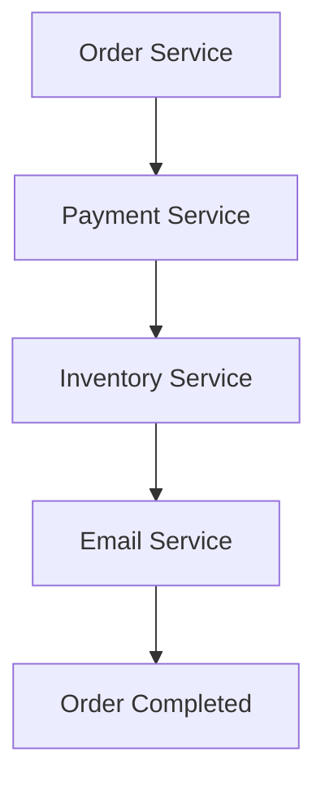
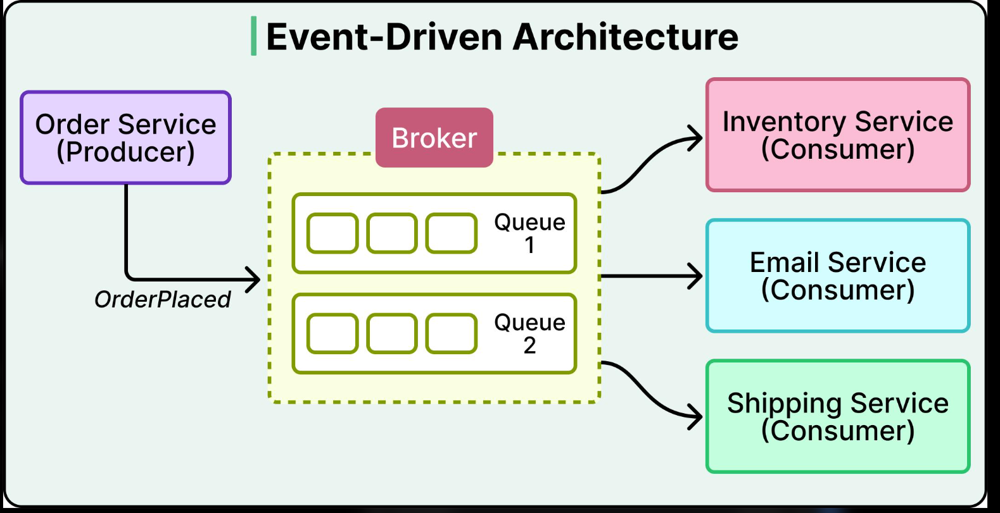
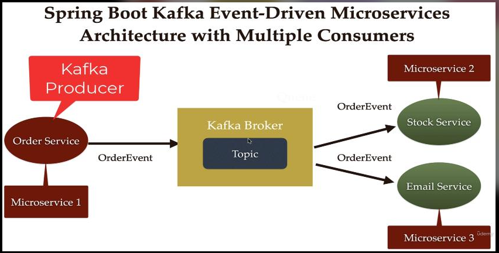
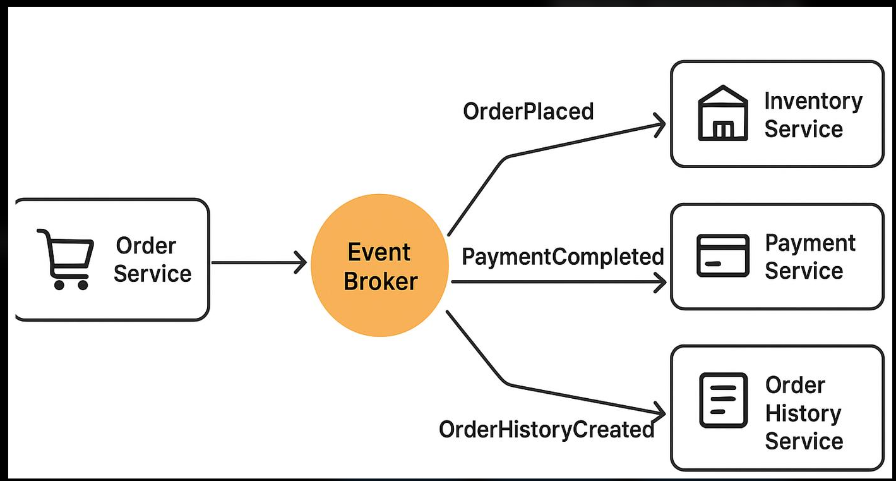
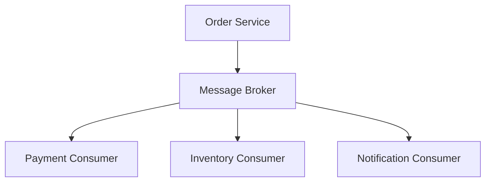

<div dir="rtl" style="text-align: right; font-family: 'B Nazanin', Tahoma, sans-serif;">


عالیه. اگر قرار است برای **RabbitMQ و Kafka در Java + Spring Boot مصاحبه فنی** آماده شوی، بهتر است فقط تعریف این دو ابزار را حفظ نکنی؛ باید بتوانی معماری، تفاوت‌ها، سناریوهای واقعی، نحوه پیاده‌سازی و مشکلات Production را توضیح بدهی.

با توجه به سؤالات Java، Spring، Hibernate، JMS و معماری بک‌اند که داری تمرین می‌کنی، پیشنهاد می‌کنم این مبحث را به شکل **سؤالات مصاحبه همراه جواب تشریحی و کد Spring Boot** جلو ببریم.

## **نقشه راه مصاحبه RabbitMQ و Kafka**

## **مرحله ۱ — مفاهیم پایه Messaging**

- Message Broker چیست و چرا استفاده می‌کنیم؟
- تفاوت Synchronous و Asynchronous communication
- Producer، Consumer، Message، Broker
- Queue و Topic چیست؟
- Message delivery guarantee
- Loose Coupling و Event-Driven Architecture

## **مرحله ۲ — RabbitMQ**

- معماری RabbitMQ
- Exchange و انواع آن
- Queue و Binding
- Routing Key
- Acknowledgment و NACK
- Retry و Dead Letter Queue
- Prefetch و Consumer concurrency
- Persistence و Durability
- پیاده‌سازی با Spring Boot و Spring AMQP

## **مرحله ۳ — Kafka**

- Kafka Architecture
- Broker و Cluster
- Topic و Partition
- Offset
- Consumer Group
- Replication و Leader/Follower
- Ordering
- Retention
- Rebalancing
- Delivery semantics
- پیاده‌سازی با Spring Kafka

## **مرحله ۴ — مقایسه RabbitMQ و Kafka**

- Queue-based Messaging vs Distributed Event Streaming
- Message حذف می‌شود یا باقی می‌ماند؟
- Retry چگونه انجام می‌شود؟
- Ordering
- Scalability
- Throughput
- چه زمانی RabbitMQ و چه زمانی Kafka؟

## **مرحله ۵ — سؤالات Senior / Production**

- جلوگیری از Duplicate Processing
- Idempotency
- Retry Strategy
- Poison Message
- Transactional Outbox
- Exactly Once و محدودیت‌های آن
- Consumer failure
- Message loss
- Backpressure
- Monitoring و Observability

# **جلسه اول: Messaging چیست و چرا استفاده می‌کنیم؟**

فرض کن یک فروشگاه اینترنتی با Spring Boot داریم. مشتری سفارش ثبت می‌کند و بعد از ثبت سفارش باید:

1. سفارش در دیتابیس ذخیره شود.
2. پرداخت انجام شود.
3. ایمیل برای مشتری ارسال شود.
4. موجودی کالا کاهش پیدا کند.
5. سرویس Notification پیام ارسال کند.

## **روش اول: ارتباط مستقیم (Synchronous)**


<div dir="ltr" style="text-align: left; font-family: 'B Nazanin', Tahoma, sans-serif;">



</div>


در این حالت Order Service باید مستقیماً سرویس‌های دیگر را صدا بزند.

### **مشکلات**

- اگر Email Service خراب باشد، ممکن است ثبت سفارش با مشکل مواجه شود.
- Order Service به سرویس‌های زیادی وابسته است.
- زمان پاسخ‌گویی بالا می‌رود.
- اگر یکی از سرویس‌ها Timeout شود، زنجیره درخواست دچار مشکل می‌شود.
- Scaling مستقل سرویس‌ها سخت‌تر می‌شود.

## **روش دوم: ارتباط Asynchronous با Message Broker**

در این معماری، Order Service پیام را به Message Broker می‌فرستد و سرویس‌های دیگر آن را دریافت می‌کنند.

[A Guide To Event-Driven Architectural Patterns](images/2.png)


[Spring Boot + Apache Kafka Course - The Practical Guide - HackMD](images/1.png)

[Event-Driven Architecture: Scalable and Resilient Systems that Never Miss a Beat | by Bakti Pratama | Coffee☕ And Code💚 | Medium](images/3.png)

10

<div dir="ltr" style="text-align: left; font-family: 'B Nazanin', Tahoma, sans-serif;">



</div>


Order Service دیگر لازم نیست منتظر بماند تا تمام سرویس‌ها کارشان را انجام دهند.

مثلاً بعد از ثبت سفارش:


<div dir="ltr" style="text-align: left; font-family: 'B Nazanin', Tahoma, sans-serif;">

```
orderRepository.save(order);

rabbitTemplate.convertAndSend(
    "order.exchange",
    "order.created",
    new OrderCreatedEvent(order.getId())
);
```

</div>


در اینجا Order Service پیام `OrderCreatedEvent` را منتشر می‌کند.

سرویس‌های دیگر می‌توانند مستقل از Order Service این پیام را دریافت و پردازش کنند.

# **1. Message Broker چیست؟**

Message Broker یک واسط نرم‌افزاری است که پیام‌ها را از Producer دریافت می‌کند و بر اساس قواعد مشخص آن‌ها را به Consumerها تحویل می‌دهد.

دو ابزار مهم:

- RabbitMQ
- Apache Kafka

### **Producer**

سیستمی که پیام تولید می‌کند.

مثال: Order Service

### **Consumer**

سیستمی که پیام را دریافت و پردازش می‌کند.

مثال: Notification Service

### **Message**

اطلاعاتی که بین سرویس‌ها ارسال می‌شود.

<div dir="ltr" style="text-align: left; font-family: 'B Nazanin', Tahoma, sans-serif;">

```
{
  "eventId": "e-1001",
  "orderId": 5001,
  "eventType": "ORDER_CREATED",
  "customerId": 120,
  "createdAt": "2026-11-21T10:00:00"
}
```

</div>


# **2. RabbitMQ چیست؟**

RabbitMQ

RabbitMQ یک Message Broker است که معمولاً برای ارسال، ذخیره موقت، Routing و تحویل پیام بین Producer و Consumer استفاده می‌شود.

در RabbitMQ مفاهیم مهم عبارت‌اند از:

| Component   | وظیفه                       |
| ----------- | --------------------------- |
| Producer    | تولید پیام                  |
| Exchange    | دریافت پیام و تعیین مسیر آن |
| Binding     | اتصال Exchange به Queue     |
| Routing Key | مشخص کردن مسیر پیام         |
| Queue       | نگهداری پیام تا مصرف آن     |
| Consumer    | دریافت و پردازش پیام        |

[Why Do We Need a Message Queue? - ByteByteGo Newsletter](https://images.openai.com/static-rsc-4/Hhu7JPU_vwfZVoJABYAM1f7arB2WdkT3CVqTytQjdFJVgPKBQh-Cwf4nX2CRMgRgM6LvmB1Hfb2bpYCyLCtycEHgqYUtvIDGS9eSa-6jQG8SlAewI548QOUtOCCBg4QZzeZosRE3p4PL0h1lkQgE9OiY6iR4XXtnauTtsnFsOmo?purpose=inline)

[RabbitMQ + Spring boot + Docker. Отправляем и получаем сообщения через Producer и Consumer. Пошаговое руководство / Хабр](https://images.openai.com/static-rsc-4/bamdFKWQpMV9mN9bCsbmwM1cdMZwLyflROwVbV5Gwe-_L7vRXc0YpA_ljvB6NTYRkcnpXPu8n8GFhcTa_jN30jQ73uUpD8fnYWtL_kqR7rs_gO6F_NdLadnDUqCuXfoRSdXW_Ca2lu2mHmMHLq75zgjybxq6ebWqui8ckaUS-To?purpose=inline)

[OpenAI + .NET Web API. Artificial Intelligence is no longer… | by Gaurav Ashish | Medium](https://images.openai.com/static-rsc-4/VewqYN-1MKyTUiWE1gz_ZEZ3vstYaKkZfIdguIoaPr5EOoQONfmG3aS9y98vEZqm0raCrZVjBwsBZh9Q8nqPiiS-hwBSgb4RrUMDyPopzX3Yr1rx29L7DxxsWdMr6nRnOrhGnayLSbxgnpktcHjPy6hzE3aQTgYqmdhs_Dp5t4A?purpose=inline)

7

معماری کلی:

<div dir="ltr" style="text-align: left; font-family: 'B Nazanin', Tahoma, sans-serif;">

```
Producer
   |
   v
 Exchange
   |
 Binding + Routing Key
   |
   v
  Queue
   |
   v
 Consumer
```

</div>


RabbitMQ در بسیاری از سناریوها برای Task Queue، توزیع کار، پردازش Async، Retry و ارتباط سرویس‌ها بسیار مناسب است.&#x20;

[image](https://www.google.com/s2/favicons?domain=https://www.rabbitmq.com\&sz=32)

RabbitMQ


# **3. Kafka چیست؟**

Apache Kafka

Kafka بیشتر برای Distributed Event Streaming و نگهداری و پردازش حجم زیادی از Eventها طراحی شده است.

معماری کلی:

<div dir="ltr" style="text-align: left; font-family: 'B Nazanin', Tahoma, sans-serif;">

```
Producer
   |
   v
 Kafka Cluster
   |
   v
 Topic
   |
   +---- Partition 0
   +---- Partition 1
   +---- Partition 2
   |
   v
 Consumer Group
   |
   +---- Consumer 1
   +---- Consumer 2
```

</div>


مفاهیم مهم Kafka:

| Component      | وظیفه                        |
| -------------- | ---------------------------- |
| Producer       | ارسال Event                  |
| Broker         | نگهداری و مدیریت داده        |
| Topic          | دسته‌بندی Eventها            |
| Partition      | تقسیم Topic برای Parallelism |
| Offset         | موقعیت Consumer در Partition |
| Consumer Group | گروه Consumerهای همکار       |
| Replication    | افزایش تحمل خرابی            |

Kafka برخلاف مدل Queue معمولی، پیام‌ها را تا زمان پایان Retention نگهداری می‌کند؛ بنابراین Consumer می‌تواند مجدداً پیام‌های قبلی را بخواند یا به Offset مشخصی برگردد.

# **4. مهم‌ترین تفاوت RabbitMQ و Kafka**

| ویژگی          | RabbitMQ                                    | Kafka                                      |
| -------------- | ------------------------------------------- | ------------------------------------------ |
| مدل            | Message Broker                              | Event Streaming Platform                   |
| ساختار اصلی    | Exchange و Queue                            | Topic و Partition                          |
| مصرف پیام      | معمولاً پیام بعد از ACK از Queue حذف می‌شود | پیام با Consumer شدن حذف نمی‌شود           |
| Replay         | معمولاً محدود و نیازمند طراحی مجدد          | قابلیت اصلی و طبیعی                        |
| Ordering       | با توجه به Queue و شرایط Consumer           | در سطح Partition                           |
| Load balancing | بین Consumerهای یک Queue                    | بین Consumerهای یک Group                   |
| کاربرد         | Task Queue، Command، Async Processing       | Event Streaming، Analytics، Event Pipeline |
| Throughput     | مناسب، بسته به معماری و تنظیمات             | بسیار مناسب حجم و Throughput بالا          |
| Retry          | معمولاً Queue، TTL، DLQ                     | Retry Topic یا الگوهای retry               |
| Scaling        | Queueها و Consumerها                        | Partitionها و Consumerها                   |

نکته مصاحبه:

این جواب اشتباه است که بگویی Kafka همیشه سریع‌تر است یا RabbitMQ همیشه بهتر است.

انتخاب ابزار به نوع نیاز بستگی دارد:

- اگر بخواهم Jobها را بین Workerها توزیع کنم → RabbitMQ انتخاب مناسبی است.
- اگر بخواهم Eventهای یک سیستم را ذخیره کنم و چند سرویس مستقل آن‌ها را مصرف کنند، Replay انجام دهند و حجم زیادی از داده پردازش کنند → Kafka انتخاب مناسبی است.

# **5. سؤال اول مصاحبه**

## **اگر در یک پروژه Microservice از شما بپرسند چرا به جای REST از RabbitMQ یا Kafka استفاده می‌کنید، چه پاسخی می‌دهید؟**

جواب پیشنهادی در مصاحبه:

> REST communication is synchronous and creates runtime dependency between services. Using a message broker allows asynchronous communication, loose coupling, better fault tolerance, and independent scaling of consumers. It also helps absorb traffic spikes and allows services to process events independently. However, it introduces additional complexity such as eventual consistency, message retries, duplicate processing, and monitoring.

پیشنهاد من این است که این موضوع را **سؤال‌به‌سؤال و با عمق مصاحبه Senior Java Developer** جلو ببریم؛ هر سؤال را اول با توضیح فارسی، بعد پاسخ مناسب انگلیسی برای مصاحبه، و در صورت نیاز با کد Spring Boot بررسی کنیم.

جلسه بعدی می‌تواند از **RabbitMQ: Exchangeها (Direct، Fanout، Topic، Headers)، Binding و Routing Key** شروع شود؛ این یکی از بخش‌هایی است که احتمال سؤال شدنش در مصاحبه بسیار زیاد است.

اگر بخواهی، از همین حالا می‌توانیم حالت مصاحبه واقعی را شروع کنیم: من سؤال می‌پرسم، تو جواب می‌دهی، و جواب تو را مثل مصاحبه‌گر Senior بررسی و اصلاح می‌کنم.
</div>
