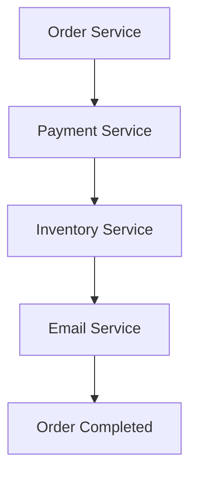
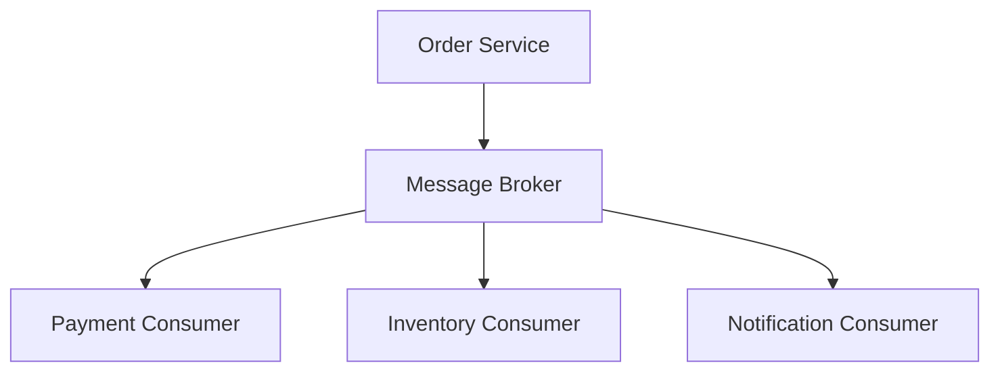

<!-- SOURCE: ch1.md -->
# File: ch1.md

<div dir="rtl" style="text-align: right; font-family: 'B Nazanin', Tahoma, sans-serif;">

باشه، بیا این موضوع رو **کاملاً از صفر و بدون اصطلاحات پیچیده** یاد بگیریم. فعلاً اصلاً به جدول نگاه نکن.

## **۱. Regex قراره چی کار کنه؟**

فرض کن این متن رو داریم:

<div dir="ltr" style="text-align: left; font-family: 'B Nazanin', Tahoma, sans-serif;">

```
String text = "<a><b><c>";
```

</div>


ما می‌خوای با Regex قسمت‌هایی رو که بین `<` و `>` هستند پیدا کنیم.

مثلاً:

<div dir="ltr" style="text-align: left; font-family: 'B Nazanin', Tahoma, sans-serif;">

```
<a>
<b>
<c>
```

</div>


اما Regex ما اینه:

<div dir="ltr" style="text-align: left; font-family: 'B Nazanin', Tahoma, sans-serif;">

```
<.+>
```

</div>


بیا ببینیم چرا این سه حالت نتیجه‌های متفاوتی می‌دن.

## **۲. اول Greedy (حریص) رو یاد بگیر**

این Regex رو ببین:

<div dir="ltr" style="text-align: left; font-family: 'B Nazanin', Tahoma, sans-serif;">

```
<.+>
```

</div>


معنی اجزاش:

| علامت | معنی                        |
| ----- | --------------------------- |
| `<`   | دقیقاً یک علامت `<` پیدا کن |
| `.`   | هر کاراکتری                 |
| `+`   | حداقل یک کاراکتر            |
| `>`   | دقیقاً یک علامت `>`         |

حالا Java سعی می‌کنه این الگو رو در متن پیدا کنه.

## **متن ما**

`<a><b><c>`

Greedy می‌خواهد تا جای ممکن از متن را بگیرد.

وقتی به اولین `<` می‌رسه، شروع می‌کنه به گرفتن کاراکترها.

اول ممکنه این رو در نظر بگیریم:

<div dir="ltr" style="text-align: left; font-family: 'B Nazanin', Tahoma, sans-serif;">

```
<a>
```

</div>


اما Greedy می‌گه:

> چرا همین‌جا متوقف بشم؟ هنوز `<b><c>` هم وجود داره!

پس تا آخر متن پیش می‌ره و آخرین `>` رو انتخاب می‌کنه.

نتیجه:

<div dir="ltr" style="text-align: left; font-family: 'B Nazanin', Tahoma, sans-serif;">

```
<a><b><c>
```

</div>


یعنی **Greedy سعی می‌کنه بزرگ‌ترین Match ممکن رو پیدا کنه.**

## **۳. Lazy (تنبل) دقیقاً برعکس عمل می‌کنه**

حالا فقط یک `?` اضافه می‌کنیم:

<div dir="ltr" style="text-align: left; font-family: 'B Nazanin', Tahoma, sans-serif;">

```
<.+?>
```

</div>


تفاوت این دو فقط همین علامت `?` هست.

Lazy می‌گه:

> من نمی‌خوام بیشتر از چیزی که لازم دارم کاراکتر بگیرم. همین که الگو کامل شد، متوقف می‌شم.

از اول متن شروع می‌کنه:

<div dir="ltr" style="text-align: left; font-family: 'B Nazanin', Tahoma, sans-serif;">

```
<a><b><c>
```

</div>


به اولین `>` که می‌رسه، الگو کامل شده:

<div dir="ltr" style="text-align: left; font-family: 'B Nazanin', Tahoma, sans-serif;">

```
<a>
```

</div>


پس متوقف می‌شه.

بعد جستجو از ادامه متن:

<div dir="ltr" style="text-align: left; font-family: 'B Nazanin', Tahoma, sans-serif;">

```
<b><c>
```

</div>


Match دوم:

<div dir="ltr" style="text-align: left; font-family: 'B Nazanin', Tahoma, sans-serif;">

```
<b>
```

</div>


و بعد:

<div dir="ltr" style="text-align: left; font-family: 'B Nazanin', Tahoma, sans-serif;">

```
<c>
```

</div>


نتیجه نهایی:

<div dir="ltr" style="text-align: left; font-family: 'B Nazanin', Tahoma, sans-serif;">

```
<a>
<b>
<c>
```

</div>


## **تفاوت اصلی**

Greedy → تا جای ممکن می‌گیرد.

Lazy → به محض اینکه بتواند Match شود، متوقف می‌شود.

## **۴. حالا Possessive (بدون عقب‌گرد)**

این قسمت رو فعلاً فقط با یک مثال یاد بگیر.

فرض کن Regex ما اینه:

<div dir="ltr" style="text-align: left; font-family: 'B Nazanin', Tahoma, sans-serif;">

```
<.++>
```

</div>


این Regex از دو قسمت تشکیل شده:

<div dir="ltr" style="text-align: left; font-family: 'B Nazanin', Tahoma, sans-serif;">

```
<.++>
```

</div>


- `<` علامت شروع رو پیدا می‌کنه.
- `.++` یعنی یک یا چند کاراکتر را بگیر، اما **دیگه از کاراکترهایی که گرفتی عقب‌نشینی نکن**.
- `>` باید در انتها Match بشه.

در حالت Greedy، اگر الگو موفق نشه، Regex می‌تونه بعضی از کاراکترهایی رو که گرفته پس بده (به این می‌گیم Backtracking).

اما Possessive می‌گه:

> هرچی گرفتم، دیگه پس نمی‌دم!

به همین دلیل در این مثال کل متن رو می‌گیره و عقب نمی‌ره.

## **۵. با یک مثال ساده‌تر، Greedy و Lazy رو مقایسه کنیم**

این مثال از همه مهم‌تره.

<div dir="ltr" style="text-align: left; font-family: 'B Nazanin', Tahoma, sans-serif;">

```
String text = "12345";
```

</div>


Regex:

<div dir="ltr" style="text-align: left; font-family: 'B Nazanin', Tahoma, sans-serif;">

```
\d+
```

</div>


خروجی:

<div dir="ltr" style="text-align: left; font-family: 'B Nazanin', Tahoma, sans-serif;">

```
12345
```

</div>


چون Greedy هست، تمام اعداد رو می‌گیره.

حالا:

<div dir="ltr" style="text-align: left; font-family: 'B Nazanin', Tahoma, sans-serif;">

```
\d+?
```

</div>


اگر با `Matcher.find()` اجراش کنیم، خروجی تقریباً این می‌شه:

<div dir="ltr" style="text-align: left; font-family: 'B Nazanin', Tahoma, sans-serif;">

```
1
2
3
4
5
```

</div>


چرا؟ چون Lazy سعی می‌کنه کمترین تعداد ممکن رو بگیره؛ اینجا هر بار فقط یک رقم.

## **۶. مثال واقعی Java (این قسمت مهمه)**

فرض کن یک متن HTML داریم:

<div dir="ltr" style="text-align: left; font-family: 'B Nazanin', Tahoma, sans-serif;">

```
String html = "<b>سلام</b> و <b>خداحافظ</b>";
```

</div>


می‌خوای فقط متن داخل تگ `b` رو استخراج کنی.

### **روش اول: Greedy**

<div dir="ltr" style="text-align: left; font-family: 'B Nazanin', Tahoma, sans-serif;">

```
Pattern pattern = Pattern.compile("<b>(.*)</b>");
Matcher matcher = pattern.matcher(html);

while (matcher.find()) {
    System.out.println(matcher.group(1));
}
```

</div>


خروجی:

<div dir="ltr" style="text-align: left; font-family: 'B Nazanin', Tahoma, sans-serif;">

```
سلام</b> و <b>خداحافظ
```

</div>


چرا؟

`.*` حریص هست. تا آخر متن می‌ره و آخرین `</b>` رو پیدا می‌کنه. در نتیجه دو تگ `b` رو به هم وصل می‌کنه و یک Match بزرگ تحویل می‌ده.

### **روش دوم: Lazy**

<div dir="ltr" style="text-align: left; font-family: 'B Nazanin', Tahoma, sans-serif;">

```
Pattern pattern = Pattern.compile("<b>(.*?)</b>");
Matcher matcher = pattern.matcher(html);

while (matcher.find()) {
    System.out.println(matcher.group(1));
}
```

</div>


خروجی:

<div dir="ltr" style="text-align: left; font-family: 'B Nazanin', Tahoma, sans-serif;">

```
سلام
خداحافظ
```

</div>


اینجا `.*?` به محض اینکه به اولین `</b>` می‌رسه متوقف می‌شه.

## **۷. فقط این رو فعلاً حفظ کن**

## **خلاصه سه حالت**

**Greedy**

بیشترین مقدار ممکن

**Lazy**

کمترین مقدار لازم

**Possessive**

گرفتن و پس ندادن

| حالت       | علامت | رفتار                                               |
| ---------- | ----- | --------------------------------------------------- |
| Greedy     | `+`   | حداکثر رو می‌گیره، اگر لازم باشه عقب می‌ره          |
| Lazy       | `+?`  | ابتدا حداقل رو می‌گیره و در صورت نیاز بیشتر می‌گیره |
| Possessive | `++`  | حداکثر رو می‌گیره و دیگه عقب نمی‌ره                 |

### **یک جمله برای مصاحبه**

> Greedy تا حد امکان Match می‌کند و در صورت نیاز Backtracking انجام می‌دهد. Lazy کمترین Match ممکن را انتخاب می‌کند و در صورت نیاز گسترش می‌دهد. Possessive مثل Greedy عمل می‌کند، اما Backtracking ندارد.

اگر بخوای، در مرحله بعد می‌تونم با **۵ تمرین خیلی ساده و خروجی هر Regex** کاری کنم که این سه حالت کاملاً برات جا بیفته.
</div>


<!-- SOURCE: 2.md -->
# File: 2.md

<div dir="rtl" style="text-align: right; font-family: 'B Nazanin', Tahoma, sans-serif;">


# 🎓 جلسه ۲ — کوانتیفایرها و کلاس‌های کاراکتری (عمیق)

این جلسه **قلب اعتبارسنجی**‌ه. اگه این رو کامل بفهمی، ۸۰٪ اعتبارسنجی‌ها رو راحت می‌نویسی.

## ۲.۱ کوانتیفایرها — لیست کامل

| کوانتیفایر | معنی | مثال | match می‌شه با |
|-----------|------|------|---------------|
| `?` | ۰ یا ۱ | `colou?r` | `color`, `colour` |
| `*` | ۰ یا بیشتر | `ab*` | `a`, `ab`, `abb`, `abbb` |
| `+` | ۱ یا بیشتر | `ab+` | `ab`, `abb` (نه `a`) |
| `{n}` | دقیقاً n | `\d{3}` | `123` (نه `12`, نه `1234`) |
| `{n,}` | حداقل n | `\d{3,}` | `123`, `1234`, `12345` |
| `{n,m}` | بین n تا m | `\d{3,5}` | `123`, `1234`, `12345` |

## ۲.۲ سه حالت کوانتیفایر — Greedy / Lazy / Possessive

این بخشی‌ه که خیلی‌ها نمی‌دونن و بعداً باگ می‌سازه:

<div dir="ltr" style="text-align: left; font-family: 'B Nazanin', Tahoma, sans-serif;">

```java
String text = "<a><b><c>";
```

</div>


| الگو | نتیجه | توضیح |
|------|-------|-------|
| `<.+>` (greedy) | `<a><b><c>` | بیشترین مقدار ممکن |
| `<.+?>` (lazy) | `<a>`, `<b>`, `<c>` | کمترین مقدار ممکن |
| `<.++>` (possessive) | `<a><b><c>` (بدون backtracking) | مثل greedy ولی بدون عقب‌گرد |

**پیش‌فرض `greedy` هست.** برای اعتبارسنجی معمولاً همین خوبه. ولی برای **استخراج** (مثلاً از HTML یا لاگ) معمولاً `lazy` (`?`) می‌خوای.

<div dir="ltr" style="text-align: left; font-family: 'B Nazanin', Tahoma, sans-serif;">

```java
// مثال واقعی: استخراج محتوای تگ <b>
String html = "<b>سلام</b> و <b>خداحافظ</b>";
Pattern.compile("<b>(.*?)</b>");   // lazy → دو تا match جدا
Pattern.compile("<b>(.*)</b>");    // greedy → یک match بزرگ
```

</div>


## ۲.۳ کلاس‌های کاراکتری — لیست کامل

| نماد | معنی | معادل |
|------|------|-------|
| `\d` | یک رقم | `[0-9]` |
| `\D` | غیر رقم | `[^0-9]` |
| `\w` | word (حرف/رقم/_ ) | `[a-zA-Z0-9_]` (پیش‌فرض ASCII) |
| `\W` | غیر word | `[^a-zA-Z0-9_]` |
| `\s` | فضای خالی (space, tab, \n...) | `[ \t\n\x0B\f\r]` |
| `\S` | غیر فضای خالی | — |
| `.` | **هر** کاراکتری به‌جز newline | — |

## ۲.۴ ⚠️ تله‌های رایج (این‌ها رو حفظ کن)

**تله ۱: `.` با `matches()` و رشتهٔ خالی**

<div dir="ltr" style="text-align: left; font-family: 'B Nazanin', Tahoma, sans-serif;">

```java
"".matches(".*");   // true ✅ (صفر کاراکتر)
"".matches(".+");   // false ✅ (حداقل یک کاراکتر)
```

</div>


**تله ۲: `.` شامل newline نمی‌شه**

<div dir="ltr" style="text-align: left; font-family: 'B Nazanin', Tahoma, sans-serif;">

```java
"a\nb".matches("a.b");   // false ❌
"a\nb".matches("a(?s).b"); // true (یا با Pattern.DOTALL)
```

</div>


**تله ۳: `-` داخل `[]`**

<div dir="ltr" style="text-align: left; font-family: 'B Nazanin', Tahoma, sans-serif;">

```java
"[a-z]"    // بازه: هر حرف کوچک ✅
"[az-]"    // حرف a، حرف z، یا دش (چون آخر `[]` هست)
"[-az]"    // همون بالا (چون اول `[]` هست)
"[a\\-z]"  // حرف a، دش، حرف z (escape شده)
```

</div>

دش در **وسط** `[]` معنی «بازه» می‌ده. این دقیقاً همون چیزیه که توی تمرین ۴ جلسهٔ قبل خوردی.

**تله ۴: `^` داخل `[]` معنی نگاتیو داره**

<div dir="ltr" style="text-align: left; font-family: 'B Nazanin', Tahoma, sans-serif;">

```java
"[abc]"    // a یا b یا c
"[^abc]"   // هر چیزی به‌جز a, b, c (حداقل یک کاراکتر)
```

</div>


**تله ۵: `\w` حروف فارسی رو نمی‌گیره (پیش‌فرض)**

<div dir="ltr" style="text-align: left; font-family: 'B Nazanin', Tahoma, sans-serif;">

```java
"سلام".matches("\\w+");   // false ❌
```

</div>

اگه لازم داری Unicode هم پشتیبانی بشه، `Pattern.UNICODE_CHARACTER_CLASS` یا `\p{L}` لازمه (جلسهٔ ۳).

## ۲.۵ نکته‌ای که خیلی کمک می‌کنه: «چی مجاز نیست؟» رو بپرس

برای اعتبارسنجی، دو طرز فکر:

**الف) «چه چیزایی مجازه»** (whitelist — پیشنهادی):

<div dir="ltr" style="text-align: left; font-family: 'B Nazanin', Tahoma, sans-serif;">

```java
"^[a-z]+$"   // فقط حروف کوچک
```

</div>


**ب) «چه چیزایی مجاز نیست»** (blacklist — خطرناک):

<div dir="ltr" style="text-align: left; font-family: 'B Nazanin', Tahoma, sans-serif;">

```java
"^[^0-9]+$"  // هر چیزی به‌جز رقم ← شامل فاصله، ایموجی، ...
```

</div>


همیشه از **الف** استفاده کن. blacklist نشت داره.

---

## 📝 تمرین‌های جلسه ۲ (۶ تا — سخت‌تر از قبل)

برای هرکدوم **الگو + یه تست کوچیک** بنویس.

### تمرین ۱ — کوانتیفایر `*` و `+` (مفهومی، ولی بنویس)
این‌ها true هستن یا false؟ چرا؟

<div dir="ltr" style="text-align: left; font-family: 'B Nazanin', Tahoma, sans-serif;">

```java
"".matches("a*")          // ?
"".matches("a+")          // ?
"aaa".matches("a{2,}")    // ?
"aa".matches("a{2,}")     // ?
"a".matches("a{2,}")      // ?
"abcdef".matches("a.*f")  // ?
"af".matches("a.*f")      // ?
```

</div>


### تمرین ۲ — کد ملی ۱۰ رقمی واقعی
کد ملی ایران: **دقیقاً ۱۰ رقم**. سه رقم اول **نباید همه صفر باشن** (مثل `0001234567` نامعتبره).

<div dir="ltr" style="text-align: left; font-family: 'B Nazanin', Tahoma, sans-serif;">

```
"1234567890"  → true
"0001234567"  → false
"123456789"   → false (۹ رقم)
"12345678901" → false (۱۱ رقم)
```

</div>


**راهنما:** از lookahead منفی استفاده کن: `(?!...)` — در جلسهٔ ۳ مفصل می‌گم ولی توی این یه مورد می‌تونی امتحان کنی. یا از یه روش دیگه هم می‌شه (بدون lookahead) — هر دو درسته.

### تمرین ۳ — کد ملی «با چک‌سام» (چالشی)
فقط با Regex **نمی‌شه** چک‌سام کد ملی رو حساب کرد. پس:
1. اول Regex بنویس که فقط ۱۰ رقم و سه رقم اول غیرصفر رو قبول کنه
2. بعد یه متد جاوا بنویس که چک‌سام واقعی رو چک کنه (الگوریتم معروف: مجموع رقم‌ها × وزن، mod 11)

این تمرین بهت یاد می‌ده **مرز Regex کجاست** — بخش مهمی از اعتبارسنجی درست.

### تمرین ۴ — ایمیل (نسخهٔ کاربردی، نه استاندارد کامل)
ایمیل: `username@domain.tld`
- username: حروف انگلیسی، رقم، `.`، `_`، `-` (حداقل ۱ کاراکتر)
- `@`
- domain: حروف، رقم، `-` (حداقل ۱ کاراکتر)
- `.`
- tld: حروف (حداقل ۲ کاراکتر)

<div dir="ltr" style="text-align: left; font-family: 'B Nazanin', Tahoma, sans-serif;">

```
"ali@gmail.com"        → true
"ali.2000@test.co.uk"  → true
"ali@"                 → false
"@gmail.com"           → false
"ali@gmail"            → false (tld نداره)
```

</div>


### تمرین ۵ — این الگو چه اشکالی داره؟

<div dir="ltr" style="text-align: left; font-family: 'B Nazanin', Tahoma, sans-serif;">

```java
String email = "^.+@.+\\..+$";
```

</div>

چرا این برای اعتبارسنجی **بد** هست؟ حداقل ۲ تا مشکل بگو. (نکته: از بحث blacklist vs whitelist کمک بگیر.)

### تمرین ۶ — URL ساده
URL که با `http://` یا `https://` شروع می‌شه، بعد domain (حروف/رقم/`-`/`.`، حداقل ۱ کاراکتر)، و اختیاراً یه `/path` با هر کاراکتری به‌جز فاصله.

<div dir="ltr" style="text-align: left; font-family: 'B Nazanin', Tahoma, sans-serif;">

```
"https://google.com"           → true
"http://test.org/path/to/page" → true
"ftp://google.com"             → false
"google.com"                   → false
```

</div>


---

## 💡 راهنماها

| چی می‌خوای | چطور |
|-----------|------|
| دقیقاً ۱۰ رقم | `\d{10}` |
| سه رقم اول غیر از ۰۰۰ | `(?!000)` یا `[1-9]\d{2}` برای بخش اول + `\d{7}` |
| حروف+رقم+بعضی نمادها | `[A-Za-z0-9._-]` |
| اختیاری | `?` |
| `(?!...)` = «از اینجا به بعد نباید شروع بشه با...» | جلسهٔ ۳ کامل می‌گم |
| tld حداقل ۲ حرف | `[a-zA-Z]{2,}` |

---

هر ۶ تا رو بنویس. **مخصوصاً تمرین ۵ رو جدی بگیر** — این طرز فکر (چرا این الگو بد است؟) از هر تکنیک Regex مهم‌تره.

بعد جلسه ۳ می‌ریم **lookahead/lookbehind** که برای اعتبارسنجی حرفه‌ای حیاتیه. 🚀
</div>


<!-- SOURCE: 1.md -->
# File: 1.md

Java 8 was a landmark release that fundamentally changed how Java developers write code, introducing functional programming concepts to the language. For a core review, it's essential to understand its most impactful features, which primarily center around **Lambda Expressions, the Stream API, and a suite of new APIs** for modern application development.

### 📝 Lambda Expressions & Functional Interfaces
These are the foundation of Java 8's functional style.

*   **Lambda Expressions**: These allow you to treat functionality as a method argument or code as data. They provide a clear and concise way to represent a single method interface using an expression. The basic syntax is `(parameters) -> expression` or `(parameters) -> { statements; }`.
    ```java
    // Before Java 8: Anonymous inner class
    Runnable r = new Runnable() {
        @Override
        public void run() {
            System.out.println("Hello, Java 8!");
        }
    };

    // With Java 8 Lambda
    Runnable r = () -> System.out.println("Hello, Java 8!");
    ```
*   **Functional Interfaces**: A functional interface is any interface that contains **exactly one abstract method** (it can still have multiple default or static methods). This is the type that a lambda expression targets. The `@FunctionalInterface` annotation is optional but helps the compiler enforce the single-abstract-method rule.
    ```java
    @FunctionalInterface
    interface MathOperation {
        int operate(int a, int b);
    }

    MathOperation addition = (a, b) -> a + b; // Lambda targets the functional interface
    ```
*   **Method References**: A shorthand notation for a lambda expression that simply calls an existing method. It uses the `::` operator and makes code even more readable. There are four main types: static method reference (`Integer::parseInt`), instance method of a particular object (`System.out::println`), instance method of an arbitrary object of a type (`String::toUpperCase`), and constructor reference (`ArrayList::new`).

### 🌊 The Stream API
The Stream API provides a powerful, declarative way to process sequences of elements (like collections) with functional-style operations.

*   **Key Concepts**:
    *   **Declarative**: You specify *what* you want to do, not *how* to do it (unlike traditional loops).
    *   **Lazy Evaluation**: Intermediate operations (like `filter`, `map`) are not executed until a terminal operation (like `collect`, `forEach`) is called.
    *   **Parallel Processing**: Streams can easily leverage multiple cores with `.parallelStream()`.
*   **Common Operations**:
    *   **Intermediate Operations** (return a new Stream): `filter()`, `map()`, `flatMap()`, `distinct()`, `sorted()`, `limit()`, `skip()`.
    *   **Terminal Operations** (produce a result or side-effect): `forEach()`, `collect()`, `reduce()`, `count()`, `anyMatch()`, `findFirst()`.
    ```java
    List<String> names = Arrays.asList("Alice", "Bob", "Charlie", "David");

    // Imperative style (pre-Java 8)
    for (String name : names) {
        if (name.startsWith("A")) {
            System.out.println(name.toUpperCase());
        }
    }

    // Functional style with Stream API
    names.stream()
         .filter(name -> name.startsWith("A"))
         .map(String::toUpperCase)
         .forEach(System.out::println);
    ```

### 🛡️ Optional Class
`Optional<T>` is a container object that may or may not contain a non-null value. Its primary purpose is to provide a **clearer API signal** that a method might return no result, and to help avoid `NullPointerException`.

```java
// Instead of returning null, a method can return an Optional
public Optional<String> findUserById(int id) {
    // ... lookup logic
    return Optional.ofNullable(user); // Wraps a possibly null value
}

// Using the Optional
Optional<String> user = findUserById(123);
String name = user.orElse("Guest"); // Provides a default value if empty
user.ifPresent(System.out::println); // Executes only if a value is present
```

### ⏰ New Date and Time API (`java.time`)
This API was introduced to fix the design flaws of the old `java.util.Date` and `Calendar` classes. It is **immutable and thread-safe**, providing a fluent interface for date-time manipulation.

*   **Core Classes**:
    *   `LocalDate`, `LocalTime`, `LocalDateTime`: Represent date and/or time without a timezone.
    *   `ZonedDateTime`: Represents a date-time with a specific timezone.
    *   `Instant`: Represents a point in time (machine-readable timestamp).
    *   `Duration` and `Period`: Used to represent amounts of time.
    *   `DateTimeFormatter`: For parsing and formatting date-time objects.
    ```java
    LocalDate today = LocalDate.now();
    LocalDate nextWeek = today.plusWeeks(1);
    LocalTime now = LocalTime.of(14, 30);

    DateTimeFormatter formatter = DateTimeFormatter.ofPattern("yyyy-MM-dd");
    String formattedDate = today.format(formatter);
    ```

### ⚡ Concurrency: CompletableFuture
`CompletableFuture<T>` is a major enhancement for asynchronous programming. It implements both `Future` and `CompletionStage`, allowing you to **compose, combine, and chain asynchronous computations** in a non-blocking way.

```java
// Start an asynchronous task
CompletableFuture<String> future = CompletableFuture.supplyAsync(() -> {
    // Simulate a long-running task
    return "Result";
});

// Chain another operation to run when the first completes
future.thenApply(result -> result + " Processed")
      .thenAccept(finalResult -> System.out.println(finalResult));
```

### 🔧 Other Core Enhancements
*   **Default Methods**: Allow interfaces to have method implementations without breaking existing implementing classes. This enables library evolution (e.g., adding `forEach` to `Iterable`).
*   **Static Methods in Interfaces**: Interfaces can now have static helper methods.
*   **Enhanced `Map` API**: New methods like `getOrDefault()`, `forEach()`, `computeIfAbsent()`, `merge()`, and `replaceAll()` make working with maps easier.
*   **Repeating & Type Annotations**: You can apply the same annotation multiple times to a declaration, and annotations can be placed on any type use.
*   **Nashorn JavaScript Engine**: A new, faster JavaScript engine integrated into the JVM, allowing seamless interaction between Java and JavaScript.

### 💎 Summary
For a core review, focus on mastering **Lambdas, Functional Interfaces, and the Stream API**, as they are the most transformative features. Then, ensure you are comfortable using **`Optional`** for null safety and the **`java.time`** API for all date/time operations. Understanding **`CompletableFuture`** is crucial for writing modern, non-blocking asynchronous code. These features together define the modern Java programming paradigm.

If you'd like to dive deeper into any specific area, such as advanced Stream collectors or `CompletableFuture` composition patterns, feel free to ask.


<!-- SOURCE: 2.md -->
# File: 2.md

Moving on to **Phase 2: Mastering SQL**. This is where you learn to actually talk to your database—to ask it questions, to add or change information, and to shape the structure of your data itself.

Here’s a step-by-step breakdown of the core SQL skills to acquire.

### 📝 Step 1: The Foundation – Retrieving Data with `SELECT`

The `SELECT` statement is the most fundamental SQL command. It's how you ask the database to show you data. You'll build on it by adding clauses to filter, sort, and refine your results.

*   **Basic Retrieval**: Start with `SELECT column1, column2 FROM table_name;` to pick specific columns. Use `SELECT *` to see all columns (good for exploring, but not for production code).
*   **Filtering Rows (`WHERE`)**: Use the `WHERE` clause to specify conditions a row must meet to be included in the results. You'll learn to use operators like `=`, `>`, `<`, `BETWEEN`, `IN`, and `LIKE` (for pattern matching).
*   **Sorting Results (`ORDER BY`)**: Control the presentation order of your output with `ORDER BY column_name ASC` (ascending, default) or `DESC` (descending).
*   **Eliminating Duplicates (`DISTINCT`)**: Use `SELECT DISTINCT column_name` to see only unique values in a column.

**Hands-On Practice**: On your Oracle Live SQL or local database, try these queries. (Oracle Live SQL often has sample tables like `EMPLOYEES` and `DEPARTMENTS` you can use).
```sql
-- See all data in the employees table
SELECT * FROM employees;

-- Select just names and salaries
SELECT first_name, last_name, salary FROM employees;

-- Filter for employees in department 50
SELECT first_name, last_name, salary
FROM employees
WHERE department_id = 50;

-- Sort those employees by salary, highest first
SELECT first_name, last_name, salary
FROM employees
WHERE department_id = 50
ORDER BY salary DESC;
```

### 🔗 Step 2: Connecting Data – Joins and Subqueries

Real-world data is spread across many tables. Joins and subqueries let you combine that data into a single, meaningful result set.

*   **The Concept of a Join**: A join links rows from two or more tables based on a related column between them (usually a primary key/foreign key relationship).
*   **The Main Types**:
    *   **`INNER JOIN`**: Returns only the rows that have a match in **both** tables. This is the most common type.
    *   **`LEFT [OUTER] JOIN`**: Returns **all** rows from the left table, and the matched rows from the right table. If there is no match, the result is `NULL` on the right side.
    *   **`RIGHT [OUTER] JOIN`**: The reverse of a LEFT JOIN; returns all rows from the right table.
    *   **`FULL [OUTER] JOIN`**: Returns all rows when there is a match in **either** table.
*   **Subqueries**: A subquery is a `SELECT` statement nested inside another SQL statement. You can use it in the `WHERE` or `FROM` clause to perform multi-step filtering, like "find employees who earn more than the average salary."

**Hands-On Practice**:
```sql
-- Inner join: get employee names and their department names
SELECT e.first_name, e.last_name, d.department_name
FROM employees e
INNER JOIN departments d ON e.department_id = d.department_id;

-- Left join: list all departments, including those with no employees
SELECT d.department_name, e.first_name, e.last_name
FROM departments d
LEFT JOIN employees e ON d.department_id = e.department_id;

-- Subquery: find employees who earn more than the average salary
SELECT first_name, last_name, salary
FROM employees
WHERE salary > (SELECT AVG(salary) FROM employees);
```

### 📊 Step 3: Summarizing Data – Aggregation and Analytic Functions

Instead of looking at individual rows, you'll often need to summarize data into groups.

*   **Aggregate Functions**: These functions perform a calculation on a set of rows and return a single result. Common ones are `SUM()`, `AVG()`, `COUNT()`, `MAX()`, and `MIN()`. They are almost always used with the `GROUP BY` clause, which groups rows that have the same values in specified columns.
*   **`HAVING` Clause**: Just like `WHERE` filters individual rows, `HAVING` filters **groups** created by `GROUP BY`. For example, "show me departments where the average salary is greater than 5000."
*   **Analytic (Window) Functions**: This is a powerful Oracle SQL feature. They perform calculations across a set of rows that are related to the current row, without collapsing them into a single output row like aggregates do. You'll learn to use `ROW_NUMBER()`, `RANK()`, and `DENSE_RANK()` with the `OVER()` clause to solve complex ranking and reporting problems.

**Hands-On Practice**:
```sql
-- Aggregate: count employees and average salary per department
SELECT department_id, COUNT(*) AS num_employees, AVG(salary) AS avg_salary
FROM employees
GROUP BY department_id
HAVING AVG(salary) > 5000;

-- Analytic: rank employees by salary within each department
SELECT first_name, last_name, department_id, salary,
       RANK() OVER (PARTITION BY department_id ORDER BY salary DESC) AS salary_rank
FROM employees;
```

### ✏️ Step 4: Modifying Data – DML (Data Manipulation Language)

DML statements are how you change the data inside your tables. The three core commands are `INSERT`, `UPDATE`, and `DELETE`.

*   **`INSERT`**: Adds new rows to a table. You can insert a single row or multiple rows at once.
*   **`UPDATE`**: Modifies existing rows. **Always use a `WHERE` clause** unless you intend to change every row in the table.
*   **`DELETE`**: Removes rows from a table. Again, **be very careful with the `WHERE` clause**.
*   **Transactions (`COMMIT` / `ROLLBACK`)**: In Oracle, DML changes are not permanent until you issue a `COMMIT`. If you make a mistake, you can use `ROLLBACK` to undo the changes made since your last `COMMIT`.

**Hands-On Practice** (Remember to `COMMIT` or `ROLLBACK` after experimenting):
```sql
-- Insert a new department
INSERT INTO departments (department_id, department_name)
VALUES (999, 'New Department');
-- COMMIT; -- Uncomment to save permanently

-- Update the salary of a specific employee
UPDATE employees
SET salary = salary * 1.10
WHERE employee_id = 100;

-- Delete the department you just created (before committing)
DELETE FROM departments WHERE department_id = 999;
-- ROLLBACK; -- To undo the insert and delete
```

### 🏗️ Step 5: Defining Structure – DDL (Data Definition Language)

DDL statements define, change, and remove database objects like tables. The most important one to start with is `CREATE TABLE`.

*   **Creating Tables**: You define a table by specifying its columns and their data types (e.g., `NUMBER`, `VARCHAR2`, `DATE`).
*   **Constraints**: These are rules that enforce data integrity. You should learn to use:
    *   **`PRIMARY KEY`**: Uniquely identifies each row.
    *   **`FOREIGN KEY`**: Enforces a link to a primary key in another table.
    *   **`NOT NULL`**: Ensures a column cannot be empty.
    *   **`UNIQUE`**: Ensures all values in a column are different.
    *   **`CHECK`**: Ensures values meet a specific condition.

**Hands-On Practice**:
```sql
CREATE TABLE projects (
    project_id    NUMBER(6) PRIMARY KEY,
    project_name  VARCHAR2(100) NOT NULL,
    start_date    DATE,
    end_date      DATE,
    budget        NUMBER(10,2),
    department_id NUMBER(4),
    CONSTRAINT fk_dept
        FOREIGN KEY (department_id)
        REFERENCES departments(department_id)
);
```

### 🎯 Your Practice Plan & Next Steps

1.  **Use a Sample Schema**: The best way to practice is with real data. Oracle provides the **`HR` (Human Resources) sample schema** with tables like `EMPLOYEES`, `DEPARTMENTS`, and `JOBS`. You can find scripts to install it in your local Docker database or use it directly if your Live SQL session includes it.
2.  **Follow a Structured Tutorial**: Look for "Oracle Database SQL" tutorials. The topics covered here align with the **Oracle Database SQL Certified Associate (1Z0-071)** exam objectives, which is a great syllabus to follow for structured learning.
3.  **Explore Official Documentation**: For every command, the [Oracle SQL Language Reference](https://docs.oracle.com/en/database/oracle/oracle-database/23/sqlrf/) is the ultimate source of truth.

Once you feel comfortable writing queries that join multiple tables, summarize data, and modify it with DML, you'll have a solid SQL foundation. Let me know when you're ready, and we can move on to **Phase 3: Procedural SQL (PL/SQL)** to start building logic inside the database.


<!-- SOURCE: ch2.md -->
# File: ch2.md

<div dir="rtl" style="text-align: right; font-family: 'B Nazanin', Tahoma, sans-serif;">

عالیه 👌 این ۵ تمرین رو از خیلی ساده به کمی چالشی می‌چینیم. **فعلاً جواب‌ها رو نگاه نکن؛ خودت حدس بزن هر Regex چه خروجی‌ای می‌ده.** بعد جواب هر سؤال رو باز کن و با توضیح مقایسه کن.

# **تمرین ۱ — Greedy**

فرض کن این کد رو داریم:

<div dir="ltr" style="text-align: left; font-family: 'B Nazanin', Tahoma, sans-serif;">

```
String text = "12345";

Pattern pattern = Pattern.compile("\\d+");
Matcher matcher = pattern.matcher(text);

while (matcher.find()) {
    System.out.println(matcher.group());
}
```

</div>


❓ سؤال

به نظرت خروجی کد چی می‌شه؟

آیا ۵ عدد جدا چاپ می‌شوند یا کل عدد یک‌جا؟

مشاهده جواب

خروجی:

<div dir="ltr" style="text-align: left; font-family: 'B Nazanin', Tahoma, sans-serif;">

```
12345
```

</div>


**چرا؟** `\d+` یعنی یک یا چند رقم. چون `+` به‌صورت Greedy است، همه رقم‌های متوالی را در یک Match می‌گیرد.

# **تمرین ۲ — Lazy**

این بار فقط یک `?` اضافه شده:

<div dir="ltr" style="text-align: left; font-family: 'B Nazanin', Tahoma, sans-serif;">

```
String text = "12345";

Pattern pattern = Pattern.compile("\\d+?");
Matcher matcher = pattern.matcher(text);

while (matcher.find()) {
    System.out.println(matcher.group());
}
```

</div>


❓ سؤال

این بار چند Match داریم؟

آیا خروجی مثل تمرین قبلی است؟

مشاهده جواب

خروجی:

<div dir="ltr" style="text-align: left; font-family: 'B Nazanin', Tahoma, sans-serif;">

```
1
2
3
4
5
```

</div>


**چرا؟** `\d+?` ابتدا کمترین تعداد رقم را می‌گیرد که یک رقم است. بعد `find()` جستجو را از ادامه متن انجام می‌دهد.

# **تمرین ۳ — تفاوت Greedy و Lazy در تگ**

متن:

<div dir="ltr" style="text-align: left; font-family: 'B Nazanin', Tahoma, sans-serif;">

```
String text = "<a><b><c>";
```

</div>


Regex:

<div dir="ltr" style="text-align: left; font-family: 'B Nazanin', Tahoma, sans-serif;">

```
Pattern pattern = Pattern.compile("<.+>");
Matcher matcher = pattern.matcher(text);

while (matcher.find()) {
    System.out.println(matcher.group());
}
```

</div>


❓ سؤال

چند بار چاپ می‌شود؟

یک بار کل متن یا سه بار هر تگ جداگانه؟

مشاهده جواب

خروجی:

<div dir="ltr" style="text-align: left; font-family: 'B Nazanin', Tahoma, sans-serif;">

```
<a><b><c>
```

</div>


**چرا؟** چون `.+` حریص است. اولین `<` را پیدا می‌کند، تا آخر متن پیش می‌رود و با آخرین `>` تطبیق را کامل می‌کند.

# **تمرین ۴ — Lazy در تگ‌ها**

همان متن قبلی:

<div dir="ltr" style="text-align: left; font-family: 'B Nazanin', Tahoma, sans-serif;">

```
String text = "<a><b><c>";
```

</div>


اما این بار Regex:

<div dir="ltr" style="text-align: left; font-family: 'B Nazanin', Tahoma, sans-serif;">

```
Pattern pattern = Pattern.compile("<.+?>");
Matcher matcher = pattern.matcher(text);

while (matcher.find()) {
    System.out.println(matcher.group());
}
```

</div>


❓ سؤال

چرا این Regex با تمرین ۳ متفاوت است، در حالی که فقط یک `?` اضافه شده؟

مشاهده جواب

خروجی:

<div dir="ltr" style="text-align: left; font-family: 'B Nazanin', Tahoma, sans-serif;">

```
<a>
<b>
<c>
```

</div>


**چرا؟** `.+?` از اولین `<` شروع می‌کند و به محض اینکه اولین `>` را پیدا کرد، Match را تمام می‌کند. سپس `find()` از ادامه متن جستجو می‌کند.

# **تمرین ۵ — Possessive (مهم‌ترین تمرین)**

اینجا یک مثال می‌بینیم که تفاوت واقعی Possessive با Greedy مشخص می‌شود.

متن:

<div dir="ltr" style="text-align: left; font-family: 'B Nazanin', Tahoma, sans-serif;">

```
String text = "123abc";
```

</div>


### **Regex اول — Greedy**

<div dir="ltr" style="text-align: left; font-family: 'B Nazanin', Tahoma, sans-serif;">

```
Pattern pattern = Pattern.compile("\\d+\\d");
Matcher matcher = pattern.matcher(text);

System.out.println(matcher.find());
```

</div>


**خروجی:**

<div dir="ltr" style="text-align: left; font-family: 'B Nazanin', Tahoma, sans-serif;">

```
true
```

</div>


**چرا؟**

`\d+` ابتدا تمام ارقام `123` را می‌گیرد. اما Regex هنوز یک `\d` دیگر لازم دارد.

Greedy می‌تواند Backtracking کند؛ یعنی یک رقم را پس بدهد تا `\d` آخر آن را مصرف کند.

در نتیجه Match پیدا می‌شود: `12` به‌عنوان `\d+` و `3` به‌عنوان `\d` آخر.

### **Regex دوم — Possessive**

<div dir="ltr" style="text-align: left; font-family: 'B Nazanin', Tahoma, sans-serif;">

```
Pattern pattern = Pattern.compile("\\d++\\d");
Matcher matcher = pattern.matcher(text);

System.out.println(matcher.find());
```

</div>


**خروجی:**

<div dir="ltr" style="text-align: left; font-family: 'B Nazanin', Tahoma, sans-serif;">

```
false
```

</div>


**چرا؟**

`\d++` تمام ارقام `123` را می‌گیرد و دیگر هیچ رقمی را پس نمی‌دهد.

`\d` آخر نیاز به یک رقم دارد؛ ولی تمام رقم‌ها قبلاً گرفته شده‌اند و Possessive اجازه عقب‌گرد نمی‌دهد.

پس Match شکست می‌خورد.

# **خلاصه تصویری در ذهن**

## **فرض کن ۵ تا توپ داری**

### **1**

### **2**

### **3**

### **4**

### **5**

**Greedy 🟠**

همه ۵ توپ را برمی‌دارد؛ اگر لازم شود، یکی‌یکی پس می‌دهد.

**Lazy 🟢**

ابتدا یک توپ برمی‌دارد؛ اگر لازم باشد توپ‌های بیشتری برمی‌دارد.

**Possessive 🔴**

همه ۵ توپ را برمی‌دارد؛ ولی تحت هیچ شرایطی پس نمی‌دهد.

| Regex  | معنی                                    |
| ------ | --------------------------------------- |
| `\d+`  | Greedy؛ یک یا چند رقم                   |
| `\d+?` | Lazy؛ کمترین تعداد لازم، سپس گسترش      |
| `\d++` | Possessive؛ یک یا چند رقم، بدون عقب‌گرد |
| `.*`   | هر کاراکتری، Greedy                     |
| `.*?`  | هر کاراکتری، Lazy                       |
| `.*+`  | هر کاراکتری، Possessive                 |

**یک نکته مهم برای مصاحبه:** Greedy و Lazy هر دو می‌توانند Backtracking انجام دهند؛ تفاوتشان در نحوه شروع Match است. Possessive Backtracking را در آن بخش از الگو ممنوع می‌کند.

اگر بخواهی، مرحله بعد می‌توانیم همین مبحث را با ۵ سؤال تستی شبیه مصاحبه Java جلو ببریم که خودت خروجی Regexها را حدس بزنی و من جواب‌ها را بررسی کنم.
</div>


<!-- SOURCE: 1.md -->
# File: 1.md

# Java Threads — Step by Step

I'll walk you from "what is a thread" to writing safe, modern multithreaded code. Each step builds on the previous one.

---

## Step 1: What is a Thread?

A **thread** is the smallest unit of execution inside a program. A Java program starts with one thread — the **main thread**. Threads let you do multiple things "at the same time" (concurrently).

**Why use threads?**
- Keep the UI responsive while doing background work
- Use multi-core CPUs
- Handle many network requests at once

**Key idea:** Threads share memory (the heap), but each has its own stack. Sharing memory is powerful *and* dangerous (we'll see why in Step 5).

---

## Step 2: Creating a Thread

There are **two classic ways**, plus a modern lambda way.

### Way 1: Extend `Thread`

```java
class MyThread extends Thread {
    @Override
    public void run() {
        System.out.println("Running in: " + Thread.currentThread().getName());
    }
}

public class Main {
    public static void main(String[] args) {
        MyThread t = new MyThread();
        t.start();   // NOT t.run()!
    }
}
```

### Way 2: Implement `Runnable` (preferred)

```java
class MyTask implements Runnable {
    @Override
    public void run() {
        System.out.println("Running in: " + Thread.currentThread().getName());
    }
}

public class Main {
    public static void main(String[] args) {
        Thread t = new Thread(new MyTask());
        t.start();
    }
}
```

### Way 3: Lambda (modern, concise)

```java
public class Main {
    public static void main(String[] args) {
        Thread t = new Thread(() -> System.out.println("Hello from " + Thread.currentThread().getName()));
        t.start();
    }
}
```

> ⚠️ **Critical:** call `start()`, never `run()` directly. `start()` creates a new thread; `run()` just executes the code on the current thread.

**Why prefer `Runnable`?** Java allows only one superclass, so extending `Thread` blocks you from extending anything else. `Runnable` keeps your class free.

---

## Step 3: Thread Lifecycle & Key Methods

A thread goes through states: `NEW → RUNNABLE → (BLOCKED / WAITING / TIMED_WAITING) → TERMINATED`.

The methods you'll actually use:

```java
Thread t = new Thread(() -> {
    try {
        Thread.sleep(2000);               // pause 2s (throws InterruptedException)
    } catch (InterruptedException e) {
        System.out.println("Interrupted!");
        return;                            // good practice: stop cleanly
    }
    System.out.println("Done sleeping");
});

t.start();
t.join();                                  // main thread waits until t finishes
System.out.println("Main continues");
```

| Method | What it does |
|---|---|
| `start()` | Launch the thread |
| `join()` | Wait for a thread to finish |
| `sleep(ms)` | Pause current thread (static) |
| `interrupt()` | Signal a thread to stop; causes `InterruptedException` in blocking calls |
| `Thread.currentThread()` | Reference to the running thread (static) |
| `isAlive()` | Is it still running? |

---

## Step 4: The Problem — Race Conditions

When threads share mutable data, results become unpredictable.

```java
class Counter {
    int count = 0;
    void increment() { count++; }     // NOT atomic!
}

public class Main {
    public static void main(String[] args) throws InterruptedException {
        Counter c = new Counter();
        Runnable task = () -> {
            for (int i = 0; i < 100_000; i++) c.increment();
        };

        Thread t1 = new Thread(task);
        Thread t2 = new Thread(task);
        t1.start(); t2.start();
        t1.join();  t2.join();

        System.out.println(c.count);   // Expect 200000, often get less!
    }
}
```

Why? `count++` is actually **three steps**: read → add → write. Threads interleave between steps and overwrite each other. This is a **race condition**.

---

## Step 5: Fix It with `synchronized`

`synchronized` ensures only one thread at a time executes a block, using a **lock** (monitor).

### Synchronized method

```java
class Counter {
    private int count = 0;

    synchronized void increment() {   // locks on `this`
        count++;
    }

    synchronized int getCount() { return count; }
}
```

### Synchronized block (finer-grained, better performance)

```java
class Counter {
    private int count = 0;
    private final Object lock = new Object();

    void increment() {
        synchronized (lock) {          // only this block is locked
            count++;
        }
    }
}
```

**Rules to remember:**
- `synchronized` instance method → locks on `this`
- `synchronized static` method → locks on the `Class` object
- Threads must lock on the **same object** to be mutually excluded

---

## Step 6: `volatile` and Atomics

### `volatile` — visibility, not atomicity

```java
class Flag {
    volatile boolean running = true;   // other threads see writes immediately
}
```

`volatile` guarantees a thread sees the latest value. It does **not** make `count++` safe.

### `AtomicInteger` — lock-free, thread-safe counters

```java
import java.util.concurrent.atomic.AtomicInteger;

class Counter {
    private final AtomicInteger count = new AtomicInteger(0);

    void increment() { count.incrementAndGet(); }   // atomic
    int getCount()   { return count.get(); }
}
```

Use `Atomic*` classes for simple counters and flags; they're usually faster than `synchronized`.

---

## Step 7: Deadlock (what to avoid)

Deadlock happens when two threads each hold a lock the other needs — forever.

```java
Object lockA = new Object();
Object lockB = new Object();

Thread t1 = new Thread(() -> {
    synchronized (lockA) {
        sleep(100);
        synchronized (lockB) { System.out.println("t1 done"); }
    }
});

Thread t2 = new Thread(() -> {
    synchronized (lockB) {
        sleep(100);
        synchronized (lockA) { System.out.println("t2 done"); }
    }
});
// Both threads hang forever.
```

**Prevention:** always acquire locks in the **same order** across all threads, and keep lock scopes small.

---

## Step 8: Thread Pools & `ExecutorService` (the modern way)

Creating a new thread per task is expensive. Use a **thread pool** instead.

```java
import java.util.concurrent.ExecutorService;
import java.util.concurrent.Executors;

public class Main {
    public static void main(String[] args) {
        ExecutorService pool = Executors.newFixedThreadPool(4);  // 4 worker threads

        for (int i = 0; i < 10; i++) {
            int taskId = i;
            pool.submit(() -> System.out.println("Task " + taskId + " on " + Thread.currentThread().getName()));
        }

        pool.shutdown();   // stop accepting new tasks; existing ones finish
    }
}
```

Common factories: `newFixedThreadPool(n)`, `newCachedThreadPool()`, `newSingleThreadExecutor()`.

> 💡 Always `shutdown()` the pool, or your app may never exit.

---

## Step 9: Getting Results with `Callable` + `Future`

`Runnable` can't return a value. `Callable<T>` can.

```java
import java.util.concurrent.*;

public class Main {
    public static void main(String[] args) throws Exception {
        ExecutorService pool = Executors.newFixedThreadPool(2);

        Callable<Integer> task = () -> {
            Thread.sleep(1000);
            return 42;
        };

        Future<Integer> future = pool.submit(task);

        System.out.println("Doing other work...");
        int result = future.get();      // blocks until result is ready
        System.out.println("Result: " + result);

        pool.shutdown();
    }
}
```

`Future` also gives you `isDone()`, `cancel()`, and `get(timeout, unit)`.

---

## Step 10: Best Practices ✅

1. **Prefer executors over raw `Thread`.** Let the pool manage threads.
2. **Minimize shared mutable state.** If you can avoid sharing, do.
3. **Prefer immutability.** `final` fields, immutable objects, no shared mutability = no locks needed.
4. **Use `Atomic*` or `synchronized` — but know which you need.** `volatile` alone won't make compound operations safe.
5. **Keep synchronized blocks small.** Don't do I/O or long work while holding a lock.
6. **Never swallow `InterruptedException`.** Either rethrow or restore the interrupt flag with `Thread.currentThread().interrupt()`.
7. **For complex coordination**, learn `java.util.concurrent`: `CountDownLatch`, `Semaphore`, `BlockingQueue`, `CompletableFuture`.
8. **Test under stress** — run your concurrency code many times; race conditions are intermittent.

---

## Quick Cheat Sheet

| Need | Use |
|---|---|
| Run code in background | `ExecutorService.submit(Runnable)` |
| Return a value | `Callable<T>` + `Future<T>` |
| Safe counter | `AtomicInteger` |
| Visibility across threads | `volatile` |
| Protect a critical section | `synchronized` block |
| Producer/consumer | `BlockingQueue` |
| Wait for N tasks | `CountDownLatch` / `invokeAll` |
| Combine async results | `CompletableFuture` |

---

**Suggested next steps:** try the Step 4 example, break it (see the wrong count), fix it with `synchronized`, then with `AtomicInteger`. Then rewrite Step 8 using `CompletableFuture`. That progression covers 90% of what you'll need in real code.

Want me to go deeper into any step — e.g., `CompletableFuture`, `BlockingQueue`, or how `synchronized` works under the hood (monitors & happens-before)?


<!-- SOURCE: 1.md -->
# File: 1.md

<div dir="rtl" style="text-align: right; font-family: 'B Nazanin', Tahoma, sans-serif;">

# آزمون جامع Redis و SQL
بر اساس فایل‌های ۱ و ۲ — همراه با پاسخنامه  
زمان پیشنهادی: ۷۵ دقیقه | بارم کل: ۱۰۰ نمره

> نکته: در سوالات Redis فرض بر Redis پایه است؛ برای RedisJSON، Time Series و Vector Sets دسترسی به ماژول/Redis Stack باید بررسی شود. در SQL از نمونه‌اسکیمای HR با جداول `EMPLOYEES` و `DEPARTMENTS` استفاده شده است.

---

## بخش ۱: Redis — چندگزینه‌ای (۱۰ سوال × ۲ نمره = ۲۰ نمره)

1. کدام Data Structure برای Leaderboard و رتبه‌بندی بر اساس امتیاز مناسب‌تر است؟  
   A) String  
   B) Hash  
   C) Sorted Set  
   D) List

2. برای نگهداری Object با فیلدهای مستقل مثل User Profile، کدام گزینه مناسب‌تر است؟  
   A) String  
   B) Hash  
   C) Set  
   D) Stream

3. کدام دستور برای Counter به‌صورت Atomic مناسب است؟  
   A) SET  
   B) INCR  
   C) HSET  
   D) SADD

4. کدام ساختار برای نگهداری مقادیر Unique و بررسی سریع Membership مناسب است؟  
   A) List  
   B) Set  
   C) Sorted Set  
   D) Bitmap

5. کدام ساختار برای Event Processing با Consumer Group و ACK مناسب است؟  
   A) List  
   B) Stream  
   C) Hash  
   D) Geo

6. کدام ساختار برای ذخیره وضعیت‌های Boolean با مصرف حافظه کم مناسب است؟  
   A) Bitmap  
   B) HyperLogLog  
   C) Set  
   D) Stream

7. کدام ساختار برای تخمین تعداد عناصر Unique طراحی شده است؟  
   A) Set  
   B) HyperLogLog  
   C) Sorted Set  
   D) Bitmap

8. کدام قابلیت Redis برای جستجوی مکان‌های نزدیک استفاده می‌شود؟  
   A) Geo  
   B) Stream  
   C) Hash  
   D) List

9. کدام جمله درباره تفاوت List و Stream صحیح است؟  
   A) List دارای Consumer Group است.  
   B) Stream دارای ACK و Pending Messages است.  
   C) Stream اصلاً ID ندارد.  
   D) List همیشه برای Event Processing مناسب‌تر است.

10. برای ذخیره JSON ساختاریافته و تغییر یک فیلد بدون بازنویسی کل JSON، کدام گزینه مناسب است؟  
    A) RedisJSON  
    B) Bitfield  
    C) HyperLogLog  
    D) Geo

---

## بخش ۲: Redis — صحیح/غلط (۵ سوال × ۲ نمره = ۱۰ نمره)

1. Redis String فقط می‌تواند متن نگهداری کند و نمی‌تواند عدد یا داده Binary ذخیره کند.
2. Hash برای تغییر یک فیلد بدون بازنویسی کل Object مناسب است.
3. HyperLogLog مقدار دقیق تعداد عناصر Unique را برمی‌گرداند.
4. در Sorted Set هر Member یک Score دارد و Redis اعضا را بر اساس Score مرتب می‌کند.
5. اگر Bloom Filter بگوید عنصر وجود ندارد، قطعاً وجود ندارد؛ اما اگر بگوید وجود دارد، ممکن است False Positive رخ دهد.

---

## بخش ۳: Redis — دستورات و پاسخ کوتاه (۵ سوال × ۴ نمره = ۲۰ نمره)

1. دستور Redis برای Cache کردن JSON کاربر `user:1001` با TTL برابر ۳۰۰ ثانیه را بنویسید.

2. یک Hash برای `user:1001` با فیلدهای `name=Ali`، `age=30`، `email=ali@example.com` بسازید و سپس فقط `age` را به `31` تغییر دهید.

3. یک Queue ساده FIFO با List بسازید که شامل `job1`، `job2` و `job3` باشد و اولین Job را Pop کند.

4. سه کاربر `Ali=100`، `Reza=250` و `Sara=180` را در Sorted Set با نام `leaderboard` اضافه کنید و Top 3 را از بالاترین امتیاز دریافت کنید.

5. برای Stream با نام `orders:stream` یک Event سفارش اضافه کنید، Consumer Group با نام `order-workers` بسازید، یک Consumer پیام را بخواند و سپس ACK کند. دستورات اصلی را بنویسید.

---

## بخش ۴: SQL — چندگزینه‌ای (۸ سوال × ۲ نمره = ۱۶ نمره)

1. برای فیلتر کردن ردیف‌ها از کدام Clause استفاده می‌شود؟  
   A) ORDER BY  
   B) WHERE  
   C) GROUP BY  
   D) HAVING

2. `INNER JOIN` چه نتیجه‌ای برمی‌گرداند؟  
   A) همه ردیف‌های جدول چپ  
   B) فقط ردیف‌هایی که در هر دو جدول Match دارند  
   C) همه ردیف‌های جدول راست  
   D) همه ردیف‌ها حتی بدون Match

3. برای فیلتر کردن گروه‌های ساخته‌شده با `GROUP BY` از کدام Clause استفاده می‌شود؟  
   A) WHERE  
   B) HAVING  
   C) ORDER BY  
   D) DISTINCT

4. برای حذف مقادیر تکراری در خروجی کدام گزینه مناسب است؟  
   A) DISTINCT  
   B) UNIQUE  
   C) GROUP  
   D) HAVING

5. کدام Analytic Function در رتبه‌بندی ممکن است شکاف ایجاد کند؟  
   A) ROW_NUMBER()  
   B) RANK()  
   C) DENSE_RANK()  
   D) COUNT()

6. در Oracle تغییرات DML چه زمانی دائمی می‌شوند؟  
   A) با ROLLBACK  
   B) با COMMIT  
   C) با SELECT  
   D) با SAVEPOINT

7. کدام Constraint به‌طور یکتا هر ردیف را شناسایی می‌کند؟  
   A) NOT NULL  
   B) CHECK  
   C) PRIMARY KEY  
   D) FOREIGN KEY

8. کدام گزینه برای پیدا کردن کارمندانی که حقوقشان بیشتر از میانگین است، صحیح است؟  
   A) `SELECT ... FROM employees WHERE salary > (SELECT AVG(salary) FROM employees);`  
   B) `SELECT ... FROM employees HAVING salary > AVG(salary);`  
   C) `SELECT ... FROM employees ORDER BY AVG(salary);`  
   D) `SELECT ... FROM employees GROUP BY salary > AVG(salary);`

---

## بخش ۵: SQL — صحیح/غلط (۵ سوال × ۲ نمره = ۱۰ نمره)

1. استفاده از `SELECT *` در کد Production توصیه می‌شود.
2. `LEFT JOIN` همه ردیف‌های جدول چپ و ردیف‌های Match‌شده جدول راست را برمی‌گرداند.
3. `WHERE` برای فیلتر کردن گروه‌های ساخته‌شده با `GROUP BY` استفاده می‌شود.
4. `UPDATE` بدون `WHERE` همه ردیف‌های جدول را تغییر می‌دهد.
5. `ROLLBACK` تغییرات بعد از آخرین `COMMIT` را undo می‌کند.

---

## بخش ۶: SQL — عملی (۶ سوال × ۴ نمره = ۲۴ نمره)

1. نام، نام خانوادگی و حقوق کارمندانی را نمایش دهید که `department_id = 50` دارند و بر اساس حقوق نزولی مرتب شوند.

2. نام کارمند و نام دپارتمان او را با `INNER JOIN` بین `employees` و `departments` نمایش دهید.

3. همه دپارتمان‌ها را نمایش دهید، حتی دپارتمان‌هایی که کارمند ندارند؛ همراه با نام کارمند در صورت وجود.

4. برای هر دپارتمان تعداد کارکنان و میانگین حقوق را نمایش دهید، فقط دپارتمان‌هایی که میانگین حقوقشان بیشتر از ۵۰۰۰ است.

5. کارمندان را بر اساس حقوق در هر دپارتمان رتبه‌بندی کنید و رتبه را در ستون `salary_rank` نمایش دهید.

6. جدول `projects` را با ستون‌های `project_id` به‌عنوان Primary Key، `project_name` غیر Null، `start_date`، `end_date`، `budget` و `department_id` به‌عنوان Foreign Key به `departments(department_id)` بسازید.

---

# پاسخنامه

## بخش ۱: Redis — چندگزینه‌ای

1. C) Sorted Set
2. B) Hash
3. B) INCR
4. B) Set
5. B) Stream
6. A) Bitmap
7. B) HyperLogLog
8. A) Geo
9. B) Stream دارای ACK و Pending Messages است.
10. A) RedisJSON

---

## بخش ۲: Redis — صحیح/غلط

1. غلط — Redis String می‌تواند متن، عدد، JSON، Token و داده Binary نگهداری کند.
2. صحیح
3. غلط — HyperLogLog تخمین می‌زند و مقدار دقیق نمی‌دهد.
4. صحیح
5. صحیح

---

## بخش ۳: Redis — دستورات

1.

<div dir="ltr" style="text-align: left; font-family: 'B Nazanin', Tahoma, sans-serif;">

```redis
SET user:1001 '{"id":1001,"name":"Ali","age":30}' EX 300
```

</div>


2.

<div dir="ltr" style="text-align: left; font-family: 'B Nazanin', Tahoma, sans-serif;">

```redis
HSET user:1001 name Ali age 30 email ali@example.com
HSET user:1001 age 31
```

</div>


3.

<div dir="ltr" style="text-align: left; font-family: 'B Nazanin', Tahoma, sans-serif;">

```redis
LPUSH jobs job1 job2 job3
RPOP jobs
```

</div>

خروجی Pop اول: `job1`

4.

<div dir="ltr" style="text-align: left; font-family: 'B Nazanin', Tahoma, sans-serif;">

```redis
ZADD leaderboard 100 Ali 250 Reza 180 Sara
ZREVRANGE leaderboard 0 2 WITHSCORES
```

</div>


5.

<div dir="ltr" style="text-align: left; font-family: 'B Nazanin', Tahoma, sans-serif;">

```redis
XADD orders:stream * orderId 1001 customerId 50 amount 2500
XGROUP CREATE orders:stream order-workers 0 MKSTREAM
XREADGROUP GROUP order-workers worker-1 COUNT 10 BLOCK 5000 STREAMS orders:stream >
XACK orders:stream order-workers <message-id>
```

</div>

در `XACK` باید `<message-id>` همان ID پیام خوانده‌شده باشد.

---

## بخش ۴: SQL — چندگزینه‌ای

1. B) WHERE
2. B) فقط ردیف‌هایی که در هر دو جدول Match دارند
3. B) HAVING
4. A) DISTINCT
5. B) RANK()
6. B) با COMMIT
7. C) PRIMARY KEY
8. A

---

## بخش ۵: SQL — صحیح/غلط

1. غلط
2. صحیح
3. غلط — برای فیلتر گروه‌ها از `HAVING` استفاده می‌شود.
4. صحیح
5. صحیح

---

## بخش ۶: SQL — پاسخ عملی

1.

<div dir="ltr" style="text-align: left; font-family: 'B Nazanin', Tahoma, sans-serif;">

```sql
SELECT first_name, last_name, salary
FROM employees
WHERE department_id = 50
ORDER BY salary DESC;
```

</div>


2.

<div dir="ltr" style="text-align: left; font-family: 'B Nazanin', Tahoma, sans-serif;">

```sql
SELECT e.first_name, e.last_name, d.department_name
FROM employees e
INNER JOIN departments d
  ON e.department_id = d.department_id;
```

</div>


3.

<div dir="ltr" style="text-align: left; font-family: 'B Nazanin', Tahoma, sans-serif;">

```sql
SELECT d.department_name, e.first_name, e.last_name
FROM departments d
LEFT JOIN employees e
  ON d.department_id = e.department_id;
```

</div>


4.

<div dir="ltr" style="text-align: left; font-family: 'B Nazanin', Tahoma, sans-serif;">

```sql
SELECT department_id,
       COUNT(*) AS num_employees,
       AVG(salary) AS avg_salary
FROM employees
GROUP BY department_id
HAVING AVG(salary) > 5000;
```

</div>


5.

<div dir="ltr" style="text-align: left; font-family: 'B Nazanin', Tahoma, sans-serif;">

```sql
SELECT first_name,
       last_name,
       department_id,
       salary,
       RANK() OVER (
         PARTITION BY department_id
         ORDER BY salary DESC
       ) AS salary_rank
FROM employees;
```

</div>


6.

<div dir="ltr" style="text-align: left; font-family: 'B Nazanin', Tahoma, sans-serif;">

```sql
CREATE TABLE projects (
    project_id    NUMBER(6) PRIMARY KEY,
    project_name  VARCHAR2(100) NOT NULL,
    start_date    DATE,
    end_date      DATE,
    budget        NUMBER(10,2),
    department_id NUMBER(4),
    CONSTRAINT fk_dept
        FOREIGN KEY (department_id)
        REFERENCES departments(department_id)
);
```

</div>


---

## جمع‌بندی نمره‌دهی

| بخش | موضوع | بارم |
|---|---|---|
| ۱ | Redis چندگزینه‌ای | ۲۰ |
| ۲ | Redis صحیح/غلط | ۱۰ |
| ۳ | Redis دستورات | ۲۰ |
| ۴ | SQL چندگزینه‌ای | ۱۶ |
| ۵ | SQL صحیح/غلط | ۱۰ |
| ۶ | SQL عملی | ۲۴ |
| **کل** |  | **۱۰۰** |
</div>


<!-- SOURCE: 1.md -->
# File: 1.md

Working with JSON in Java EE (now Jakarta EE) involves a few key approaches. The ecosystem has evolved from needing third-party libraries to having powerful, standardized APIs built directly into the platform.

Here’s a breakdown of the main options, how they differ, and how to use them.

### 🧭 The Landscape: Your Options for JSON in Java EE

There are two main paths you can take, depending on the version of Java/Jakarta EE you are using and your specific needs.

1.  **Standard APIs (Recommended for modern Java EE/Jakarta EE 8+):**
    *   **JSON-B (JSON Binding):** A high-level API for directly mapping Java objects to JSON and back (serialization/deserialization). It's the standard and is integrated into JAX-RS.
    *   **JSON-P (JSON Processing):** A lower-level API for parsing, generating, and manipulating JSON data as a tree (object model) or a stream. It's useful for dynamic or generic JSON structures.

2.  **Third-Party Libraries:**
    *   **Jackson:** A very popular, feature-rich library that serves as the default JSON provider for many Java EE application servers (like JBoss/WildFly).
    *   **Gson:** A simple and widely-used library from Google, particularly good for straightforward serialization and deserialization.

The Servlet API itself does not have built-in JSON support. To use JSON in a plain servlet, you pair it with one of the libraries mentioned above.

### 🚀 Using the Standard Java EE APIs (JSON-B & JSON-P)

These APIs are part of the Jakarta EE specification (formerly Java EE). In a full application server, the implementations are already provided. On a plain servlet container or Java SE, you would need to add an implementation like Eclipse Yasson (for JSON-B) or Eclipse Parsson (for JSON-P).

#### JSON-B: The Object Mapper

JSON-B is the easiest way to work with JSON when you have a fixed, typed Java object.

**Example: Serialize and Deserialize a `User` object**

```java
import jakarta.json.bind.Jsonb;
import jakarta.json.bind.JsonbBuilder;

public class User {
    public String name;
    public int age;
    // A public no-arg constructor is required for deserialization
    public User() {}
}

public class JsonBExample {
    public static void main(String[] args) {
        User user = new User();
        user.name = "Ada";
        user.age = 36;

        // Create a Jsonb instance (it's thread-safe and should be reused)
        try (Jsonb jsonb = JsonbBuilder.create()) {
            // Serialize: Object -> JSON String
            String json = jsonb.toJson(user);
            System.out.println(json); // {"name":"Ada","age":36}

            // Deserialize: JSON String -> Object
            User parsedUser = jsonb.fromJson("{\"name\":\"Ada\",\"age\":36}", User.class);
            System.out.println(parsedUser.name); // Ada
        } catch (Exception e) {
            e.printStackTrace();
        }
    }
}
```
This example is based on the standard usage pattern for JSON-B. You can customize the mapping with annotations like `@JsonbProperty("full_name")` to rename fields or `@JsonbTransient` to exclude them.

#### JSON-P: The Tree and Stream Processor

JSON-P is more flexible for cases where you don't have a corresponding Java class or need to manipulate the JSON structure directly.

**Example: Build and Parse a JSON Object with the Object Model (Tree)**

```java
import jakarta.json.Json;
import jakarta.json.JsonObject;
import jakarta.json.JsonObjectBuilder;
import java.io.StringReader;

public class JsonPExample {
    public static void main(String[] args) {
        // Build a JSON object
        JsonObjectBuilder builder = Json.createObjectBuilder()
            .add("firstName", "Michael")
            .add("lastName", "Scott");
        JsonObject jsonObject = builder.build();
        String jsonString = jsonObject.toString();
        System.out.println(jsonString); // {"firstName":"Michael","lastName":"Scott"}

        // Parse a JSON string
        try (var reader = Json.createReader(new StringReader(jsonString))) {
            JsonObject parsedObj = reader.readObject();
            String firstName = parsedObj.getString("firstName");
            System.out.println(firstName); // Michael
        }
    }
}
```
The object model for JSON-P is similar to the DOM API for XML. For very large JSON documents, JSON-P also offers a streaming API (similar to StAX for XML) to process data without loading it all into memory.

### 🔌 Using Third-Party Libraries: Jackson & Gson

These libraries are often used in plain servlets or in environments where you want more control.

#### Jackson

Jackson is known for its performance and extensive feature set.

**Example: Handling JSON in a Servlet with Jackson**

```java
import com.fasterxml.jackson.databind.ObjectMapper;
import jakarta.servlet.http.*;
import java.io.IOException;
import java.util.Map;

public class UserServlet extends HttpServlet {
    // ObjectMapper is thread-safe and should be reused
    private static final ObjectMapper MAPPER = new ObjectMapper();

    @Override
    protected void doPost(HttpServletRequest req, HttpServletResponse resp) throws IOException {
        Map<?, ?> body;
        try {
            // Read JSON from the request body
            body = MAPPER.readValue(req.getInputStream(), Map.class);
        } catch (IOException e) {
            resp.sendError(HttpServletResponse.SC_BAD_REQUEST, "Invalid JSON");
            return;
        }

        // Set response headers and write JSON
        resp.setStatus(HttpServletResponse.SC_CREATED);
        resp.setContentType("application/json");
        resp.setCharacterEncoding("UTF-8");
        MAPPER.writeValue(resp.getOutputStream(), Map.of("received", body.size()));
    }
}
```
This pattern is recommended for servlets: read directly from the request's `InputStream` and write to the response's `OutputStream`, letting Jackson handle the encoding.

#### Gson

Gson is often praised for its simplicity.

**Example: Returning a JSON Response from a Servlet with Gson**

```java
import com.google.gson.Gson;
import jakarta.servlet.http.*;
import java.io.IOException;
import java.io.PrintWriter;

public class EmployeeServlet extends HttpServlet {
    private final Gson gson = new Gson();

    @Override
    protected void doGet(HttpServletRequest request, HttpServletResponse response) throws IOException {
        Employee employee = new Employee(1, "Karan", "IT", 5000);
        String employeeJsonString = this.gson.toJson(employee);

        response.setContentType("application/json");
        response.setCharacterEncoding("UTF-8");
        PrintWriter out = response.getWriter();
        out.print(employeeJsonString);
        out.flush();
    }
}
```
This is a standard, straightforward approach for sending a JSON response from a servlet using Gson.

### ✨ Modern Best Practices: Let JAX-RS Do the Work

If you are building RESTful web services with JAX-RS (the standard REST API for Java EE), you rarely need to manually call a JSON library. The runtime handles serialization and deserialization for you.

By declaring the media types, you can use your Java objects directly as method parameters and return types.

```java
import jakarta.ws.rs.*;
import jakarta.ws.rs.core.MediaType;
import jakarta.ws.rs.core.Response;

@Path("/users")
public class UserResource {

    @POST
    @Consumes(MediaType.APPLICATION_JSON) // Expect JSON in the request body
    @Produces(MediaType.APPLICATION_JSON) // Return JSON in the response
    public Response create(User user) {
        // The 'user' object is automatically deserialized from the request JSON
        // The returned object will be automatically serialized to JSON
        return Response.status(Response.Status.CREATED).entity(user).build();
    }
}
```
With this approach, the JAX-RS runtime (using a provider like JSON-B or Jackson) transparently handles the conversion. Malformed JSON is typically rejected with a 400 Bad Request before your method is even called.

### 💎 Key Takeaways and Common Pitfalls

*   **Choose the right tool:** Use **JSON-B** (or Jackson/Gson) for mapping to typed objects. Use **JSON-P** for dynamic or streaming processing. In **JAX-RS**, rely on automatic content negotiation.
*   **Reuse instances:** Creating `Jsonb`, `ObjectMapper`, or `Gson` instances is expensive. Create them once (e.g., as a `static final` field or a CDI bean) and reuse them.
*   **Ensure a default constructor:** Classes deserialized by JSON-B or Jackson generally need a public no-argument constructor.
*   **Mind the namespace:** Jakarta EE 9+ uses `jakarta.*` packages (e.g., `jakarta.json`), replacing the older `javax.*` namespaces. Ensure your imports match your server version.
*   **Handle errors gracefully:** When parsing JSON in a servlet, catch `IOException` and return a `400 Bad Request` for invalid input instead of letting a `500 Server Error` occur.

Hopefully, this gives you a solid foundation for working with JSON in Java EE. If you want to dive deeper into a specific API or see a particular use case in more detail, feel free to ask.


<!-- SOURCE: 2.md -->
# File: 2.md

<div dir="rtl" style="text-align: right; font-family: 'B Nazanin', Tahoma, sans-serif;">

حتماً. بر اساس متن فایل شما، یک **آزمون جامع و شبیه آزمون استخدامی و مصاحبه فنی Java Backend** آماده می‌کنم.

مطالب آزمون از موضوعات موجود در متن تهیه می‌شود؛ از جمله:

- JSON در Java EE / Jakarta EE
- JSON-B و JSON-P
- Jackson و Gson
- JAX-RS و REST
- Regex، Quantifierها و Greedy/Lazy/Possessive
- Java Threads و Thread Lifecycle
- Race Condition و Synchronization
- `synchronized`، `volatile` و `AtomicInteger`
- Deadlock
- `ExecutorService`، `Callable`، `Future`
- اصول برنامه‌نویسی Concurrent و Best Practices

آزمون ترکیبی از **تست چهارگزینه‌ای، خروجی کد، تشخیص خطا، سوالات مفهومی و سوالات سناریومحور مصاحبه** خواهد بود.

# **آزمون جامع Java Backend — نسخه تمرینی**

**سطح:** متوسط تا پیشرفته

40 سؤال

**زمان پیشنهادی:** 60 دقیقه\
**نمره:** 100

سؤالات چهارگزینه‌ای، تحلیل کد و سناریوهای مصاحبه

## **بخش اول — JSON در Java EE / Jakarta EE**

سؤالات ۱ تا ۸ | هر سؤال ۲ امتیاز

### **سؤال ۱**

کدام API برای تبدیل مستقیم یک Java Object به JSON و بالعکس مناسب‌تر است؟

- A) JSON-P
- B) JSON-B
- C) Servlet API
- D) JDBC

### **سؤال ۲**

مهم‌ترین تفاوت JSON-B و JSON-P چیست؟

- A) JSON-B فقط برای خواندن JSON است.
- B) JSON-P فقط برای تبدیل Object به String استفاده می‌شود.
- C) JSON-B برای mapping بین Java Object و JSON و JSON-P برای پردازش ساختار JSON استفاده می‌شود.
- D) هیچ تفاوتی ندارند.

### **سؤال ۳**

در JSON-B برای تغییر نام یک فیلد Java هنگام تبدیل به JSON از کدام Annotation استفاده می‌کنیم؟

- A) `@JsonIgnore`
- B) `@JsonbProperty`
- C) `@JsonProperty`
- D) `@JsonbTransient`

### **سؤال ۴**

Annotation `@JsonbTransient` چه کاری انجام می‌دهد؟

- A) فیلد را به JSON تبدیل می‌کند.
- B) فیلد را از Mapping حذف می‌کند.
- C) فیلد را فقط در صورت Null بودن حذف می‌کند.
- D) فیلد را به String تبدیل می‌کند.

### **سؤال ۵**

در JSON-P کدام API برای ساخت یک JSON Object استفاده می‌شود؟

- A) `JsonObjectBuilder`
- B) `JsonObjectMapper`
- C) `JsonConverter`
- D) `JsonSerializer`

### **سؤال ۶**

کدام گزینه درباره JSON-P صحیح است؟

- A) فقط برای JSONهای کوچک مناسب است.
- B) هیچ قابلیت Streaming ندارد.
- C) می‌تواند از Object Model و Streaming برای پردازش JSON استفاده کند.
- D) فقط برای Servletها کاربرد دارد.

### **سؤال ۷**

در Jakarta EE 9 به بعد، Namespace جدید APIها چیست؟

- A) `java.*`
- B) `javax.*`
- C) `jakarta.*`
- D) `org.java.*`

### **سؤال ۸**

در یک Servlet ساده، برای دریافت و ارسال JSON چه چیزی صحیح است؟

- A) Servlet API به‌صورت داخلی JSON را تبدیل می‌کند.
- B) باید از کتابخانه‌ای مانند Jackson یا Gson استفاده کرد.
- C) فقط JSON-B قابل استفاده است.
- D) استفاده از JSON در Servlet امکان‌پذیر نیست.

## **بخش دوم — Jackson، Gson و JAX-RS**

سؤالات ۹ تا ۱۵ | هر سؤال ۲ امتیاز

### **سؤال ۹**

کدام کلاس در Jackson برای Serialization و Deserialization استفاده می‌شود؟

- A) `JsonConverter`
- B) `ObjectMapper`
- C) `JsonBuilder`
- D) `JsonFactoryBean`

### **سؤال ۱۰**

چرا در Jackson بهتر است `ObjectMapper` را مجدداً استفاده کنیم؟

- A) چون فقط یک بار قابل اجراست.
- B) چون ساخت آن هزینه‌بر است و Thread-safe بوده و می‌توان آن را reuse کرد.
- C) چون در هر درخواست باید تغییر کند.
- D) چون Serialization فقط با یک Mapper انجام می‌شود.

### **سؤال ۱۱**

در کد زیر چه اتفاقی می‌افتد؟

<div dir="ltr" style="text-align: left; font-family: 'B Nazanin', Tahoma, sans-serif;">

```
Map<?, ?> body =
    MAPPER.readValue(req.getInputStream(), Map.class);
```

</div>


- A) JSON خروجی Response تولید می‌شود.
- B) JSON ورودی به یک Map تبدیل می‌شود.
- C) Map به JSON تبدیل می‌شود.
- D) Request حذف می‌شود.

### **سؤال ۱۲**

اگر JSON ورودی نامعتبر باشد، در مثال Servlet با Jackson چه پاسخ مناسبی باید به Client داده شود؟

- A) `200 OK`
- B) `201 Created`
- C) `400 Bad Request`
- D) `500 Internal Server Error` در همه شرایط

### **سؤال ۱۳**

در Gson، کدام متد برای تبدیل Java Object به JSON String استفاده می‌شود؟

- A) `fromJson()`
- B) `parse()`
- C) `toJson()`
- D) `readValue()`

### **سؤال ۱۴**

در JAX-RS، Annotation `@Consumes(MediaType.APPLICATION_JSON)` چه مفهومی دارد؟

- A) نوع داده‌ای که Endpoint در Response برمی‌گرداند.
- B) نوع محتوایی که Endpoint دریافت می‌کند.
- C) Endpoint فقط JSON را در Database ذخیره می‌کند.
- D) JSON را حذف می‌کند.

### **سؤال ۱۵**

در JAX-RS اگر یک متد Resource یک Java Object برگرداند و `@Produces(MediaType.APPLICATION_JSON)` داشته باشد، چه اتفاقی می‌افتد؟

- A) باید حتماً Object را دستی به String تبدیل کنیم.
- B) Runtime می‌تواند Object را به JSON تبدیل کند.
- C) خروجی همیشه XML خواهد بود.
- D) درخواست رد می‌شود.

## **بخش سوم — Regex و Quantifierها**

سؤالات ۱۶ تا ۲۵ | هر سؤال ۲ امتیاز

### **سؤال ۱۶**

Quantifier `?` چه مفهومی دارد؟

- A) حداقل یک بار
- B) صفر یا بیشتر
- C) صفر یا یک بار
- D) دقیقاً دو بار

### **سؤال ۱۷**

الگوی زیر چه رشته‌هایی را Match می‌کند؟

<div dir="ltr" style="text-align: left; font-family: 'B Nazanin', Tahoma, sans-serif;">

```
ab*
```

</div>


- A) فقط `ab`
- B) `a` و `ab` و `abb` و `abbb` و ...
- C) فقط `abb`
- D) `a` یا `b`

### **سؤال ۱۸**

تفاوت `+` و `*` چیست؟

- A) هیچ تفاوتی ندارند.
- B) `+` صفر یا بیشتر و `*` یک یا بیشتر است.
- C) `+` یک یا بیشتر و `*` صفر یا بیشتر است.
- D) `+` دقیقاً یک بار.

### **سؤال ۱۹**

خروجی Match برای Regex زیر کدام است؟

<div dir="ltr" style="text-align: left; font-family: 'B Nazanin', Tahoma, sans-serif;">

```
\d{3}
```

</div>


- A) فقط 2 رقم
- B) حداقل 3 رقم
- C) دقیقاً 3 رقم
- D) حداکثر 3 رقم

### **سؤال ۲۰**

Regex زیر چه چیزی را Match می‌کند؟

<div dir="ltr" style="text-align: left; font-family: 'B Nazanin', Tahoma, sans-serif;">

```
\d{3,}
```

</div>


- A) دقیقاً 3 رقم
- B) حداقل 3 رقم
- C) بین 3 و 5 رقم
- D) حداکثر 3 رقم

### **سؤال ۲۱**

Regex زیر کدام رشته‌ها را Match می‌کند؟

<div dir="ltr" style="text-align: left; font-family: 'B Nazanin', Tahoma, sans-serif;">

```
\d{3,5}
```

</div>


- A) 2 تا 6 رقم
- B) حداقل 5 رقم
- C) بین 3 تا 5 رقم
- D) فقط 3 رقم

### **سؤال ۲۲**

تفاوت Greedy و Lazy چیست؟

- A) Greedy کوتاه‌ترین Match را انتخاب می‌کند.
- B) Lazy بلندترین Match را انتخاب می‌کند.
- C) Greedy سعی می‌کند بیشترین Match ممکن و Lazy کمترین Match ممکن را پیدا کند.
- D) هیچ تفاوتی ندارند.

### **سؤال ۲۳**

در Regex، کدام علامت Quantifier را Lazy می‌کند؟

- A) `+`
- B) `?`
- C) `*`
- D) `^`

### **سؤال ۲۴**

Possessive Quantifier چه ویژگی‌ای دارد؟

- A) Match را به عقب برمی‌گرداند و کوتاه می‌کند.
- B) هیچ‌وقت Match نمی‌کند.
- C) Match گرفته‌شده را پس نمی‌دهد و Backtracking را در آن بخش متوقف می‌کند.
- D) فقط یک کاراکتر را Match می‌کند.

### **سؤال ۲۵**

کدام گزینه یک Quantifier با تعداد دقیق 4 بار است؟

- A) `+`
- B) `*`
- C) `{4}`
- D) `{4,}`

## **بخش چهارم — Thread و Multithreading در Java**

سؤالات ۲۶ تا ۳۵ | هر سؤال ۲ امتیاز

### **سؤال ۲۶**

Thread چیست؟

- A) یک Database
- B) کوچک‌ترین واحد اجرای مستقل در یک Process
- C) یک کلاس برای ذخیره اطلاعات
- D) یک نوع Exception

### **سؤال ۲۷**

در کد زیر چه تفاوتی بین `start()` و `run()` وجود دارد؟

<div dir="ltr" style="text-align: left; font-family: 'B Nazanin', Tahoma, sans-serif;">

```
Thread t = new Thread(() -> {
    System.out.println("Hello");
});

t.start();
```

</div>


- A) `start()` فقط متد `run()` را صدا می‌زند.
- B) `start()` یک Thread جدید را اجرا می‌کند، اما اجرای مستقیم `run()` روی Thread جاری است.
- C) هر دو یک Thread جدید ایجاد می‌کنند.
- D) `run()` همیشه سریع‌تر است.

### **سؤال ۲۸**

چرا معمولاً Implement کردن `Runnable` نسبت به Extend کردن `Thread` ترجیح داده می‌شود؟

- A) چون `Runnable` قابلیت اجرای چند بار ندارد.
- B) چون Java از Multiple Inheritance پشتیبانی می‌کند.
- C) چون محدودیت ارث‌بری از یک کلاس را ایجاد نمی‌کند و Task را از Thread جدا می‌کند.
- D) چون `Runnable` همیشه Thread-safe است.

### **سؤال ۲۹**

کدام ترتیب Lifecycle یک Thread صحیح است؟

- A) `NEW → TERMINATED → RUNNABLE`
- B) `NEW → RUNNABLE → BLOCKED/WAITING/TIMED_WAITING → TERMINATED`
- C) `RUNNABLE → NEW → WAITING`
- D) `WAITING → NEW → TERMINATED`

### **سؤال ۳۰**

متد `join()` چه کاری انجام می‌دهد؟

- A) Thread را متوقف و حذف می‌کند.
- B) Thread جاری منتظر اتمام Thread دیگری می‌ماند.
- C) Thread جدید ایجاد می‌کند.
- D) Lock را آزاد می‌کند.

### **سؤال ۳۱**

چرا `count++` یک عملیات Atomic نیست؟

- A) چون متغیر باید `final` باشد.
- B) چون شامل خواندن، افزایش و نوشتن است و ممکن است بین Threadها تداخل ایجاد شود.
- C) چون فقط در Main Thread کار می‌کند.
- D) چون `++` در Java وجود ندارد.

### **سؤال ۳۲**

Race Condition چیست؟

- A) خطای Syntax
- B) زمانی که نتیجه اجرای برنامه به ترتیب یا زمان‌بندی اجرای Threadها وابسته می‌شود.
- C) زمانی که یک Thread اجرا نمی‌شود.
- D) خطای اتصال به Database.

### **سؤال ۳۳**

`synchronized` چه کاری انجام می‌دهد؟

- A) اجرای تمام Threadها را متوقف می‌کند.
- B) دسترسی هم‌زمان به بخش محافظت‌شده را با استفاده از Lock کنترل می‌کند.
- C) یک Thread جدید ایجاد می‌کند.
- D) فقط مقدار متغیر را به‌روز می‌کند.

### **سؤال ۳۴**

کدام گزینه درباره `volatile` صحیح است؟

- A) عملیات `count++` را Atomic می‌کند.
- B) Visibility تغییرات را بین Threadها تضمین می‌کند، اما Atomicity عملیات مرکب را تضمین نمی‌کند.
- C) جایگزین تمام Lockها است.
- D) باعث ایجاد Thread جدید می‌شود.

### **سؤال ۳۵**

برای یک Counter ساده که نیاز به Increment اتمیک دارد، کدام گزینه مناسب‌تر است؟

- A) `String`
- B) `volatile int`
- C) `AtomicInteger`
- D) `ArrayList<Integer>`

## **بخش پنجم — Deadlock، ExecutorService و Concurrent Best Practices**

سؤالات ۳۶ تا ۴۰ | هر سؤال ۳ امتیاز

### **سؤال ۳۶**

Deadlock چه زمانی اتفاق می‌افتد؟

- A) وقتی یک Thread به‌سرعت اجرا می‌شود.
- B) وقتی دو یا چند Thread منتظر Lockهایی هستند که توسط Threadهای دیگر نگه داشته شده‌اند و هیچ‌کدام پیش نمی‌روند.
- C) وقتی Thread به پایان می‌رسد.
- D) وقتی از `Runnable` استفاده می‌کنیم.

### **سؤال ۳۷**

بهترین راه جلوگیری از Deadlock در مثال دو Lock چیست؟

- A) استفاده از Lockهای بیشتر
- B) استفاده از `sleep()` بیشتر
- C) گرفتن Lockها همیشه در یک ترتیب ثابت
- D) حذف `join()`

### **سؤال ۳۸**

چرا استفاده از `ExecutorService` نسبت به ایجاد Thread جدید برای هر Task بهتر است؟

- A) چون Threadها را حذف می‌کند.
- B) چون مدیریت Threadها و Reuse آن‌ها را انجام می‌دهد و هزینه ایجاد Threadهای مکرر را کاهش می‌دهد.
- C) چون تمام Taskها را هم‌زمان اجرا می‌کند.
- D) چون هیچ محدودیتی در تعداد Thread ندارد.

### **سؤال ۳۹**

تفاوت `Runnable` و `Callable` چیست؟

- A) `Runnable` مقدار برمی‌گرداند، اما `Callable` نه.
- B) هر دو فقط `void` برمی‌گردانند.
- C) `Callable` می‌تواند نتیجه برگرداند و Exception پرتاب کند؛ `Runnable` نتیجه‌ای برنمی‌گرداند.
- D) هیچ تفاوتی ندارند.

### **سؤال ۴۰**

در کد زیر، `future.get()` چه رفتاری دارد؟

<div dir="ltr" style="text-align: left; font-family: 'B Nazanin', Tahoma, sans-serif;">

```
Future<Integer> future = pool.submit(() -> {
    Thread.sleep(1000);
    return 42;
});

int result = future.get();
```

</div>


- A) نتیجه را بدون انتظار برمی‌گرداند.
- B) Thread را حذف می‌کند.
- C) در صورت آماده نبودن نتیجه، منتظر می‌ماند تا Task کامل شود.
- D) باعث Deadlock در تمام شرایط می‌شود.

## **بخش ششم — سؤالات سناریومحور و تحلیل کد**

سؤالات ۴۱ تا ۴۵ | هر سؤال ۳ امتیاز

### **سؤال ۴۱ — تحلیل Race Condition**

کد زیر را در نظر بگیر:

<div dir="ltr" style="text-align: left; font-family: 'B Nazanin', Tahoma, sans-serif;">

```
class Counter {
    int count = 0;

    void increment() {
        count++;
    }
}
```

</div>


دو Thread هرکدام 100,000 بار متد `increment()` را اجرا می‌کنند.

کدام نتیجه محتمل است؟

- A) همیشه 200000
- B) همیشه 100000
- C) ممکن است عددی کمتر از 200000 باشد.
- D) برنامه حتماً Exception می‌دهد.

### **سؤال ۴۲ — انتخاب راهکار Thread-Safe**

برای اصلاح کد سؤال قبل، کدام گزینه صحیح‌تر است؟

- A) استفاده از `volatile int`
- B) استفاده از `synchronized` یا `AtomicInteger`
- C) استفاده از `String`
- D) حذف `join()`

### **سؤال ۴۳ — Thread Pool**

در کد زیر، پس از اجرای `shutdown()` چه اتفاقی می‌افتد؟

<div dir="ltr" style="text-align: left; font-family: 'B Nazanin', Tahoma, sans-serif;">

```
ExecutorService pool = Executors.newFixedThreadPool(4);

pool.submit(() -> doWork());
pool.submit(() -> doWork());

pool.shutdown();
```

</div>


- A) Taskهای اجراشده فوراً متوقف می‌شوند.
- B) Thread Pool هیچ‌وقت بسته نمی‌شود.
- C) Taskهای قبلی اجازه تکمیل دارند، اما Task جدید پذیرفته نمی‌شود.
- D) تمام Threadها فوراً Kill می‌شوند.

### **سؤال ۴۴ — InterruptedException**

در کد زیر بهترین رفتار چیست؟

<div dir="ltr" style="text-align: left; font-family: 'B Nazanin', Tahoma, sans-serif;">

```
try {
    Thread.sleep(1000);
} catch (InterruptedException e) {
    // What should we do?
}
```

</div>


- A) Exception را نادیده بگیریم.
- B) فقط `printStackTrace()` کنیم.
- C) وضعیت Interrupt را Restore کنیم یا Exception را به لایه بالاتر منتقل کنیم.
- D) Thread جدید بسازیم.

### **سؤال ۴۵ — انتخاب ابزار مناسب**

در یک پروژه Java، نیازهای زیر را داریم:

- پردازش تعداد زیادی Task
- جلوگیری از ایجاد Thread جدید برای هر درخواست
- دریافت نتیجه از Task
- امکان انتظار برای نتیجه

کدام ترکیب مناسب‌تر است؟

- A) `Thread` + `sleep()`
- B) `ExecutorService` + `Callable` + `Future`
- C) `volatile` + `String`
- D) `synchronized` + `System.out.println()`

# **نتیجه و ارزیابی آزمون**

## **مجموع: 100 امتیاز**

40 سؤال اصلی + 5 سؤال سناریویی

| نمره       | سطح شما                                    |
| ---------- | ------------------------------------------ |
| 90 تا 100  | عالی — آمادگی بسیار خوب برای مصاحبه        |
| 80 تا 89   | خوب — نقاط ضعف جزئی دارید                  |
| 70 تا 79   | متوسط رو به خوب — نیازمند مرور             |
| 60 تا 69   | متوسط — بعضی مفاهیم هنوز تثبیت نشده‌اند    |
| 40 تا 59   | نیاز به تمرین جدی                          |
| کمتر از 40 | پیشنهاد می‌شود مطالب را مجدداً مطالعه کنید |

## **نحوه شرکت در آزمون**

پیشنهاد من این است که فعلاً **کلید پاسخ را به شما نشان ندهم** تا آزمون واقعاً شبیه مصاحبه باشد.

جواب‌ها را به این شکل ارسال کن:

<div dir="ltr" style="text-align: left; font-family: 'B Nazanin', Tahoma, sans-serif;">

```
1:B
2:C
3:B
4:B
5:A
...
45:B
```

</div>


می‌توانی پاسخ‌ها را حتی در چند مرحله ارسال کنی.

بعد از اینکه جواب‌ها را فرستادی، من:

- نمره از 100 محاسبه می‌کنم.
- تمام جواب‌های اشتباه را مشخص می‌کنم.
- پاسخ صحیح هر سؤال را توضیح می‌دهم.
- نکات مهم مصاحبه‌ای هر مبحث را توضیح می‌دهم.
- مشخص می‌کنم در کدام مبحث ضعف داری.
- در پایان، یک **آزمون شفاهی مصاحبه Java Backend** از نقاط ضعفت می‌گیرم.

اگر بخواهی، می‌توانیم همین آزمون را به شکل **مصاحبه تعاملی** هم برگزار کنیم؛ یعنی من یک سؤال بپرسم، تو جواب بدهی و سؤال بعدی بر اساس جواب تو مطرح شود.
</div>


<!-- SOURCE: 2.md -->
# File: 2.md

<div dir="rtl" style="text-align: right; font-family: 'B Nazanin', Tahoma, sans-serif;">


حتماً. این مجموعه را به شکل **سؤالات احتمالی مصاحبه Java Developer (Mid-level تا Senior) درباره RabbitMQ، Kafka و Spring Boot همراه جواب** آماده کردم.

جواب‌ها را طوری نوشته‌ام که بتوانی در مصاحبه شفاهی بیان کنی؛ نه فقط تعریف کتابی، بلکه همراه با نکات فنی و سناریوهای واقعی.

# **بخش ۱ — مفاهیم پایه Messaging**

## **سؤال ۱: Message Broker چیست و چرا از آن استفاده می‌کنیم؟**

**جواب:**

Message Broker یک واسط بین سرویس‌هاست که ارتباط Asynchronous را برقرار می‌کند. Producer پیام را ارسال می‌کند و Consumer در زمان مناسب آن را دریافت و پردازش می‌کند.

مزایای اصلی:

- Loose Coupling بین سرویس‌ها
- کاهش وابستگی مستقیم
- پردازش Async
- تحمل بهتر خطا و در دسترس نبودن موقت سرویس‌ها
- مدیریت حجم بالای درخواست‌ها با Buffering
- امکان Scaling مستقل Consumerها

مثلاً Order Service پس از ثبت سفارش، یک Event منتشر می‌کند و Notification Service بدون اینکه Order Service منتظر آن بماند، ایمیل ارسال می‌کند.

## **سؤال ۲: تفاوت Synchronous و Asynchronous Communication چیست؟**

**Synchronous:**

سرویس درخواست را ارسال می‌کند و منتظر پاسخ می‌ماند.

مثال:

<div dir="ltr" style="text-align: left; font-family: 'B Nazanin', Tahoma, sans-serif;">

```
Order Service
     |
     | REST
     v
Payment Service
     |
     | Response
     v
Order Service
```

</div>


**Asynchronous:**

سرویس پیام را ارسال می‌کند و لازم نیست منتظر پردازش Consumer باشد.

<div dir="ltr" style="text-align: left; font-family: 'B Nazanin', Tahoma, sans-serif;">

```
Order Service
     |
     v
Message Broker
     |
     v
Payment Consumer
```

</div>


در ارتباط Async، سرویس‌ها وابستگی زمانی کمتری به یکدیگر دارند؛ ولی مدیریت Retry، Duplicate Message و Eventual Consistency مهم‌تر می‌شود.

## **سؤال ۳: تفاوت Queue و Topic چیست؟**

**Queue:**

پیام‌ها برای مصرف‌کننده یا مصرف‌کنندگان نگهداری می‌شوند. در مدل Work Queue، معمولاً هر پیام توسط یکی از Consumerهای همکار پردازش می‌شود.

**Topic:**

برای انتشار Eventها در یک دسته مشخص استفاده می‌شود. چند Consumer مستقل می‌توانند همان Eventها را دریافت کنند.

مثلاً:

<div dir="ltr" style="text-align: left; font-family: 'B Nazanin', Tahoma, sans-serif;">

```
order.created
order.cancelled
payment.completed
```

</div>


البته Topic در RabbitMQ و Kafka دقیقاً رفتار یکسانی ندارد؛ در RabbitMQ Topic معمولاً نوع Exchange و Routing Pattern است، ولی در Kafka Topic یک Log از Partitionها است.

## **سؤال ۴: Message Delivery Guarantee چیست؟**

مشخص می‌کند پیام با چه تضمینی به مقصد برسد یا پردازش شود.

سه مدل مهم:

| مدل           | مفهوم                                                           |
| ------------- | --------------------------------------------------------------- |
| At-most-once  | پیام حداکثر یک بار پردازش می‌شود؛ احتمال از دست رفتن وجود دارد  |
| At-least-once | پیام ممکن است دوباره تحویل داده شود؛ احتمال Duplicate وجود دارد |
| Exactly-once  | اثر پردازش دقیقاً یک بار اعمال شود، با وجود Retry و Failure     |

در عمل، در بسیاری از سیستم‌ها At-least-once استفاده می‌شود و با Idempotency از اثر تکراری پیام جلوگیری می‌کنیم.

# **بخش ۲ — سؤالات RabbitMQ**

[RabbitMQ Cluster using AWS Peer Discovery | by Sugandh Pasricha | Medium](https://images.openai.com/static-rsc-4/lo1gAWePJK5z2o3HkAEwYeUjaAhXPXOejK1giAuJqepCAKqRz4TB5BYQTzpb4-XH-CqeyMtau1-MUfHv3jPJLGY3a4plM2XloYkiKRjIRgGWN1B791fRIqCLOtVaOzh4JPw8ZK4bMFEOwgj-zOGh-FdAYkPFSfVHURFxXaGdti0?purpose=inline)

[Kafka vs. RabbitMQ: How to Choose the Right Message Queue for Your Microservices](https://images.openai.com/static-rsc-4/qj-H7NaSMpPMDp4M59crVXgLZfB8Zv1FkuIshCE-mQH0O3e3zIh2ToMjitdJqGgA8AQ2s-qqZaL_otn4Z9IFZY5M5TGkyxGCSzPqd7Q8Q_frR9d1jx_mhLfi5sRbB-rBfbDh-Gf9NoCk4yjAGIgCt5CwTFORRLpys2laEfg__wA?purpose=inline)

[How RabbitMQ Works: A Guide to Asynchronous Messaging and Queueing | by Double Pointer | Tech Wrench | Medium](https://images.openai.com/static-rsc-4/8XEcdy09aD70YNeXKm9SR3vJ4OBFooYzuholHfxidlL7qPBGkCl0hbDEC4Y9bF9kh9mbG1W_eMq80pUknQ4CDrxeILVA-yhqe6Hz2pkowD9cprDeBy8erHEOzERAgBDuk39Hcr88qlMSRJqLKS5N6dXe00lc-2xBJEUjHNyEL1A?purpose=inline)

7

## **سؤال ۵: RabbitMQ چگونه کار می‌کند؟**

RabbitMQ یک Message Broker است که پیام را از Producer دریافت می‌کند، به Exchange می‌فرستد و Exchange با استفاده از Binding و Routing Key پیام را به Queue مناسب هدایت می‌کند.

<div dir="ltr" style="text-align: left; font-family: 'B Nazanin', Tahoma, sans-serif;">

```
Producer
   |
   v
 Exchange
   |
 Routing Key
   |
 Binding
   |
   v
  Queue
   |
   v
 Consumer
```

</div>


Consumer پیام را دریافت و پس از پردازش موفق، ACK می‌دهد تا Broker آن را حذف کند.

## **سؤال ۶: Exchange چیست و چه انواعی دارد؟**

Exchange پیام را از Producer دریافت می‌کند و براساس Routing Rules آن را به Queueها هدایت می‌کند.

چهار نوع اصلی:

### **1. Direct Exchange**

Routing Key باید با Binding Key برابر باشد.

<div dir="ltr" style="text-align: left; font-family: 'B Nazanin', Tahoma, sans-serif;">

```
Routing Key: order.created
Binding Key: order.created
```

</div>


پیام به Queue متصل به این Binding ارسال می‌شود.

### **2. Fanout Exchange**

پیام را به تمام Queueهای متصل ارسال می‌کند و Routing Key را نادیده می‌گیرد.

مناسب Broadcast.

### **3. Topic Exchange**

بر اساس Patternهای Routing Key مسیریابی می‌کند.

مثلاً:

<div dir="ltr" style="text-align: left; font-family: 'B Nazanin', Tahoma, sans-serif;">

```
order.eu.created
order.us.created
order.eu.cancelled
```

</div>


الگوها:

- `*` → دقیقاً یک کلمه
- `#` → صفر یا چند کلمه

مثال:

<div dir="ltr" style="text-align: left; font-family: 'B Nazanin', Tahoma, sans-serif;">

```
order.*.created
```

</div>


این موارد را Match می‌کند:

<div dir="ltr" style="text-align: left; font-family: 'B Nazanin', Tahoma, sans-serif;">

```
order.eu.created
order.us.created
```

</div>


اما این را Match نمی‌کند:

<div dir="ltr" style="text-align: left; font-family: 'B Nazanin', Tahoma, sans-serif;">

```
order.eu.payment.created
```

</div>


### **4. Headers Exchange**

Routing براساس Headerهای پیام انجام می‌شود، نه Routing Key.

## **سؤال ۷: تفاوت Direct Exchange و Topic Exchange چیست؟**

**Direct Exchange:**

مقایسه دقیق Routing Key با Binding Key.

<div dir="ltr" style="text-align: left; font-family: 'B Nazanin', Tahoma, sans-serif;">

```
payment.success
```

</div>


**Topic Exchange:**

از Pattern Matching استفاده می‌کند.

<div dir="ltr" style="text-align: left; font-family: 'B Nazanin', Tahoma, sans-serif;">

```
payment.*
payment.#
```

</div>


Direct زمانی مناسب است که Routing دقیق داشته باشیم؛ Topic زمانی که Routing انعطاف‌پذیر و مبتنی بر الگو می‌خواهیم.

## **سؤال ۸: Binding چیست؟**

Binding ارتباط بین Exchange و Queue است و تعیین می‌کند چه پیام‌هایی از Exchange به Queue منتقل شوند.

مثلاً:

<div dir="ltr" style="text-align: left; font-family: 'B Nazanin', Tahoma, sans-serif;">

```
Exchange: order.exchange
Queue: order.created.queue
Binding Key: order.created
```

</div>


اگر پیام با Routing Key برابر `order.created` منتشر شود، به Queue مربوطه هدایت می‌شود.

## **سؤال ۹: ACK، NACK و Reject چیست؟**

### **ACK**

Consumer اعلام می‌کند پیام با موفقیت پردازش شده است.

<div dir="ltr" style="text-align: left; font-family: 'B Nazanin', Tahoma, sans-serif;">

```
Message → Processing → ACK → Message Removed
```

</div>


### **NACK**

Consumer اعلام می‌کند پردازش پیام موفق نبوده و امکان Requeue یا Dead-letter کردن آن وجود دارد.

### **Reject**

برای رد یک پیام استفاده می‌شود و می‌توان مشخص کرد که دوباره به Queue برگردد یا خیر.

در Spring:

<div dir="ltr" style="text-align: left; font-family: 'B Nazanin', Tahoma, sans-serif;">

```
channel.basicAck(deliveryTag, false);
```

</div>


برای NACK:

<div dir="ltr" style="text-align: left; font-family: 'B Nazanin', Tahoma, sans-serif;">

```
channel.basicNack(deliveryTag, false, true);
```

</div>


پارامتر آخر `true` یعنی پیام دوباره به Queue برگردد.

نکته: Requeue دائمی پیام‌های خراب می‌تواند باعث Infinite Retry و مصرف منابع شود.

## **سؤال ۱۰: تفاوت Durable Queue و Persistent Message چیست؟**

این سؤال بسیار مهم است.

**Durable Queue** یعنی تعریف Queue بعد از Restart شدن Broker باقی بماند.

**Persistent Message** یعنی پیام برای ذخیره‌سازی پایدار علامت‌گذاری شده باشد.

برای اینکه پیام در مقابل Restart شدن RabbitMQ دوام بیشتری داشته باشد، معمولاً هر دو لازم‌اند؛ البته تضمین نهایی به نوع Queue، وضعیت Replication، تنظیمات و نحوه تأیید Publish نیز وابسته است.

## **سؤال ۱۱: Dead Letter Queue (DLQ) چیست؟**

DLQ محل نگهداری پیام‌هایی است که نمی‌توانند به شکل عادی پردازش شوند.

پیام ممکن است Dead Letter شود اگر:

- Reject یا NACK شود و Requeue غیرفعال باشد.
- TTL پیام تمام شود.
- Queue به دلیل محدودیت Length پیام را Dead Letter کند.

معمولاً برای پیام‌های خراب یا پیام‌هایی که Retryهایشان تمام شده است استفاده می‌شود.

<div dir="ltr" style="text-align: left; font-family: 'B Nazanin', Tahoma, sans-serif;">

```
Main Queue
    |
    v
 Consumer
    |
    +---- Success → ACK
    |
    +---- Failure → Retry
                      |
                      +---- Retry exhausted
                                  |
                                  v
                                DLQ
```

</div>


بهتر است پیام‌های DLQ بررسی و Alert شوند؛ صرفاً انتقال به DLQ به معنی حل مشکل نیست.

## **سؤال ۱۲: Retry در RabbitMQ چگونه پیاده‌سازی می‌شود؟**

سه روش رایج:

1. Retry مستقیم با Requeue
2. Retry Queue به همراه TTL
3. Dead Letter Exchange

معماری پیشنهادی:

<div dir="ltr" style="text-align: left; font-family: 'B Nazanin', Tahoma, sans-serif;">

```
Main Queue
    |
 Consumer
    |
 Failure
    |
    v
Retry Queue (TTL)
    |
    v
Dead Letter Exchange
    |
    v
Main Queue
```

</div>


برای جلوگیری از Retry بی‌نهایت، باید تعداد Retry مشخص باشد.

مثلاً:

<div dir="ltr" style="text-align: left; font-family: 'B Nazanin', Tahoma, sans-serif;">

```
Retry 1 → 5 seconds
Retry 2 → 30 seconds
Retry 3 → 2 minutes
After 3 retries → DLQ
```

</div>


Retry فوری همیشه مناسب نیست؛ چون اگر سرویس مقصد Down باشد، باعث فشار بیشتر می‌شود. Retry با Backoff معمولاً بهتر است.

## **سؤال ۱۳: Prefetch در RabbitMQ چیست؟**

Prefetch تعیین می‌کند Consumer تا چه تعداد پیام را می‌تواند دریافت کند که هنوز ACK نشده‌اند.

مثلاً:

<div dir="ltr" style="text-align: left; font-family: 'B Nazanin', Tahoma, sans-serif;">

```
Prefetch = 10
```

</div>


یعنی Broker حداکثر ۱۰ پیام Unacknowledged را برای آن Consumer ارسال می‌کند.

مزایا:

- کنترل مصرف حافظه
- جلوگیری از دریافت حجم زیاد پیام
- جلوگیری از Overload شدن Consumer
- کنترل Load Balancing بین Consumerها

اگر Prefetch خیلی بالا باشد، یک Consumer ممکن است پیام‌های زیادی را دریافت کند و Consumerهای دیگر بیکار بمانند.

## **سؤال ۱۴: اگر Consumer در RabbitMQ Crash کند چه اتفاقی می‌افتد؟**

اگر پیام هنوز ACK نشده باشد، RabbitMQ معمولاً آن پیام را دوباره به حالت قابل مصرف برمی‌گرداند و Consumer دیگری می‌تواند آن را دریافت کند.

اگر Consumer قبل از ACK پیام را پردازش کرده باشد، اما بعد از پردازش Crash کند، پیام ممکن است دوباره تحویل داده شود.

بنابراین Duplicate Processing ممکن است اتفاق بیفتد.

برای جلوگیری از اثر تکراری باید Consumer را Idempotent طراحی کنیم.

## **سؤال ۱۵: چگونه RabbitMQ را در Spring Boot پیاده‌سازی می‌کنیم؟**

Dependency:

<div dir="ltr" style="text-align: left; font-family: 'B Nazanin', Tahoma, sans-serif;">

```
<dependency>
    <groupId>org.springframework.boot</groupId>
    <artifactId>spring-boot-starter-amqp</artifactId>
</dependency>
```

</div>


تعریف Queue و Exchange:

<div dir="ltr" style="text-align: left; font-family: 'B Nazanin', Tahoma, sans-serif;">

```
@Configuration
public class RabbitConfig {

    @Bean
    public Queue orderQueue() {
        return new Queue("order.queue", true);
    }

    @Bean
    public DirectExchange orderExchange() {
        return new DirectExchange("order.exchange");
    }

    @Bean
    public Binding orderBinding() {
        return BindingBuilder
                .bind(orderQueue())
                .to(orderExchange())
                .with("order.created");
    }
}
```

</div>


Producer:

<div dir="ltr" style="text-align: left; font-family: 'B Nazanin', Tahoma, sans-serif;">

```
@Service
@RequiredArgsConstructor
public class OrderProducer {

    private final RabbitTemplate rabbitTemplate;

    public void send(OrderCreatedEvent event) {
        rabbitTemplate.convertAndSend(
                "order.exchange",
                "order.created",
                event
        );
    }
}
```

</div>


Consumer:

<div dir="ltr" style="text-align: left; font-family: 'B Nazanin', Tahoma, sans-serif;">

```
@Component
public class OrderConsumer {

    @RabbitListener(queues = "order.queue")
    public void consume(OrderCreatedEvent event) {
        System.out.println("Order received: " + event.getOrderId());
    }
}
```

</div>


## **سؤال ۱۶: RabbitMQ چگونه Message Loss را کاهش می‌دهد؟**

برای کاهش احتمال از دست رفتن پیام باید از چند قابلیت استفاده کنیم:

- Durable Queue
- Persistent Message
- Publisher Confirms
- Manual ACK
- Replicated Queue مانند Quorum Queue
- مدیریت صحیح Retry و DLQ

نکته مهم: صرف استفاده از RabbitMQ به معنی تضمین قطعی عدم از دست رفتن پیام نیست. باید Producer، Broker و Consumer هر کدام درست تنظیم و مدیریت شوند.

# **بخش ۳ — سؤالات Kafka**

[Kafka Topics, Partitions & Replication Factor — A Beginner-Friendly Guide | by Rajat Gupta | Medium](https://images.openai.com/static-rsc-4/VE515cwveGSb2TgD3iUSE75jdKHMF8x3ZrUoBIVsSgqgy4sKmMkUTd5FXd1YaoqK8yR0Y3nXqxaV8aySV0iz4elu5upIswo8dv96rt7vuS_kNKXkvUZIQ_dfsOdfJeMieTblQRuecExv1oJlneUy_cvW-Gw1USTdyuerjMXGypU?purpose=inline)

[All things Kafka - DEV Community](https://images.openai.com/static-rsc-4/DqEEx-xDjrg5xHA14DxSX52W9GJHkrUypD-yPUoFpY9KkD5eA8pCHjWW8I54BlPfiagvxaX8lEElYTxs50EEeem53qqfevYzhlpkp6boL7E9CPD5rkGHcNHDkgfd-AKMLzUnihPTo3CSJ-X1XPWUaQAlBORYa1hIhbB9zzW5SZY?purpose=inline)

[Apache Kafka: Key concepts. A Snapshot of Key Concepts | by Amine Raji | Medium](https://images.openai.com/static-rsc-4/B35DBkcxh9tvtII6q1R8B55KG_6mHuHfH5xSOfMeOqbbaSyVzAlg6gpyA1DfIlqresfdEaxBYLtxVq-cwuBzESEAhet6Ji9oxcjqQKfDZIe-1qun8-mQCn6ViCvZPQQ3G_MnHPW7s_D3heb1PS2WC5Akr89mk0a5cmqMgTQkzts?purpose=inline)

8

## **سؤال ۱۷: Kafka چیست و چه تفاوتی با RabbitMQ دارد؟**

Kafka یک Distributed Event Streaming Platform است که برای ذخیره و پردازش حجم بالای Eventها طراحی شده است.

Kafka پیام‌ها را در Topic و Partition نگهداری می‌کند. برخلاف Queueهای سنتی، پیام بعد از خواندن Consumer به صورت خودکار حذف نمی‌شود؛ بلکه براساس Retention Policy باقی می‌ماند.

Kafka مناسب است برای:

- Event-Driven Microservices
- Event Streaming
- Log Aggregation
- Data Pipeline
- Real-time Analytics
- Event Replay

## **سؤال ۱۸: Topic و Partition چیست؟**

**Topic** دسته‌ای از Eventهاست.

مثلاً:

<div dir="ltr" style="text-align: left; font-family: 'B Nazanin', Tahoma, sans-serif;">

```
orders
payments
users
notifications
```

</div>


Topic از Partition تشکیل می‌شود.

<div dir="ltr" style="text-align: left; font-family: 'B Nazanin', Tahoma, sans-serif;">

```
orders
  |
  +---- Partition 0
  +---- Partition 1
  +---- Partition 2
```

</div>


Partitionها باعث Parallel Processing و Scaling می‌شوند.

هر Partition یک Log مرتب از پیام‌هاست.

[Kafka Topics, Partitions & Replication Factor — A Beginner-Friendly Guide | by Rajat Gupta | Medium](https://images.openai.com/static-rsc-4/VE515cwveGSb2TgD3iUSE75jdKHMF8x3ZrUoBIVsSgqgy4sKmMkUTd5FXd1YaoqK8yR0Y3nXqxaV8aySV0iz4elu5upIswo8dv96rt7vuS_kNKXkvUZIQ_dfsOdfJeMieTblQRuecExv1oJlneUy_cvW-Gw1USTdyuerjMXGypU?purpose=inline)

[Kafka Topics, Partitions, and Brokers: Core Architecture | Conduktor](https://images.openai.com/static-rsc-4/s1rNvxnUeLI-esV4tBQGbbomCeJBVA_yAYUHWM2E6lwgrHstxPUxjLQl1UknMbF2nSoIbldCDUIPp9j0MIGSajcXuHIY2R21wX6vCuoGsRj8BUA2plqJn2kh66jlFwldV13M5i54FsR1Flqs8OuN4O2CqwlVr4RggwOdzDz8Q5E?purpose=inline)

[Documentation Redirect Legacy | Apache Kafka](https://images.openai.com/static-rsc-4/H3z45Z5f806_1cAQrbYjYphKG89P1yXBJUpxSe8gy-aTxz6u9bKaCO5AXqz97-28WmYtYxeQhtfb5DiQfDAe6S33GEmJYV1qMBCEqDDK4gf8FmcHQ6IM0teGccYY3WcuopM-xb1eFLmui-jKMFUFPeEgzgMut-SwVX-s5DpuaWM?purpose=inline)

7

مثلاً:

| Partition | Offset | Event     |
| --------- | ------ | --------- |
| 0         | 0      | Order-101 |
| 0         | 1      | Order-102 |
| 0         | 2      | Order-103 |
| 1         | 0      | Order-104 |
| 1         | 1      | Order-105 |

Ordering در Kafka در سطح Partition تضمین می‌شود، نه بین همه Partitionهای یک Topic.

## **سؤال ۱۹: Offset چیست؟**

Offset شماره موقعیت یک پیام در Partition است.

Consumer از Offset برای مشخص کردن محل خواندن پیام استفاده می‌کند.

<div dir="ltr" style="text-align: left; font-family: 'B Nazanin', Tahoma, sans-serif;">

```
Partition 0

Offset 0 → Event A
Offset 1 → Event B
Offset 2 → Event C
Offset 3 → Event D
```

</div>


اگر Consumer روی Offset 2 باشد، یعنی موقعیت خواندن آن در این Partition مربوط به پیام با Offset 2 است.

Kafka Offset را برای هر Partition جداگانه مدیریت می‌کند.

## **سؤال ۲۰: Consumer Group چیست؟**

Consumer Group مجموعه‌ای از Consumerهاست که برای مصرف یک Topic یا چند Topic با هم کار می‌کنند.

Kafka Partitionها را بین Consumerهای یک Group تقسیم می‌کند.

مثال:

<div dir="ltr" style="text-align: left; font-family: 'B Nazanin', Tahoma, sans-serif;">

```
Topic: orders
Partitions: 4

Consumer Group: order-service

Consumer 1 → Partition 0, 1
Consumer 2 → Partition 2
Consumer 3 → Partition 3
```

</div>


هر Partition در یک Consumer Group در یک لحظه به یک Consumer اختصاص داده می‌شود.

اگر Consumerهای یک Group از تعداد Partitionها بیشتر باشند، Consumerهای اضافی بیکار خواهند ماند.

[KIP-848: A New Consumer Rebalance Protocol for Apache Kafka® 4.0](https://images.openai.com/static-rsc-4/3oZjV_e_OiNL9gZDZ8AaVGQVs-KbknmUEoBSB2c_q3pyBwXuvoun5afbyXstzn6JhXgntqEQWRUsLBlPuVe9uGV0swLwcnmQB52opBGyMGs6a4pyJXUVD0nXSVidQWDUwcE-JD25w4hhyUxZcLRVNQ_XtGkCq8lPVvG3WGc6YGY?purpose=inline)

## **سؤال ۲۱: اگر تعداد Consumer از تعداد Partition بیشتر باشد چه اتفاقی می‌افتد؟**

Consumerهای اضافی Partition دریافت نمی‌کنند و Idle می‌مانند.

مثلاً:

<div dir="ltr" style="text-align: left; font-family: 'B Nazanin', Tahoma, sans-serif;">

```
Partitions = 3
Consumers = 5
```

</div>


در نتیجه:

<div dir="ltr" style="text-align: left; font-family: 'B Nazanin', Tahoma, sans-serif;">

```
Consumer 1 → Partition 0
Consumer 2 → Partition 1
Consumer 3 → Partition 2
Consumer 4 → Idle
Consumer 5 → Idle
```

</div>


بنابراین تعداد Consumerهای فعال در یک Group برای یک Topic معمولاً نمی‌تواند از تعداد Partitionهای آن بیشتر شود.

## **سؤال ۲۲: اگر Consumer Crash کند، Kafka چه کاری انجام می‌دهد؟**

Kafka تشخیص می‌دهد Consumer از Group خارج شده است.

سپس Rebalancing انجام می‌شود و Partitionهای Consumer خراب به Consumerهای باقی‌مانده تخصیص داده می‌شوند.

<div dir="ltr" style="text-align: left; font-family: 'B Nazanin', Tahoma, sans-serif;">

```
Before:

Consumer 1 → Partition 0
Consumer 2 → Partition 1
Consumer 3 → Partition 2

Consumer 2 Crash

After Rebalance:

Consumer 1 → Partition 0, 1
Consumer 3 → Partition 2
```

</div>


Consumer جدید از Offset ثبت‌شده یا Offset تعیین‌شده توسط سیاست Reset شروع به مصرف می‌کند.

## **سؤال ۲۳: Rebalancing چیست؟**

Rebalancing فرایند تخصیص مجدد Partitionها بین Consumerهای یک Group است.

دلایل:

- اضافه شدن Consumer
- حذف Consumer
- Crash شدن Consumer
- تغییر تعداد Partitionها
- تغییر Subscription

در زمان Rebalance ممکن است مصرف پیام موقتاً متوقف شود.

در سیستم‌های حساس به Latency، Rebalancing زیاد می‌تواند باعث کاهش Performance شود.

## **سؤال ۲۴: تفاوت&#x20;**`enable.auto.commit`**&#x20;و Manual Commit چیست؟**

### **Auto Commit**

Kafka Offset را به شکل خودکار Commit می‌کند.

<div dir="ltr" style="text-align: left; font-family: 'B Nazanin', Tahoma, sans-serif;">

```
enable.auto.commit=true
```

</div>


مزیت: پیاده‌سازی ساده‌تر.

ریسک: ممکن است Offset جلوتر از پردازش واقعی ثبت شود و در صورت Crash پیام از دست برود.

### **Manual Commit**

Consumer پس از پردازش موفق پیام، Offset را Commit می‌کند.

در این حالت کنترل بیشتری داریم.

ریسک: اگر پردازش انجام شود ولی Commit موفق نشود، پیام ممکن است دوباره پردازش شود.

بنابراین Manual Commit نیز Duplicate را به تنهایی حذف نمی‌کند.

## **سؤال ۲۵: تفاوت&#x20;**`earliest`**&#x20;و&#x20;**`latest`**&#x20;چیست؟**

تنظیم:

<div dir="ltr" style="text-align: left; font-family: 'B Nazanin', Tahoma, sans-serif;">

```
auto.offset.reset=earliest
```

</div>


اگر Consumer Group Offset معتبر نداشته باشد، مصرف را از اولین Offset موجود در محدوده Retention شروع می‌کند.

<div dir="ltr" style="text-align: left; font-family: 'B Nazanin', Tahoma, sans-serif;">

```
auto.offset.reset=latest
```

</div>


اگر Offset معتبر نداشته باشد، از آخرین موقعیت موجود شروع می‌کند و پیام‌های جدید را می‌خواند.

این تنظیم فقط وقتی استفاده می‌شود که Offset معتبر برای Consumer وجود نداشته باشد؛ نه اینکه در هر Restart مصرف را از ابتدا شروع کند.

## **سؤال ۲۶: Kafka چگونه Ordering را تضمین می‌کند؟**

Kafka ترتیب پیام‌ها را در یک Partition تضمین می‌کند.

اگر بخواهیم تمام Eventهای مربوط به یک سفارش به ترتیب پردازش شوند، باید از یک Key مشخص استفاده کنیم.

مثلاً:

<div dir="ltr" style="text-align: left; font-family: 'B Nazanin', Tahoma, sans-serif;">

```
kafkaTemplate.send(
    "orders",
    orderId,
    event
);
```

</div>


اگر Key برابر `orderId` باشد، پیام‌های دارای Key یکسان معمولاً به یک Partition هدایت می‌شوند؛ بنابراین ترتیب آن‌ها در آن Partition حفظ می‌شود.

مثال:

<div dir="ltr" style="text-align: left; font-family: 'B Nazanin', Tahoma, sans-serif;">

```
order-100
    |
    v
Partition 2

OrderCreated
PaymentCompleted
OrderShipped
```

</div>


این پیام‌ها به ترتیب در Partition ثبت می‌شوند.

## **سؤال ۲۷: Replication در Kafka چیست؟**

Replication یعنی نگهداری نسخه‌های مختلف Partition روی Brokerهای مختلف.

مثلاً:

<div dir="ltr" style="text-align: left; font-family: 'B Nazanin', Tahoma, sans-serif;">

```
Topic: orders
Partition: 0

Broker 1 → Leader
Broker 2 → Follower
Broker 3 → Follower
```

</div>


Leader مسئول دریافت و مدیریت اصلی درخواست‌های مربوط به Partition است.

Followerها داده را Replicate می‌کنند تا در صورت خرابی Broker، امکان بازیابی وجود داشته باشد.

مفاهیم مهم:

- Leader
- Follower
- Replication Factor
- ISR (In-Sync Replicas)

مثلاً اگر Replication Factor برابر 3 باشد، از هر Partition سه Replica وجود خواهد داشت.

## **سؤال ۲۸: ISR چیست؟**

ISR مخفف In-Sync Replicas است.

Replicaهایی که به اندازه کافی با Leader هماهنگ هستند و طبق شرایط Kafka در مجموعه Replicaهای همگام قرار دارند.

اگر Leader خراب شود، Kafka می‌تواند از Replicaهای مناسب برای انتخاب Leader جدید استفاده کند.

برای جلوگیری از از دست رفتن داده، تنظیمات Replication و Producer باید متناسب با نیاز Reliability انجام شوند.

## **سؤال ۲۹: Kafka چگونه پیام‌ها را نگهداری می‌کند؟**

Kafka پیام‌ها را براساس Retention Policy نگهداری می‌کند.

Retention می‌تواند براساس زمان یا حجم باشد.

مثال:

<div dir="ltr" style="text-align: left; font-family: 'B Nazanin', Tahoma, sans-serif;">

```
retention.ms=604800000
```

</div>


یعنی حدود ۷ روز.

پس حتی اگر Consumer پیام‌ها را بخواند، Kafka تا پایان Retention آن‌ها را نگهداری می‌کند.

همچنین Kafka از Log Compaction نیز پشتیبانی می‌کند که برای Topicهایی با Key مناسب، آخرین مقدار مربوط به هر Key را حفظ می‌کند و به مدیریت حجم کمک می‌کند.

## **سؤال ۳۰: تفاوت Kafka و Traditional Queue در حذف پیام چیست؟**

در Traditional Queue مانند مدل معمول RabbitMQ، وقتی پیام به شکل موفق مصرف و ACK شود، معمولاً از Queue حذف می‌شود.

اما در Kafka:

<div dir="ltr" style="text-align: left; font-family: 'B Nazanin', Tahoma, sans-serif;">

```
Producer → Kafka Topic → Consumer
                         |
                         v
                    Offset Commit
```

</div>


Commit شدن Offset به معنی حذف پیام نیست.

پیام همچنان در Kafka باقی می‌ماند تا Retention Policy آن را حذف کند.

به همین دلیل چند Consumer Group می‌توانند یک Event را مستقل از یکدیگر مصرف کنند.

# **بخش ۴ — Kafka در Spring Boot**

## **سؤال ۳۱: Kafka را چگونه در Spring Boot پیاده‌سازی می‌کنیم؟**

Dependency:

<div dir="ltr" style="text-align: left; font-family: 'B Nazanin', Tahoma, sans-serif;">

```
<dependency>
    <groupId>org.springframework.kafka</groupId>
    <artifactId>spring-kafka</artifactId>
</dependency>
```

</div>


Configuration:

<div dir="ltr" style="text-align: left; font-family: 'B Nazanin', Tahoma, sans-serif;">

```
spring:
  kafka:
    bootstrap-servers: localhost:9092

    producer:
      key-serializer: org.apache.kafka.common.serialization.StringSerializer
      value-serializer: org.springframework.kafka.support.serializer.JsonSerializer

    consumer:
      group-id: order-group
      auto-offset-reset: earliest
      key-deserializer: org.apache.kafka.common.serialization.StringDeserializer
      value-deserializer: org.springframework.kafka.support.serializer.JsonDeserializer
      properties:
        spring.json.trusted.packages: com.example.event
```

</div>


## **سؤال ۳۲: Kafka Producer در Spring Boot چگونه نوشته می‌شود؟**

<div dir="ltr" style="text-align: left; font-family: 'B Nazanin', Tahoma, sans-serif;">

```
@Service
@RequiredArgsConstructor
public class OrderProducer {

    private final KafkaTemplate<String, OrderCreatedEvent> kafkaTemplate;

    public void publish(OrderCreatedEvent event) {

        kafkaTemplate.send(
                "orders",
                event.getOrderId().toString(),
                event
        );
    }
}
```

</div>


`KafkaTemplate` برای ارسال پیام به Kafka استفاده می‌شود.

در این مثال:

- Topic: `orders`
- Key: `orderId`
- Value: `OrderCreatedEvent`

است.

## **سؤال ۳۳: Kafka Consumer در Spring Boot چگونه نوشته می‌شود؟**

<div dir="ltr" style="text-align: left; font-family: 'B Nazanin', Tahoma, sans-serif;">

```
@Component
public class OrderConsumer {

    @KafkaListener(
        topics = "orders",
        groupId = "order-group"
    )
    public void consume(OrderCreatedEvent event) {

        System.out.println(
            "Received order: " + event.getOrderId()
        );
    }
}
```

</div>


Spring Kafka پیام را به Listener تحویل می‌دهد.

در Production، Consumer باید Exception Handling، Retry، کنترل Offset و Idempotency مناسب داشته باشد.

## **سؤال ۳۴: تفاوت&#x20;**`KafkaTemplate`**&#x20;و&#x20;**`@KafkaListener`**&#x20;چیست؟**

`KafkaTemplate` برای ارسال پیام به Kafka استفاده می‌شود.

<div dir="ltr" style="text-align: left; font-family: 'B Nazanin', Tahoma, sans-serif;">

```
kafkaTemplate.send("orders", event);
```

</div>


`@KafkaListener` برای دریافت پیام از Kafka استفاده می‌شود.

<div dir="ltr" style="text-align: left; font-family: 'B Nazanin', Tahoma, sans-serif;">

```
@KafkaListener(topics = "orders")
public void listen(OrderCreatedEvent event) {
    // Process event
}
```

</div>


پس:

- `KafkaTemplate` → Producer
- `@KafkaListener` → Consumer

## **سؤال ۳۵: تفاوت&#x20;**`RabbitTemplate`**&#x20;و&#x20;**`KafkaTemplate`**&#x20;چیست؟**

| RabbitTemplate       | KafkaTemplate           |
| -------------------- | ----------------------- |
| متعلق به Spring AMQP | متعلق به Spring Kafka   |
| ارسال به Exchange    | ارسال به Topic          |
| Routing Key دارد     | Key و Partitioning دارد |
| RabbitMQ             | Kafka                   |
| Message Broker       | Event Streaming         |

در RabbitMQ پیام با Exchange و Routing Key مسیریابی می‌شود.

در Kafka پیام به Topic ارسال می‌شود و Key می‌تواند در تعیین Partition نقش داشته باشد.

# **بخش ۵ — سؤالات مهم Reliability و Production**

این بخش از سؤال‌های تعریف‌محور مهم‌تر است؛ معمولاً در مصاحبه‌های سطح Senior، مصاحبه‌کننده از اینجا وارد سناریوهای واقعی می‌شود.

## **سؤال ۳۶: چگونه از پردازش تکراری پیام جلوگیری می‌کنید؟**

مشکل Duplicate Message در سیستم‌های Messaging طبیعی است.

مثلاً:

1. Consumer پیام را دریافت می‌کند.
2. عملیات ثبت پرداخت را انجام می‌دهد.
3. قبل از ACK یا Commit، برنامه Crash می‌کند.
4. پیام دوباره دریافت می‌شود.
5. پرداخت مجدداً انجام می‌شود.

برای جلوگیری از این مشکل از **Idempotency** استفاده می‌کنیم.

مثلاً هر Event دارای `eventId` باشد:

<div dir="ltr" style="text-align: left; font-family: 'B Nazanin', Tahoma, sans-serif;">

```
{
  "eventId": "evt-12345",
  "orderId": 1001,
  "eventType": "PAYMENT_COMPLETED"
}
```

</div>


در دیتابیس جدول پردازش Eventها داشته باشیم:

<div dir="ltr" style="text-align: left; font-family: 'B Nazanin', Tahoma, sans-serif;">

```
CREATE TABLE processed_events (
    event_id VARCHAR(100) PRIMARY KEY,
    processed_at TIMESTAMP
);
```

</div>


قبل از پردازش:

<div dir="ltr" style="text-align: left; font-family: 'B Nazanin', Tahoma, sans-serif;">

```
@Transactional
public void process(OrderEvent event) {

    if (processedEventRepository.existsById(event.getEventId())) {
        return;
    }

    paymentService.process(event);

    processedEventRepository.save(
        new ProcessedEvent(event.getEventId())
    );
}
```

</div>


اما این مثال به تنهایی کافی نیست؛ باید عملیات اصلی و ثبت `eventId` در یک Transaction انجام شوند و در برابر Race Condition هم طراحی درستی داشته باشیم.

## **سؤال ۳۷: Idempotency چیست؟**

Idempotency یعنی اجرای چندباره یک عملیات نتیجه نهایی یکسانی داشته باشد.

مثلاً:

<div dir="ltr" style="text-align: left; font-family: 'B Nazanin', Tahoma, sans-serif;">

```
Set account balance to 100
```

</div>


اگر چند بار اجرا شود، نتیجه همچنان 100 خواهد بود.

اما:

<div dir="ltr" style="text-align: left; font-family: 'B Nazanin', Tahoma, sans-serif;">

```
Add 100 to account balance
```

</div>


اگر چند بار اجرا شود، هر بار مقدار حساب تغییر می‌کند.

در Messaging، Idempotent Consumer باعث می‌شود Duplicate Message اثر تکراری روی سیستم نداشته باشد.

روش‌های رایج:

- Event ID
- Unique Constraint در دیتابیس
- Idempotency Key
- جدول Processed Events
- عملیات Database با شرط و کنترل مناسب

## **سؤال ۳۸: Exactly-once آیا واقعاً وجود دارد؟**

جواب مناسب مصاحبه:

> Exactly-once delivery is difficult to guarantee across distributed systems. Kafka supports idempotent producers and transactions for specific Kafka workflows, but exactly-once processing across Kafka and an external database or service requires additional design. In practice, we often use at-least-once delivery combined with idempotent consumers.

یعنی Kafka قابلیت Exactly-once در سناریوهای مشخصی دارد، اما اگر Consumer در دیتابیس Oracle یا PostgreSQL اطلاعات ذخیره کند، Kafka نمی‌تواند به تنهایی تضمین کند که تغییر دیتابیس و Commit Offset با هم Atomic باشند.

## **سؤال ۳۹: اگر Kafka پیام را دریافت کند ولی Consumer قبل از Commit کردن Offset Crash کند چه می‌شود؟**

اگر پیام پردازش شده باشد ولی Offset Commit نشده باشد، Consumer بعد از Restart ممکن است همان پیام را مجدداً دریافت کند.

<div dir="ltr" style="text-align: left; font-family: 'B Nazanin', Tahoma, sans-serif;">

```
Receive Message
      |
Process Successfully
      |
      X Crash before Offset Commit
      |
Restart
      |
Receive Same Message Again
```

</div>


نتیجه:

**Duplicate Processing**

راهکار:

- Idempotent Consumer
- کنترل Offset Commit
- ذخیره Event ID
- جلوگیری از Side Effect تکراری

## **سؤال ۴۰: اگر Consumer پیام را دریافت کند ولی پردازش آن شکست بخورد چه می‌کنید؟**

باید براساس نوع خطا تصمیم بگیریم.

### **خطای موقت**

مثلاً:

- Database temporarily unavailable
- Timeout سرویس دیگر
- Network issue

از Retry با Backoff استفاده می‌کنیم.

### **خطای دائمی**

مثلاً:

- Invalid payload
- داده ناقص
- Unsupported event

پیام را پس از Retry محدود به DLQ منتقل می‌کنیم تا بررسی شود.

<div dir="ltr" style="text-align: left; font-family: 'B Nazanin', Tahoma, sans-serif;">

```
Consumer
   |
   v
Processing
   |
   +---- Success → ACK / Commit
   |
   +---- Temporary Failure → Retry
   |
   +---- Permanent Failure → DLQ
```

</div>


## **سؤال ۴۱: Backpressure چیست؟**

Backpressure زمانی مطرح می‌شود که Producer سریع‌تر از Consumer پیام تولید کند.

مثلاً:

<div dir="ltr" style="text-align: left; font-family: 'B Nazanin', Tahoma, sans-serif;">

```
Producer: 10,000 messages/sec
Consumer: 2,000 messages/sec
```

</div>


در نتیجه، حجم پیام‌ها افزایش پیدا می‌کند.

راهکارها:

- افزایش Consumerها
- افزایش Partitionها در Kafka
- کنترل Prefetch در RabbitMQ
- Rate Limiting
- Batch Processing
- کاهش هزینه پردازش
- کنترل Producer Rate
- مانیتورینگ Lag و Queue Depth

نکته: افزایش Consumer همیشه جواب نمی‌دهد؛ در Kafka تعداد Consumerهای فعال به تعداد Partitionها محدود است و در RabbitMQ نیز محدودیت‌های منابع و ظرفیت Queue مطرح‌اند.

## **سؤال ۴۲: Kafka Consumer Lag چیست؟**

Consumer Lag یعنی Consumer از آخرین پیام موجود در Partition عقب افتاده است.

مثلاً:

<div dir="ltr" style="text-align: left; font-family: 'B Nazanin', Tahoma, sans-serif;">

```
Latest Offset = 10000
Consumer Offset = 8500

Lag = 1500
```

</div>


یعنی Consumer هنوز 1500 پیام عقب‌تر از آخرین پیام موجود است.

Lag زیاد ممکن است نشان‌دهنده این موارد باشد:

- Consumer کند است.
- حجم پیام‌ها افزایش یافته است.
- تعداد Consumer کافی نیست.
- Database یا External Service کند است.
- پردازش پیام‌ها هزینه زیادی دارد.

## **سؤال ۴۳: Transactional Outbox Pattern چیست و چرا استفاده می‌شود؟**

این سؤال برای مصاحبه Senior بسیار مهم است.

فرض کنید:

<div dir="ltr" style="text-align: left; font-family: 'B Nazanin', Tahoma, sans-serif;">

```
@Transactional
public void createOrder(Order order) {

    orderRepository.save(order);

    kafkaTemplate.send("orders", new OrderCreatedEvent(order));
}
```

</div>


مشکل:

ممکن است Order در Database ثبت شود، اما ارسال پیام به Kafka شکست بخورد.

در نتیجه:

<div dir="ltr" style="text-align: left; font-family: 'B Nazanin', Tahoma, sans-serif;">

```
Database → Order Saved
Kafka → Event Not Sent
```

</div>


این وضعیت باعث ناسازگاری سیستم می‌شود.

### **راهکار: Transactional Outbox**

به جای ارسال مستقیم پیام به Kafka، Event را در همان Database و Transaction ثبت می‌کنیم.

<div dir="ltr" style="text-align: left; font-family: 'B Nazanin', Tahoma, sans-serif;">

```
Transaction
    |
    +---- Save Order
    |
    +---- Save Outbox Event
```

</div>


هر دو عملیات در یک Transaction دیتابیس انجام می‌شوند.

سپس یک Worker یا CDC Tool مانند Debezium، Outbox را خوانده و Event را به Kafka ارسال می‌کند.

[Outbox Pattern for Reliable Event Publishing | Conduktor](https://images.openai.com/static-rsc-4/W5LVi_TQcPZQZ4LBWH_Pkz8ECnpW8pAsw3nbZjWkvK9bHc0D-XmfooOZovJzq4Z3uUOEpeWQlrT2vVdeBOCkRWTUAkKFu38pBHvCDAnfWfP8aI4NN8XSHYvfLh1dJ61nhL_S-DEEKr9kCNdKknmDbZ2xF1IeBcIMWrB2tMOuqC8?purpose=inline)

[11 Kafka Design Patterns for Every Backend Engineer | by Vineet Sharma | Apr, 2026 | Medium](https://images.openai.com/static-rsc-4/sdii90X5WvymvOvsuOBy3_jpcqV3vEPoqPVAoj_6iuSNEFFLlaPBXTun208ke2ZwnqZzAbHcyC8-JEbx_n5Wd971Uv3vTbBPKErPE26a9x40vyA4sJYdMQiIhx73ND_j9JT2jNc6T0JKUZoovGSYCTtuhOgQZThTl6RCsRpRmqo?purpose=inline)

[Debezium meets Quarkus](https://images.openai.com/static-rsc-4/0SIsPrmB-NW3Zq9cI4kK5-9sCSfYMlUdj9ivrJedmFJKtVf-8L7vY1KnyvAvZukR0kk8hSVqRYWiM4Z-3YH8VX_l6gig-jA_FXhe2MZvLSy1CoB5CGw0Vzv9R8a7-wa-4tJrdI__3IJ2BXRVWrcWryrxTzR3qTkWjIvghTffJJs?purpose=inline)

9

مزایا:

- جلوگیری از مشکل Dual Write
- هماهنگی بین ذخیره اطلاعات و ثبت Event
- کاهش احتمال گم شدن Event

با این حال، ارسال Event ممکن است تکراری شود؛ بنابراین Consumer باید Idempotent باشد.

## **سؤال ۴۴: تفاوت Event و Command چیست؟**

### **Command**

درخواست انجام یک کار است.

مثلاً:

<div dir="ltr" style="text-align: left; font-family: 'B Nazanin', Tahoma, sans-serif;">

```
CreateOrder
ProcessPayment
SendEmail
```

</div>


Command معمولاً به یک Handler مشخص هدایت می‌شود.

### **Event**

اعلام می‌کند یک اتفاق در گذشته رخ داده است.

<div dir="ltr" style="text-align: left; font-family: 'B Nazanin', Tahoma, sans-serif;">

```
OrderCreated
PaymentCompleted
UserRegistered
```

</div>


Event معمولاً برای چند سرویس قابل انتشار است و هر سرویس می‌تواند مستقل به آن واکنش نشان دهد.

| Command                  | Event                            |
| ------------------------ | -------------------------------- |
| فعل و درخواست            | اتفاق رخ‌داده                    |
| `CreateOrder`            | `OrderCreated`                   |
| هدف انجام عملیات         | اطلاع‌رسانی                      |
| معمولاً یک Handler منطقی | ممکن است چند Consumer داشته باشد |

## **سؤال ۴۵: اگر یک Event توسط چند Microservice مصرف شود، چه معماری‌ای طراحی می‌کنید؟**

مثلاً پس از ثبت سفارش:

<div dir="ltr" style="text-align: left; font-family: 'B Nazanin', Tahoma, sans-serif;">

```
                  Order Service
                       |
                       v
                  OrderCreated
                       |
                       v
                     Kafka
          _____________|______________
         |             |             |
         v             v             v
  Payment Service  Inventory     Notification
                   Service         Service
```

</div>


هر Microservice Consumer Group مستقل دارد.

مثلاً:

<div dir="ltr" style="text-align: left; font-family: 'B Nazanin', Tahoma, sans-serif;">

```
payment-group
inventory-group
notification-group
```

</div>


در این صورت هر Group می‌تواند Eventهای Topic را مستقل مصرف کند.

نکته مهم: اگر چند Consumer در یک Group باشند، Partitionها بین آن‌ها تقسیم می‌شوند؛ اما اگر Consumerها در Groupهای مختلف باشند، هر Group به صورت مستقل Eventها را دریافت می‌کند.

## **سؤال ۴۶: چگونه Message Ordering را در یک سیستم Microservice حفظ می‌کنید؟**

در Kafka:

- از Key مناسب استفاده می‌کنیم.
- Eventهای مربوط به یک Entity را با Key یکسان منتشر می‌کنیم.
- مطمئن می‌شویم به Partition یکسان هدایت شوند.
- در Consumer از Parallel Processing نامناسب که ترتیب را خراب می‌کند جلوگیری می‌کنیم.

مثلاً برای سفارش:

<div dir="ltr" style="text-align: left; font-family: 'B Nazanin', Tahoma, sans-serif;">

```
kafkaTemplate.send(
    "orders",
    orderId.toString(),
    event
);
```

</div>


برای `orderId` یکسان، پیام‌ها معمولاً به Partition یکسان می‌روند.

در RabbitMQ نیز برای Ordering باید Queue، تعداد Consumerها و نحوه Processing را با دقت انتخاب کنیم. داشتن چند Consumer یا پردازش Concurrent می‌تواند ترتیب نهایی انجام عملیات را تغییر دهد.

## **سؤال ۴۷: آیا می‌توان از Kafka و RabbitMQ به صورت همزمان در یک پروژه استفاده کرد؟**

بله.

مثلاً:

| کاربرد                 | ابزار    |
| ---------------------- | -------- |
| پردازش سفارش‌های Async | RabbitMQ |
| توزیع Job              | RabbitMQ |
| Eventهای دامنه         | Kafka    |
| Event Analytics        | Kafka    |
| Audit Events           | Kafka    |
| ارسال ایمیل با Worker  | RabbitMQ |

اما استفاده هم‌زمان از هر دو باعث پیچیدگی عملیاتی می‌شود.

اگر یک ابزار تمام نیازها را پوشش می‌دهد، اضافه کردن ابزار دوم ممکن است ارزش کافی نداشته باشد.

# **بخش ۶ — سؤالات سناریویی که احتمالاً مصاحبه‌کننده می‌پرسد**

این قسمت را حتماً تمرین کن؛ چون در مصاحبه معمولاً مصاحبه‌کننده با یک مشکل شروع می‌کند و می‌خواهد راهکار معماری تو را بشنود.

## **سؤال ۴۸: اگر پیام‌ها در RabbitMQ یا Kafka Duplicate شوند، چه می‌کنید؟**

**جواب:**

Duplicate Message یک اتفاق طبیعی در سیستم‌های توزیع‌شده است. من سیستم را به شکلی طراحی می‌کنم که Consumerها Idempotent باشند. برای هر Event یک شناسه یکتا در نظر می‌گیرم و در دیتابیس از Unique Constraint یا جدول Processed Events استفاده می‌کنم تا یک Event نتواند Side Effect تکراری ایجاد کند.

## **سؤال ۴۹: اگر Kafka Consumer خیلی کند باشد، چطور مشکل را حل می‌کنید؟**

**جواب:**

ابتدا Consumer Lag و زمان پردازش هر پیام را بررسی می‌کنم. مشخص می‌کنم مشکل از خود Consumer است یا Database، شبکه یا سرویس‌های خارجی.

سپس:

- اگر پردازش CPU-bound باشد، Consumer را بهینه می‌کنم.
- اگر Database کند باشد، Query و Indexها را بررسی می‌کنم.
- اگر Parallelism کم باشد، تعداد Partitionها و Consumerها را بررسی می‌کنم.
- اگر پیام‌ها به صورت تکی پردازش شوند، در صورت مناسب بودن از Batch استفاده می‌کنم.
- اگر External API کند باشد، Timeout، Retry و Circuit Breaker را بررسی می‌کنم.

## **سؤال ۵۰: اگر RabbitMQ Queue دائماً در حال بزرگ شدن باشد، چه می‌کنید؟**

**جواب:**

ابتدا Queue Depth و نرخ تولید و مصرف پیام را بررسی می‌کنم.

اگر:

<div dir="ltr" style="text-align: left; font-family: 'B Nazanin', Tahoma, sans-serif;">

```
Publish Rate > Consume Rate
```

</div>


Queue بزرگ‌تر خواهد شد.

بعد موارد زیر را بررسی می‌کنم:

1. Consumerها سالم هستند؟
2. تعداد Consumer کافی است؟
3. Processing Time زیاد است؟
4. Database کند است؟
5. پیام‌ها به شکل غیرضروری Retry می‌شوند؟
6. Prefetch مناسب است؟
7. آیا می‌توان Consumerها را Scale کرد؟

اگر Consumerها امکان Scaling داشته باشند، تعداد آن‌ها را افزایش می‌دهم و سپس ظرفیت Queue و منابع Broker را بررسی می‌کنم.

## **سؤال ۵۱: آیا Kafka تضمین می‌کند یک پیام فقط یک بار پردازش شود؟**

**جواب:**

خیر، به صورت پیش‌فرض چنین تضمینی برای کل عملیات Business نداریم.

Kafka از Idempotent Producer و Transactional Processing پشتیبانی می‌کند، اما اگر Consumer پیام را دریافت کند، عملیات Database را انجام دهد و قبل از Commit کردن Offset Crash کند، ممکن است پیام دوباره دریافت شود.

برای جلوگیری از اثر تکراری، Consumer باید Idempotent باشد.

## **سؤال ۵۲: چرا نباید در Consumer عملیات سنگین انجام دهیم؟**

**جواب:**

چون عملیات سنگین باعث افزایش Processing Time، Consumer Lag، کاهش Throughput و احتمال Rebalance می‌شود.

اگر پردازش سنگین باشد:

- پردازش را به بخش‌های کوچک‌تر تقسیم می‌کنم.
- Database را بهینه می‌کنم.
- Parallelism کنترل‌شده ایجاد می‌کنم.
- از Batch استفاده می‌کنم.
- در صورت نیاز Event دیگری منتشر می‌کنم تا یک سرویس مستقل مسئول پردازش سنگین باشد.

اما Parallel Processing باید به نحوی باشد که ترتیب Eventها و Thread Safety به هم نخورند.

# **بخش ۷ — سؤالات کوتاه و پرتکرار مصاحبه**

| سؤال                  | جواب کوتاه                                                    |
| --------------------- | ------------------------------------------------------------- |
| RabbitMQ چیست؟        | Message Broker برای ارتباط Async و Routing پیام‌ها            |
| Kafka چیست؟           | Distributed Event Streaming Platform                          |
| Exchange چیست؟        | نقطه ورود و Routing پیام در RabbitMQ                          |
| Binding چیست؟         | ارتباط بین Exchange و Queue                                   |
| Routing Key چیست؟     | کلیدی که در Routing پیام نقش دارد                             |
| Fanout چیست؟          | ارسال پیام به تمام Queueهای متصل                              |
| Topic Exchange چیست؟  | Exchange با Pattern Matching روی Routing Key                  |
| DLQ چیست؟             | محل نگهداری پیام‌های ناموفق                                   |
| ACK چیست؟             | تأیید پردازش پیام                                             |
| NACK چیست؟            | رد پیام                                                       |
| Prefetch چیست؟        | محدودیت پیام‌های Unacknowledged Consumer                      |
| Kafka Partition چیست؟ | تقسیم Topic برای Parallelism و Scalability                    |
| Offset چیست؟          | موقعیت پیام در Partition                                      |
| Consumer Group چیست؟  | گروه Consumerهای همکار برای تقسیم Partitionها                 |
| Rebalancing چیست؟     | تخصیص مجدد Partition بین Consumerها                           |
| Consumer Lag چیست؟    | فاصله Consumer از آخرین پیام موجود                            |
| ISR چیست؟             | مجموعه Replicaهای همگام با Leader                             |
| Idempotency چیست؟     | اجرای تکراری بدون ایجاد اثر تکراری                            |
| Retention چیست؟       | مدت یا میزان نگهداری پیام در Kafka                            |
| Backpressure چیست؟    | کنترل فشار ناشی از تولید سریع‌تر پیام نسبت به مصرف            |
| Replay چیست؟          | خواندن دوباره Eventهای قبلی                                   |
| Poison Message چیست؟  | پیام مشکل‌داری که مکرراً نمی‌تواند پردازش شود                 |
| Outbox Pattern چیست؟  | ثبت Transactional داده و Event در دیتابیس برای ارسال مطمئن‌تر |

# **بخش ۸ — جدول نهایی مقایسه RabbitMQ و Kafka**

| موضوع             | RabbitMQ                     | Kafka                        |
| ----------------- | ---------------------------- | ---------------------------- |
| معماری            | Broker با Routing            | Distributed Log              |
| Message Structure | Exchange → Queue             | Topic → Partition            |
| مصرف پیام         | معمولاً با ACK حذف می‌شود    | با Commit Offset حذف نمی‌شود |
| Replay            | محدود و نیازمند طراحی        | بسیار مناسب                  |
| Ordering          | وابسته به Queue و Consumer   | در هر Partition              |
| Parallelism       | Consumerها                   | Partitionها و Consumer Group |
| Retry             | Queue، TTL، DLX              | Retry Topic و الگوهای دیگر   |
| Throughput        | مناسب                        | بسیار بالا در Streaming      |
| Work Distribution | بسیار مناسب                  | ممکن، اما متفاوت از Queue    |
| Event Streaming   | ممکن، ولی Kafka مناسب‌تر است | کاربرد اصلی                  |
| Persistence       | Queue و Message              | Log و Retention              |
| Scaling           | Queue و Consumer             | Partition و Broker           |
| کاربرد            | Job، Task، Async Command     | Event، Streaming، Analytics  |

# **بخش ۹ — ۱۰ سؤال طلایی که باید بتوانی بدون کمک جواب بدهی**

اگر برای مصاحبه آماده می‌شوی، این ۱۰ سؤال را در اولویت قرار بده:

1. چرا به جای REST از RabbitMQ یا Kafka استفاده می‌کنیم؟
2. تفاوت RabbitMQ و Kafka چیست و چه زمانی کدام را انتخاب می‌کنیم؟
3. Exchangeهای RabbitMQ چه تفاوتی دارند؟
4. ACK، NACK و Retry چگونه کار می‌کنند؟
5. DLQ چیست و چگونه پیاده‌سازی می‌شود؟
6. Kafka Partition و Consumer Group چگونه کار می‌کنند؟
7. Offset و Rebalancing چیست؟
8. چگونه از Duplicate Processing جلوگیری می‌کنیم؟
9. Transactional Outbox Pattern چیست و چرا استفاده می‌شود؟
10. اگر Consumer کند شود، پیام‌ها Duplicate شوند یا Queue/Lag زیاد شود، چه راهکاری داریم؟

## **پیشنهاد برای نحوه مطالعه**

## **ترتیب پیشنهادی مطالعه**

۱

**RabbitMQ — مباحث Core**

Exchange، Queue، Binding، Routing، ACK، Retry و DLQ

۲

**Kafka — مباحث Core**

Topic، Partition، Offset، Consumer Group، Rebalance و Replication

۳

**Spring Boot Implementation**

RabbitTemplate، KafkaTemplate، Listenerها، Configuration و Serialization

۴

**Production Scenarios**

Idempotency، Retry، Outbox، Failure، Scaling و Monitoring

اگر بخواهی برای مصاحبه آماده شوی، صرف خواندن جواب‌ها کافی نیست. باید بتوانی هر جواب را در حدود ۱ تا ۲ دقیقه توضیح بدهی و اگر مصاحبه‌کننده سؤال بعدی را پرسید، وارد جزئیات فنی شوی.

در ادامه می‌توانیم RabbitMQ و Kafka را به صورت یک **جزوه کامل مصاحبه Java Spring Boot، سؤال و جواب سطح Mid/Senior، همراه مثال واقعی، کد و سناریوهای Production** تکمیل کنیم.
</div>


<!-- SOURCE: 1.md -->
# File: 1.md

<div dir="rtl" style="text-align: right; font-family: 'B Nazanin', Tahoma, sans-serif;">


عالیه. اگر قرار است برای **RabbitMQ و Kafka در Java + Spring Boot مصاحبه فنی** آماده شوی، بهتر است فقط تعریف این دو ابزار را حفظ نکنی؛ باید بتوانی معماری، تفاوت‌ها، سناریوهای واقعی، نحوه پیاده‌سازی و مشکلات Production را توضیح بدهی.

با توجه به سؤالات Java، Spring، Hibernate، JMS و معماری بک‌اند که داری تمرین می‌کنی، پیشنهاد می‌کنم این مبحث را به شکل **سؤالات مصاحبه همراه جواب تشریحی و کد Spring Boot** جلو ببریم.

## **نقشه راه مصاحبه RabbitMQ و Kafka**

## **مرحله ۱ — مفاهیم پایه Messaging**

- Message Broker چیست و چرا استفاده می‌کنیم؟
- تفاوت Synchronous و Asynchronous communication
- Producer، Consumer، Message، Broker
- Queue و Topic چیست؟
- Message delivery guarantee
- Loose Coupling و Event-Driven Architecture

## **مرحله ۲ — RabbitMQ**

- معماری RabbitMQ
- Exchange و انواع آن
- Queue و Binding
- Routing Key
- Acknowledgment و NACK
- Retry و Dead Letter Queue
- Prefetch و Consumer concurrency
- Persistence و Durability
- پیاده‌سازی با Spring Boot و Spring AMQP

## **مرحله ۳ — Kafka**

- Kafka Architecture
- Broker و Cluster
- Topic و Partition
- Offset
- Consumer Group
- Replication و Leader/Follower
- Ordering
- Retention
- Rebalancing
- Delivery semantics
- پیاده‌سازی با Spring Kafka

## **مرحله ۴ — مقایسه RabbitMQ و Kafka**

- Queue-based Messaging vs Distributed Event Streaming
- Message حذف می‌شود یا باقی می‌ماند؟
- Retry چگونه انجام می‌شود؟
- Ordering
- Scalability
- Throughput
- چه زمانی RabbitMQ و چه زمانی Kafka؟

## **مرحله ۵ — سؤالات Senior / Production**

- جلوگیری از Duplicate Processing
- Idempotency
- Retry Strategy
- Poison Message
- Transactional Outbox
- Exactly Once و محدودیت‌های آن
- Consumer failure
- Message loss
- Backpressure
- Monitoring و Observability

# **جلسه اول: Messaging چیست و چرا استفاده می‌کنیم؟**

فرض کن یک فروشگاه اینترنتی با Spring Boot داریم. مشتری سفارش ثبت می‌کند و بعد از ثبت سفارش باید:

1. سفارش در دیتابیس ذخیره شود.
2. پرداخت انجام شود.
3. ایمیل برای مشتری ارسال شود.
4. موجودی کالا کاهش پیدا کند.
5. سرویس Notification پیام ارسال کند.

## **روش اول: ارتباط مستقیم (Synchronous)**


<div dir="ltr" style="text-align: left; font-family: 'B Nazanin', Tahoma, sans-serif;">



</div>


در این حالت Order Service باید مستقیماً سرویس‌های دیگر را صدا بزند.

### **مشکلات**

- اگر Email Service خراب باشد، ممکن است ثبت سفارش با مشکل مواجه شود.
- Order Service به سرویس‌های زیادی وابسته است.
- زمان پاسخ‌گویی بالا می‌رود.
- اگر یکی از سرویس‌ها Timeout شود، زنجیره درخواست دچار مشکل می‌شود.
- Scaling مستقل سرویس‌ها سخت‌تر می‌شود.

## **روش دوم: ارتباط Asynchronous با Message Broker**

در این معماری، Order Service پیام را به Message Broker می‌فرستد و سرویس‌های دیگر آن را دریافت می‌کنند.

[A Guide To Event-Driven Architectural Patterns](images/2.png)


[Spring Boot + Apache Kafka Course - The Practical Guide - HackMD](images/1.png)

[Event-Driven Architecture: Scalable and Resilient Systems that Never Miss a Beat | by Bakti Pratama | Coffee☕ And Code💚 | Medium](images/3.png)

10

<div dir="ltr" style="text-align: left; font-family: 'B Nazanin', Tahoma, sans-serif;">



</div>


Order Service دیگر لازم نیست منتظر بماند تا تمام سرویس‌ها کارشان را انجام دهند.

مثلاً بعد از ثبت سفارش:


<div dir="ltr" style="text-align: left; font-family: 'B Nazanin', Tahoma, sans-serif;">

```
orderRepository.save(order);

rabbitTemplate.convertAndSend(
    "order.exchange",
    "order.created",
    new OrderCreatedEvent(order.getId())
);
```

</div>


در اینجا Order Service پیام `OrderCreatedEvent` را منتشر می‌کند.

سرویس‌های دیگر می‌توانند مستقل از Order Service این پیام را دریافت و پردازش کنند.

# **1. Message Broker چیست؟**

Message Broker یک واسط نرم‌افزاری است که پیام‌ها را از Producer دریافت می‌کند و بر اساس قواعد مشخص آن‌ها را به Consumerها تحویل می‌دهد.

دو ابزار مهم:

- RabbitMQ
- Apache Kafka

### **Producer**

سیستمی که پیام تولید می‌کند.

مثال: Order Service

### **Consumer**

سیستمی که پیام را دریافت و پردازش می‌کند.

مثال: Notification Service

### **Message**

اطلاعاتی که بین سرویس‌ها ارسال می‌شود.

<div dir="ltr" style="text-align: left; font-family: 'B Nazanin', Tahoma, sans-serif;">

```
{
  "eventId": "e-1001",
  "orderId": 5001,
  "eventType": "ORDER_CREATED",
  "customerId": 120,
  "createdAt": "2026-11-21T10:00:00"
}
```

</div>


# **2. RabbitMQ چیست؟**

RabbitMQ

RabbitMQ یک Message Broker است که معمولاً برای ارسال، ذخیره موقت، Routing و تحویل پیام بین Producer و Consumer استفاده می‌شود.

در RabbitMQ مفاهیم مهم عبارت‌اند از:

| Component   | وظیفه                       |
| ----------- | --------------------------- |
| Producer    | تولید پیام                  |
| Exchange    | دریافت پیام و تعیین مسیر آن |
| Binding     | اتصال Exchange به Queue     |
| Routing Key | مشخص کردن مسیر پیام         |
| Queue       | نگهداری پیام تا مصرف آن     |
| Consumer    | دریافت و پردازش پیام        |

[Why Do We Need a Message Queue? - ByteByteGo Newsletter](https://images.openai.com/static-rsc-4/Hhu7JPU_vwfZVoJABYAM1f7arB2WdkT3CVqTytQjdFJVgPKBQh-Cwf4nX2CRMgRgM6LvmB1Hfb2bpYCyLCtycEHgqYUtvIDGS9eSa-6jQG8SlAewI548QOUtOCCBg4QZzeZosRE3p4PL0h1lkQgE9OiY6iR4XXtnauTtsnFsOmo?purpose=inline)

[RabbitMQ + Spring boot + Docker. Отправляем и получаем сообщения через Producer и Consumer. Пошаговое руководство / Хабр](https://images.openai.com/static-rsc-4/bamdFKWQpMV9mN9bCsbmwM1cdMZwLyflROwVbV5Gwe-_L7vRXc0YpA_ljvB6NTYRkcnpXPu8n8GFhcTa_jN30jQ73uUpD8fnYWtL_kqR7rs_gO6F_NdLadnDUqCuXfoRSdXW_Ca2lu2mHmMHLq75zgjybxq6ebWqui8ckaUS-To?purpose=inline)

[OpenAI + .NET Web API. Artificial Intelligence is no longer… | by Gaurav Ashish | Medium](https://images.openai.com/static-rsc-4/VewqYN-1MKyTUiWE1gz_ZEZ3vstYaKkZfIdguIoaPr5EOoQONfmG3aS9y98vEZqm0raCrZVjBwsBZh9Q8nqPiiS-hwBSgb4RrUMDyPopzX3Yr1rx29L7DxxsWdMr6nRnOrhGnayLSbxgnpktcHjPy6hzE3aQTgYqmdhs_Dp5t4A?purpose=inline)

7

معماری کلی:

<div dir="ltr" style="text-align: left; font-family: 'B Nazanin', Tahoma, sans-serif;">

```
Producer
   |
   v
 Exchange
   |
 Binding + Routing Key
   |
   v
  Queue
   |
   v
 Consumer
```

</div>


RabbitMQ در بسیاری از سناریوها برای Task Queue، توزیع کار، پردازش Async، Retry و ارتباط سرویس‌ها بسیار مناسب است.&#x20;

[image](https://www.google.com/s2/favicons?domain=https://www.rabbitmq.com\&sz=32)

RabbitMQ


# **3. Kafka چیست؟**

Apache Kafka

Kafka بیشتر برای Distributed Event Streaming و نگهداری و پردازش حجم زیادی از Eventها طراحی شده است.

معماری کلی:

<div dir="ltr" style="text-align: left; font-family: 'B Nazanin', Tahoma, sans-serif;">

```
Producer
   |
   v
 Kafka Cluster
   |
   v
 Topic
   |
   +---- Partition 0
   +---- Partition 1
   +---- Partition 2
   |
   v
 Consumer Group
   |
   +---- Consumer 1
   +---- Consumer 2
```

</div>


مفاهیم مهم Kafka:

| Component      | وظیفه                        |
| -------------- | ---------------------------- |
| Producer       | ارسال Event                  |
| Broker         | نگهداری و مدیریت داده        |
| Topic          | دسته‌بندی Eventها            |
| Partition      | تقسیم Topic برای Parallelism |
| Offset         | موقعیت Consumer در Partition |
| Consumer Group | گروه Consumerهای همکار       |
| Replication    | افزایش تحمل خرابی            |

Kafka برخلاف مدل Queue معمولی، پیام‌ها را تا زمان پایان Retention نگهداری می‌کند؛ بنابراین Consumer می‌تواند مجدداً پیام‌های قبلی را بخواند یا به Offset مشخصی برگردد.

# **4. مهم‌ترین تفاوت RabbitMQ و Kafka**

| ویژگی          | RabbitMQ                                    | Kafka                                      |
| -------------- | ------------------------------------------- | ------------------------------------------ |
| مدل            | Message Broker                              | Event Streaming Platform                   |
| ساختار اصلی    | Exchange و Queue                            | Topic و Partition                          |
| مصرف پیام      | معمولاً پیام بعد از ACK از Queue حذف می‌شود | پیام با Consumer شدن حذف نمی‌شود           |
| Replay         | معمولاً محدود و نیازمند طراحی مجدد          | قابلیت اصلی و طبیعی                        |
| Ordering       | با توجه به Queue و شرایط Consumer           | در سطح Partition                           |
| Load balancing | بین Consumerهای یک Queue                    | بین Consumerهای یک Group                   |
| کاربرد         | Task Queue، Command، Async Processing       | Event Streaming، Analytics، Event Pipeline |
| Throughput     | مناسب، بسته به معماری و تنظیمات             | بسیار مناسب حجم و Throughput بالا          |
| Retry          | معمولاً Queue، TTL، DLQ                     | Retry Topic یا الگوهای retry               |
| Scaling        | Queueها و Consumerها                        | Partitionها و Consumerها                   |

نکته مصاحبه:

این جواب اشتباه است که بگویی Kafka همیشه سریع‌تر است یا RabbitMQ همیشه بهتر است.

انتخاب ابزار به نوع نیاز بستگی دارد:

- اگر بخواهم Jobها را بین Workerها توزیع کنم → RabbitMQ انتخاب مناسبی است.
- اگر بخواهم Eventهای یک سیستم را ذخیره کنم و چند سرویس مستقل آن‌ها را مصرف کنند، Replay انجام دهند و حجم زیادی از داده پردازش کنند → Kafka انتخاب مناسبی است.

# **5. سؤال اول مصاحبه**

## **اگر در یک پروژه Microservice از شما بپرسند چرا به جای REST از RabbitMQ یا Kafka استفاده می‌کنید، چه پاسخی می‌دهید؟**

جواب پیشنهادی در مصاحبه:

> REST communication is synchronous and creates runtime dependency between services. Using a message broker allows asynchronous communication, loose coupling, better fault tolerance, and independent scaling of consumers. It also helps absorb traffic spikes and allows services to process events independently. However, it introduces additional complexity such as eventual consistency, message retries, duplicate processing, and monitoring.

پیشنهاد من این است که این موضوع را **سؤال‌به‌سؤال و با عمق مصاحبه Senior Java Developer** جلو ببریم؛ هر سؤال را اول با توضیح فارسی، بعد پاسخ مناسب انگلیسی برای مصاحبه، و در صورت نیاز با کد Spring Boot بررسی کنیم.

جلسه بعدی می‌تواند از **RabbitMQ: Exchangeها (Direct، Fanout، Topic، Headers)، Binding و Routing Key** شروع شود؛ این یکی از بخش‌هایی است که احتمال سؤال شدنش در مصاحبه بسیار زیاد است.

اگر بخواهی، از همین حالا می‌توانیم حالت مصاحبه واقعی را شروع کنیم: من سؤال می‌پرسم، تو جواب می‌دهی، و جواب تو را مثل مصاحبه‌گر Senior بررسی و اصلاح می‌کنم.
</div>


<!-- SOURCE: 4.md -->
# File: 4.md

<div dir="rtl" style="text-align: right; font-family: 'B Nazanin', Tahoma, sans-serif;">


# مرحله ۴: Docker Compose — همه‌چیز با هم 🎼

هدف این مرحله: بتونی **هر stack واقعی** رو با YAML تعریف کنی، بفهمی `depends_on` و `healthcheck` چطور کار می‌کنن، و **بدونی چطور با setup فعلیت تداخل نکنی**.

---

## ۱. Compose دقیقاً چیه و چرا؟

تا مرحله ۳، همه‌چیز رو **دستی** با `docker network create`، `docker volume create`، `docker run` می‌ساختیم. تصور کن ۱۰ سرویس داشته باشی:


<div dir="ltr" style="text-align: left; font-family: 'B Nazanin', Tahoma, sans-serif;">

```bash
# بدون Compose (کابوس)
docker network create myapp-net
docker volume create myapp-pgdata
docker volume create myapp-redisdata
docker run -d --name myapp-db --network myapp-net -e POSTGRES_PASSWORD=... -v myapp-pgdata:/var/lib/postgresql/data postgres:15
docker run -d --name myapp-cache --network myapp-net redis:alpine
docker run -d --name myapp-api --network myapp-net -p 3000:3000 -e DB_HOST=myapp-db ...
# ... ۲۰ خط دیگه
```

</div>


**با Compose:**

<div dir="ltr" style="text-align: left; font-family: 'B Nazanin', Tahoma, sans-serif;">

```yaml
services:
  db:
    image: postgres:15
    environment:
      POSTGRES_PASSWORD: secret
    volumes:
      - pgdata:/var/lib/postgresql/data
  cache:
    image: redis:alpine
  api:
    build: .
    ports:
      - "3000:3000"
    environment:
      DB_HOST: db
volumes:
  pgdata:
```

</div>


<div dir="ltr" style="text-align: left; font-family: 'B Nazanin', Tahoma, sans-serif;">

```bash
docker compose up -d
```

</div>


**Compose این کارها رو خودکار می‌کنه:**
- ✅ یه network به اسم `<project>_default` می‌سازه
- ✅ volume ها رو می‌سازه
- ✅ container ها رو به ترتیب dependency راه می‌اندازه
- ✅ DNS بین سرویس‌ها (با اسم سرویس!)
- ✅ یکجا `down` همه رو می‌بره

---

## ۲. 🔴 مهم‌ترین نکته برای تو: **Project Name**

Compose هر stack رو زیر یه **project** می‌بره. اسم project پیش‌فرض = **اسم پوشه** که compose توش هست. این برای setup فعلیت **حیاتیه**:

- **Network** می‌شه: `<project>_default`
- **Volume** می‌شه: `<project>_<volumename>`
- **Container** می‌شه: `<project>-<service>-1`

**خطر:** اگه تو یه پوشه به اسم `backend` compose بسازی و setup اصلیت هم پوشه‌ش `backend` باشه، collide می‌شن!

**راه‌حل قطعی:** همیشه `-p` بده:

<div dir="ltr" style="text-align: left; font-family: 'B Nazanin', Tahoma, sans-serif;">

```bash
docker compose -p learn up -d
```

</div>


اینطوری:
- network → `learn_default`
- volume → `learn_pgdata`
- container → `learn-db-1`

**قانون طلایی:** از الان هر compose ای می‌سازی، با `-p learn` اجرا کن. یا `COMPOSE_PROJECT_NAME=learn` تو `.env`.

---

## ۳. اولین Compose — نسخه ساده

<div dir="ltr" style="text-align: left; font-family: 'B Nazanin', Tahoma, sans-serif;">

```bash
mkdir -p ~/docker-learn/step4/first && cd ~/docker-learn/step4/first
```

</div>


**`docker-compose.yml`** (یا `compose.yml` — تو نسخه‌های جدید هر دو کار می‌کنن، ولی `compose.yml` توصیه‌ست):

<div dir="ltr" style="text-align: left; font-family: 'B Nazanin', Tahoma, sans-serif;">

```yaml
services:
  web:
    image: nginx:alpine
    ports:
      - "8888:80"
```

</div>


<div dir="ltr" style="text-align: left; font-family: 'B Nazanin', Tahoma, sans-serif;">

```bash
# اجرا
docker compose -p learn up -d

# چک
docker compose -p learn ps

# لاگ‌ها
docker compose -p learn logs

# دنبال کردن لاگ‌ها
docker compose -p learn logs -f web

# متوقف کردن و حذف
docker compose -p learn down
```

</div>


**بعد از `up` اینا رو ببین:**

<div dir="ltr" style="text-align: left; font-family: 'B Nazanin', Tahoma, sans-serif;">

```bash
docker ps --filter "name=learn-"
docker network ls | grep learn
docker volume ls | grep learn
```

</div>


**نتیجه:** Compose خودش یه network ساخت (`learn_default`)، container رو بهش وصل کرد.

---

## ۴. دستورات Compose — چیت‌شیت

<div dir="ltr" style="text-align: left; font-family: 'B Nazanin', Tahoma, sans-serif;">

```bash
# ─── چرخه حیات ───
docker compose -p learn up -d              # ساخت و اجرا در پس‌زمینه
docker compose -p learn up -d --build      # rebuild image ها
docker compose -p learn up -d --force-recreate  # بازسازی اجباری
docker compose -p learn down               # حذف container + network (volume می‌مونه!)
docker compose -p learn down -v            # ⚠️ + حذف volume ها (دیتا می‌ره)
docker compose -p learn down --rmi all     # + حذف image ها
docker compose -p learn stop               # متوقف (نه حذف)
docker compose -p learn start              # شروع دوباره
docker compose -p learn restart            # ری‌استارت

# ─── مشاهده ───
docker compose -p learn ps                 # وضعیت
docker compose -p learn ps -a              # همه (حتی متوقف)
docker compose -p learn logs               # همه لاگ‌ها
docker compose -p learn logs -f api        # لاگ یه سرویس زنده
docker compose -p learn logs --tail=100    # آخرین ۱۰۰ خط
docker compose -p learn top                # process ها
docker compose -p learn images             # image های استفاده شده

# ─── تعامل ───
docker compose -p learn exec api bash      # shell تو سرویس در حال اجرا
docker compose -p learn run --rm api sh    # یه container موقت
docker compose -p learn run --rm api python manage.py migrate

# ─── build ───
docker compose -p learn build              # build همه
docker compose -p learn build api          # فقط یه سرویس
docker compose -p learn pull               # pull image ها

# ─── بررسی/اعتبار ───
docker compose -p learn config             # نمایش compose نهایی (بعد از merge)
docker compose -p learn config --services  # لیست سرویس‌ها

# ─── scale ───
docker compose -p learn up -d --scale api=3  # ۳ تا api!
```

</div>


**نکته مهم:** `docker compose` (با فاصله) نسخه جدید (v2) هست. `docker-compose` (با خط تیره) نسخه قدیم. **از `docker compose` استفاده کن.**

---

## ۵. ساختار کامل یک compose file

بیایم یه compose کامل و واقعی رو خط به خط بفهمیم:

<div dir="ltr" style="text-align: left; font-family: 'B Nazanin', Tahoma, sans-serif;">

```yaml
# ─── نسخه: از Compose v2 لازم نیست بنویسی ───
# version: "3.8"   ← قدیمی، حذف کن

# ─── سرویس‌ها: قلب فایل ───
services:

  # ─── ۱. یه سرویس با image آماده ───
  db:
    image: postgres:15
    environment:
      POSTGRES_USER: app
      POSTGRES_PASSWORD: secret
      POSTGRES_DB: mydb
    volumes:
      - pgdata:/var/lib/postgresql/data
    networks:
      - backend
    # ⚠️ پورت publish نشده — فقط داخل network

  # ─── ۲. یه سرویس با build ───
  api:
    build:
      context: ./api
      dockerfile: Dockerfile
      args:
        NODE_VERSION: "20"
      target: prod            # اگه multi-stage داری
    ports:
      - "3000:3000"
    environment:
      DB_HOST: db             # ← اسم سرویس!
      DB_PORT: 5432
      NODE_ENV: production
    env_file:
      - .env.api
    depends_on:
      db:
        condition: service_healthy   # ← نکته مهم! بعداً
    networks:
      - backend
      - frontend
    restart: unless-stopped
    healthcheck:
      test: ["CMD", "curl", "-f", "http://localhost:3000/health"]
      interval: 30s
      timeout: 5s
      retries: 3
      start_period: 10s

  # ─── ۳. سرویس frontend ───
  web:
    image: nginx:alpine
    ports:
      - "8080:80"
    volumes:
      - ./nginx.conf:/etc/nginx/nginx.conf:ro
      - ./static:/usr/share/nginx/html:ro
    depends_on:
      - api
    networks:
      - frontend

  # ─── ۴. cache ───
  cache:
    image: redis:7-alpine
    command: ["redis-server", "--appendonly", "yes"]
    volumes:
      - redisdata:/data
    networks:
      - backend

# ─── Volume ها ───
volumes:
  pgdata:
    # driver: local  ← پیش‌فرض
  redisdata:

# ─── Network ها ───
networks:
  backend:
    driver: bridge
  frontend:
    driver: bridge
```

</div>


**نکات مهم این فایل:**

1. **`DB_HOST: db`** — به اسم سرویس وصل می‌شه، نه IP!
2. **دو network جدا** (`backend`, `frontend`) — `web` به `db` دسترسی نداره! این isolation امنیتیه.
3. **`db` پورت publish نکرده** — فقط از داخل network accessible.
4. **`condition: service_healthy`** — تا db سالم نشه، api شروع نمی‌شه (بعداً توضیح کامل).

---

## ۶. `depends_on` — تله‌ی کلاسیک 🪤

### اشتباه رایج:

<div dir="ltr" style="text-align: left; font-family: 'B Nazanin', Tahoma, sans-serif;">

```yaml
services:
  db:
    image: postgres:15
  api:
    build: .
    depends_on:
      - db
```

</div>


**فکر می‌کنی:** "api بعد از db شروع می‌شه، عالیه!"
**واقعیت:** `depends_on` فقط **ترتیب شروع** رو تعیین می‌کنه. Postgres ممکنه **چند ثانیه** طول بکشه تا آماده بشه. `api` بلافاصله بعد از `db` استارت می‌خوره، تلاش می‌کنه وصل شه، **fail** می‌شه.

### راه‌حل: `healthcheck` + `condition: service_healthy`

<div dir="ltr" style="text-align: left; font-family: 'B Nazanin', Tahoma, sans-serif;">

```yaml
services:
  db:
    image: postgres:15
    environment:
      POSTGRES_PASSWORD: secret
    healthcheck:
      test: ["CMD-SHELL", "pg_isready -U postgres"]
      interval: 5s
      timeout: 5s
      retries: 10
      start_period: 10s

  api:
    build: .
    depends_on:
      db:
        condition: service_healthy   # ← کلید!
```

</div>


**حالا:** Compose صبر می‌کنه تا healthcheck دیتابیس `healthy` بشه، بعد api رو شروع می‌کنه.

### سه حالت `condition`:

<div dir="ltr" style="text-align: left; font-family: 'B Nazanin', Tahoma, sans-serif;">

```yaml
depends_on:
  db:
    condition: service_started    # فقط شروع بشه (پیش‌فرض، ناکافی)
  db:
    condition: service_healthy    # healthcheck سبز بشه (توصیه!)
  db:
    condition: service_completed_successfully  # برای job های یک‌باره (migrations)
```

</div>


### مثال `service_completed_successfully` (مهم):

<div dir="ltr" style="text-align: left; font-family: 'B Nazanin', Tahoma, sans-serif;">

```yaml
services:
  db:
    image: postgres:15
    healthcheck:
      test: ["CMD-SHELL", "pg_isready -U postgres"]
      interval: 5s
      retries: 10

  migrate:
    build: ./api
    command: ["npm", "run", "migrate"]
    depends_on:
      db:
        condition: service_healthy
    restart: "no"          # بعد از اتمام، متوقف بمونه

  api:
    build: ./api
    depends_on:
      migrate:
        condition: service_completed_successfully   # ← تا migration تموم نشه!
```

</div>


این پترن برای migration ها **بینهایت مهمه**.

---

## ۷. Environment و Secrets

### روش ۱: `environment` مستقیم

<div dir="ltr" style="text-align: left; font-family: 'B Nazanin', Tahoma, sans-serif;">

```yaml
services:
  api:
    environment:
      DB_HOST: db
      DEBUG: "false"
      # یا لیست:
      # - DB_HOST=db
      # - DEBUG=false
```

</div>


**نکته:** مقدارها باید string باشن. `DEBUG: false` (بدون quote) ممکنه مشکل بشه. `DEBUG: "false"` بذار.

### روش ۲: `env_file`

<div dir="ltr" style="text-align: left; font-family: 'B Nazanin', Tahoma, sans-serif;">

```yaml
services:
  api:
    env_file:
      - .env
      - .env.local
```

</div>


**`.env`:**

<div dir="ltr" style="text-align: left; font-family: 'B Nazanin', Tahoma, sans-serif;">

```
DB_HOST=db
DB_PASSWORD=secret
API_KEY=xyz
```

</div>


**مزیت:** secrets تو git نمی‌رن (اگه `.env` رو ignore کنی).

### روش ۳: متغیر از هاست (variable substitution)

<div dir="ltr" style="text-align: left; font-family: 'B Nazanin', Tahoma, sans-serif;">

```yaml
services:
  api:
    image: myapp:${TAG:-latest}
    environment:
      DB_PASSWORD: ${DB_PASSWORD:?DB_PASSWORD is required}
```

</div>


- `${VAR}` = مقدار از هاست
- `${VAR:-default}` = اگه نبود، default
- `${VAR:?error}` = اگه نبود، خطا بده (بهترین برای secrets!)

**Compose خودکار `.env` تو پوشه فعلی رو می‌خونه** برای این substitution.

### روش ۴: `secrets` (برای production)

<div dir="ltr" style="text-align: left; font-family: 'B Nazanin', Tahoma, sans-serif;">

```yaml
services:
  api:
    secrets:
      - db_password

secrets:
  db_password:
    file: ./secrets/db_password.txt
```

</div>


داخل container: `/run/secrets/db_password`

**نکته:** تو standalone compose، secrets فقط **فایل mount** می‌شن. برای رمزنگاری واقعی باید Swarm یا K8s داشته باشی. ولی از ENV بهترن چون تو `docker inspect` دیده نمی‌شن.

---

## ۸. Profiles — سرویس‌های اختیاری

بعضی سرویس‌ها فقط برای dev یا debug لازم‌ان. `profiles` اینا رو مدیریت می‌کنه:

<div dir="ltr" style="text-align: left; font-family: 'B Nazanin', Tahoma, sans-serif;">

```yaml
services:
  api:
    build: .
    # بدون profile → همیشه اجرا

  db:
    image: postgres:15

  adminer:
    image: adminer
    profiles: ["tools"]      # فقط با profile tools

  debug:
    image: busybox
    profiles: ["debug", "tools"]
```

</div>


<div dir="ltr" style="text-align: left; font-family: 'B Nazanin', Tahoma, sans-serif;">

```bash
# بدون profile — فقط api و db
docker compose -p learn up -d

# با profile tools — api, db, adminer, debug
docker compose -p learn --profile tools up -d

# فقط چیزهای یه profile خاص
docker compose -p learn --profile debug up -d
```

</div>


**کاربرد:** adminer, mailhog, portainer, pgadmin — همه تو `tools` بذار. production بدونشون بالا میاد.

---

## ۹. Override Files — dev vs prod

**الگو:**

<div dir="ltr" style="text-align: left; font-family: 'B Nazanin', Tahoma, sans-serif;">

```
compose.yml             ← پایه (production-ready)
compose.override.yml    ← خودکار merge می‌شه (dev)
compose.prod.yml        ← برای production
```

</div>


**`compose.yml`:**

<div dir="ltr" style="text-align: left; font-family: 'B Nazanin', Tahoma, sans-serif;">

```yaml
services:
  api:
    image: myregistry/api:latest
    restart: always
    environment:
      NODE_ENV: production

  db:
    image: postgres:15
    volumes:
      - pgdata:/var/lib/postgresql/data
```

</div>


**`compose.override.yml`** (خودکار merge، **بدون نیاز به دستور اضافه**):

<div dir="ltr" style="text-align: left; font-family: 'B Nazanin', Tahoma, sans-serif;">

```yaml
services:
  api:
    build: .
    volumes:
      - ./src:/app/src          # live reload
    environment:
      NODE_ENV: development
    ports:
      - "3000:3000"

  db:
    ports:
      - "127.0.0.1:5432:5432"   # فقط از localhost
```

</div>


<div dir="ltr" style="text-align: left; font-family: 'B Nazanin', Tahoma, sans-serif;">

```bash
# dev (خودکار override رو merge می‌کنه)
docker compose -p learn up -d

# prod (فقط compose.yml)
docker compose -p learn -f compose.yml up -d

# یا هر ترکیبی
docker compose -p learn -f compose.yml -f compose.prod.yml up -d
```

</div>


**چرا override خوبه؟**
- `compose.yml` = منبع حقیقت (production)
- `override` = تغییرات dev که تو gitignore هستن
- **بدون دستور اضافه** فعاله → سرعت توسعه

**⚠️ نکته مهم:** `override.yml` خودکار فقط وقتی load می‌شه که `-f` نداده باشی.

---

## ۱۰. Healthcheck در Compose

همون healthcheck مرحله ۲، ولی حالا تو compose:

<div dir="ltr" style="text-align: left; font-family: 'B Nazanin', Tahoma, sans-serif;">

```yaml
services:
  api:
    healthcheck:
      test: ["CMD", "curl", "-f", "http://localhost:3000/health"]
      interval: 30s        # هر ۳۰ ثانیه چک
      timeout: 5s          # هر چک بیشتر از ۵ ثانیه طول کشید = fail
      retries: 3           # ۳ بار fail = unhealthy
      start_period: 10s    # ۱۰ ثانیه اول نادیده بگیر (grace period)

  db:
    healthcheck:
      test: ["CMD-SHELL", "pg_isready -U postgres"]
      interval: 5s
      timeout: 3s
      retries: 10

  cache:
    healthcheck:
      test: ["CMD", "redis-cli", "ping"]
      interval: 10s
      retries: 5
```

</div>


**سه حالت سلامتی:**
- `starting` — تو `start_period`
- `healthy` — تست پاس شد
- `unhealthy` — `retries` بار fail شد

**مشاهده:**

<div dir="ltr" style="text-align: left; font-family: 'B Nazanin', Tahoma, sans-serif;">

```bash
docker compose -p learn ps
# NAME           STATUS
# learn-api-1    Up 2 minutes (healthy)
# learn-db-1     Up 2 minutes (healthy)
```

</div>


---

## ۱۱. `restart` Policy

<div dir="ltr" style="text-align: left; font-family: 'B Nazanin', Tahoma, sans-serif;">

```yaml
services:
  api:
    restart: unless-stopped    # ← توصیه برای production
```

</div>


| مقدار | معنی |
|-------|------|
| `no` | ری‌استارت نکن (پیش‌فرض) |
| `always` | همیشه، حتی بعد از reboot هاست |
| `unless-stopped` | مگر اینکه خودت stop کنی (بهترین برای prod) |
| `on-failure[:N]` | فقط اگه fail شد (کد خطا) |

---

## ۱۲. `command` و `entrypoint`

<div dir="ltr" style="text-align: left; font-family: 'B Nazanin', Tahoma, sans-serif;">

```yaml
services:
  # override کردن CMD
  api:
    image: node:20-alpine
    command: ["npm", "run", "dev"]      # CMD رو عوض می‌کنه
    working_dir: /app
    volumes:
      - .:/app

  # override کردن ENTRYPOINT
  special:
    image: alpine
    entrypoint: ["sh", "-c"]
    command: ["echo hello && sleep 3600"]
```

</div>


**تفاوت `command` و `entrypoint` تو compose، همون Dockerfile هستش.**

---

## ۱۳. `build` — همه گزینه‌ها

<div dir="ltr" style="text-align: left; font-family: 'B Nazanin', Tahoma, sans-serif;">

```yaml
services:
  api:
    build:
      context: .                    # مسیر build (پیش‌فرض = پوشه compose)
      dockerfile: Dockerfile.prod   # اسم فایل (پیش‌فرض = Dockerfile)
      target: prod                  # برای multi-stage
      args:
        NODE_VERSION: "20"
        BUILD_ENV: production
      cache_from:
        - myregistry/api:cache
      labels:
        - "com.example.version=1.0"
      shm_size: "2gb"               # برای build های سنگین
    image: myregistry/api:1.0       # ← tag نهایی (بعد از build)
```

</div>


**نکته `image` + `build`:** اگه هم `build` بدی هم `image`، Docker build می‌کنه و با اون اسم tag می‌زنه. بدون `image`، اسم تصادفی می‌شه.

---

## ۱۴. مثال کامل و عملی — همه‌چیز با هم

بیایم یه stack واقعی بسازیم که همه مفاهیم رو داشته باشه:

<div dir="ltr" style="text-align: left; font-family: 'B Nazanin', Tahoma, sans-serif;">

```bash
mkdir -p ~/docker-learn/step4/full && cd ~/docker-learn/step4/full
```

</div>


**ساختار:**

<div dir="ltr" style="text-align: left; font-family: 'B Nazanin', Tahoma, sans-serif;">

```
full/
├── compose.yml
├── .env
├── api/
│   ├── Dockerfile
│   ├── package.json
│   └── index.js
└── nginx.conf
```

</div>


**`api/Dockerfile`:**

<div dir="ltr" style="text-align: left; font-family: 'B Nazanin', Tahoma, sans-serif;">

```dockerfile
FROM node:20-alpine
WORKDIR /app
COPY package*.json ./
RUN npm install --production
COPY index.js .
ENV NODE_ENV=production
EXPOSE 3000
CMD ["node", "index.js"]
```

</div>


**`api/package.json`:**

<div dir="ltr" style="text-align: left; font-family: 'B Nazanin', Tahoma, sans-serif;">

```json
{
  "name": "api",
  "version": "1.0.0",
  "dependencies": { "express": "^4.19.0", "pg": "^8.11.0" }
}
```

</div>


**`api/index.js`:**

<div dir="ltr" style="text-align: left; font-family: 'B Nazanin', Tahoma, sans-serif;">

```javascript
const express = require('express');
const { Pool } = require('pg');
const app = express();

const pool = new Pool({
  host: process.env.DB_HOST,
  port: process.env.DB_PORT,
  user: process.env.DB_USER,
  password: process.env.DB_PASSWORD,
  database: process.env.DB_NAME,
});

app.get('/', async (req, res) => {
  try {
    const r = await pool.query('SELECT NOW() as now');
    res.json({ message: 'hello', db_time: r.rows[0].now });
  } catch (e) {
    res.status(500).json({ error: e.message });
  }
});

app.get('/health', (req, res) => res.json({ status: 'ok' }));

app.listen(3000, () => console.log('api on 3000'));
```

</div>


**`.env`:**

<div dir="ltr" style="text-align: left; font-family: 'B Nazanin', Tahoma, sans-serif;">

```bash
DB_USER=app
DB_PASSWORD=secret
DB_NAME=mydb
```

</div>


**`compose.yml`:**

<div dir="ltr" style="text-align: left; font-family: 'B Nazanin', Tahoma, sans-serif;">

```yaml
services:
  db:
    image: postgres:15-alpine
    environment:
      POSTGRES_USER: ${DB_USER}
      POSTGRES_PASSWORD: ${DB_PASSWORD}
      POSTGRES_DB: ${DB_NAME}
    volumes:
      - pgdata:/var/lib/postgresql/data
    healthcheck:
      test: ["CMD-SHELL", "pg_isready -U ${DB_USER} -d ${DB_NAME}"]
      interval: 5s
      timeout: 3s
      retries: 10
      start_period: 10s
    networks:
      - backend
    restart: unless-stopped

  api:
    build:
      context: ./api
    environment:
      DB_HOST: db
      DB_PORT: 5432
      DB_USER: ${DB_USER}
      DB_PASSWORD: ${DB_PASSWORD}
      DB_NAME: ${DB_NAME}
    depends_on:
      db:
        condition: service_healthy
    healthcheck:
      test: ["CMD", "wget", "-qO-", "http://localhost:3000/health"]
      interval: 10s
      timeout: 3s
      retries: 5
      start_period: 10s
    networks:
      - backend
    restart: unless-stopped

  web:
    image: nginx:alpine
    ports:
      - "8090:80"
    depends_on:
      api:
        condition: service_healthy
    networks:
      - backend
    restart: unless-stopped

volumes:
  pgdata:

networks:
  backend:
    driver: bridge
```

</div>


**اجرا:**

<div dir="ltr" style="text-align: left; font-family: 'B Nazanin', Tahoma, sans-serif;">

```bash
# اجرا
docker compose -p learn4 up -d

# تماشای راه‌اندازی
docker compose -p learn4 ps
docker compose -p learn4 logs -f

# تست
curl http://localhost:8090/health
# → {"status":"ok"}

curl http://localhost:8090/
# → باید nginx پیش‌فرض باشه (چون nginx.conf ننوشتیم)، یا اگه nginx.conf بدی، api رو proxy می‌کنه
```

</div>


**نکته:** چون `web` پورت publish شده ولی `api` نه، از بیرون فقط به `web` دسترسی داری. `web` از طریق network با `api` حرف می‌زنه. این isolation امنیتیه.

**آزمایش isolation:**

<div dir="ltr" style="text-align: left; font-family: 'B Nazanin', Tahoma, sans-serif;">

```bash
# از web به db دسترسی داری؟
docker compose -p learn4 exec web sh -c "nc -zv db 5432"
# ✅ open — چون هر دو تو backend هستن

# اگه یه network جدا برای web می‌ساختیم، این fail می‌شد
```

</div>


**تست healthcheck و dependency:**

<div dir="ltr" style="text-align: left; font-family: 'B Nazanin', Tahoma, sans-serif;">

```bash
# همه رو متوقف کن
docker compose -p learn4 down

# فقط db رو راه بنداز
docker compose -p learn4 up -d db

# وضعیت رو ببین
docker compose -p learn4 ps
# STATUS: Up ... (health: starting)
# چند ثانیه بعد: (healthy)

# حالا api رو بالا بیار — بلافاصله بعد از healthy
docker compose -p learn4 up -d api

# تست
sleep 3
curl http://localhost:8090/health
```

</div>


**پاک‌سازی:**

<div dir="ltr" style="text-align: left; font-family: 'B Nazanin', Tahoma, sans-serif;">

```bash
docker compose -p learn4 down
# volume موند
docker volume ls | grep learn4

# اگه دیتا هم می‌خوای پاک کنی:
docker compose -p learn4 down -v
```

</div>


---

## ۱۵. `docker compose watch` — قابلیت جدید

از Docker Compose v2.22+، `watch` جایگزین hot reload دستی می‌شه:

<div dir="ltr" style="text-align: left; font-family: 'B Nazanin', Tahoma, sans-serif;">

```yaml
services:
  api:
    build: .
    develop:
      watch:
        - action: sync          # کد رو sync کن
          path: ./src
          target: /app/src
        - action: rebuild       # rebuild کن
          path: package.json
        - action: sync+restart
          path: ./config
          target: /app/config
```

</div>


<div dir="ltr" style="text-align: left; font-family: 'B Nazanin', Tahoma, sans-serif;">

```bash
docker compose -p learn watch
```

</div>


**سه action:**
- `sync` — فایل رو کپی می‌کنه تو container (سریع)
- `rebuild` — image رو دوباره می‌سازه (برای `package.json`)
- `sync+restart` — کپی + ری‌استارت (برای config)

**خیلی بهتر از bind mount برای dev.**

---

## ۱۶. Compose خودکار setup رو merge می‌کنه (نکته امنیتی)

اگه تو یه پوشه دو فایل `compose.yml` و `compose.override.yml` داشته باشی، **خودکار** merge می‌شن. حالا تصور کن یه `compose.override.yml` از یه پروژه قدیمی یادت مونده باشه:

<div dir="ltr" style="text-align: left; font-family: 'B Nazanin', Tahoma, sans-serif;">

```bash
# چک کن تو پوشه فعلیت چه فایلایی هستن
ls -la compose*.yml docker-compose*.yml
```

</div>


**راه امن:**

<div dir="ltr" style="text-align: left; font-family: 'B Nazanin', Tahoma, sans-serif;">

```bash
# همیشه فایل رو صریح بده
docker compose -p learn -f compose.yml up -d
```

</div>


**یا چک کن چه چیزی merge می‌شه:**

<div dir="ltr" style="text-align: left; font-family: 'B Nazanin', Tahoma, sans-serif;">

```bash
docker compose -p learn config
```

</div>


---

## ۱۷. `extends` — ارث‌بری بین فایل‌ها

<div dir="ltr" style="text-align: left; font-family: 'B Nazanin', Tahoma, sans-serif;">

```yaml
# base.yml
services:
  base-api:
    image: myapi:latest
    environment:
      LOG_LEVEL: info
    restart: unless-stopped
```

</div>


<div dir="ltr" style="text-align: left; font-family: 'B Nazanin', Tahoma, sans-serif;">

```yaml
# compose.yml
services:
  api:
    extends:
      file: base.yml
      service: base-api
    environment:
      LOG_LEVEL: debug     # override
```

</div>


**کاربرد:** اشتراک تنظیمات بین چند stack. ولی **معمولاً از override files بهتره** برای اکثر کارها.

---

## ۱۸. `scale` — چند نمونه از یه سرویس

<div dir="ltr" style="text-align: left; font-family: 'B Nazanin', Tahoma, sans-serif;">

```bash
# ۳ تا api
docker compose -p learn up -d --scale api=3
```

</div>


**⚠️ محدودیت:** اگه سرویس `ports` publish کرده باشه، نمی‌تونی scale کنی (پورت collide می‌شه). راه‌حل: از `expose` (فقط داخل network) یا reverse proxy (nginx, traefik) استفاده کن.

<div dir="ltr" style="text-align: left; font-family: 'B Nazanin', Tahoma, sans-serif;">

```yaml
services:
  api:
    build: .
    expose:
      - "3000"           # فقط داخل network، پورت هاست نمی‌گیره
  lb:
    image: nginx
    ports:
      - "8080:80"
    # nginx.conf: upstream api → api:3000 (Docker DNS همه instance ها رو resolve می‌کنه)
```

</div>


---

## ۱۹. نکات کاربردی و ترفندها

### ۱۹.۱. متغیرهای `.env` پیش‌فرض
Compose خودکار `.env` تو **پوشه compose** رو می‌خونه. برای override:

<div dir="ltr" style="text-align: left; font-family: 'B Nazanin', Tahoma, sans-serif;">

```bash
docker compose --env-file .env.prod -p learn up -d
```

</div>


### ۱۹.۲. `COMPOSE_PROJECT_NAME` تو `.env`

<div dir="ltr" style="text-align: left; font-family: 'B Nazanin', Tahoma, sans-serif;">

```bash
# .env
COMPOSE_PROJECT_NAME=learn
```

</div>

حالا نیازی به `-p learn` نداری.

### ۱۹.۳. `container_name` — مراقب باش!

<div dir="ltr" style="text-align: left; font-family: 'B Nazanin', Tahoma, sans-serif;">

```yaml
services:
  api:
    container_name: my-custom-api    # ← اسم ثابت
```

</div>


**⚠️ هشدار:** با `container_name` نمی‌تونی scale کنی (اسم‌ها collide می‌شن) و ممکنه با setup اصلیت collide بشه. **توصیه: نداشته باشش** و از naming خودکار Compose استفاده کن.

### ۱۹.۴. `pull_policy`

<div dir="ltr" style="text-align: left; font-family: 'B Nazanin', Tahoma, sans-serif;">

```yaml
services:
  db:
    image: postgres:15
    pull_policy: always          # همیشه pull کن (برای latest)
    # pull_policy: missing       # پیش‌فرض: اگه نبود pull کن
    # pull_policy: never         # هرگز pull نکن (از image محلی)
```

</div>


### ۱۹.۵. `logging` — کنترل حجم لاگ

<div dir="ltr" style="text-align: left; font-family: 'B Nazanin', Tahoma, sans-serif;">

```yaml
services:
  api:
    logging:
      driver: json-file
      options:
        max-size: "10m"
        max-file: "3"
```

</div>


**مهم برای production:** جلوگیری از پر شدن دیسک با لاگ.

### ۱۹.۶. `resources` — محدودیت منابع (Compose v2.24+)

<div dir="ltr" style="text-align: left; font-family: 'B Nazanin', Tahoma, sans-serif;">

```yaml
services:
  api:
    deploy:
      resources:
        limits:
          cpus: "1.0"
          memory: 512M
        reservations:
          memory: 256M
```

</div>


**نکته:** `deploy` تو compose معمولی هم کار می‌کنه (نه فقط swarm).

### ۱۹.۷. `depends_on` تو حالت scale
اگه `--scale api=3` بزنی، `depends_on` روی **همه ۳ تا** اعمال می‌شه. یعنی هر ۳ تا منتظر `db` سالم می‌مونن.

---

## ۲۰. چک‌لیست امنیتی برای setup فعلیت

**قبل از هر `docker compose up`:**

<div dir="ltr" style="text-align: left; font-family: 'B Nazanin', Tahoma, sans-serif;">

```bash
# ۱. فایلای compose تو پوشه رو ببین
ls compose*.yml docker-compose*.yml 2>/dev/null

# ۲. چک کن پورت‌ها با چیزی collide نکنن
ss -tlnp | grep -E ':(8888|8090|5432|6379)'
# یا:
docker ps --format "{{.Ports}}" | grep -E '8888|8090'

# ۳. اسم project رو چک کن
echo "Project: learn"
docker ps --filter "name=learn-" -a

# ۴. قبل از up، config رو بررسی کن
docker compose -p learn config

# ۵. همیشه با -p کار کن
docker compose -p learn up -d
```

</div>


**قانون‌های طلایی برای تو:**
1. ✅ همیشه `-p learn` (یا `COMPOSE_PROJECT_NAME=learn` تو `.env`)
2. ✅ اسم پورت‌ها رو با setup اصلیت collide نکن (مثلاً 8888, 8889, 8090)
3. ✅ `docker compose down` بدون `-v` → volume ها سالم می‌مونن
4. ❌ هرگز `docker compose down -v` روی setup اصلیت
5. ❌ `container_name` ثابت نذار (جلوگیری از collide)
6. ✅ قبل از `down`، `ps` بزن که مطمئن شی setup اصلیت نیست

**اسکریپت امن برای پاک‌سازی:**

<div dir="ltr" style="text-align: left; font-family: 'B Nazanin', Tahoma, sans-serif;">

```bash
# همه چیزهای learn رو ببر
docker compose -p learn down
docker compose -p learn4 down
docker rm -f $(docker ps -aq --filter "name=learn") 2>/dev/null
docker network rm $(docker network ls -q --filter "name=learn") 2>/dev/null
docker volume rm $(docker volume ls -q --filter "name=learn") 2>/dev/null
```

</div>


---

## ۲۱. برای فهم بهتر setup فعلیت

<div dir="ltr" style="text-align: left; font-family: 'B Nazanin', Tahoma, sans-serif;">

```bash
# ─── تو پوشه setup اصلیت ───
cd /path/to/your/compose/files

# نمایش compose نهایی (بعد از merge)
docker compose config

# لیست سرویس‌ها
docker compose config --services

# لیست network ها و volume ها
docker compose config --volumes
docker compose config --networks

# کدوم project name?
docker compose ls
# NAME     STATUS     CONFIG FILES
# myapp    running    /path/compose.yml

# وضعیت
docker compose ps
```

</div>


**این تحلیل بهت نشون می‌ده setup فعلیت زیر کاپوت چطور کار می‌کنه.** اینطوری وقتی چیزی خراب شد، می‌دونی کجا رو نگاه کنی.

---

## ۲۲. سوالات خودآزمایی

1. `docker compose down` با `down -v` چه فرقی داره؟ کدوم برای setup اصلیت امنه؟
2. چرا `depends_on` کافی نیست برای دیتابیس؟
3. تفاوت `environment` و `env_file` چیه؟
4. `docker compose -p learn up` چه چیزهایی می‌سازه؟ (اسم دقیق)
5. `compose.override.yml` چطور کار می‌کنه؟
6. `profiles` به چه دردی می‌خوره؟
7. اگه یه سرویس `ports` publish کرده باشه، می‌تونی scale کنی؟ چرا؟
8. تفاوت `expose` و `ports` تو compose چیه؟
9. `condition: service_completed_successfully` کِی استفاده می‌شه؟
10. چرا `container_name` برای setup فعلیت خطرناکه؟

<details>
<summary>جواب‌ها</summary>

1. `down` فقط container + network رو می‌بره (volume سالم). `down -v` volume رو هم می‌بره (دیتا نابود). برای setup اصلیت **هرگز** `-v` نزن.
2. `depends_on` فقط ترتیب شروع رو کنترل می‌کنه، نه آمادگی. Postgres چند ثانیه طول می‌کشه تا وصل بشه. `healthcheck` + `condition: service_healthy` لازمه.
3. `environment` مستقیم تو YAML. `env_file` از فایل `.env` می‌خونه. `env_file` بهتره برای secrets (تو git نمی‌ره).
4. Network به اسم `learn_default`، container هایی به اسم `learn-<service>-1`، volume هایی به اسم `learn_<volume>`.
5. خودکار با `up` (بدون `-f`) merge می‌شه. برای dev استفاده می‌شه، تو gitignore هست.
6. سرویس‌های اختیاری (adminer, debug tools) که فقط با `--profile` فعال می‌شن. در غیر این صورت نادیده گرفته می‌شن.
7. نه، چون هر instance پورت هاست رو می‌خواد و collide می‌شه. باید `expose` کنی و از reverse proxy استفاده کنی.
8. `ports` پورت رو روی هاست باز می‌کنه (از بیرون accessible). `expose` فقط داخل network (برای scale و امنیت).
9. برای job های یک‌باره مثل migration — api صبر می‌کنه تا migration با موفقیت تموم بشه.
10. اسم ثابت cause collide می‌شه اگه setup اصلیت هم بخواد از همون اسم استفاده کنه. همچنین مانع scale می‌شه. بذار Compose خودش اسم بده.
</details>

---

## ۲۳. چک‌لیست پایان مرحله ۴

قبل از رفتن به مرحله ۵ (امنیت و بهینه‌سازی)، مطمئن شو:

- [ ] یه stack کامل (app + db + cache) رو با Compose راه انداختم
- [ ] `depends_on` + `healthcheck` رو عملی دیدم (بدونش fail، با اون کار کرد)
- [ ] می‌فهمم چرا `-p learn` حیاتیه برای setup فعلیت
- [ ] تفاوت `down` و `down -v` رو می‌دونم
- [ ] override files رو تست کردم (dev vs prod)
- [ ] profiles رو تست کردم (سرویس اختیاری)
- [ ] `docker compose config` رو روی setup فعلیت زدم و ساختارش رو فهمیدم

---

**قدم بعدی:** مرحله ۵ (امنیت، بهینه‌سازی، multi-stage پیشرفته، registry، CI/CD). ولی اول، اگه خواستی، می‌تونیم مرحله ۴ رو با یه پروژه واقعی (همون FastAPI/Node که پیشنهاد دادم) عملی‌تر کنیم.

**آماده مرحله ۵ باشیم؟** یا می‌خوای الان مرحله ۴ رو روی یه مثال واقعی با هم پیاده کنیم؟


</div>


<!-- SOURCE: 1.md -->
# File: 1.md

<div dir="rtl" style="text-align: right; font-family: 'B Nazanin', Tahoma, sans-serif;">


# **Data Structureهای Redis و کاربرد هرکدام**

Redis یک **In-Memory Data Store** است که اطلاعات را با ساختارهای داده مختلف نگهداری می‌کند. برخلاف تصور رایج، Redis فقط یک Key-Value ساده نیست؛ هر Key می‌تواند Value از نوع String، Hash، List، Set، Sorted Set، Stream و انواع تخصصی‌تر داشته باشد.

انتخاب Data Structure مناسب در Redis مستقیماً روی Performance، Memory Consumption و پیچیدگی برنامه تأثیر می‌گذارد.&#x20;

[image](https://www.google.com/s2/favicons?domain=https://redis.io\&sz=32)

Docs


## **1. انواع اصلی Redis Data Structures**

[Estruturas de dados | Redis](https://images.openai.com/static-rsc-4/ONDfzf3qKnKOV52KCZIywb4edY7-nW2zwqXTWf92GaEaoWrDP1nNhamVKeePxCuxWuyKxw2bxI23SxRNA3wlwYLiEfXS9Gnz1iyOALCWotx9gIuElVss8MoO-IlT5-zWyPg0fWuofHQDpKAhoxrattYFQ9a9Z69EcJvHXv-m41k?purpose=inline)

**String**

Cache، Token، Counter

[redis - Engineering Blog](https://images.openai.com/static-rsc-4/m2BhKWA0tGJfCDLRJaBUgpdNP9tmevkS6ZLFscEcWiHkw0yikjcsHscgCCagxidLbl9aPu4z-hiooW4zsv41m40zjH1spqSjSJauYLFgKnkkePYD5S4c8iZlrNGvXfYsVSEMNAGponRdGh4Hsc5VB8QtakUwNFjCssF32L016mc?purpose=inline)

**Hash**

نگهداری Object و User Profile

[Redis List](https://images.openai.com/static-rsc-4/Y2Vd60mdZGc_GTHa3GmWfMMa2JHjxSQjH4DIwdy4dhROmaCkg60GHOkrq4w7R5JQjgqjRdHSq65pov7i9qfLAbOE1zA4G6Rj-Rq1FmLl7FvggEEoiv9wt85gE9mCWx9qTVqRTuHLFLMoM6ZmRAfIDa8ysUiyl9yH9S4bN-kfk2U?purpose=inline)

**List**

Queue و Buffer

[7 Redis Data Types: Commands & Data Structures Guide 2024](https://images.openai.com/static-rsc-4/JTPYH1tJ1bH1k6R-JaJepWJ4eWAAbBjUzWkuZl08jeIIQNx-f_kfVo0Rm3D4Y6yKVgM7dRCjXoiaDZtsY7aqkKS77wIP6Ffx9jT1gsCTIy9YBEwKdsp-iZLqQfKsTHFAcGRwg646ldMpprwReuKkc2nfi690_PhdIYb7dWpftyw?purpose=inline)

**Set**

Unique values و membership

[Redis is great](https://images.openai.com/static-rsc-4/rKKtgs-hTe0WN6bJnYPzNygxPfVgmtCuxSLJFmRW_a1lWrQQr4Py9duBKSFJQcSnm4_FCS99qqKJu6bw4oWZ_0PzONpEAIlWcnmqG_chSbc6VyB_0jys9AYLtgwTYTmdFFioMjUhhRL1zJgRIOa7acoHg1Hry5fLCwTYkGO9Nrw?purpose=inline)

**Sorted Set**

Ranking، Leaderboard

[Mastering Redis Streams: From Basics to Advanced Usage](https://images.openai.com/static-rsc-4/36BbRfhxSaxHi3q_GyozCEIMaHTvVidPPEyALN8C-uXFXXrLf4zZFPZROqEa18Ox6dbMrEdW3mQntP5Axd5TokFvaU0Iqxk-txY3PNLGJ_NhUZmkOWe_rYKXFvXEkrJtz1-6sHoSdJRx7umO62DW0YJAHL0aUIYpes7rXvIp6gA?purpose=inline)

**Stream**

Event processing و Messaging

# **2. String**

String ساده‌ترین و پرکاربردترین Data Structure در Redis است.

Redis String می‌تواند String معمولی، عدد، JSON، Token یا حتی داده Binary را نگهداری کند.

### **دستورات**

<div dir="ltr" style="text-align: left; font-family: 'B Nazanin', Tahoma, sans-serif;">

```
SET user:1001:name "Ali"
GET user:1001:name
```

</div>


خروجی:

<div dir="ltr" style="text-align: left; font-family: 'B Nazanin', Tahoma, sans-serif;">

```
"Ali"
```

</div>


### **استفاده برای Cache**

فرض کن اطلاعات یک User را از Oracle دریافت می‌کنیم و می‌خواهیم برای درخواست‌های بعدی در Redis Cache کنیم.

<div dir="ltr" style="text-align: left; font-family: 'B Nazanin', Tahoma, sans-serif;">

```
SET user:1001 '{"id":1001,"name":"Ali","age":30}' EX 300
```

</div>


`EX 300` یعنی این Key بعد از 300 ثانیه Expire شود.

در Java با Spring Boot معمولاً چنین چیزی از طریق `RedisTemplate` یا Spring Cache پیاده‌سازی می‌شود.

### **Counter**

Redis String عملیات Atomic برای افزایش و کاهش دارد.

<div dir="ltr" style="text-align: left; font-family: 'B Nazanin', Tahoma, sans-serif;">

```
SET page:views 100
INCR page:views
INCRBY page:views 10
DECR page:views
```

</div>


این عملیات برای مواردی مثل:

- تعداد بازدید
- تعداد Login
- تعداد درخواست
- Rate Limiting

مناسب است.

نکته مصاحبه:

`INCR` یک عملیات Atomic است؛ بنابراین برای Counterهای ساده، برخلاف این الگو در Java که `GET` و سپس `SET` جداگانه انجام شود، خطر Lost Update در همان عملیات افزایش وجود ندارد.

# **3. Hash**

Hash برای نگهداری مجموعه‌ای از Field/Valueها در یک Key استفاده می‌شود.

در واقع مشابه یک `Map<String, String>` در Java.

[Architectures of Large Scalable Systems — Part 3: Redis | by M. Esat Ceber | Medium](https://images.openai.com/static-rsc-4/5e6eZEIxUTz1iE2y9-Og-DlqdoUBbWp_o3tqwMKbU4YcaAR9YHYA-TNmL-bIBkSanJ-HXZgp_Xk4PH_vo2doU1OcvGF-7Z_-z53VtQtzW-B6gj5uuV6dNl92HCnL5t8hvg8viK0sghnutjz_JycwEEioZdTJFYv4TF2gMU-wDsQ?purpose=inline)

### **مثال**

<div dir="ltr" style="text-align: left; font-family: 'B Nazanin', Tahoma, sans-serif;">

```
HSET user:1001 name Ali age 30 email ali@example.com
```

</div>


خواندن یک Field:

<div dir="ltr" style="text-align: left; font-family: 'B Nazanin', Tahoma, sans-serif;">

```
HGET user:1001 name
```

</div>


خواندن همه Fieldها:

<div dir="ltr" style="text-align: left; font-family: 'B Nazanin', Tahoma, sans-serif;">

```
HGETALL user:1001
```

</div>


تغییر فقط یک Field:

<div dir="ltr" style="text-align: left; font-family: 'B Nazanin', Tahoma, sans-serif;">

```
HSET user:1001 age 31
```

</div>


### **کاربرد**

- User Profile
- Product Information
- تنظیمات کاربر
- Session data
- Objectهای ساده

### **String یا Hash؟**

| String                     | Hash                         |
| -------------------------- | ---------------------------- |
| کل Object به‌صورت یک مقدار | Object به‌صورت Fieldهای جدا  |
| مناسب JSON کامل            | مناسب تغییر فیلد مستقل       |
| خواندن و نوشتن کل Value    | امکان خواندن/تغییر Field خاص |
| `GET/SET`                  | `HGET/HSET`                  |

مثلاً اگر فقط Age تغییر کند، در Hash می‌توان فقط Age را تغییر داد، بدون اینکه کل JSON را مجدداً بنویسیم.

البته String حاوی JSON نیز می‌تواند انتخاب مناسبی باشد؛ تصمیم به نحوه دسترسی و تغییر داده بستگی دارد.

# **4. List**

Redis List یک لیست مرتب از Stringها است که ترتیب ورود عناصر را حفظ می‌کند و امکان درج و حذف از دو سمت را دارد.

[Demystifying Redis Messaging. Redis is well-known as a Cache. But it… | by Tarunannapareddy | Medium](https://images.openai.com/static-rsc-4/li8kB0o-27IHdAXUcxXOTSJ5FI4N_MJJdaZ3fKDW2xPmB3NXaCXd5o7j9j5mGgKgCeCTLF7VtgB7ucRCSSNGiaOTxTG-VLvaeD50ESU3cUHlW6nY1Ojchthm2KNdfjvtN1XjDRZUpPCrB-mVLA0O4NZ5NpL1NE6foT433888_X8?purpose=inline)

[Beyond the Cache with Python | Redis](https://images.openai.com/static-rsc-4/HtB-dIvBiKgkq379Xx9ZW8FmP3NhLQQRw94yuVeTcASv1hJy7XOMuU8G5qcXWBA92YQ024zpgIvPhtALeqpA6zE8ai91HMQ2rBuZZn6aV9A3nXjHjaiT17pyQoMIqwkvFo-bQEItPEQI0UINjqK4Y9lOKtJ_QC9HRJ_yr5lAurs?purpose=inline)

### **دستورات**

<div dir="ltr" style="text-align: left; font-family: 'B Nazanin', Tahoma, sans-serif;">

```
LPUSH queue:orders order1 order2
RPUSH queue:orders order3
```

</div>


خواندن:

<div dir="ltr" style="text-align: left; font-family: 'B Nazanin', Tahoma, sans-serif;">

```
LRANGE queue:orders 0 -1
```

</div>


خروجی:

<div dir="ltr" style="text-align: left; font-family: 'B Nazanin', Tahoma, sans-serif;">

```
1) "order2"
2) "order1"
3) "order3"
```

</div>


حذف از ابتدا:

<div dir="ltr" style="text-align: left; font-family: 'B Nazanin', Tahoma, sans-serif;">

```
LPOP queue:orders
```

</div>


حذف از انتها:

<div dir="ltr" style="text-align: left; font-family: 'B Nazanin', Tahoma, sans-serif;">

```
RPOP queue:orders
```

</div>


### **کاربرد List**

- Queue ساده
- Task Queue
- آخرین فعالیت‌های کاربر
- نگهداری Recent Items
- Buffer

### **Queue با List**

برای FIFO (First In First Out):

<div dir="ltr" style="text-align: left; font-family: 'B Nazanin', Tahoma, sans-serif;">

```
LPUSH jobs job1
LPUSH jobs job2
LPUSH jobs job3

RPOP jobs
```

</div>


خروجی:

<div dir="ltr" style="text-align: left; font-family: 'B Nazanin', Tahoma, sans-serif;">

```
job1
```

</div>


در سیستم‌های واقعی، برای Queueهای قابل اطمینان بهتر است به‌جای List ساده، از قابلیت‌هایی مانند `BLMOVE`، `LMOVE` یا Redis Streams استفاده کنیم؛ چون List ساده به‌تنهایی قابلیت کامل Ack و مدیریت پیام پردازش‌شده را ندارد.

# **5. Set**

Set مجموعه‌ای از عناصر String است که:

- ترتیب مشخصی ندارد.
- عناصر تکراری را قبول نمی‌کند.
- بررسی عضویت بسیار سریع انجام می‌دهد.

[redis基本数据类型 set类型 - 高佳丰 - 博客园](https://images.openai.com/static-rsc-4/W8BuZY1mon0IzaIEy1QupgbaLbohJOpe9h8LNbo6Q5voBzP2NicEFlYN0rzFMBaer4ZSt1lqOZ6b5NOM3sKuMYUhmtGZebKaitrYLkEZcCYfjgViAASFHfgn7yuZoZxyBTd_wd-YNlSBSyDRo1JDjrIu3FrN2oprqCiAhj4DaPc?purpose=inline)

### **مثال**

<div dir="ltr" style="text-align: left; font-family: 'B Nazanin', Tahoma, sans-serif;">

```
SADD user:1001:roles ADMIN USER
SADD user:1001:roles USER
```

</div>


در اینجا `USER` فقط یک بار ذخیره می‌شود.

بررسی عضویت:

<div dir="ltr" style="text-align: left; font-family: 'B Nazanin', Tahoma, sans-serif;">

```
SISMEMBER user:1001:roles ADMIN
```

</div>


دریافت همه اعضا:

<div dir="ltr" style="text-align: left; font-family: 'B Nazanin', Tahoma, sans-serif;">

```
SMEMBERS user:1001:roles
```

</div>


### **عملیات Set**

فرض کن دو User، دو مجموعه از Skillها دارند.

<div dir="ltr" style="text-align: left; font-family: 'B Nazanin', Tahoma, sans-serif;">

```
SADD user:1:skills Java SQL Redis
SADD user:2:skills Java Python Redis
```

</div>


Skill مشترک:

<div dir="ltr" style="text-align: left; font-family: 'B Nazanin', Tahoma, sans-serif;">

```
SINTER user:1:skills user:2:skills
```

</div>


نتیجه:

<div dir="ltr" style="text-align: left; font-family: 'B Nazanin', Tahoma, sans-serif;">

```
Java
Redis
```

</div>


Union:

<div dir="ltr" style="text-align: left; font-family: 'B Nazanin', Tahoma, sans-serif;">

```
SUNION user:1:skills user:2:skills
```

</div>


### **کاربرد**

- Role و Permission
- Tagهای یک محصول
- کاربران Online
- Unique visitor IDs (در برخی سناریوها)
- عضویت در Group
- تشخیص عضویت سریع

# **6. Sorted Set (ZSET)**

یکی از مهم‌ترین Data Structureهای Redis.

Sorted Set شبیه Set است، با این تفاوت که هر Member یک Score دارد و Redis اعضا را بر اساس Score مرتب می‌کند.

[Redis is great](https://images.openai.com/static-rsc-4/rKKtgs-hTe0WN6bJnYPzNygxPfVgmtCuxSLJFmRW_a1lWrQQr4Py9duBKSFJQcSnm4_FCS99qqKJu6bw4oWZ_0PzONpEAIlWcnmqG_chSbc6VyB_0jys9AYLtgwTYTmdFFioMjUhhRL1zJgRIOa7acoHg1Hry5fLCwTYkGO9Nrw?purpose=inline)

[7 Redis Data Types: Commands & Data Structures Guide 2024](https://images.openai.com/static-rsc-4/-RUKRx3VcCJmH89H_nFrZnMJWOQKJTmflIOnOeJle7aN-JKaK1SXkmbav61swAhcJCPBpfDIYi85Lo0Zjh7c08pogFPbl_VKFUczhfh0JiYYOHbNBUBYM1F-s8Ytr7ujqEEw-K5twOMPiiaVa8dxtCUYfQbr66WobO0vpc-14xU?purpose=inline)

[Redis Sorted Sets (with Spring) | I Think So!](https://images.openai.com/static-rsc-4/JquGMFMnVQXqckwDX0-V9L1H8zDLcmZkcRkLiZozkko7SZURMF5-7nTietABlKvixO6GRcWKoTD5YwlEge1jR41g0LO_rIfwZZHN8RhGn1icFA7N-tPMGyTJD5xXPSyvC3SGm8BmHuqAdmRgxm_BkMALYU4V9y2XXFezJRQPVPg?purpose=inline)

[The 6 Most Impactful Ways Redis is Used in Production Systems](https://images.openai.com/static-rsc-4/_nA4RSuzwmEy7FDiD39YipZD7Wph64w8jnwFCaVIxfK92KnvWODhTDe4SBlZCO4ZzvDDkkMZzjLl_uyBl05lFX91sRuHbWZ7LUXDVq_ft6kQrRxgMsB3rB5Fzxx5AkSScFGF4aDmslK8ZhuIiC36nZpa1b2m47g7Aad5xa9hpK0?purpose=inline)

[Redis Sorted Sets Explained. Try to understand Sorted Sets with a… | by Dunith Danushka | Analytics Vidhya | Medium](https://images.openai.com/static-rsc-4/EgoCsM6HiIamF8vWXhn9vLxdOH_eALGIVhmPdi_EEZF5ycqeeYYLFFoCcnhkC0VJrS4B6BdPUHdInQCwaOMvBaDR-VJopmxNeyJI5CoePSTZFWZzrumNzZFrVYiHTVICMDz0L-Ni_unixYGiW09Y__8gzJrOmOO8lnzGBI3o6rk?purpose=inline)

[Leaderboard System Design - System Design](https://images.openai.com/static-rsc-4/Sw2JFILxrHNXX_rAf8MoHKARggykPxkXfuCXc-LAi6z5J9_Xj1LRSvnX9rhgE6zPMHOSU2aMWruFiC8Nx5WpLRneOxkUL9kzuDHB4S123B4GzUAmhRkGbkL8rCq4qBJiTl72l1zUdldUa1d6MrQnPzWvqG8qkubsxzBqqIsgt-A?purpose=inline)

ساختار:

<div dir="ltr" style="text-align: left; font-family: 'B Nazanin', Tahoma, sans-serif;">

```
Member        Score
Ali           100
Reza          250
Sara          180
```

</div>


### **ایجاد**

<div dir="ltr" style="text-align: left; font-family: 'B Nazanin', Tahoma, sans-serif;">

```
ZADD leaderboard 100 Ali
ZADD leaderboard 250 Reza
ZADD leaderboard 180 Sara
```

</div>


خواندن به ترتیب Score صعودی:

<div dir="ltr" style="text-align: left; font-family: 'B Nazanin', Tahoma, sans-serif;">

```
ZRANGE leaderboard 0 -1 WITHSCORES
```

</div>


رتبه‌های بالاتر:

<div dir="ltr" style="text-align: left; font-family: 'B Nazanin', Tahoma, sans-serif;">

```
ZREVRANGE leaderboard 0 2 WITHSCORES
```

</div>


افزایش امتیاز:

<div dir="ltr" style="text-align: left; font-family: 'B Nazanin', Tahoma, sans-serif;">

```
ZINCRBY leaderboard 50 Ali
```

</div>


### **کاربردهای مهم**

- Leaderboard بازی
- رتبه‌بندی کاربران
- Priority Queue
- Scheduled Jobs
- نمایش Top N
- مدیریت امتیاز
- نگهداری آیتم‌ها با Score زمانی

### **مثال واقعی: Leaderboard**

فرض کن امتیاز کاربران بازی:

<div dir="ltr" style="text-align: left; font-family: 'B Nazanin', Tahoma, sans-serif;">

```
ZADD game:ranking 1200 Ali
ZADD game:ranking 950 Reza
ZADD game:ranking 1800 Sara
```

</div>


Top 3:

<div dir="ltr" style="text-align: left; font-family: 'B Nazanin', Tahoma, sans-serif;">

```
ZREVRANGE game:ranking 0 2 WITHSCORES
```

</div>


نتیجه از بالاترین امتیاز به پایین‌ترین خواهد بود.

نکته مصاحبه:

اگر بخواهی Top 10 User را مرتب‌شده دریافت کنی، Sorted Set بسیار مناسب‌تر از این است که تمام کاربران را از دیتابیس بگیری و در Java مرتب‌سازی کنی.

# **7. Stream**

Redis Stream یک Data Structure برای ثبت Eventها به شکل یک Log است. برخلاف List ساده، امکانات مناسب‌تری برای پردازش پیام و Consumerها دارد.

[The 6 Most Impactful Ways Redis is Used in Production Systems](https://images.openai.com/static-rsc-4/MKT5_w6vMuegl-RYBxaiXQhZQsTmFgSoy-YQQINCFNSUU10rAX2i22m5a-Jz_6qgd0Qz3hQ2OmKtY_wwUmHaLDp26hjM87kpR2IEdniy4pt29ROicPEy1D8wMJ6KABe71Ea77XOd76jb-M9kBEdKH9biI1_gobg8DnDTl9QQx6U?purpose=inline)

[🚀 Redis Streams: The Modern, Lightweight, Real‑Time Data Pipeline You Should Know About](https://images.openai.com/static-rsc-4/UuRxXxiK6WljP79iGHuQY85GFE20W4onW9iuUmuCm3WwEJMXw-AGNbxqEbqdMovJ1PUFs88bw2q7Z7wfa85Icco4DsG8wgQOa-wCu228fBdUxpVhvMFVRAPKFnp46KrxRAOxBexxPN9tCoEZlaPAIupHjNr0GLDpFqOncMtkauM?purpose=inline)

[Mastering Redis Streams: From Basics to Advanced Usage](https://images.openai.com/static-rsc-4/36BbRfhxSaxHi3q_GyozCEIMaHTvVidPPEyALN8C-uXFXXrLf4zZFPZROqEa18Ox6dbMrEdW3mQntP5Axd5TokFvaU0Iqxk-txY3PNLGJ_NhUZmkOWe_rYKXFvXEkrJtz1-6sHoSdJRx7umO62DW0YJAHL0aUIYpes7rXvIp6gA?purpose=inline)

[Demystifying Redis Messaging. Redis is well-known as a Cache. But it… | by Tarunannapareddy | Medium](https://images.openai.com/static-rsc-4/2x8MJbY2RCPs__NbB9uRPnapWg1hkHJWu-K7AXL2kPWjhuhFFoNgW7f0qDJ-xaHgZ-OAUeyJeUX6Qfj5rXkNkzNr9iJj_4AmxxWDY-vzDUbeMhFyiDGfeRxoV25VdQWp7W1X1n0CbQUHMCKmVr-Tx6ha-BvNxP9y6Te7l-l16N8?purpose=inline)

[Event-Driven Architecture Using Redis Streams](https://images.openai.com/static-rsc-4/NS91L6kSdUopx81xbb2gNBAkqJ21ajdurqF4yanhQlQgvlEEpjQcj5ovYsuv-ggTba7YcHCx4cy6FV0J_Y9lKR8TDksJer-xjFMjwDjsSjllNysyw7L6dl-HnaeIZV7pZm45T3XrVybCa5Ms9bFkU7QZ3I8yWJwUoqi66elP14c?purpose=inline)

[10 Redis Streams + Node Patterns for Million-Event Throughput | by Nexumo | Medium](https://images.openai.com/static-rsc-4/apF5DZOI5rRAxpyBZPPxdQWzfMHCrBlxq9CLZoGR1WdwlXjG0oh745czbBp6dIjw6As-5fiGZm7YAxKvkeOaVT0cI5nDGD1z8rYCkfZkfJFlr6FrLwPV3poDnohfi8TP8Vb8YpHC11LN-DTQLKEcGKQ5I3x4xVR4pSH3oQ2sK3o?purpose=inline)

[Redis Streams Explained: A Correct Mental Model for Distributed Message Processing | by Roy Wong | Apr, 2026 | Medium](https://images.openai.com/static-rsc-4/n7NHXxh8C-PCfLzVcXe_ZZGw0O3-ElIORSkvS3IXtlgJC3E8I92N8KBaZ_qVNsvzMTY-Qg-A_cXIiVov6hMWp-HnhfhNn-oNyyC2-dRFHODXzvPV3o2Q20p5fnOj6GouMpeOtctrMa8n9xeNnimIJAgnv-Qvpq6kq7Ux3wHBaHM?purpose=inline)

[Grafana as the Core of an Enterprise Monitoring Platform: Integrating APM, Logs, and Metrics | by sharma-akhil | Medium](https://images.openai.com/static-rsc-4/4uImQDh9OzMIw4lVoc5vRxeGsFV26aKPmclUc0IIlPKTWQU4lvMOzCdTRZKNvijlRth7lgDcvsa-oqyurHZMD_RDNSbg0mNHw8iToFScdRae_VB71UnrOme_Uj8EEcOLljE34QIocXUfzq20w3vr38Ey9x9Qj-A6C9oSppDn78c?purpose=inline)

هر Event در Stream یک ID دارد و اطلاعات آن به شکل Field/Value ذخیره می‌شود.

### **تولید پیام**

<div dir="ltr" style="text-align: left; font-family: 'B Nazanin', Tahoma, sans-serif;">

```
XADD orders:stream * orderId 1001 customerId 50 amount 2500
```

</div>


علامت `*` به Redis می‌گوید ID را خودش تولید کند.

### **خواندن پیام**

<div dir="ltr" style="text-align: left; font-family: 'B Nazanin', Tahoma, sans-serif;">

```
XRANGE orders:stream - +
```

</div>


### **خواندن پیام جدید**

<div dir="ltr" style="text-align: left; font-family: 'B Nazanin', Tahoma, sans-serif;">

```
XREAD COUNT 10 BLOCK 5000 STREAMS orders:stream $
```

</div>


`$` یعنی از پیام‌های جدید بعد از آخرین پیام موجود شروع کن.

### **Consumer Group**

برای پردازش پیام توسط چند Consumer:

<div dir="ltr" style="text-align: left; font-family: 'B Nazanin', Tahoma, sans-serif;">

```
XGROUP CREATE orders:stream order-workers 0 MKSTREAM
```

</div>


دریافت پیام توسط Consumer:

<div dir="ltr" style="text-align: left; font-family: 'B Nazanin', Tahoma, sans-serif;">

```
XREADGROUP GROUP order-workers worker-1 COUNT 10 BLOCK 5000 STREAMS orders:stream >
```

</div>


بعد از پردازش موفق:

<div dir="ltr" style="text-align: left; font-family: 'B Nazanin', Tahoma, sans-serif;">

```
XACK orders:stream order-workers 1712345678901-0
```

</div>


### **کاربرد**

- Event Processing
- پیام‌رسانی بین Microserviceها
- Background Job Processing
- Audit Log
- Event-driven architecture

### **تفاوت List و Stream**

| List                         | Stream                           |
| ---------------------------- | -------------------------------- |
| ساختار ساده                  | ساختار Event Log                 |
| Push/Pop                     | ثبت Event با ID                  |
| مناسب Queue ساده             | مناسب Event Processing           |
| امکانات Consumer Group ندارد | Consumer Group دارد              |
| پیام حذف یا خارج می‌شود      | امکان نگهداری و خواندن مجدد پیام |

اگر در یک معماری Microservice بخواهیم Consumerها، Pending Messages و ACK داشته باشیم، Stream معمولاً انتخاب قوی‌تری نسبت به List ساده است.

# **8. Bitmap**

Bitmap در Redis در واقع بر اساس String و عملیات Bitwise کار می‌کند؛ اما برای ذخیره وضعیت‌های Boolean بسیار بهینه است.

هر Bit می‌تواند نشان‌دهنده یک وضعیت باشد.

[The Fundamentals of Computer Systems: A High-Level Overview | by Christian Loschiavo | Medium](https://images.openai.com/static-rsc-4/-km6Nmd19eXuGuN0Y4uLm7ArKs99jFstcfhqbQCyEXqH2WOLtuuciTjA09kTuMV4IhdpjtnQ-o577-L7mcIyFvj93CCoh8ouRyk1DAUyrjeOfgzABhNQqClNNPHXHeiwMJgeLzUeAtK38VdLZmepR6hVyb7J0LjfujDaDH8jQ5M?purpose=inline)

فرض کن می‌خواهیم وضعیت Login کاربران را برای 1 میلیون User نگهداری کنیم.

به‌جای ذخیره:

<div dir="ltr" style="text-align: left; font-family: 'B Nazanin', Tahoma, sans-serif;">

```
user:1 = true
user:2 = false
user:3 = true
...
```

</div>


می‌توانیم برای هر User یک Bit در Bitmap داشته باشیم.

### **مثال**

<div dir="ltr" style="text-align: left; font-family: 'B Nazanin', Tahoma, sans-serif;">

```
SETBIT login:2026-11-20 1001 1
SETBIT login:2026-11-20 1002 1
SETBIT login:2026-11-20 1003 0
```

</div>


بررسی وضعیت:

<div dir="ltr" style="text-align: left; font-family: 'B Nazanin', Tahoma, sans-serif;">

```
GETBIT login:2026-11-20 1001
```

</div>


شمارش کاربران فعال:

<div dir="ltr" style="text-align: left; font-family: 'B Nazanin', Tahoma, sans-serif;">

```
BITCOUNT login:2026-11-20
```

</div>


### **کاربرد**

- User Activity
- حضور و غیاب
- Login tracking
- Feature flags ساده
- وضعیت‌های Boolean
- شمارش کاربران فعال روزانه

Bitmap برای تعداد بسیار زیادی وضعیت Boolean با Memory بسیار کم مفید است.

# **9. HyperLogLog**

HyperLogLog یک Data Structure احتمالی (Probabilistic) است که برای تخمین تعداد عناصر Unique طراحی شده است.

یعنی اگر بخواهیم تعداد بازدیدکنندگان Unique یک سایت را محاسبه کنیم، لازم نیست تمام User IDها را به صورت کامل ذخیره کنیم.

[Understanding HyperLogLog: A Visual Workflow | by Ranchana Kiriyapong | Medium](https://images.openai.com/static-rsc-4/NZB3HF4fVjUSBi6CzqAYGchhLPO3_q2joro82H98LhUZsoWNIrsRfrekZqNpS0c4hcqXsH5-GoEnzdp1tdCE1-RGOhKifD_r1E7uvyuVTcBGCcPbY32brUegzZGY_0SonnqNq5XBadho2u1aszcXyytkKSKj8P0liy0r2xL7I4s?purpose=inline)

[System Design’s Secret Weapon: Probabilistic Data Structures | by Kunal Sinha | CodeToDeploy | Medium](https://images.openai.com/static-rsc-4/OCF-oW0DpAHpBVUyycvZTr5Ft8i6uWr-2tELf8hlKHj3B3MaGnxdWZ9JOa1hsEWvLYx_P0jBwedhvkeOdE9J-rqHYJNO6ly92GGO4S7m56ZMTLx7GboR9lf5kDAYnsm5p6pRIeHMOkWfX9lgFFPrzBDsXIIKH4xMPovrubymn7c?purpose=inline)

[Approximation algorithms for stream and batch processing | PDF](https://images.openai.com/static-rsc-4/iaf3hKF8BbLxWMcBdrisudzY7lNFKTqde5FwUandRH1pcNlzMndZL5afjb0MvG49A9722QTQQt3wgMSHkeMLJTJNP0_lZqwlN45snnU7cFStKWKmZmAIYczXPS9OgHCABUh57MXOWZy4Wb0NJ-HhJRVVxEDrOXZZvLW3C_ADBcY?purpose=inline)

[Probabilistic Data Structures: When to Use Bloom Filters and HyperLogLog](https://images.openai.com/static-rsc-4/LW3T8hGm0Jc7BzEC83V9eP4TLr_ONdLkrfQps1UFhIGXzMnr_ubihQffI3_lHtNrBUsHqV2pERgX8vtlwbQbrJ26zACRiC41O8hmk6rqp4BV1x_FME4NhpG7_zoXoFbT-QI8mHtE5novo0ACsf7dXdOgPO-dNTu7Jw9rFRV11Oc?purpose=inline)

[初识Redis的数据类型HyperLogLog未来一段时间开发的项目或者需求会大量使用到Redis，趁着这段时间业务并不 - 掘金](https://images.openai.com/static-rsc-4/qe2tSzVM48BIgOO9KrlT0eh0gYl6B2aS41lae2JJbBdJY6Qdr4rzKrj6NtyDke1WJTH1R8Wt2JvcV2JrBYFo0m2OAxbATcsHaxJIxdz7YrxDBoQSkZzIhp1lpBme8tqXCCRJbaLlegqIYmnAQ7Te3ArPjHkzZj0JRQWPU8-5Yvg?purpose=inline)

[Big Data Day LA 2015 - Large Scale Distinct Count -- The HyperLogLog algorithm and its applications by Felix Chern of OpenX | PDF](https://images.openai.com/static-rsc-4/YZbswY9z2GxFTpVGLpv9kT4IMVtVhYR-JHwaqcZH8T6S9hZXPUC_i5ncVdY-ApkjLHPDU79gbfxZvBs6dJJrfPP9OI23lfq_-aXTXLq5A43_Ocgo_1yIt54n9StE7CmqPn1SQAVLxA7ZwAW6ks1PgtBGOWLZXiNAKup_AA5iVTo?purpose=inline)

[Building a Concurrent HyperLogLog Service 🦀 | by Enzo Lombardi | Rustaceans | Medium](https://images.openai.com/static-rsc-4/lvI_wQ6rGl4z_tYHBWf5FWeHlvWe5tvE2aRVhlgzJtlfNOrzdFrExz9b5MIb7smTczPZlE_wMPc2T9eZ2pkfCsUTrgOMm5SS7wwBtW4sVb-1pS0cYY_l62M9oWUPvSPcexEsp9_4k_h9phiea1HYuTFRFodeHR33dfA-H9k4fJg?purpose=inline)

[Cardinality Estimation, HyperLogLog, and Bloom Filters | by Damini Bansal | Medium](https://images.openai.com/static-rsc-4/esU4ip-qmi0Prx0S5l0QU-2rK34X8S10jNje48DETnS7FVVBBsAniQ935MmxV_7tfKqssCnoPSvKUFGW-xsGWBNdPnJa0tiD9wTZ01fUy6h3Dipi0zsuKkA1sibqZ49042mo-eZXcwgnxBYqn6D_SAFIKu0iDZ21eSO4mAgbnRE?purpose=inline)

### **مثال**

<div dir="ltr" style="text-align: left; font-family: 'B Nazanin', Tahoma, sans-serif;">

```
PFADD visitors:today user1
PFADD visitors:today user2
PFADD visitors:today user3
PFADD visitors:today user1
```

</div>


تعداد Unique Visitorها:

<div dir="ltr" style="text-align: left; font-family: 'B Nazanin', Tahoma, sans-serif;">

```
PFCOUNT visitors:today
```

</div>


نتیجه تقریباً:

<div dir="ltr" style="text-align: left; font-family: 'B Nazanin', Tahoma, sans-serif;">

```
3
```

</div>


حتی اگر میلیون‌ها User اضافه کنیم، حافظه مصرفی HyperLogLog بسیار کم و ثابت (تقریباً 12KB برای هر ساختار در حالت استاندارد) است.

### **کاربرد**

- Unique Visitor
- تعداد Unique Eventها
- Unique IPها
- آمار و Analytics
- شمارش تقریبی Unique Entityها

نکته:

HyperLogLog مقدار دقیق ارائه نمی‌دهد؛ فقط تخمین می‌زند. اگر نیاز به لیست واقعی Userها یا حذف/جستجوی Member داشته باشی، باید از Set یا راهکار دیگری استفاده کنی.

# **10. Geospatial (Geo)**

Redis قابلیت نگهداری موقعیت جغرافیایی و جستجوی Locationهای نزدیک را دارد.

در عمل داده‌های Geo در Redis با استفاده از Sorted Set و Encoding مختصات نگهداری می‌شوند.

[Stop Using Redis as Just a Cache: The 7 Killer Use Cases Your Backend is Missing | by Prem Chandak | CodeX | Medium](https://images.openai.com/static-rsc-4/tZ4FKftAZXUiBBxWnCcQzCAz0961z7VlMyHBKtfOFLcGHmz9tzR2W5l6Nl5JNe5_ATQUFDL4bN0-P4KWyR3kcjcsc5jxJC-BeTp3y5KbrJNJGbUcH1UNkhKaS1-jL0OYLCmBLAx-2yCe0xHn066XMJhDzFiy3hEq3T5SgGpfoEk?purpose=inline)

[GeoBike Part Two: Querying The Data | Redis](https://images.openai.com/static-rsc-4/0WE_uRc721oQQhftQeFNMhJZRQfliZ0VwKki1gphJ4OagAzTHD6TmHvZFhvkbNrXCCjQdKg5QCXq1vljIZcUyW-mDQ_0O1cfcoJUpdeR7oKeHjQXfxJLtD3GT-3pN0sa3CqFb893tZ-nESHsBcSCQvQNGyV7nYlL-WSvOVIo6js?purpose=inline)

[Redis Use Cases Examples in the Real-World](https://images.openai.com/static-rsc-4/3YxwPwS5i6-_E3PBmr3KQECvDDnmUJOv-0FclnjL7c3oGu7njlTcUb9TbFP0iLXNAa61cVzbPiOybXluROHJprIcyKM7a3Ch8is67IUnX8ZNMvJ_dXP_RAVjnF3f4JJXJtRq5-eDcn3I76N6ZOlo10VX3Lu59ppt2Yr9Ikk0rgY?purpose=inline)

[Redis6.2发布 地理位置功能增强了什么？-阿里云开发者社区](https://images.openai.com/static-rsc-4/xfOAirrqDYb3Gw0XQ_5YVpZN-JSAohVyC1cNxcREUQHxgQCZu7V2bPciA-GiKhQ-aF16F-KmwvSO_K8vWHx_TxU5dp_VY0mmLPuImNGAhecU01Q1e_TKRbgwhIpwnWPqWpPHbHJurHbGf5hI8-GVo3oR4qJTeJwDZDC_OAXtUuo?purpose=inline)

[Implementing Geospatial Indexing in Spring Boot Using Redis Geohash | by Hüseyin Tugay Yeşilyurt | Medium](https://images.openai.com/static-rsc-4/gbr_wKNV4m5H1pPV9t2jm4uJSlKM4mVKPFGxwUujxPNee9b8_82EhWRMNeYoJe3KoJ_AF1ORJFKZE0h9yRxlZkDdhfy-YqtXvt5SSVVAlIYBQIbOhwi6VUVIMVKLZO4tPG0nvC9jQ_UOU6e8KQ8mgp1DoB60VMmybHVpgMd0zxc?purpose=inline)

[Real-time Driver Location Tracking in .NET: Redis GEO, State Buffer and SignalR | Adrian Bailador | .NET](https://images.openai.com/static-rsc-4/oGOJEUes1t_1e19cT2S137pG7mU725bdBi6HZcnC6nhJK8uHVcvYAaarYObE-f0C9aIDxuUof1e_ZwQYzuVsLrEC_y8NAhHXZNC_q4fDicIf79kt1xc8oNCd8GjHIR6YlcczzpjKH2-OPJmnGXGvreZ6LHooFbNQ0QFTREvV2A4?purpose=inline)

### **ثبت موقعیت**

<div dir="ltr" style="text-align: left; font-family: 'B Nazanin', Tahoma, sans-serif;">

```
GEOADD drivers:locations 51.3890 35.6892 driver1
GEOADD drivers:locations 51.4000 35.7000 driver2
GEOADD drivers:locations 51.4100 35.7100 driver3
```

</div>


ترتیب پارامترها:

<div dir="ltr" style="text-align: left; font-family: 'B Nazanin', Tahoma, sans-serif;">

```
Longitude Latitude Member
```

</div>


### **جستجوی راننده‌های نزدیک**

<div dir="ltr" style="text-align: left; font-family: 'B Nazanin', Tahoma, sans-serif;">

```
GEOSEARCH drivers:locations
FROMLONLAT 51.3890 35.6892
BYRADIUS 5 km
ASC
```

</div>


این Query راننده‌های داخل شعاع 5 کیلومتری را به ترتیب فاصله برمی‌گرداند.

### **کاربرد**

- پیدا کردن راننده نزدیک
- اپلیکیشن‌های Delivery
- Nearby Restaurants
- Nearby Stores
- Location-based services
- پیدا کردن دستگاه‌های نزدیک

# **11. Bitfield**

Bitfield برای ذخیره چند مقدار عددی کوچک در Bitهای یک String استفاده می‌شود و می‌توان بدون خواندن کل داده، مقدارها را تغییر داد.

مثلاً به‌جای ذخیره چند Counter جداگانه، می‌توان مقادیر کوچک را در یک ساختار Bit فشرده کرد.

<div dir="ltr" style="text-align: left; font-family: 'B Nazanin', Tahoma, sans-serif;">

```
BITFIELD stats:users
SET u8 0 10
SET u8 1 20
INCRBY u8 0 5
GET u8 0
```

</div>


در این مثال، هر مقدار `u8` یک عدد 8 بیتی unsigned است.

### **کاربرد**

- Counterهای فشرده
- ذخیره Flagها
- مصرف حافظه کمتر
- عملیات عددی روی Bitها

تفاوت Bitmap و Bitfield:

- Bitmap برای وضعیت‌های Boolean (0 و 1) مناسب است.
- Bitfield برای ذخیره مقادیر عددی کوچک با تعداد Bit مشخص مناسب است.

# **12. Probabilistic Data Structures**

Redis قابلیت‌هایی دارد که با مصرف حافظه بسیار کم، اطلاعات تقریبی را محاسبه می‌کنند.

این ساختارها در بعضی نسخه‌ها یا با Redis Stack / Redis Modules در دسترس هستند؛ بنابراین باید تفاوت Data Typeهای اصلی Redis با قابلیت‌های افزوده‌شده را در نظر گرفت.&#x20;

[image](https://www.google.com/s2/favicons?domain=https://redis.io\&sz=32)

Docs


| Data Structure   | کاربرد                           |
| ---------------- | -------------------------------- |
| Bloom Filter     | بررسی احتمالی وجود عنصر          |
| Count-Min Sketch | تخمین تعداد تکرار یک عنصر        |
| Cuckoo Filter    | بررسی وجود عناصر با قابلیت حذف   |
| HyperLogLog      | تخمین تعداد عناصر Unique         |
| Top-K            | شناسایی پرتکرارترین عناصر        |
| t-digest         | تخمین Percentileها مثل P95 و P99 |

### **مثال کاربردی Bloom Filter**

فرض کن یک سیستم میلیون‌ها Email دارد و می‌خواهیم قبل از مراجعه به Database بررسی کنیم که آیا Email احتمالاً وجود دارد یا نه.

Bloom Filter:

- اگر بگوید عنصر وجود ندارد، قطعاً وجود ندارد.
- اگر بگوید وجود دارد، ممکن است False Positive باشد؛ یعنی عنصر واقعاً وجود نداشته باشد.

پس Bloom Filter برای کاهش Queryهای غیرضروری به Database مفید است، اما برای تأیید نهایی وجود کاربر مناسب نیست.

# **13. Redis JSON**

در Redis، قابلیت JSON با RedisJSON ارائه می‌شود که امکان ذخیره JSON به‌صورت ساختاریافته، خواندن و تغییر بخش‌های مشخص از آن را فراهم می‌کند.

مثلاً:

<div dir="ltr" style="text-align: left; font-family: 'B Nazanin', Tahoma, sans-serif;">

```
{
  "id": 1001,
  "name": "Ali",
  "address": {
    "city": "Baku",
    "country": "Azerbaijan"
  },
  "skills": ["Java", "Redis", "Oracle"]
}
```

</div>


با RedisJSON می‌توان بخشی از JSON را تغییر داد، بدون اینکه کل JSON را به‌صورت String بازنویسی کنیم.

مثلاً:

<div dir="ltr" style="text-align: left; font-family: 'B Nazanin', Tahoma, sans-serif;">

```
JSON.SET user:1001 $ '{"id":1001,"name":"Ali","age":30}'
```

</div>


خواندن یک فیلد:

<div dir="ltr" style="text-align: left; font-family: 'B Nazanin', Tahoma, sans-serif;">

```
JSON.GET user:1001 $.name
```

</div>


تغییر Age:

<div dir="ltr" style="text-align: left; font-family: 'B Nazanin', Tahoma, sans-serif;">

```
JSON.SET user:1001 $.age 31
```

</div>


### **کاربرد**

- Cache کردن Objectهای پیچیده
- نگهداری JSON
- تغییر بخشی از Object
- ساختارهای API
- داده‌های Document-oriented

توجه: RedisJSON جزو قابلیت‌های افزوده Redis است و باید دسترسی آن در Redis deployment بررسی شود؛ در همه نصب‌های Redis OSS لزوماً به شکل یک قابلیت built-in در دسترس نیست.

# **14. Time Series**

Redis Time Series برای نگهداری داده‌های دارای Timestamp مناسب است.

مثلاً اطلاعات CPU Usage سرور:

<div dir="ltr" style="text-align: left; font-family: 'B Nazanin', Tahoma, sans-serif;">

```
Timestamp          CPU
10:00             20%
10:01             35%
10:02             50%
10:03             30%
```

</div>


[到底什么是时序数据库？ | Coding Husky](https://images.openai.com/static-rsc-4/L_vUPjA9L2J1Z8yLEqBenXW8cOYvCHwwNHRxikUhTC8D0owETDNGpVQj3P9QHWkU7VFeoLw5EJy5ccqrNd9OqlOTh-y36GNKe50MXZaG-Pggcz4j_i_WwRDtOea4BNKtGkuW8Sv9Ukk0rfedafBSbb0SDCetLFhH8AdwlafAMz4?purpose=inline)

### **کاربرد**

- Monitoring
- CPU / RAM metrics
- Sensor data
- IoT
- نرخ درخواست در بازه زمانی
- Performance metrics

Redis Time Series امکاناتی مانند:

- ذخیره Timestamp و Value
- Query روی بازه زمانی
- Aggregation
- Downsampling
- تعیین Retention

را فراهم می‌کند.

این قابلیت نیز به Redis Time Series module / قابلیت‌های توزیع مربوطه وابسته است و باید availability آن را در deployment بررسی کرد.

# **15. Vector Sets**

Vector Sets برای داده‌های برداری و عملیات مشابهت (Similarity Search) طراحی شده‌اند.

مثلاً در AI، متن به Embedding تبدیل می‌شود:

<div dir="ltr" style="text-align: left; font-family: 'B Nazanin', Tahoma, sans-serif;">

```
"Java developer"
       ↓
[0.21, 0.75, -0.14, 0.88, ...]
```

</div>


و یک متن دیگر:

<div dir="ltr" style="text-align: left; font-family: 'B Nazanin', Tahoma, sans-serif;">

```
"Spring Boot programmer"
       ↓
[0.22, 0.73, -0.10, 0.85, ...]
```

</div>


Redis Vector Sets برای یافتن بردارهای مشابه و کاربردهای AI/Recommendation/Search استفاده می‌شوند.&#x20;

[image](https://www.google.com/s2/favicons?domain=https://redis.io\&sz=32)

Docs


[LLMs + Vector Databases: Building Memory Architectures for AI Agents | HackerNoon](https://images.openai.com/static-rsc-4/Rd7H8Q-pZK2PqTDG8vDooA48fhXv36i1xf2CyP4d-ElVm4czK6DwhD-9TrWXSX6Ynr3zfRvkMHu1oEshdNalGUdbN2yZCIC30YGxplelNVp1SboXKwhMCAfAi6iuZI9RzCFCPp6yBZUP1XgB3cMeqpU__8onQOhZKS6pTUBNoWk?purpose=inline)

[Vector Database vs Graph Database for RAG: Similarity vs Understanding | by Khushbu Shah | Data Science Collective | Jan, 2026 | Medium](https://images.openai.com/static-rsc-4/eIuB2OdxI5gYnxYplll6sabYb_b_O7dTincrExxopEhRqa_LGFK82Ss8NnlcTauQNMtH69xXBU46ac3wgMRZ42O51mO42XDIFODxzBq8fmi-sxgOQCDM3RU_CyyQPpSyJ3QP0LHxlbwNiCQefnJt4opzrZ8zSzcGtSzTpj_ULDs?purpose=inline)

[🚀 Introduction to Vector Search | Sciences 44](https://images.openai.com/static-rsc-4/jBnmo8QWApqJ3fLA-dI5_J6xoczD8Or1G1WlH0VVkkeL9jWjbPA3ox0SixIcziDop1QRoBWf4y7u2Wrbr6uDK8G2mIJGwXUOtVx4TdM2n8hYbzuNX3pwMV6fsr6GTekZxwMRyiuJ1Y01SwgXgiJtfuym1FnAMhHNbgfcUphH9UI?purpose=inline)

[NSW 和 HNSW：基于小世界图的高效近邻搜索 | 脑洞一光年](https://images.openai.com/static-rsc-4/i4PpdpVbuHwaScloL6rMKsg2RhnXw-_dOJnADb0gUfk3XvNmuYwX5a1BisHXY0WmnEq3nJ7UmK6pJCHtICOABxsHWYRlZGF1lyjr9S39KGSxYsSmwP-JaFQmwddF35rmdRaX6BLSAcJgmgaLuF86mqpQ-S76-QGIC40NY2iIo-g?purpose=inline)

[Vector Similarity Search in 2025: a RAG Engineer’s Field Guide](https://images.openai.com/static-rsc-4/KOJN0IvpgeMP5KCKmQFGAOJyuO2JuSqwcyEoCxlGMd_hfPEQIyHUYsewBiy_tRgLn_qDS8h6IfVyXjh4YQiD_izcWSa542AInBCRaxugAZJJ7-zEOfSMFOf6y5-ebQ6lIZ6C8k4lt4ivCllsX1vjgT3CZnLLq21yRR26E_6GziQ?purpose=inline)

[Medium](https://images.openai.com/static-rsc-4/2cM-jD6D1HdfE-ACApvfsDk9x0LIWlqYyVlIDjZRCMy_Fbz5pC8dnthhiyzU2BseQoN6i_MeG4WCcMamOaTnA7w0j7OyjZ2R3yAUrdlniHOpAQl_h8DT5D1lSioemb_NpouHtoEPb0EJI_JiOsnUT-b72wPXNvPivPVNWO0-l5M?purpose=inline)

[RAG Embeddings, Vector Databases, and Chunking](https://images.openai.com/static-rsc-4/fCG4GDgq-P1K4mv5qSy5ZkDO1tNVGiVUVdH17auv-rShL5OFI6oMPMeFmt9_CmpLGKGZsXUO5C9QSS-l1hT-wBCpV-FDL4V-waP7V35kjjPjNiz2pOINfMojIH8c4oACM1r6LPx3-SxoeLL5ph6OUE8lqsgOYfj6vZlJ3ZGrWlc?purpose=inline)

[Paul Minogue](https://images.openai.com/static-rsc-4/sZsfUfmyXecoMeQaNbd3JwFnqriqbmDVmchbZjf70KJKKYbAzT-coG20D8sCqBKzyW-XmJtKgfOx5ikep3yWvWcJwuHIhqQZrsmvwWceefGiHgjuun6_SZXsYa2iaKn4-7GUkejWZ6JssSoqSPSoRlUGl24lUOqT3N2YIcp9SpI?purpose=inline)

### **کاربرد**

- Semantic Search
- AI Chatbot
- RAG
- Recommendation Engine
- Similarity Search

مثلاً کاربر سؤال می‌کند:

> How can I implement transactions in Spring?

سیستم می‌تواند به جای جستجوی صرفاً کلمه‌ای، Embedding سؤال را با Embeddingهای ذخیره‌شده مقایسه کند و محتوای معنایی مشابه را پیدا کند.

# **16. کدام Data Structure را در چه سناریویی انتخاب کنیم؟**

این جدول برای مصاحبه و طراحی سیستم بسیار کاربردی است.

| نیاز سیستم               | Redis Data Structure | مثال                       |
| ------------------------ | -------------------- | -------------------------- |
| Cache یک Object          | String یا Hash       | User Profile               |
| نگهداری JSON             | String یا JSON       | API Response               |
| Counter                  | String               | Page Views                 |
| نگهداری Unique Values    | Set                  | کاربران Online             |
| مرتب‌سازی بر اساس Score  | Sorted Set           | Ranking                    |
| Queue ساده               | List                 | Job Queue                  |
| Event Processing         | Stream               | Event-driven Microservices |
| Boolean State            | Bitmap               | Daily Login                |
| تخمین Unique Count       | HyperLogLog          | Unique Visitors            |
| جستجوی Location نزدیک    | Geo                  | Nearby Drivers             |
| ذخیره اعداد کوچک فشرده   | Bitfield             | Counterهای کم‌حجم          |
| جستجوی احتمالی وجود عنصر | Bloom Filter         | کاهش DB lookup             |
| نگهداری Metrics          | Time Series          | CPU/RAM                    |
| Semantic Search          | Vector Sets          | AI / RAG                   |

# **17. سناریوی واقعی در Spring Boot**

فرض کن یک سیستم E-Commerce داری.

## **Redis در یک E-Commerce**

[Customer - Free user icons](https://images.openai.com/static-rsc-4/K0UkXu8XszwHbjo3NAkvCEO1HiSlodcTSXTiOE-cKCJK0Z6Q_WIA5DxzQcXsD0-Cspqoose0GDbAlSZloW4NhugGDs3qEOtPQS5T7d-dVHjCwEkfIC4_CSK-1ATfFEqRmaYXuGdpHT3cE55LrnF14MfYkVIwgKAvBdsoGYt52Mc?purpose=inline)

**String / Hash**

Cache اطلاعات کاربر و محصولات

[Shopping cart 3d icon. Trolley with basket button](https://images.openai.com/static-rsc-4/PwBu4pwVfwYJMT2ntNpJKCEAeT3i0kxxjcOq3JBIjZKPyKNGhXHTEl5fNsn2JgrUsu50zazU3rv4xNtnOfJQH_MTkJBc3GzWZCZUyf01A5GPpplW_E9oZzBDDEj3i5LYzMqWVk6cUZLHs9Iqw-0dChafY-MC7kY3Owwa0NUkHv0FKjHrvV1dJSY6d_eqdAw6?purpose=inline)

**Hash**

Shopping Cart

[Winner Award Cube Gold Laurel Wreath Podium, Stage or Pedestal with Golden Shopping Trolley Cart. 3d Rendering](https://images.openai.com/static-rsc-4/aueSgghct6xrtARIIN63osWPl2AM_cBQl3VKcXshFVjHZu5rdDqPWhwk3sybc0IU-P1kVEdH7WMKM4lV0SbKs05mQDEFSkDAJ1wf8a-8dB0Kt_tjknv_rAf-YTVBYV24fhqIu4U_E5vFZjYSwI-WCiqgJ5lRQWNeeAZ79X28GN06cYNnVIoIj1ntYhPMZp2g?purpose=inline)

**Sorted Set**

محبوب‌ترین محصولات و Ranking

[(NestJS-20) NestJS & Bull: Building Scalable Background Job Queues with Redis | by Bhargava Chary | Medium](https://images.openai.com/static-rsc-4/MbkKQIa1wYXd_1cswfHfq-OclBkGmMrwJFcn50JbFLZI5J5vnBH59LcAMrihoz6n6ABSVjO9wZRhyyOOlNXACPm5YJWszkCIEXF5ogz7zGk94HGx7emMa2HdV-d8tkmJZrxpIuwamw_zL7FLFST7NhLePRVevPu7_EjDh6l34a8?purpose=inline)

**Stream**

پردازش Eventهای سفارش

[Profile user - Free security icons](https://images.openai.com/static-rsc-4/l8BfAcgdCToc19L3uav5Qjpl8oIkhVzEuW6BtYGSANcQXwQ4ZqED10oZ6sQaZepIItEZb53YdUxw_3tA75SxYA4QfbtnmbRQ1mFbgTb2Wm15Pn2fsaE6B9gCnsYJtIFs3CXXXpByH3qC5_tsLOBX9u_zYSE-vWrKX6JhiwcQ0SE?purpose=inline)

**String**

Token، Session یا Cache مربوط به Authorization

مثلاً Cache یک محصول:

<div dir="ltr" style="text-align: left; font-family: 'B Nazanin', Tahoma, sans-serif;">

```
SET product:1001 '{"id":1001,"name":"Laptop","price":1200}' EX 600
```

</div>


Cache تعداد بازدید:

<div dir="ltr" style="text-align: left; font-family: 'B Nazanin', Tahoma, sans-serif;">

```
INCR product:1001:views
```

</div>


کاربرانی که محصول را Favorite کرده‌اند:

<div dir="ltr" style="text-align: left; font-family: 'B Nazanin', Tahoma, sans-serif;">

```
SADD product:1001:favorites user:10 user:20 user:30
```

</div>


Ranking محصولات:

<div dir="ltr" style="text-align: left; font-family: 'B Nazanin', Tahoma, sans-serif;">

```
ZADD product:ranking 150 product:1001
ZADD product:ranking 300 product:1002
```

</div>


Queue پردازش سفارش:

<div dir="ltr" style="text-align: left; font-family: 'B Nazanin', Tahoma, sans-serif;">

```
XADD orders:events * orderId 1001 event CREATED
```

</div>


با انتخاب درست Data Structure، می‌توان بخشی از workload را از Database اصلی کم کرد و عملیات سریع‌تری انجام داد.

# **18. نکته مهم در مصاحبه: Redis همیشه فقط Cache نیست**

Redis می‌تواند نقش‌های مختلفی در معماری داشته باشد:

- Cache
- Distributed Lock
- Session Store
- Rate Limiter
- Message Processing
- Event Stream
- Real-time Ranking
- Temporary Storage

اما باید به نکاتی مثل Persistence، Replication، Eviction Policy، TTL، Memory Limit، Failover و Data Consistency توجه کنیم.

مثلاً اگر Redis فقط Cache باشد، حذف داده با Eviction معمولاً قابل قبول است؛ اما اگر Redis محل نگهداری پیام‌های مهم باشد، سیاست حذف و Persistence باید بسیار دقیق‌تر طراحی شود.

# **19. پاسخ انگلیسی مناسب مصاحبه**

اگر Interviewer بپرسد:

**What are the main Redis data structures and when would you use them?**

می‌توانی این‌طور جواب بدهی:

> Redis supports several data structures, and I choose them based on the use case.
>
> Strings are commonly used for caching, counters, tokens, and simple key-value data. Hashes are useful for storing objects with multiple fields, such as user profiles. Lists can be used for simple queues and ordered collections, while Sets are useful for storing unique elements and membership checks.
>
> Sorted Sets are particularly useful for leaderboards, ranking, and priority-based processing because each member has an associated score.
>
> Redis Streams are useful for event-driven processing and messaging, especially when we need consumer groups and message acknowledgment.
>
> Redis also supports specialized structures such as Bitmaps, HyperLogLog, Geospatial indexes, and probabilistic data structures, which are useful for analytics, location-based queries, and memory-efficient counting.
>
> The key point is to select the data structure based on access patterns, memory usage, atomic operations, and consistency requirements rather than using Redis as a simple key-value cache for everything.

## **خلاصه‌ای که باید حفظ باشی**

String → Cache & Counter

Hash → Object / Field-Value

List → Queue ساده

Set → Unique / Membership

Sorted Set → Ranking / Score

Stream → Event / Consumer Group

Bitmap → Boolean states

HyperLogLog → Approximate Unique Count

Geo → Nearby locations

Bloom Filter → Probabilistic existence check

JSON → Structured JSON documents

Time Series → Timestamped metrics

Vector Sets → Similarity Search / AI

## **سؤال تمرینی مصاحبه**

فرض کن در یک سیستم فروش آنلاین:

- باید محصولات پربازدید را Cache کنی.
- تعداد بازدید هر محصول را افزایش دهی.
- ۱۰۰ محصول محبوب را سریع نمایش دهی.
- محصولات Favorite هر کاربر را ذخیره کنی.
- Eventهای ثبت سفارش را به چند Consumer پردازش‌کننده ارسال کنی.

**برای هر مورد، کدام Redis Data Structure را انتخاب می‌کنی و چرا؟**

اگر این سؤال را درست جواب بدهی، عملاً تفاوت کاربردی اکثر Redis Data Structureهای مهم را یاد گرفته‌ای.
</div>


<!-- SOURCE: week1.md -->
# File: week1.md

<div dir="rtl" style="text-align: right; font-family: 'B Nazanin', Tahoma, sans-serif;">
باشه، پس از **هفته‌ی اول** شروع می‌کنیم و روز‌به‌روز با کد نمونه پیش می‌رویم. هدف این هفته این است که با `var`, Text Blocks, Records, Pattern Matching for `instanceof`, و Switch Expressions راحت شوی و همزمان ۷ مسئله‌ی آرایه/Two Pointers را با سبک Java 17 حل کنی.

---

## 📅 هفته ۱ — روز ۱: `var`

### 🎓 بخش Java 17 (۳۰ دقیقه)

`var` یک **Local Variable Type Inference** است، نه داینامیک تایپینگ. کامپایلر نوع را از سمت راست استنتاج می‌کند و بعد از آن نوع ثابت است.

**کجا مجاز است:**
</div>

```java
var name = "Ali";                  // String
var list = new ArrayList<String>(); // ArrayList<String>
var map = new HashMap<String, Integer>();
for (var entry : map.entrySet()) { ... }
try (var reader = new BufferedReader(...)) { ... }
```

**کجا مجاز نیست:**
```java
var x;                    // ❌ بدون مقدار اولیه
var y = null;             // ❌ نوع قابل استنتاج نیست
class Foo { var field; }  // ❌ فیلد کلاس
void m(var p) {}          // ❌ پارامتر متد
var f() { return 1; }     // ❌ نوع بازگشتی
```
<div dir="rtl" style="text-align: right; font-family: 'B Nazanin', Tahoma, sans-serif;">
**نکته‌ی مصاحبه:** `var` نوع را در **compile-time** استنتاج می‌کند؛ پس `var x = 1; x = "hi";` کامپایل نمی‌شود. این سؤال خیلی رایج است.

### 🧩 بخش DSA (۶۰ دقیقه) — Two Sum

**مسئله:** آرایه‌ی `nums` و عدد `target` داده شده. دو ایندکسی را برگردان که جمعشان `target` شود.

**راه‌حل با Java 17:**

</div>


```java
public int[] twoSum(int[] nums, int target) {
    var seen = new HashMap<Integer, Integer>(); // value -> index
    for (var i = 0; i < nums.length; i++) {
        var complement = target - nums[i];
        if (seen.containsKey(complement)) {
            return new int[]{seen.get(complement), i};
        }
        seen.put(nums[i], i);
    }
    return new int[]{};
}
```
<div dir="rtl" style="text-align: right; font-family: 'B Nazanin', Tahoma, sans-serif;">
- **پیچیدگی:** زمان O(n)، فضا O(n)
- **الگو:** Hash Map
- **Edge cases:** آرایه‌ی خالی، دو عنصر یکسان، جواب در انتها

### ✍️ تمرین
همین مسئله را یک بار دیگر بنویس ولی این بار از `record` استفاده نکن (چون هنوز یاد نگرفته‌ای) و با `var` تمیز نگهش دار.

---

## 📅 روز ۲: Text Blocks

### 🎓 بخش Java 17 (۳۰ دقیقه)

Text Block یک رشته‌ی چندخطی است که با `"""` شروع و تمام می‌شود.

</div>

```java
var json = """
        {
          "name": "Ali",
          "age": 30
        }
        """;
```
<div dir="rtl" style="text-align: right; font-family: 'B Nazanin', Tahoma, sans-serif;">
**قوانین:**
- باید بعد از `"""` یک خط جدید باشد.
- فاصله‌ی ابتدایی مشترک حذف می‌شود (incidental whitespace).
- `\` در انتهای خط یعنی بدون newline.
- `\s` یعنی فاصله‌ی اجباری.

**مثال کاربردی:**
</div>

```java
var query = """
        SELECT id, name
        FROM users
        WHERE age > %d
        ORDER BY name
        """.formatted(18);
```
<div dir="rtl" style="text-align: right; font-family: 'B Nazanin', Tahoma, sans-serif;">
**نکته‌ی مصاحبه:** Text Block یک `String` معمولی است، فقط سینتکس راحت‌تر است. `String` در جاوا immutable است، پس هر Text Block هم immutable است.

### 🧩 بخش DSA (۶۰ دقیقه) — Best Time to Buy and Sell Stock

**مسئله:** آرایه‌ی قیمت‌ها. یک بار بخر و یک بار بعدش بفروش. بیشترین سود را برگردان.

**راه‌حل:**
</div>

```java
public int maxProfit(int[] prices) {
    var minPrice = Integer.MAX_VALUE;
    var maxProfit = 0;
    for (var price : prices) {
        if (price < minPrice) {
            minPrice = price;
        } else {
            maxProfit = Math.max(maxProfit, price - minPrice);
        }
    }
    return maxProfit;
}
```
<div dir="rtl" style="text-align: right; font-family: 'B Nazanin', Tahoma, sans-serif;">
- **پیچیدگی:** زمان O(n)، فضا O(1)
- **الگو:** Greedy / One Pass
- **Edge cases:** آرایه‌ی نزولی (سود صفر)، یک عنصر

### ✍️ تمرین
یک `record Report(String title, String body)` بساز که `body` را با Text Block پرش کنی و در `toString` چاپ کنی.

---

## 📅 روز ۳: Records (بخش ۱)

### 🎓 بخش Java 17 (۳۰ دقیقه)

`record` یک کلاس **immutable** است که فقط داده نگه می‌دارد. کامپایلر خودش `constructor`, `accessor`, `equals`, `hashCode`, `toString` را می‌سازد.
</div>

```java
public record Point(int x, int y) {}

var p = new Point(3, 5);
System.out.println(p.x());       // 3
System.out.println(p);           // Point[x=3, y=5]
System.out.println(p.equals(new Point(3, 5))); // true
```

**محدودیت‌ها:**
- نمی‌تواند `extends` کند (ولی `implements` می‌تواند).
- فیلدها `final` هستند.
- نمی‌توانی فیلد اضافه اضافه کنی.
- می‌توانی متد اضافه کنی، متد static، و constructor سفارشی.

**نکته‌ی مصاحبه:** Records به‌طور خودکار `final` هستند و برای DTO و value object عالی‌اند. در مصاحبه‌ها وقتی state کوچک و immutable داری، از `record` استفاده کن.

### 🧩 بخش DSA (۶۰ دقیقه) — Contains Duplicate

**مسئله:** آیا آرایه عنصر تکراری دارد؟
</div>

```java
public boolean containsDuplicate(int[] nums) {
    var seen = new HashSet<Integer>();
    for (var n : nums) {
        if (!seen.add(n)) return true;
    }
    return false;
}
```
<div dir="rtl" style="text-align: right; font-family: 'B Nazanin', Tahoma, sans-serif;">
- **پیچیدگی:** زمان O(n)، فضا O(n)
- **الگو:** HashSet
- **نکته:** `Set.add` اگر عنصر تکراری باشد `false` برمی‌گرداند — یک trick تمیز.

### ✍️ تمرین
یک `record Range(int start, int end)` بساز با یک متد `boolean contains(int n)`.

---

## 📅 روز ۴: Records (بخش ۲) — Constructor فشرده

### 🎓 بخش Java 17 (۳۰ دقیقه)

**Compact Constructor** برای اعتبارسنجی یا نرمال‌سازی:

</div>

```java
public record Range(int start, int end) {
    public Range {
        if (start > end) {
            throw new IllegalArgumentException("start > end");
        }
    }
}
```

**Static Factory:**
```java
public record Point(int x, int y) {
    public static Point origin() { return new Point(0, 0); }
    public Point translate(int dx, int dy) { return new Point(x + dx, y + dy); }
}
```
<div dir="rtl" style="text-align: right; font-family: 'B Nazanin', Tahoma, sans-serif;">
**نکته‌ی مصاحبه:** در `record` نمی‌توانی فیلد mutable اضافه کنی. اگر state متغیر می‌خواهی، `record` انتخاب درستی نیست.

### 🧩 بخش DSA (۶۰ دقیقه) — Product of Array Except Self

**مسئله:** آرایه‌ی `nums`. آرایه‌ای برگردان که هر عنصرش حاصل‌ضرب همه‌ی عناصر به‌جز خودش باشد. بدون تقسیم و در O(n).
</div>

```java
public int[] productExceptSelf(int[] nums) {
    var n = nums.length;
    var result = new int[n];
    result[0] = 1;
    for (var i = 1; i < n; i++) {
        result[i] = result[i - 1] * nums[i - 1];
    }
    var right = 1;
    for (var i = n - 1; i >= 0; i--) {
        result[i] *= right;
        right *= nums[i];
    }
    return result;
}
```
<div dir="rtl" style="text-align: right; font-family: 'B Nazanin', Tahoma, sans-serif;">
- **پیچیدگی:** زمان O(n)، فضا O(1) (به‌جز آرایه‌ی خروجی)
- **الگو:** Prefix/Suffix Product

### ✍️ تمرین
یک `record Matrix(int[][] data)` بساز و در constructor فشرده چک کن که همه‌ی سطرها طول یکسان داشته باشند.

---

## 📅 روز ۵: Pattern Matching for `instanceof`

### 🎓 بخش Java 17 (۳۰ دقیقه)

**قبل (Java 8):**
</div>

```java
if (obj instanceof String) {
    String s = (String) obj;
    System.out.println(s.length());
}
```

**حالا (Java 16+):**
```java
if (obj instanceof String s) {
    System.out.println(s.length());
}
```

**با شرط:**
```java
if (obj instanceof String s && s.length() > 5) {
    System.out.println(s.toUpperCase());
}
```
<div dir="rtl" style="text-align: right; font-family: 'B Nazanin', Tahoma, sans-serif;">
**نکته‌ی مصاحبه:** این pattern flow-sensitive است؛ یعنی `s` فقط داخل بلاکی که شرط true است قابل استفاده است. این را با `&&` و `||` می‌توانی کنترل کنی.

### 🧩 بخش DSA (۶۰ دقیقه) — Maximum Subarray (Kadane)

**مسئله:** بزرگ‌ترین مجموع زیرآرایه‌ی پیوسته را برگردان.
</div>

```java
public int maxSubArray(int[] nums) {
    var maxEndingHere = nums[0];
    var maxSoFar = nums[0];
    for (var i = 1; i < nums.length; i++) {
        maxEndingHere = Math.max(nums[i], maxEndingHere + nums[i]);
        maxSoFar = Math.max(maxSoFar, maxEndingHere);
    }
    return maxSoFar;
}
```
<div dir="rtl" style="text-align: right; font-family: 'B Nazanin', Tahoma, sans-serif;">
- **پیچیدگی:** زمان O(n)، فضا O(1)
- **الگو:** Kadane / DP ساده

### ✍️ تمرین
یک متد بنویس که `Object` می‌گیرد و اگر `Integer` بود مربعش را، اگر `String` بود طولش را، وگرنه `-1` برگرداند. با `instanceof` pattern بنویس.

---

## 📅 روز ۶: Switch Expressions

### 🎓 بخش Java 17 (۳۰ دقیقه)
</div>

**قبل:**
```java
String dayType;
switch (day) {
    case MONDAY:
    case TUESDAY:
        dayType = "Weekday";
        break;
    default:
        dayType = "Other";
}
```

**حالا:**
```java
var dayType = switch (day) {
    case MONDAY, TUESDAY, WEDNESDAY, THURSDAY, FRIDAY -> "Weekday";
    case SATURDAY, SUNDAY -> "Weekend";
};
```

**با بلاک و `yield`:**
```java
var result = switch (x) {
    case 1 -> "one";
    case 2 -> {
        var doubled = x * 2;
        yield "two (" + doubled + ")";
    }
    default -> "many";
};
```
<div dir="rtl" style="text-align: right; font-family: 'B Nazanin', Tahoma, sans-serif;">
**نکته‌ی مصاحبه:** `switch` expression باید **exhaustive** باشد (یا `default` داشته باشد یا همه‌ی حالت‌ها پوشش داده شوند). این با enum و sealed خیلی خوب کار می‌کند.

### 🧩 بخش DSA (۶۰ دقیقه) — Move Zeroes

**مسئله:** همه‌ی صفرها را به انتهای آرایه منتقل کن، ترتیب بقیه حفظ شود، in-place.

</div>

```java
public void moveZeroes(int[] nums) {
    var insertPos = 0;
    for (var n : nums) {
        if (n != 0) {
            nums[insertPos++] = n;
        }
    }
    while (insertPos < nums.length) {
        nums[insertPos++] = 0;
    }
}
```
<div dir="rtl" style="text-align: right; font-family: 'B Nazanin', Tahoma, sans-serif;">
- **پیچیدگی:** زمان O(n)، فضا O(1)
- **الگو:** Two Pointers

### ✍️ تمرین
یک enum `Season` بساز و با `switch` expression تعداد روزهای هر فصل را برگردان.

---

## 📅 روز ۷: مرور + بازنویسی

### 🎯 کارهای امروز

1. **مرور Java 17**: همه‌ی کدهای هفته را باز کن و یک بار دیگر بخوان. کدام‌ها را راحت یاد گرفتی و کدام‌ها سخت؟
2. **بازنویسی DSA**: سه مسئله‌ی زیر را دوباره حل کن، این بار بدون نگاه کردن به راه‌حل:
    - Maximum Subarray
    - Product of Array Except Self
    - Move Zeroes
3. **Mock Interview کوچک**: با تایمر ۳۰ دقیقه، یک مسئله‌ی جدید (مثلاً Two Sum II) را حل کن و صدایت را ضبط کن که چطور فکر می‌کنی.
4. **پروژه‌ی هفته**: یک `record Shape` بساز که `sealed interface` باشد و با `switch` expression محیط و مساحت را حساب کن.

### 📝 چک‌لیست پایان هفته

- [ ] `var` را در ۵ جای مختلف استفاده کرده‌ام
- [ ] Text Block را در یک برنامه‌ی واقعی استفاده کرده‌ام
- [ ] حداقل ۳ `record` ساخته‌ام (با compact constructor)
- [ ] `instanceof` pattern را در کد استفاده کرده‌ام
- [ ] `switch` expression نوشته‌ام
- [ ] ۷ مسئله‌ی DSA را حل کرده‌ام
- [ ] ۱ Mock Interview انجام داده‌ام

---

## 💡 نکات مهم برای ادامه

- **هر روز کد بزن**، حتی اگر ۱۵ دقیقه. بدون کد، یادگیری Java 17 فراموش می‌شود.
- **قبل از دیدن راه‌حل، ۲۰ دقیقه تلاش کن.** این سخت‌ترین ولی مفیدترین بخش است.
- **یادداشت بردار**: برای هر مسئله، الگو + پیچیدگی + edge caseها را در یک فایل Markdown بنویس.
- **هفته‌ی بعد** روی `Sealed`, `Switch Pattern Matching`, و `HashMap/Sliding Window` تمرکز داریم.

---

اگر خواستی، می‌توانم:
- **هفته‌ی دوم** را هم با همین سطح جزئیات بنویسم، یا
- یک **قالب Markdown** برای یادداشت‌هایت بسازم که هر روز پر کنی، یا
- یک **پروژه‌ی کوچک هفتگی** طراحی کنم که همه‌ی مفاهیم هفته را ترکیب کند.

کدام را اول شروع کنیم؟

</div>

